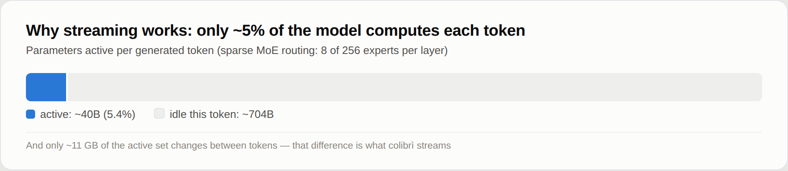
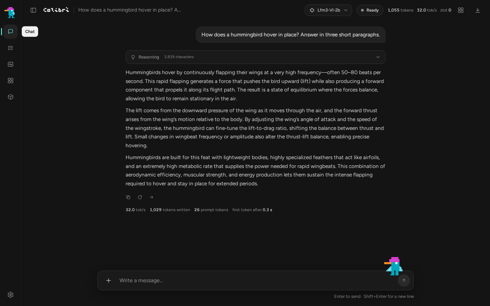
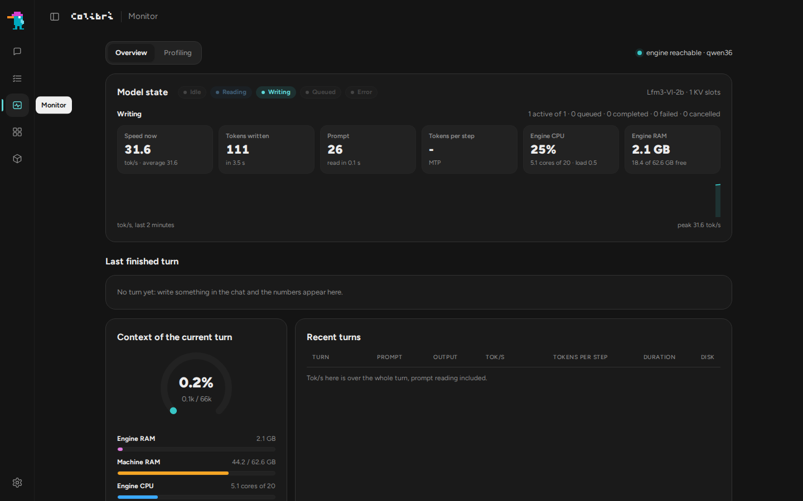
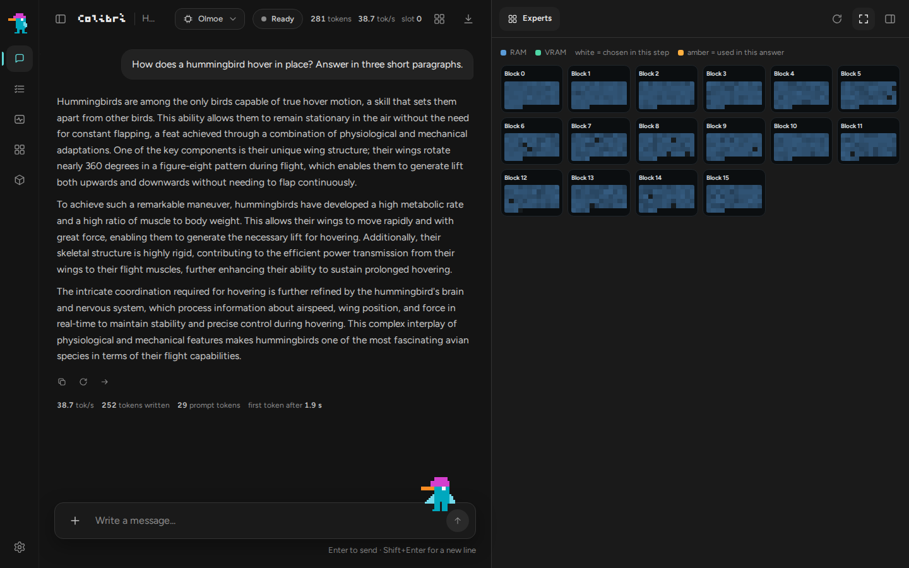
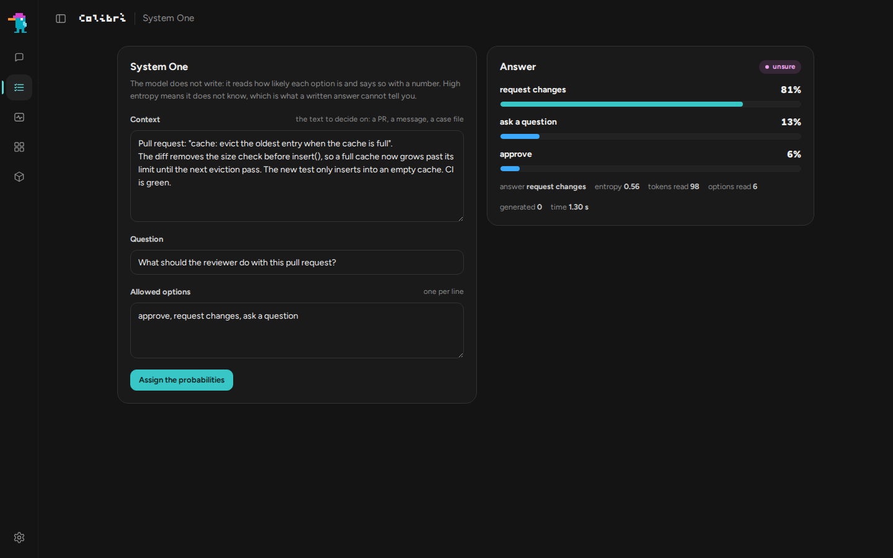
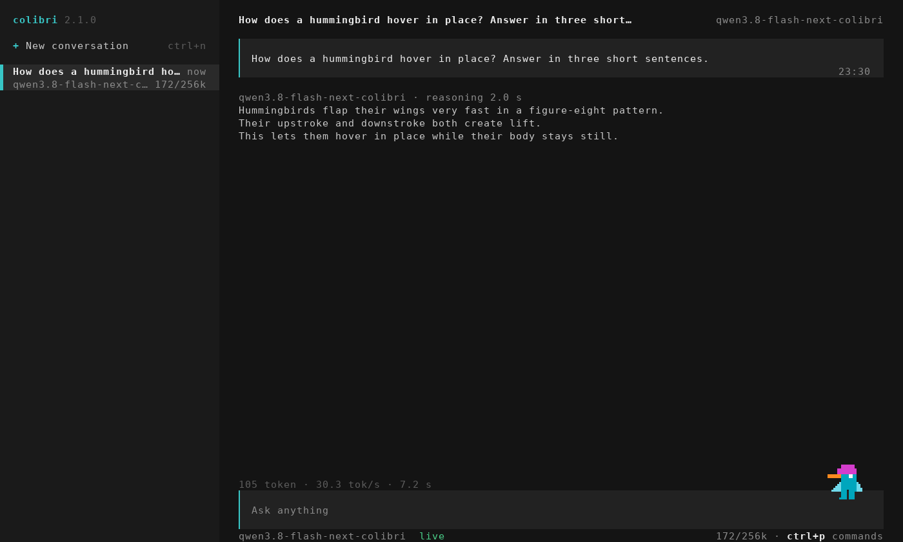
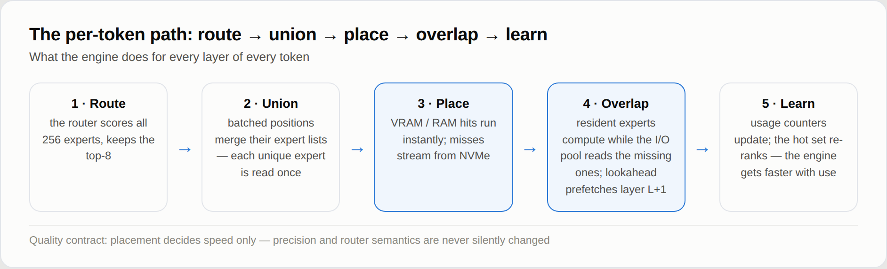
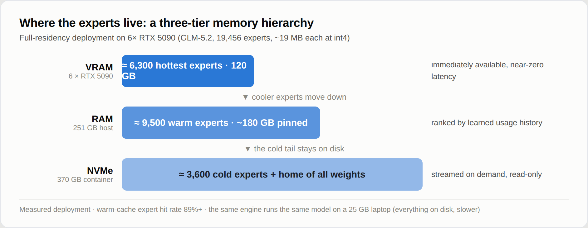
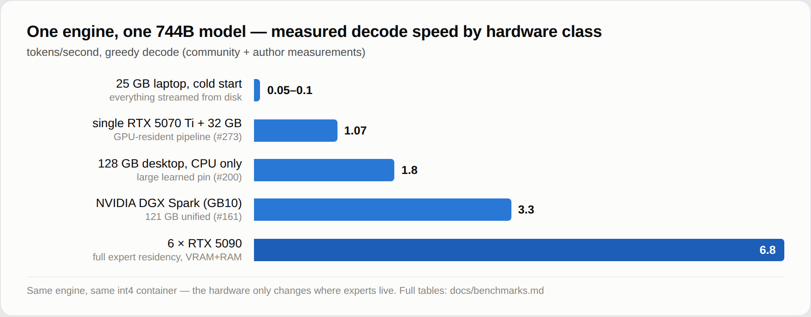

<p align="center">
  
</p>

<p align="center">
  <a href="https://justvugg.github.io/colibri"></a>
  <a href="https://github.com/JustVugg/colibri/releases"></a>
</p>

<p align="center">
  <a href="https://justvugg.github.io/colibri"><b>Website</b></a> ·
  <a href="https://discord.gg/RXV83nSZdk"><b>Discord</b></a> ·
  <a href="README.md">English</a> · <a href="README.zh-CN.md">简体中文</a> · <a href="README.zh-TW.md">繁體中文</a> · <a href="README.it.md">Italiano</a> · <a href="README.ja.md">日本語</a> · <a href="README.id.md">Bahasa Indonesia</a> · <a href="README.pt-BR.md">Português (Brasil)</a> · <a href="README.es.md">Español</a> · <a href="README.fr.md">Français</a> · Deutsch · <a href="README.ru.md">Русский</a>
</p>

**Winziger Motor, riesiges Modell.** colibri lässt sehr große offene Modelle auf
dem Rechner laufen, den du schon hast. Ein Mixture-of-Experts-Modell mit Hunderten
Milliarden Parametern nutzt für jeden Token nur einen kleinen Teil von sich:
colibri hält diesen Teil im RAM und liest den Rest, die Experts, von der Festplatte,
wenn das Modell sie anfordert. Reines C, eine Datei pro Modellfamilie, keine GPU nötig.

Heute laufen dreizehn Engines. Zehn sind für Sprachmodelle: **GLM-5.2/5.3** (die
auch **Mistral-Large-4** ausführt), **GLM-5.3-Flash**, **Inkling**, **Kimi K3** (und
K3.1 Pro), **DeepSeek V4 Flash**, **DeepSeek V4.1 Flash**, **MiMo-V2.6 Flash** (und
Pro), **Qwen3.8-Flash-Next**, **Qwen3.6** (die auch Qwen3-Coder, das dichte
Qwen3.8-27B, **Flint**, **Muse Spark Open** und **LFM3-VL** ausführt) und **OLMoE**.
Eine zeichnet Bilder: **Qwen-Image-2.1**. Zwei treffen Entscheidungen: **Laya** und
**GLiNER2.5-Decide**, dazu ein drittes Entscheidungsmodell, **Clef**, auf der
Qwen3.6-Engine. Die Sprachmodelle laufen auch direkt aus den bereits veröffentlichten
GGUF-Dateien, so wie sie sind ([GGUF](docs/gguf.md)), auf der CPU, auf jeder GPU über
Vulkan und auf NVIDIA-Karten über CUDA. [Welches für meinen Rechner](#which-model-for-my-machine)

```
$ ./coli chat
  colibri v2.1.0 · GLM-5.2 · 744B MoE · int4 · streaming CPU
  ✓ ready in 32s · resident 9.9 GB
  › ciao!
  ◆ Ciao! Come posso aiutarti oggi?
```

<p align="center">
  <a href="https://www.buymeacoffee.com/justvugg"></a>
  <br>
  <sub>colibri ist kostenlos und Open Source. Wenn es sich einen Platz auf deinem Rechner verdient hat, hilft ein Kaffee, die nächste Engine und den nächsten Geschwindigkeitssprung zu finanzieren.</sub>
</p>

<a id="get-started"></a>
<a id="the-one-step-way"></a>

## In einem Schritt starten

Du brauchst einen Rechner mit mindestens **8 GB RAM** (besser 16 GB oder mehr),
**22 GB freien Speicher auf der Festplatte** für das kleinste Modell und eine
Internetverbindung. Eine Grafikkarte ist optional.

**Windows**

1. Auf dieser Seite klickst du auf **Code**, dann auf **Download ZIP**, und entpackst
   das Archiv.
2. Doppelklicke im entpackten Ordner auf **`START-HERE.bat`**. Fehlt Python, bietet
   es an, es für dich zu installieren.

**Linux** (Ubuntu und Debian; andere Distributionen haben dieselben Pakete unter
ihren eigenen Namen)

```bash
sudo apt install git python3 build-essential
git clone https://github.com/JustVugg/colibri
cd colibri
./start-here.sh
```

**macOS** (mit [Homebrew](https://brew.sh))

```bash
xcode-select --install
brew install libomp git python
git clone https://github.com/JustVugg/colibri
cd colibri
./start-here.sh
```

Du beantwortest eine einzige Frage, welches Modell, und Enter übernimmt die
Empfehlung. Dann die Einrichtung:

1. **prüft deinen Rechner**: RAM, freien Speicher, CPU und GPUs;
2. **empfiehlt ein Modell, das passt**: der Teil des Modells, der immer im RAM bleibt,
   plus ein minimaler Expert-Cache, muss in dein RAM passen, und der Download auf
   deine Festplatte;
3. **besorgt die Engine**: Ist ein Compiler vorhanden, baut sie die Engine für deinen
   Rechner, sonst lädt sie die fertig gebaute herunter, die auf der CPU läuft und
   unter Linux und Windows auch auf einer Vulkan-GPU. Sie baut für deine GPU, wenn
   sich das lohnt: CUDA für eine NVIDIA-Karte unter Linux, wenn das CUDA-Toolkit
   installiert ist, sonst Vulkan. Bei einer dedizierten GPU geschieht das immer; bei
   einer integrierten GPU, die den RAM der CPU teilt, nur für die Modelle, die dort in
   Messungen schneller waren (Qwen3.6, Qwen3-Coder und Qwen3.8-Flash-Next). Fehlt ein
   Paket, gibt sie den genauen Befehl zu seiner Installation aus und macht mit der CPU
   weiter; danach führst du die Einrichtung erneut aus, und sie baut für die GPU neu;
4. **lädt das Modell herunter**, mit Fortschrittsanzeige und Wiederaufnahme: stoppe
   es, wann du willst, starte es erneut, und es macht dort weiter, wo es aufgehört hat;
5. **startet colibri und öffnet das Dashboard** im Browser und gibt die Adressen aus,
   die andere Apps nutzen können:

```
Starting colibri
  Browser:             http://127.0.0.1:8000/
  OpenAI base URL:     http://127.0.0.1:8000/v1
  Anthropic base URL:  http://127.0.0.1:8000
  stop: press Ctrl+C here (or close this window)
```

**Beim nächsten Mal** startest du `START-HERE.bat` oder `./start-here.sh` einfach
erneut: colibri startet sofort, ohne Download und ohne Build. `c/coli status` zeigt,
was installiert ist und ob es läuft, `c/coli stop` beendet es (`c\coli.cmd status`
und `c\coli.cmd stop` unter Windows).

Optionen kommen nach `./start-here.sh` oder `START-HERE.bat`:

| Option | Was sie tut |
|---|---|
| `--list` | jedes Modell im Vergleich zu diesem Rechner, und warum eines nicht passt |
| `--model ID` | installiert dieses Modell (die IDs stehen in [den Tabellen unten](#which-model-for-my-machine)) |
| `--yes` | keine Fragen: die Empfehlung übernehmen |
| `--dir DIR` | legt die Modelle auf einer anderen Festplatte ab (Standard `~/colibri-models`) |
| `--backend vulkan`, `cuda` oder `cpu` | den Engine-Build selbst wählen; `--no-gpu` entspricht `--backend cpu` |
| `--model-dir DIR` | ein Modell verwenden, das du bereits heruntergeladen hast |
| `--reconfigure` | ein anderes Modell wählen |

Was jeder Schritt im Detail tut: [docs/quickstart.md](docs/quickstart.md#the-one-step-way).

### Wenn etwas schiefgeht

| Was du siehst | Was zu tun ist |
|---|---|
| es hat sich während des Downloads beendet | denselben Befehl erneut ausführen: er setzt bei den Bytes an, die schon auf der Festplatte liegen |
| `to use the GPU through ..., first run: <command>` | diesen Befehl ausführen, dann die Einrichtung erneut starten: sie baut für die GPU neu und lädt nichts erneut herunter |
| `the ... build failed`, zum Beispiel `Unsupported gpu architecture`, wenn das installierte CUDA-Toolkit die Karte nicht mehr unterstützt | die Einrichtung prüft zuerst das Toolkit gegen die Karte und wählt selbst Vulkan, mit Begründung; schlägt ein Build trotzdem fehl, bietet sie den nächsten an (Vulkan, dann die CPU). `./start-here.sh --backend vulkan` erzwingt Vulkan; `--no-gpu` bleibt bei der CPU |
| `needs N GB free for the download` | `--dir` mit einem Ordner auf einer größeren Festplatte |
| unter WSL liegt der Modellordner unter `/mnt/c` | lege ihn auf die Linux-Festplatte (der Standard, `~/colibri-models`): `/mnt/c` ist um ein Vielfaches langsamer |
| du hast den Checkout aktualisiert (`git pull`) | führe `./start-here.sh` erneut aus: es baut die Engine neu, wenn sich die Quellen geändert haben, und startet sie dann |
| alles andere | `c/coli logs -n 50` zeigt das Protokoll eines im Hintergrund gestarteten Servers (einer im Vordergrund schreibt in sein eigenes Terminal), `c/coli logs --install` das der Einrichtung; öffne ein [Issue](https://github.com/JustVugg/colibri/issues) mit den letzten Zeilen, die die Einrichtung ausgegeben hat |

### Lass deinen KI-Assistenten die Einrichtung übernehmen

Wenn du einen KI-Assistenten zum Programmieren nutzt, kann er all das für dich
erledigen. Frag ihn:

> Installiere colibri auf diesem Rechner und folge dabei docs/AI_SETUP.md von https://github.com/JustVugg/colibri

[docs/AI_SETUP.md](docs/AI_SETUP.md) gibt dem Assistenten jeden Schritt als Befehl mit
einem maschinenlesbaren Ergebnis und sagt ihm, dass er dich um Bestätigung bitten
soll, bevor er ein Modell herunterlädt oder ein Systempaket installiert. Assistenten,
die das Model Context Protocol sprechen, können stattdessen den MCP-Server von colibri
nutzen: `coli mcp` bietet Werkzeuge, um die Hardware zu erkennen, ein Modell zu
empfehlen, es zu installieren, zu starten, zu stoppen und zu prüfen
([docs/MCP_SERVER.md](docs/MCP_SERVER.md)).

### Oder manuell

Wenn du jeden Schritt selbst wählen willst (ein fertiges Release oder ein Build aus
den Quellen, ein beliebiges Modell aus den Tabellen unten, dann `coli chat`,
`coli web` oder `coli serve`), siehe [Manuelle Installation](#install-by-hand) oder
den [Quick-Start-Leitfaden](docs/quickstart.md) mit jedem Schritt für jede Plattform.

## Was colibri ist und warum

Ein Mixture-of-Experts-Modell ist auf der Festplatte riesig und pro Token klein.
GLM-5.2 hat 744B Parameter, nutzt davon etwa 40B für jeden Token, und nur etwa 11 GB
davon ändern sich von einem Token zum nächsten: die gerouteten Experts.

<p align="center">
  
</p>

Das Modell muss also nicht in den schnellen Speicher passen; es muss **platziert**
werden. Der dichte Teil (Attention, geteilte Experts, Embeddings) bleibt im RAM. Die
gerouteten Experts bleiben auf der Festplatte und werden gelesen, wenn der Router sie
anfordert, über einen Cache, der lernt, welche Experts deine Arbeit nutzt. Eine GPU,
wenn vorhanden, hält die heißesten Experts und die dichten Layer. Wo ein Gewicht liegt,
bestimmt, wie schnell die Antwort kommt, nicht, welche Gewichte oder welche
Router-Entscheidungen sie erzeugen.

Warum: um Modelle dieser Größe auf der Hardware laufen zu lassen, die Menschen ohnehin
besitzen, um ihnen beim Arbeiten zuzusehen (das Dashboard zeigt jeden Expert in dem
Moment, in dem er aktiv wird), und um die Engine klein genug zu halten, dass jeder sie
messen und schneller machen kann. colibri ist außerdem eine offene Forschungsplattform:
Eine Optimierung verdient ihren Platz durch eine reproduzierbare End-to-End-Messung,
und die Standardrichtlinie ändert nie stillschweigend die Modellpräzision oder die
Router-Semantik. Weniger schneller Speicher kann Geschwindigkeit kosten; er darf das
Modell nicht heimlich neu definieren. [Wie es funktioniert](#how-it-works) enthält die Details.

<a id="which-model-for-my-machine"></a>

## Welches Modell für meinen Rechner

Die Einrichtung empfiehlt das leistungsfähigste Modell, das auf deinem Rechner aus dem
RAM läuft, und listet direkt darunter die größeren auf, die von der Festplatte
gestreamt werden. `./start-here.sh --list` zeigt sie alle im Vergleich zu deinem
Rechner. Die Tabellen folgen dem eigenen Katalog der Einrichtung
([`c/setup_catalog.py`](c/setup_catalog.py)); die Downloadgrößen sind die, die
Hugging Face für jedes Repository angibt.

- **RAM** sind zwei Zahlen: Unterhalb der ersten startet das Modell nicht, ab der
  zweiten läuft es wie gemessen.
- **GPU** ist das, was die Einrichtung für diese Engine bauen kann ([GPU](#gpus)).
  *Auch integriert* bedeutet, dass auch eine integrierte GPU genutzt wird, wo diese
  Engines in Messungen schneller waren; die anderen nutzen nur eine dedizierte GPU.
- **Gemessen** ist, was auf dem genannten Rechner gemessen wurde, bei Chat-Modellen
  die Decode-Geschwindigkeit. Die Buchstaben sind Rechner, die unter den Tabellen
  aufgeführt sind. Eine leere Zelle bedeutet, dass es noch niemand gemessen hat.

**Kleine Modelle, die aus dem RAM laufen**

| Modell | `--model` | Download | RAM | GPU | Gemessen |
|---|---|---|---|---|---|
| **Qwen3.6-35B-A3B**: Chat mit Thinking und Tools | `qwen36-35b` | 23 GB | 10 / 20 GB | CUDA, Vulkan (auch integriert) | 6.0 tok/s auf der CPU, 9.9 mit Vulkan auf der integrierten GPU (A); 30.0 mit CUDA (C) |
| Qwen3-Coder-30B-A3B: Code und Tool-Aufrufe, ohne Thinking | `qwen3-coder-30b` | 19 GB | 8 / 18 GB | CUDA, Vulkan (auch integriert) | 8.5-9.6 tok/s mit allen Experts im RAM, 5.1 mit 32 pro Layer (A, CPU) |
| **Qwen-Image-2.1**: Text zu Bild, nicht kommerzielle Lizenz | `qwen-image-2.1` | 33 GB | 12 / 18 GB | Vulkan | ein Bild 768x512 in 2 min 40 s (8 Zen-4-Kerne, CPU) |

**Große Modelle, deren Experts von der Festplatte gestreamt werden** (die Festplatte
bestimmt die Geschwindigkeit: eine schnelle NVMe hilft am meisten)

| Modell | `--model` | Download | RAM | GPU | Gemessen |
|---|---|---|---|---|---|
| DeepSeek V4 Flash REAP 150B: 132 der 256 Experts | `deepseek-v4-flash-reap` | 85 GB | 16 / 32 GB | CUDA, Vulkan | |
| **DeepSeek V4 Flash** (284B): Tools | `deepseek-v4-flash` | 167 GB | 16 / 32 GB | CUDA, Vulkan | 0.93 tok/s mit 32 GB (Ryzen 7 5800X), 1.24 mit 63 GB (Ryzen 9 5950X), nur CPU; 1.5-1.6 mit CUDA (RTX 5080, 32 GB, zwei NVMe) |
| **MiMo-V2.6 Flash** (309B): Vision und Tools | `mimo-v2.6-flash` | 172 GB | 32 / 52 GB | Vulkan | 2.34-3.37 tok/s (A, CPU) |
| **Qwen3.8-Flash-Next** (125B + 51B n-gram): Vision und Tools | `qwen38-flash-next` | 186 GB | 24 / 32 GB | CUDA, Vulkan (auch integriert) | 1.91-2.56 tok/s mit 32-96 Experts pro Layer; 3.99 mit den optionalen int4-Experts (A, CPU) |
| **GLM-5.2** (744B): das Referenzmodell, mit dem MTP-Head | `glm-5.2` | 429 GB | 16 / 24 GB | CUDA, Vulkan | 0.05-0.1 tok/s kalt auf einem Laptop mit 25 GB; 1.83 auf einem Ryzen AI Max+ 395 mit 128 GB; 9.0-9.2 auf 6x RTX 5090 |
| GLM-5.3 (744B): dieselbe Engine, ohne MTP-Head | `glm-5.3` | 419 GB | 16 / 24 GB | CUDA, Vulkan | |
| **Inkling** (975B): int4-Experts, dichte bf16-Gewichte | `inkling` | 514 GB | 120 / 128 GB wie heruntergeladen; 25 GB nach einer [Konvertierung des dichten Teils](docs/inkling.md) | CUDA, Vulkan | 0.25 tok/s (Ryzen 9 7900, 187 GB, RTX A6000) |
| MiMo-V2.6 Pro (1.02T): Vision und Tools | `mimo-v2.6-pro` | 564 GB | 54 / 64 GB | Vulkan | 0.66-0.79 tok/s (A, CPU) |
| **Kimi K3** (2.8T): das größte | `kimi-k3` | 1.56 TB | 32 / 64 GB | CUDA, Vulkan | etwa 9.4 s pro Token, Experts gelesen mit 6.3 GB/s |
| **Kimi K3.1 Pro** (2.8T): K3 mit spärlicher Attention ab 2048 Tokens | `kimi-k3.1-pro` | 1.56 TB | 32 / 64 GB | CUDA, Vulkan | |

<a id="other-supported-models"></a>

**Von Hand: ein Konvertierungs- oder Vorbereitungsschritt nach dem Download**

| Modell | Download, dann auf der Festplatte | RAM | GPU | Gemessen |
|---|---|---|---|---|
| **OLMoE** (7B): klein, um sich mit den Werkzeugen vertraut zu machen | 14 GB, 7 GB nach der Konvertierung in int8 | 8 GB | Vulkan | 22-23 tok/s (A, CPU) |
| Qwen3.8-27B (dicht): Text und Bilder | 56 GB, 51 GB nach der Konvertierung | 20 GB in int4, 30 GB in int8 | Vulkan | 3.45 tok/s in int4, 2.1 in int8 (CPU-Server mit 16 Threads) |
| **GLM-5.3-Flash** (321B): Vision und Tools | 328 GB, Shard für Shard konvertiert auf 195 GB | 25 GB | CUDA, Vulkan | etwa 20 s pro Token warm, 44 s kalt (6 Kerne, 25 GB, normale Festplatte) |
| **DeepSeek V4.1 Flash** (552B): Vision und Tools, keine Konvertierung, aber eine einmalige Vorbereitung | 510 GB | etwa 18 GB plus der Expert-Cache (24.8 GB Spitze mit 8 pro Layer) | Vulkan | 0.21-0.24 tok/s (CPU-Server mit 16 Threads, der 68 % der Experts hält) |

<a id="from-a-gguf"></a>

**Aus einem GGUF: die veröffentlichten Dateien, so wie sie sind gelesen**

`./coli import` nimmt die erste Datei eines GGUF (die anderen Teile daneben) und schreibt
daneben einen Modellordner; diesen Ordner übergibt man dann `--model`, wie bei jedem
anderen ([gguf.md](docs/gguf.md)). Nichts wird erneut konvertiert oder quantisiert: Die
Blöcke laufen so, wie die Datei sie enthält, von IQ1_S bis Q8_0, F16, BF16 und MXFP4.
Auch die Engines aller oben genannten Chat-Modelle lesen GGUFs
([die Architekturen](docs/gguf.md#supported-architectures)); diese Modelle gibt es als GGUF:

| Modell | GGUF | GPU | Gemessen |
|---|---|---|---|
| **Mistral-Large-4** (1T, 52B aktiv): Text, Bilder, Reasoning und Tools | unsloth, UD-IQ1_S 233 GB | CUDA, Vulkan | 1.34-1.36 tok/s mit CUDA, 1.16-1.17 mit Vulkan (D) |
| **Muse Spark Open** (816B, 42B aktiv): Text und Tools, mit der Lizenzvereinbarung von Meta | unsloth, von UD-IQ1_S 176 GB bis UD-Q4_K_XL 505 GB | CUDA, Vulkan | 1.55-1.58 tok/s mit Vulkan, 1.34-1.40 mit CUDA, 0.83-0.89 auf der CPU (D) |
| **Flint** (40B, 2.5B aktiv): Text und Tools, Apache 2.0 | unsloth, von UD-IQ1_M 11.4 GB bis BF16 79.6 GB | CUDA, Vulkan | UD-Q4_K_XL: 77.4 tok/s mit CUDA, 77.7 mit Vulkan, 15.8 auf der CPU (D) |
| **LFM3-VL-2B**: Text, Bilder und Tools, LFM Open License | LiquidAI, von QAD-Q4_0 bis BF16 (oder der Checkpoint, konvertiert) | CUDA, Vulkan | Q4_K_M: 235.1 tok/s mit CUDA, 214.1 mit Vulkan, 34.5 auf der CPU (D) |
| **Qwen-Image-2.1** und sein **Turbo**: Text zu Bild, nicht kommerzielle Lizenz ([qwen-image.md](docs/qwen-image.md#gguf-unsloth)) | unsloth, von Q2_K 2.5 GB bis F16 14.2 GB, mit einem Qwen3-VL-8B-Instruct-GGUF als Text-Encoder | Vulkan | Turbo Q4_K_M, 1024x1024 in 8 Schritten: 37 s Denoising mit Vulkan (D); bei 512x512 8.4-9.3 s pro Schritt auf der CPU (A) |

Die größeren Modelle aus den Tabellen oben aus ihren GGUFs, auf demselben Rechner:
[Benchmarks](#large-models-on-the-same-machine).

**Entscheidungsmodelle** (sie beantworten Fragen von [System One](#system-one-a-decision-with-a-probability), sie chatten nicht)

| Modell | Download, dann auf der Festplatte | RAM | GPU | Gemessen |
|---|---|---|---|---|
| **Laya** (Convai Innovations), Englisch | 0.85 GB | 1.7 GB | CPU, CUDA | 219 ms für eine Frage, 882 ms für drei (B); zwölf in 0.69 s mit CUDA, 11.4-13.0 s auf der CPU (D) |
| **GLiNER2.5-Decide** (fastino), Englisch | 1.95 GB | 1.9 GB | CPU, CUDA | 294 ms für eine Frage, 897 ms für drei (B, unter Last); zwölf in 0.16-0.21 s mit CUDA, 2.0-2.6 s auf der CPU (D) |
| **Clef** (Cloudflare): Qwen3.8-27B mit einem Entscheidungs-Head, es kann auch chatten | 55 GB, 52 GB nach der Konvertierung | von 19 GB in int4 bis 55 GB in f16 | CPU | 20.4 s pro Anfrage in int8 (A) |

Die Rechner:
**A** ein Desktop mit Ryzen 7 PRO 8700GE (8 Kerne, 61-64 GB DDR5, NVMe, integrierte
Radeon 780M);
**B** ein Laptop mit i7-1355U;
**C** eine RTX 3070 8 GB in einem Threadripper-3945WX-Rechner, mit den dichten Layern und
den DeltaNet-Layern auf der Karte (int4-Container pro Zeile);
**D** ein i5-13500 mit 62 GB RAM, einer RTX PRO 4000 Blackwell SFF (24 GB) und zwei
NVMe-Laufwerken in einem md-Array: der Rechner der [Benchmark-Tabellen](#benchmarks).
Jede Zahl stammt von der Seite ihres Modells in [docs/](docs/) oder aus den
[Benchmark-Tabellen](docs/benchmarks.md), mit den genauen Einstellungen.

Jede Familie hat ihre eigene Seite: [qwen36.md](docs/qwen36.md) (Qwen3.6, Qwen3-Coder,
Qwen3.8-27B, Flint, Muse Spark Open, LFM3-VL), [mistral-large4.md](docs/mistral-large4.md),
[gguf.md](docs/gguf.md), [qwen38.md](docs/qwen38.md), [deepseek-v4.md](docs/deepseek-v4.md),
[deepseek-v41.md](docs/deepseek-v41.md), [mimo.md](docs/mimo.md),
[glm53-flash.md](docs/glm53-flash.md), [inkling.md](docs/inkling.md),
[kimi_k3.md](docs/kimi_k3.md), [qwen-image.md](docs/qwen-image.md),
[laya.md](docs/laya.md), [gliner_decide.md](docs/gliner_decide.md),
[clef.md](docs/clef.md) und GLM-5.2 im [Quick Start](docs/quickstart.md#3-get-the-model).
Checkpoints mit derselben Architektur wie ein unterstütztes, wie KAT-Coder v2.5 auf der
Qwen3.6-Engine, laufen ohne Änderungen.

<a id="gpus"></a>

## GPU

### Keine GPU nötig

Jede Engine läuft auf der CPU, ohne dass etwas anderes installiert werden muss. Eine
GPU ist ein schnellerer Ort, um Gewichte zu halten, aber keine Voraussetzung: Bei den
großen Modellen bestimmt die Festplatte die Geschwindigkeit, bei den kleinen der RAM.

### Vulkan: jede GPU

Jede MoE-Engine kann jede GPU mit einem Vulkan-1.2-Treiber nutzen (AMD, Intel, NVIDIA,
integriert oder dediziert), auf zwei Arten:

- **die Expert-Stufe**: ein Cache gerouteter Experts im GPU-Speicher, beim Start gefüllt
  mit den Experts, die deine früheren Unterhaltungen genutzt haben, und der sich anpasst,
  während du chattest. Die GPU berechnet die Experts, die sie hält, während die CPU den
  Rest berechnet;
- **die dichte Kette**: ein ganzer Layer, aufgezeichnet als eine einzige Übergabe an die
  GPU, wobei der laufende Zustand des Modells von einem Layer zum nächsten auf der GPU
  bleibt.

Gemessen auf der integrierten Radeon 780M von Rechner A, mit den Modelldateien, die vor
jedem Lauf aus dem Page Cache entfernt wurden, 100 Token im Decode
([vulkan.md](docs/vulkan.md#the-chain-on-a-radeon-780m)):

| | CPU | Vulkan, Expert-Stufe | Vulkan, Stufe und dichte Kette |
|---|---|---|---|
| Qwen3.6-35B-A3B, Decode | 6.0 tok/s | 8.0 tok/s | **9.9 tok/s** |
| Qwen3.6-35B-A3B, ein Prompt mit 512 Token | 35.7 s | 12.2 s | **9.5 s** |
| Qwen3.8-Flash-Next (int4-Experts), Decode | 3.5 tok/s | **3.8 tok/s** | 3.2 tok/s |
| Qwen3.8-Flash-Next, ein Prompt mit 512 Token | 43.6 s | 38.7 s | **30.1 s** |
| OLMoE, Decode (warm) | **23.1 tok/s** | 12.8 tok/s | 17.3 tok/s |

Eine integrierte GPU teilt sich den RAM der CPU. Was sie spart, sind die Arbeit und die
Festplattenzugriffe der Experts, die sie hält. Deshalb lohnt sie sich bei einem Modell
wie Qwen3.6, während ein kleines Modell, dessen Experts schon im RAM liegen, wie OLMoE,
dabei verlieren kann. Aus diesem Grund schaltet die Einrichtung Vulkan auf einer
integrierten GPU nur für Qwen3.6, Qwen3-Coder und Qwen3.8-Flash-Next ein, und deshalb
entscheidet jede Engine selbst, ob sie dort die dichte Kette nutzt (Qwen3.6 ja, Qwen3.8
nein). `--backend vulkan` fordert Vulkan trotzdem an.

**GPU ein- oder ausschalten.** `coli setup --backend vulkan` nutzt die GPU für jedes
Modell, und `coli setup --backend cpu` (oder `--no-gpu`) hält alles auf der CPU. Eine
mit Vulkan gebaute Engine nutzt die GPU nur mit `COLI_VULKAN=1` in der Umgebung von
`coli chat`, `serve` oder `web` (die Einrichtung setzt es, wenn sie Vulkan gewählt hat);
ohne das läuft die Engine auf der CPU. Bei eingeschalteter GPU hält `COLI_VK_CHAIN=0`
die Expert-Stufe und lässt die dichten Layer auf der CPU laufen. Auf einer integrierten
GPU probiere beide Wege: Auf einem Laptop mit einer Intel Iris Xe (Core i7-1355U) hat
Qwen3.6 auf der CPU 2.1 tok/s dekodiert, 1.7 bis 1.9 mit Vulkan und 2.1 mit ausgeschalteter
dichter Kette.

Auf einer dedizierten GPU baut die Einrichtung Vulkan für jede Engine (zuerst CUDA, wo
die Engine es hat und das Toolkit installiert ist), mit den dichten Layern auf der Karte.
Dafür ist das Projekt gedacht. Auf einer RTX PRO 4000 (24 GB, Rechner D) erreicht
Qwen3.6-35B-A3B 92.9 tok/s im Decode und liest einen Prompt mit 2076, OLMoE 299.4 und
6867 ([die Tabelle](#three-backends-on-one-machine)). Ein Modell, das größer ist als die
Karte, hält die Experts, die die Karte nicht fassen kann, in einem Pool im RAM, und in
jedem Schritt berechnet die CPU diese, während die Karte ihre eigenen berechnet, im
selben Frame: Qwen3.8-Flash-Next IQ2_XS (68 GB) erreicht dort 50.6 tok/s im Decode
([vulkan.md](docs/vulkan.md#the-routed-experts-in-the-frame-vk_dmoeh)). Ein Nutzer hat
Qwen3.6 mit 17 bis 19 tok/s auf einer Tesla V100 16 GB gemessen
([#1852](https://github.com/JustVugg/colibri/issues/1852)). Zahlen von deiner Karte
sind willkommen.

**Karten ohne Resizable BAR** funktionieren jetzt. Eine solche Karte (alle Turing-Karten,
Ampere-Karten mit ihrer Launch-Firmware, ältere AMD-Karten mit ausgeschalteter Option)
lässt die CPU nur etwa 256 MB ihres Speichers direkt beschreiben; colibri kopiert die
Gewichte jetzt selbstständig über einen Staging-Puffer hinein. Der Pfad ist getestet,
indem man ihn erzwingt und das kleine Fenster auf drei Geräten emuliert, und er kostet
auf der 780M nichts Messbares; auf einer Karte ohne Resizable BAR wurde er nicht gemessen
([vulkan.md](docs/vulkan.md#memory-placement-without-resizable-bar)).

Die CI prüft den Vulkan-Pfad jeder Engine gegen die Token der CPU auf einem
Software-Treiber. Die GPU summiert Zahlen in einer anderen Reihenfolge und hält einige
Aktivierungen in f32, wo die CPU sie rundet; daher kann eine lange Antwort um ein Wort
von der der CPU abweichen ([vulkan.md](docs/vulkan.md#the-other-engines)).

### CUDA: NVIDIA-Karten

Die Einrichtung baut CUDA unter Linux, wenn das CUDA-Toolkit installiert ist, für die
Engines, die einen CUDA-Pfad haben: GLM-5.2/5.3 und Mistral-Large-4, GLM-5.3-Flash,
Inkling, Kimi K3, DeepSeek V4 Flash, DeepSeek V4.1 Flash, MiMo-V2.6,
Qwen3.8-Flash-Next und Qwen3.6 mit den Modellen, die es ausführt; OLMoE und die
Entscheidungs-Engines werden mit `make <engine> CUDA=1` gebaut. Unter Windows ist die
CUDA-Engine eine eigene DLL ([windows.md](docs/windows.md)), und jedes Release liefert
sie bereits gebaut mit: `colibri-<version>-windows-x86_64-cuda.zip` enthält
`coli_cuda.dll` (Karten mit Compute Capability 8.0 oder neuer) und die Engines colibri,
glm53, qwen36 und kimi_k3, die sie laden, mit den CUDA-DLLs von DeepSeek V4. Entpacke
es über das Hauptarchiv, dann wählt die Einrichtung CUDA.

- **Jeder Layer auf der Karte** für Qwen3.6, Qwen3.8 und OLMoE: die dichten Layer, die
  Attention und die gerouteten Experts, die die Karte hält, laufen als eine Kette, und
  die Experts, die sie nicht hält, laufen auf der CPU. Auf einer RTX PRO 4000 erreicht
  Qwen3.6-35B-A3B UD-Q4_K_M 104.8 tok/s im Decode und liest einen Prompt mit 3491,
  OLMoE 354.6 und 10418 ([die Tabelle](#three-backends-on-one-machine)).
- **Eine Stufe gerouteter Experts auf der Karte für jede Engine** (`cu_tier.h`), und die
  dichten Matrizen darauf für DeepSeek V4, V4.1, Kimi K3, GLM-5.3 und MiMo
  (`cu_dense.h`).
- **Die Blöcke eines GGUF auf der Karte** (`cuda_bd.cuh`): jeder ggml-Blocktyp mit 32
  Gewichten oder mehr, jede Zeile so, wie die Datei sie hat; ein Prompt läuft über die
  Tensor Cores ([gguf.md](docs/gguf.md)).
- **Die Expert-Stufe im VRAM** hält die heißesten Experts auf der Karte, ausgewählt nach
  dem gemessenen Routing; Misses werden gleichzeitig auf der CPU berechnet. Qwen3.6 auf
  zwei Karten mit je 8 GB (RTX 3070 und Quadro RTX 4000) hat mit einer warmen Historie
  11.3 tok/s im Decode erreicht ([qwen36-cuda-tier.md](docs/qwen36-cuda-tier.md));
  GLM-5.2 auf sechs RTX 5090 mit allen Experts resident, 9.0-9.2 tok/s
  ([benchmarks.md](docs/benchmarks.md)); DeepSeek V4 Flash auf einer RTX 5080, 1.5-1.6
  tok/s und ein Prompt mit 3,324 Token in 90 s ([deepseek-v4.md](docs/deepseek-v4.md)).
- **Qwen3.6-DeltaNet-Layer auf der Karte** (`Q36_DN_GPU=1`, opt-in). Jeder der 30
  DeltaNet-Layer von Qwen3.6 kopierte seine Daten früher viermal pro Token zwischen Karte
  und CPU; jetzt führt ein Decode-Token den ganzen Layer auf der Karte aus, mit seinem
  rekurrenten Zustand im VRAM. Auf einer RTX 3070 mit den dichten Layern im VRAM: von
  25.4 auf 30.0 tok/s ([qwen36-cuda-tier.md](docs/qwen36-cuda-tier.md#the-deltanet-layer-on-the-card-q36_dn_gpu1)).
- **Ältere Karten.** Wenn das CUDA-Toolkit für deine Karte nicht mehr kompiliert (CUDA 13
  und eine V100, in [#1852](https://github.com/JustVugg/colibri/issues/1852)), sieht die
  Einrichtung das vor dem Build und nutzt die Karte über Vulkan, mit Begründung; ein
  CUDA-Toolkit 12.x bringt den CUDA-Pfad zurück. Die CUDA-Stufe von DeepSeek V4 baut auch
  für Pascal und Turing (`CUDA_ARCH=portable-pre-ampere NO_TC=1`).

Alles dazu: [docs/cuda.md](docs/cuda.md).

### Apple Silicon

Ein Metal-Backend führt die Expert-Berechnungen für mehrere Engines auf der GPU mit
einheitlichem Speicher aus ([docs/metal.md](docs/metal.md)). Im macOS-Archiv des Releases
sind `colibri`, `inkling` und `kimi_k3` damit gebaut: `COLI_METAL=1` (`K3_METAL=1` für
Kimi K3) schaltet es ein, und ohne läuft es auf der CPU. Aus den Quellen baust du mit
`METAL=1`; die Einrichtung in einem Schritt baut für die CPU.

<a id="system-one-mode-ask-a-closed-question"></a>
<a id="system-one-a-decision-with-a-probability"></a>

## System One: eine Entscheidung mit einer Wahrscheinlichkeit

Vieles von dem, wofür man ein Modell fragt, ist eine Wahl, kein Absatz: welche
Warteschlange, welches Urteil, ja oder nein. `POST /v1/systemone` nimmt einen Zustand
(Text oder JSON) und typisierte Fragen entgegen und antwortet auf jede mit der
Wahrscheinlichkeit jeder erlaubten Option und einer Konfidenz. Es wird nichts generiert,
daher kann keine Antwort außerhalb deiner Liste liegen, und „das Modell ist sich nicht
sicher“ ist eine Zahl, auf die du einen Schwellenwert setzen kannst.

```bash
curl -s http://127.0.0.1:8000/v1/systemone -H 'Content-Type: application/json' -d '{
  "state": "340 lines, 8 files, no tests. CI is green but nothing covers that path.",
  "questions": {
    "review": {"type": "choice", "instructions": "What should the reviewer do?",
               "criteria": {"merge": null, "request changes": null, "close": null}},
    "risky":  {"type": "noul", "instructions": "Is this change risky?"}}}'
```

Ein `choice` kommt mit dem gewählten Label zurück, einer Wahrscheinlichkeit für jedes
Label und einer `confidence` von 0 (flach) bis 1 (sicher); ein `noul` mit der
Wahrscheinlichkeit für ja; ein `score` mit der erwarteten Stufe.

Wer antwortet:

- **Jedes Chat-Modell, das colibri ausführt**, durch Bewerten: Es liest die
  Wahrscheinlichkeit jeder Option, statt eine Antwort zu schreiben. Mehrere Fragen zum
  selben Dokument lesen das Dokument nur einmal: Auf Qwen3.6 kamen vier Fragen zu einem
  Dokument 5.7x schneller zurück, als wenn dieselben Antworten auf derselben
  CPU-Maschine erzeugt worden wären.
- **Drei Entscheidungsmodelle**, nativ, in einem einzigen Forward-Pass mit der
  Kalibrierung, die ihre Autoren angepasst haben: [Laya](docs/laya.md) (Convai
  Innovations), [GLiNER2.5-Decide](docs/gliner_decide.md) (fastino) und
  [Clef](docs/clef.md) (Cloudflare; es kann auch chatten). Ihre Größen und
  Geschwindigkeiten stehen in [der Tabelle der Entscheidungsmodelle](#which-model-for-my-machine).

**Umstieg von Jev.** Anfrage und Antwort sind die der Jev-API von TypeSafe, daher wechselt
ein Jev-Client zu colibri, indem er nur seine Base URL ändert und sonst nichts:
`TYPESAFE_BASE_URL=http://127.0.0.1:8000` (der Schlüssel, den er bereits sendet, wird
von einem Server akzeptiert, der ohne `COLI_API_KEY` gestartet wurde). Die beiden
offiziellen SDKs sind unverändert gegen `coli serve` getestet.

Derselbe Modus ist im Terminal verfügbar (`/decide merge | request changes | close` in
`coli chat`) und auf der System-One-Seite des Dashboards. Anfrage und Antwort vollständig,
die Bewertungsregeln und wo es nicht hilft: [docs/systemone.md](docs/systemone.md).

## Das Dashboard

`coli web` öffnet es, und das tut auch die Einrichtung in einem Schritt: den Chat, die
System-One-Seite, das Brain und die Profiling-Seite, im hellen oder dunklen Design.

### Der neue Chat

`coli ui` öffnet den neuen Chat neben einem laufenden `coli serve`: das Reasoning in
einem eigenen Block, Bilder für Modelle mit Vision-Tower, Websuche, die Expert-Karte,
ein Live-Monitor und Coding-Agenten, die bereits auf colibri ausgerichtet geöffnet
werden. Sieben Sprachen. Siehe [ui/README.md](ui/README.md).

<p align="center">
  
</p>
<p align="center"><em>LFM3-VL-2B auf der CPU eines i5-13500, 32 tok/s.</em></p>

<p align="center">
  
</p>
<p align="center"><em>Der <strong>Monitor</strong>, während LFM3-VL-2B schreibt: 31.6 tok/s, der Prompt in 0.1 s gelesen, 2.1 GB RAM.</em></p>

<p align="center">
  
</p>
<p align="center"><em>OLMoE mit geöffneter <strong>Expert-Karte</strong> neben dem Chat: eine Zelle pro Expert in jedem Block, weiß, wenn er in diesem Schritt gewählt wurde, bernsteinfarben, wenn er in dieser Antwort genutzt wurde.</em></p>

<p align="center">
  
</p>
<p align="center"><em><strong>System One</strong>: Gib dem Modell ein Dokument und nur die Antworten, die es wählen darf. Hier liest Qwen3.6-35B auf einer RTX PRO 4000
eine Pull Request, die das Größenlimit eines Caches bricht: <strong>request changes zu 81%</strong>, Entropie 0.56 (unsicher), 98 Token gelesen, 0 erzeugt.</em></p>

Die **Profiling**-Seite zeigt, wo jeder Turn seine Zeit verbringt, Phase für Phase, mit
den letzten 30 Turns als Trend. Mit [Joule](https://pypi.org/project/landauer-gap/),
installiert neben dem Gateway (`pip install landauer-gap`), zeigt sie zusätzlich die
Watt des Rechners und die Joule des letzten Turns pro Token.

### Die Terminal-Oberfläche

`coli tui` ist derselbe Chat in einem Terminal, eine einzige C-Datei ohne Bibliotheken:
die Unterhaltungen, die Antwort im Stream mit eingeklapptem Reasoning, der Monitor
(`F2`) mit CPU und RAM der Engine, der GPU und ihrem VRAM sowie dem Profil jedes Turns,
die Expert-Karte (`ctrl+e`) und der Kolibri der Chat-Seite, gezeichnet als Bild, wo das
Terminal Sixel darstellt (Windows Terminal, foot, WezTerm). Es verbindet sich mit einem
laufenden `coli serve` oder startet eines mit `--model`. Siehe [docs/tui.md](docs/tui.md).

<p align="center">
  
</p>
<p align="center"><em>Qwen3.8-Flash-Next auf einer RTX PRO 4000 über <code>coli serve</code>, mit einem Kontext von 256K.</em></p>

## Aus anderen Apps nutzen

`coli serve` (das die Einrichtung für dich startet) ist ein einziger Server mit mehreren
APIs:

- **OpenAI-kompatibel**: `/v1/chat/completions`, `/v1/completions` und `/v1/models`,
  mit Streaming, JSON-Antworten, Stop-Sequenzen und Logprobs;
- **Anthropic-kompatibel**: `/v1/messages`, sodass Claude Code und die Anthropic-SDKs
  damit arbeiten;
- **Tool Calling** auf jeder Chat-Engine außer Inkling und OLMoE, jeweils im nativen
  Format des Modells ([die Tabelle pro Engine](docs/api.md#tool-calling-support));
- **Bilder als Eingabe** bei GLM-5.3-Flash, DeepSeek V4.1 Flash, MiMo-V2.6,
  Qwen3.8-Flash-Next, Qwen3.8-27B, LFM3-VL und Mistral-Large-4 (aus einem GGUF, mit der
  Datei `mmproj` daneben): ein Pfad in einer Nachricht von `coli chat`, ein Anhang in
  `coli web` oder `coli ui`, oder ein `image_url`-Teil;
- **Dokumente als Eingabe** auf jeder Chat-Engine: `/file PATH` in `coli chat` (oder
  `coli chat --file PATH`) sendet den Text einer Textdatei oder eines PDFs zusammen mit
  der nächsten Nachricht. Nur eine so benannte Datei wird gelesen, nie ein Pfad innerhalb
  einer Nachricht; sie muss eine reguläre Datei mit einer Textendung oder `.pdf` sein,
  höchstens 64 MiB und 2 Millionen Zeichen. Ein PDF wird in einem eigenen Prozess mit
  Zeit- und Speicherlimit verarbeitet, durch `pdftotext` (poppler) oder `pypdf`;
- **Bilder als Ausgabe** mit Qwen-Image-2.1 auf `POST /v1/images/generations`, und im
  Terminal von `coli chat` gezeichnet ([qwen-image.md](docs/qwen-image.md));
- **Entscheidungen** auf `POST /v1/systemone` ([oben](#system-one-a-decision-with-a-probability));
- **mehrere Unterhaltungen gleichzeitig** auf jeder Text-Engine: `coli serve
  --kv-slots N` hält bis zu 16, jede mit ihrem eigenen Cache, und dekodiert deren
  nächste Token gemeinsam ([api.md](docs/api.md#isolated-kv-contexts)).

Programmier-CLIs und Editoren verbinden sich wie mit jedem OpenAI-kompatiblen Provider:
Base URL `http://127.0.0.1:8000/v1`, die Modell-ID, die `coli status` ausgibt, und ein
beliebiger nicht leerer Schlüssel ([docs/api.md](docs/api.md#connect-a-coding-cli-or-editor)).

<a id="how-it-works"></a>

## Wie es funktioniert

<p align="center">
  
</p>

Jeder Layer jedes Tokens durchläuft dieselben fünf Schritte: leiten, vereinen,
platzieren, überlappen, lernen. Das Designziel ist, dass **die Platzierung nur die
Geschwindigkeit bestimmt**: Die Entscheidungen des Routers und die Präzision der Gewichte
sind dieselben, ob ein Expert aus dem VRAM, aus dem RAM oder von der Festplatte antwortet.

<p align="center">
  
</p>

- **Ein JIT für Gewichte.** Ein JIT-Compiler kompiliert nie das ganze Programm: Er
  beobachtet, was läuft, und kompiliert die heißen Pfade. colibri geht bei den Gewichten
  dieselbe Wette ein. Die gemessene Routing-Wärme entscheidet, welche Experts sich VRAM,
  RAM oder Festplatte verdienen: ein LRU-Cache pro Layer, dazu ein angehefteter heißer
  Satz, der aus deinen eigenen Unterhaltungen gelernt wird (`.coli_usage`, bei jedem Turn
  aktualisiert). colibri wird schneller, je mehr du es nutzt. Es funktioniert, weil das
  Routing eine messbare Struktur hat (der [Expert-Atlas](https://github.com/JustVugg/colibri/issues/175)).
- **Nie zweimal auf die Festplatte warten.** Die drei Matrizen eines Experts werden mit
  einem einzigen `pread` gelesen; ein Pool von Loadern liest die fehlenden Experts, während
  die residenten rechnen; ein Batch von Positionen liest jeden Expert nur einmal; ein
  Router-Lookahead-Thread kann den nächsten Layer vorausladen (das Routing von GLM-5.2 ist
  einen Layer im Voraus zu 71.6% vorhersagbar). `DIRECT=1` (O_DIRECT) ist auf schnellen
  NVMe-Laufwerken oft ein großer Gewinn und auf anderen neutral oder schlechter: miss es
  auf deinem System ([tuning.md](docs/tuning.md)).
- **Mehr als eine SSD.** `COLI_MODEL_MIRROR=/second/glm52_i4 ./coli chat --model /fast/glm52_i4`
  liest von einer Kopie auf einem zweiten Laufwerk. Zwei NVMe-Laufwerke an unabhängigen
  Controllern haben +37.5% im Decode gemessen; ein partieller Spiegel auf einem kleineren
  Laufwerk funktioniert ebenfalls ([multidisk.md](docs/multidisk.md)).
- **Vom Laptop bis zum Rack.** Auf einem Laptop mit 25 GB wird jeder Expert von der
  Festplatte gestreamt, langsam, aber korrekt; auf einem großen Host ist jeder Expert
  resident (`CUDA_EXPERT_GB=auto PIN_GB=all`), und die Festplatte fällt aus dem Decoding
  heraus. `COLI_NUMA=1` verteilt die residenten Gewichte über die Speichercontroller eines
  Multi-Socket-Hosts, und ein lokaler Cluster-Modus führt gerouteten Experts auf anderen
  Rechnern aus ([cluster.md](docs/cluster.md)).
- **Ein treues Modell.** Jede Engine wird in der CI gegen die Referenzimplementierung
  ihres Modells auf einer winzigen Fixture geprüft. Die MLA-Attention von GLM-5.2 hält
  einen komprimierten KV-Zustand (576 Floats pro Token statt 32,768, 57x kleiner), der
  Neustarts übersteht, sodass sich eine Unterhaltung wieder öffnet, ohne dass ein Prompt
  erneut gelesen werden muss.
- **Spekulation, die sich auszahlt.** Der int8-MTP-Head von GLM-5.2 schlägt 2.2-2.8 Token
  pro Forward vor, wenn sich das lohnt; der MTP-Head von Qwen3.8-Flash-Next, standardmäßig
  eingeschaltet, bringt 16-20% bei gleicher Ausgabe, und das Prompt-Lookup 6-7% bei
  Code-Änderungen. Der Head von Qwen3.6 (`Q36_MTP=1`) bringt den Decode von 99.7-104.5 auf
  115.8-120.1 tok/s mit CUDA und von 83.2-83.8 auf 99.9-109.3 mit Vulkan (eine RTX PRO
  4000). Der DSpark-Head von DeepSeek V4.1 schlägt so tief vor, wie seine Konfidenz es
  sagt, und ein Gate überspringt die Vorschläge, die sich nicht auszahlen können. Wo das
  Vorschlagen mehr kostet, als es spart (DeepSeek V4), bleibt es aus
  ([speculative.md](docs/speculative.md), [tuning.md](docs/tuning.md#speculation-and-reproducibility)).

Die Engine ist eine C-Datei pro Modellfamilie (`c/colibri.c` für GLM-5.2) über gemeinsamen
Headern, ohne BLAS und ohne Python zur Laufzeit: Python führt nur die Einrichtung, den
Launcher, die Konverter und das API-Gateway aus.

<a id="what-it-achieves"></a>
<a id="benchmarks"></a>

## Benchmarks

<p align="center">
  
</p>

Dieselbe Engine und derselbe int4-Container: Die Hardware ändert nur, wo die Experts
liegen. Decode von GLM-5.2, aus [den vollständigen Tabellen](docs/benchmarks.md):

- **6x RTX 5090, jeder Expert resident:** 5.8-6.8 tok/s, 9.0-9.2 mit selektivem
  NUMA-Interleave ([Experiment-Protokoll](docs/experiments/glm52-6x5090-2026-07-12.md));
- **128 GB, nur CPU** (Ryzen AI Max+ 395): 1.83 tok/s warm
  ([#200](https://github.com/JustVugg/colibri/issues/200));
- **eine einzelne RTX 5070 Ti, Rechner in Laptop-Klasse:** 1.07 tok/s
  ([#273](https://github.com/JustVugg/colibri/issues/273));
- **der 25-GB-Laptop, mit dem alles begann:** 0.05-0.1 tok/s kalt, die ehrliche Untergrenze.

<a id="three-backends-on-one-machine"></a>

### Drei Backends auf einem Rechner

Ein i5-13500 mit 62 GB RAM und eine RTX PRO 4000 Blackwell SFF (24 GB, 70 W), jedes
Modell bedient von `coli serve`: ein frischer Prompt mit 450 Token, dann eine Antwort mit
128 Token im Stream, einschließlich des HTTP der Anfrage; der bessere von zwei Läufen, tok/s.

| GGUF | CUDA-Prompt | CUDA-Decode | Vulkan-Prompt | Vulkan-Decode | CPU-Prompt | CPU-Decode |
|---|---:|---:|---:|---:|---:|---:|
| Qwen3.6-35B-A3B UD-Q4_K_M | 3,491 | 104.8 | 2,076 | 92.9 | 122.6 | 13.9 |
| LFM3-VL-2B Q4_K_M | 12,317 | 235.1 | 8,174 | 214.1 | 286.5 | 34.5 |
| OLMoE-1B-7B-0125-Instruct Q4_K_M | 10,418 | 354.6 | 6,867 | 299.4 | 279.9 | 47.4 |
| LFM3-VL-2B F16 | 11,524 | 103.4 | 7,767 | 99.3 | 49.7 | 6.4 |
| Qwen3.8-Flash-Next IQ2_XS (68 GB: die Experts, die die Karte nicht fassen kann, bleiben im RAM) | 217.1 | 51.4 | 214.3 | 50.6 | 38.3 | 9.3 |

<a id="large-models-on-the-same-machine"></a>

### Große Modelle auf demselben Rechner

Wieder Rechner D, jedes Modell aus seinem veröffentlichten GGUF über `coli serve`: Was
weder die Karte noch der RAM hält, kommt von den beiden NVMe-Laufwerken. Token pro Sekunde,
von der Seite jedes Modells:

| GGUF | Größe | Backend | Prompt | Decode |
|---|---:|---|---:|---:|
| Inkling-Small UD-IQ2_XXS | 77 GB | Vulkan | 15.1-33.1 | 10.92-11.53 ([vulkan.md](docs/vulkan.md)) |
| MiMo-V2.6-Flash Q2_K_S | 106 GB | Vulkan | 8.2 | 7.8 ([gguf.md](docs/gguf.md)) |
| DeepSeek V4 Flash 0731 UD-IQ2_XXS | 85 GB | Vulkan | 19.7-20.4 | 6.18-6.25 ([vulkan.md](docs/vulkan.md)) |
| DeepSeek V4.1 Flash UD-IQ1_S | | Vulkan | 31.8 über 3,403 Token | 5.01-5.29 ([deepseek-v41.md](docs/deepseek-v41.md)) |
| GLM-5.3-Flash UD-IQ2_XXS | 95 GB | Vulkan | 9.3 | 2.92-3.40 ([vulkan.md](docs/vulkan.md)) |
| Muse Spark Open UD-IQ1_S | 176 GB | Vulkan | 5.0-5.3 | 1.55-1.58 ([qwen36.md](docs/qwen36.md#muse-spark-open)) |
| Mistral-Large-4 UD-IQ1_S | 233 GB | CUDA | 240 Token in 66-82 s | 1.34-1.36 ([mistral-large4.md](docs/mistral-large4.md)) |
| GLM-5.2 UD-IQ1_S | 202 GB | Vulkan | | 0.633-0.658 ([gguf.md](docs/gguf.md)) |
| Kimi K3 UD-IQ1_S | 594 GB | Vulkan | 31 Token in 46.5 s | 0.349 ([gguf.md](docs/gguf.md)) |

### Lange Kontexte und Agenten

- **Ein 256k-Kontext in der Geschwindigkeit von 64k.** Qwen3.8-Flash-Next IQ2_XS auf der
  CUDA-Kette von Rechner D, mit einem Kontext von 262,144 Token: Prompt 15.6 -> 151 tok/s,
  Decode 9.6 -> 42.9 (der RAM-Plan bei einem Prompt-Segment, K/V in float16 auf der Karte;
  bei 65,536 liest es mit 208 und dekodiert mit 52.2, bei 131,072 mit 190 und 51.9)
  ([qwen38.md](docs/qwen38.md)).
- **Die Turns eines Agenten lesen nur, was neu ist.** Eine kurze Anfrage zwischen zwei
  Turns (ein Agent, der den Titel der Unterhaltung erfragt) parkt die Unterhaltung, statt
  ihren Zustand zu übernehmen, auf jeder Engine (`COLI_PARK`). Der zweite Turn von Hermes
  Agent auf Qwen3.8-Flash-Next mit 14,810 Token: 86 s -> 4.9 s
  ([qwen38.md](docs/qwen38.md#an-agents-turns)).
- **KV-Caches in float16**: GLM-5.3 mit 131,072 Token belegt 11.9 GB statt 23.9
  ([CHANGELOG](CHANGELOG.md)).

Die Qualität ist gemessen, nicht angenommen: Die Kosten des int4-Containers und die
Quantisierungs-Ablationen stehen in
[benchmarks.md](docs/benchmarks.md#quality-benchmark). Um deinen Rechner hinzuzufügen,
folge dem [Benchmark-Protokoll](docs/benchmarking.md) und öffne ein Issue mit den Zahlen.

<a id="install-by-hand"></a>

## Manuelle Installation

<a id="1-get-colibri"></a>

**1. Das Programm.** Hol das Archiv für deine Plattform aus
[Releases](https://github.com/JustVugg/colibri/releases) (Linux x86_64, macOS,
Windows; kein Compiler nötig, nur [Python 3](https://www.python.org/downloads/)
für den Launcher und die API), entpacke es und führe dann `python3 coli info` aus. Die
Linux- und Windows-Engines haben Vulkan eingebaut, mit ihren `shaders/` daneben, die
macOS-Engines Metal; für eine NVIDIA-Karte unter Windows füge das CUDA-Archiv hinzu. Oder
baue aus den Quellen mit `gcc` (oder clang) und OpenMP:

```bash
git clone https://github.com/JustVugg/colibri && cd colibri/c
./setup.sh                                # checks gcc/OpenMP, builds, self-tests
make qwen36 VK=1                          # one engine, here with Vulkan (CUDA=1 for CUDA)
```

<a id="2-get-the-model"></a>

**2. Ein Modell.** Jeder Download aus [den Tabellen oben](#which-model-for-my-machine):
Die IDs der Einrichtung entsprechen Hugging-Face-Repositories, und die Seite jedes
Modells enthält den Download- und Konvertierungsbefehl. Für GLM-5.2 verwende den
gruppenskalierten (gs64) Container mit dem int8-MTP-Head,
[`mastouri/GLM-5.2-colibri-int4-g64-with-int8-mtp`](https://huggingface.co/mastouri/GLM-5.2-colibri-int4-g64-with-int8-mtp)
(429 GB), oder für GLM-5.3 [`Justvugg/GLM-5.3-colibri-int4-g64`](https://huggingface.co/Justvugg/GLM-5.3-colibri-int4-g64)
(419 GB, ohne MTP-Head). Nicht die älteren int4-Varianten pro Zeile: Sie schneiden bei
der Qualität etwa 9 Punkte schlechter ab und haben die Endlosschleifen in
[#455](https://github.com/JustVugg/colibri/issues/455) verursacht. `./coli convert --model
/nvme/glm52_i4` baut denselben Container aus dem FP8-Release, Shard für Shard, ohne jemals
seine 756 GB gleichzeitig auf der Festplatte zu brauchen. Wie du den MTP-Head und den Rest
prüfst: [quickstart.md](docs/quickstart.md#3-get-the-model). Ein GGUF, das du schon hast,
braucht keine Konvertierung: `./coli import` auf seine erste Datei ([oben](#from-a-gguf)).

<a id="3-run-it"></a>

**3. Starten.** Aus `c/` in einem Quellcode-Checkout oder aus dem entpackten Release. Der
Launcher liest die `config.json` des Modells und wählt die Engine und ihr Chat-Template,
daher sind die Befehle für jedes Modell gleich:

```bash
./coli chat  --model /nvme/qwen36          # chat in the terminal
./coli web   --model /nvme/qwen36          # API + dashboard, opens a browser
./coli serve --model /nvme/qwen36          # API + dashboard, no browser
./coli plan  --model /nvme/qwen36          # where the model will live: VRAM, RAM, disk
./coli doctor --model /nvme/qwen36         # read-only check: is everything ready?
./coli tune  --model /nvme/qwen36          # measure and save this machine's fastest safe settings
./coli import /nvme/Flint-UD-Q4_K_XL.gguf  # a GGUF: writes Flint-UD-Q4_K_XL.colibri next to it
./coli ui                                  # the chat UI, next to a running coli serve
./coli tui                                 # the chat in the terminal, on a running coli serve (or --model)
```

Unter Windows enthält ein Release-Archiv `coli.cmd` (`coli.cmd chat --model
D:\qwen36`); aus einem Quellcode-Checkout nutzt du `py -3 c\coli`. Die `.exe`-Dateien sind
die Engines, nicht der Launcher. Jede Option und Variable:
[SETTINGS.md](docs/SETTINGS.md), [ENVIRONMENT.md](docs/ENVIRONMENT.md).

## Forschung und wie du helfen kannst

colibri will, dass Frontier-Modelle weniger von knapper Hardware abhängen und weniger
Betriebskosten verursachen. Das heißt: die Art ändern, wie Gewichte gespeichert und
bewegt werden, entscheiden, was in VRAM, RAM oder auf dem Speicher liegt, die Arbeit von
CPU und GPU überlappen und neue Wege zum Decodieren testen. Nichts wird beibehalten, weil
es konventionell ist, und nichts übernommen, weil ein Mikrobenchmark schnell aussieht: Das
entscheidende Ergebnis ist die End-to-End-Inferenz auf echten Rechnern, mit gemessener
Qualität neben der Geschwindigkeit. Die offenen Fragen:

| Hypothese | bisherige Belege | noch nötiges Experiment |
|---|---|---|
| Routing-Verlauf kann Experts besser platzieren als einfaches LRU | gelernte Pins verbessern wiederholte Arbeitslasten, können aber auf einen Prompt überanpassen | A/B-Tests mit zurückgehaltenen Daten, sitzungsübergreifend, über Coding-, Chat-, mehrsprachige und Langkontext-Arbeitslasten |
| Mehrere SSDs können unabhängige Bandbreite in Decode-Geschwindigkeit verwandeln | zwei unabhängige NVMe-Laufwerke haben +37.5% im Decode gemessen; ein langsameres drittes Laufwerk war nach gewichtetem Striping neutral ([Messungen](docs/multidisk.md#what-has-been-measured)) | Reproduktion über verschiedene Laufwerksgeschwindigkeiten, Controller-Layouts und Cache-Zustände |
| Ein hardwarebewusster Planer kann sich automatisch der besten Konfiguration jedes Rechners annähern | RAM-/VRAM-Budgets und mehrere Backends werden heute erkannt, und die Einrichtung wählt den Build | den erzeugten Plan mit einem kontrollierten Parameter-Sweep vergleichen, über Laptops, Workstations, NUMA-Hosts und Multi-GPU-Systeme |
| Verlustfreie oder qualitätsbegrenzte Darstellungen können die Gewichtsbewegung genug verringern, um zu zählen | Format- und Quantisierungs-Ablationen existieren, mit Korrektheits- und Qualitätsschranken | Qualität, bewegte Bytes, Latenz und Kosten pro nützlichem Token gemeinsam reproduzieren, nicht nur das Kompressionsverhältnis |
| Routing-bewusste Spekulation kann sich auszahlen, bevor die Residenz nahezu vollständig ist | MTP- und Grammatik-Entwürfe funktionieren, aber MTP hat auch einen Verlust von 32% bei etwa 85% Expert-Trefferquote gemessen | die Break-even-Fläche kartieren über Akzeptanzrate, Expert-Trefferquote, Batch-Union und Entwurfstiefe |
| CPU/GPU-Überlappung kann Transfer und Synchronisation verbergen, statt den Engpass nur zu verschieben | CUDA-, Metal- und Vulkan-Gewinne existieren, aber schnelle CPUs, integrierte GPUs und geringe Residenz können sie aufheben | Profile pro Stufe und Ein-Variable-A/Bs über PCIe-, Unified-Memory- und vollständig residente Rechner, und mehr diskrete Karten für die Vulkan-Stufe und -Kette als die eine gemessene (eine RTX PRO 4000) |

Möchtest du helfen? Wähle eine Zeile und veröffentliche auch die negativen Ergebnisse.
Halte Hardware, Commit, Modell, genauen Befehl, Prompt, Cache-Zustand, Durchsatz, Zeit bis
zum ersten Token, Expert-Trefferquote, gelesene Bytes und eine Qualitätsprüfung fest;
ändere eine Variable, wiederhole den Lauf und hänge die Rohprotokolle an. Fang mit
[CONTRIBUTING.md](CONTRIBUTING.md) und [dem Benchmark-Protokoll](docs/benchmarking.md) an,
dann [öffne ein Issue](https://github.com/JustVugg/colibri/issues/new). Ein gut
kontrollierter Fehlschlag ist hier mehr wert als eine unerklärte schnelle Zahl.

## Dokumentation

| Thema | Dokument |
|---|---|
| Die Einrichtung in einem Schritt und die manuelle Installation, jede Plattform | [quickstart.md](docs/quickstart.md) |
| Einrichtung über einen KI-Assistenten, und der MCP-Server | [AI_SETUP.md](docs/AI_SETUP.md), [MCP_SERVER.md](docs/MCP_SERVER.md) |
| Die API: OpenAI, Anthropic, Tools, KV-Slots, Dashboard | [api.md](docs/api.md) |
| System One und die Entscheidungsmodelle | [systemone.md](docs/systemone.md), [laya.md](docs/laya.md), [gliner_decide.md](docs/gliner_decide.md), [clef.md](docs/clef.md) |
| GGUF-Dateien: die Architekturen, die beiden Modi, was jede Engine mit den Blöcken macht | [gguf.md](docs/gguf.md) |
| Die Modelle auf der Qwen3.6-Engine (Flint, Muse Spark Open, LFM3-VL) und Mistral-Large-4 | [qwen36.md](docs/qwen36.md), [mistral-large4.md](docs/mistral-large4.md) |
| Die Chat-Oberfläche (`coli ui`) | [ui/README.md](ui/README.md) |
| Die Terminal-Oberfläche (`coli tui`) | [tui.md](docs/tui.md) |
| Vulkan: die Expert-Stufe, die dichte Kette, Karten ohne Resizable BAR | [vulkan.md](docs/vulkan.md) |
| CUDA und die CUDA-Stufe von Qwen3.6 | [cuda.md](docs/cuda.md), [qwen36-cuda-tier.md](docs/qwen36-cuda-tier.md) |
| Apple Silicon, Windows | [metal.md](docs/metal.md), [windows.md](docs/windows.md) |
| Tuning, der lernende Cache, Prefetch | [tuning.md](docs/tuning.md) |
| Spekulatives Decodieren: die MTP-Heads, Prompt-Lookup, das Gate | [speculative.md](docs/speculative.md) |
| Mehrere SSDs, mehrere Rechner | [multidisk.md](docs/multidisk.md), [cluster.md](docs/cluster.md) |
| Benchmarks und wie man misst | [benchmarks.md](docs/benchmarks.md), [benchmarking.md](docs/benchmarking.md) |
| Jede Option und Umgebungsvariable | [SETTINGS.md](docs/SETTINGS.md), [ENVIRONMENT.md](docs/ENVIRONMENT.md) |
| Grammatik-erzwungene Entwürfe und die experimentellen Embedding-ABIs | [grammar-draft.md](docs/grammar-draft.md), [segment-runtime.md](docs/segment-runtime.md), [edge-runtime.md](docs/edge-runtime.md) |

## Repo-Layout

```
start-here.sh, START-HERE.bat   the one-step setup (Linux and macOS, Windows)
Makefile                        root build/check entry point
c/
├── colibri.c             GLM-5.2/5.3, Mistral-Large-4  (make glm)
├── glm53.c               GLM-5.3-Flash  (make glm53)
├── inkling.c             Inkling  (make inkling)
├── kimi_k3.c             Kimi K3  (make kimi_k3)
├── deepseek_v4.c         DeepSeek V4 Flash  (make deepseek-v4)
├── deepseek_v41.c        DeepSeek V4.1 Flash  (make deepseek_v41)
├── mimo.c                MiMo-V2.6 Flash and Pro  (make mimo)
├── qwen38.c              Qwen3.8-Flash-Next  (make qwen38)
├── qwen36.c              Qwen3.6, Qwen3-Coder, Qwen3.8-27B, Flint, Muse Spark,
│                         LFM3-VL, Clef  (make qwen36)
├── olmoe.c               OLMoE  (make olmoe)
├── qwenimage.c           Qwen-Image-2.1  (make qwenimage)
├── laya.c                Laya  (make laya)
├── gliner_decide.c       GLiNER2.5-Decide  (make gliner_decide)
├── tui.c                 the terminal UI, a client of coli serve  (make colibri-tui)
│
├── st.h, quant.h, idot.h        safetensors reads, container decoders, integer kernels
├── expert_ffn.h, expert_store.h routed-expert kernel and streaming expert cache
├── tok.h, json.h, compat.h      tokenizer, JSON, Windows/macOS shims
├── route_trace.h, kv_prefix.h   routing telemetry (.coli_usage), KV prefix reuse
├── gguf.h, park.h               GGUF reader, a conversation parked between an agent's turns
├── decide_serve.h               the decision engines' side of System One
│
├── backend_cuda.*, cu_tier.h, cuda_chain.cu   optional CUDA tier and chains (CUDA=1)
├── backend_metal.*       optional Metal tier  (METAL=1)
├── backend_vulkan.*, vk_tier.c, vk_chain.c   optional Vulkan tier and dense chain (VK=1)
│
├── coli                  user-facing CLI
├── setup_*.py            the one-step setup: hardware, catalog, downloads, flow
├── mcp_server.py         the MCP server (coli mcp)
├── openai_server.py      OpenAI- and Anthropic-compatible HTTP gateway
├── resource_plan.py      RAM/VRAM planner behind coli plan and coli doctor
├── tools/                conversion, fixtures and benchmarks
└── tests/                dependency-free C and Python tests
ui/                       the chat UI (coli ui)
web/                      the dashboard (a pure API client)
desktop/                  Tauri desktop shell around the dashboard
docker/                   container images
docs/                     reference docs, experiments, media
site/                     the website
```

**Eine `.c` pro Modellfamilie, über gemeinsamen Single-Header-Dateien.** Eine Engine
besitzt ihre Architektur und nichts weiter; alles, was zwei Engines brauchen, liegt in
einem Header, den beide einbinden, sodass eine Korrektur sie alle auf einmal erreicht.
Aus dem Wurzelverzeichnis des Repositorys delegieren `make`, `make check` und `make clean`
an das Engine-Makefile.

## Das Projekt unterstützen

colibri begann als Ein-Personen-Projekt auf einem 12-Kern-Laptop mit 25 GB RAM; heute
stammen seine Zahlen von einer Community echter Rechner. Wenn es dir nützlich ist:

- gib dem Repository einen Stern und teile es;
- öffne Issues mit Benchmark-Zahlen aus deiner Hardware: Datenpunkte bewegen dieses
  Projekt mehr als alles andere;
- tritt der [Discord-Community](https://discord.gg/RXV83nSZdk) bei, um Experimente,
  Hardware-Ergebnisse und Forschungsrichtungen zu besprechen;
- melde dich über GitHub-Issues, um die Entwicklung zu sponsern oder Hardware zu spenden.

## Warum „colibrì“

Der Kolibri wiegt ein paar Gramm, schwebt an Ort und Stelle und besucht täglich tausend
Blüten. Diese Engine hält einen Riesen mit 744 Milliarden Parametern am Leben, mit
Kolibri-Rationen: 25 GB RAM, zwölf CPU-Kerne und eine Menge Geduld mit der Festplatte.

## Danksagungen

colibri ist eine Engine; die Modelle, die sie ausführt, sind ein Geschenk. Danke an die
Teams, die ihre Gewichte offen veröffentlichen: **Z.ai** (GLM), **Moonshot AI** (Kimi),
**Alibaba Qwen**, **DeepSeek**, **Xiaomi** (MiMo), **Thinking Machines** (Inkling),
**Allen AI** (OLMoE), **Convai Innovations** (Laya), **fastino** (GLiNER2.5-Decide) und
**Cloudflare** (Clef); an die Menschen, die konvertierte Container veröffentlichen; und an
jeden Mitwirkenden, der etwas benchmarkt, eingegrenzt, einen Atlas-Lauf repliziert oder
einen Patch geschickt hat. Code von Drittanbietern in diesem Repository und deren
Lizenzen: [THIRD_PARTY_NOTICES.md](THIRD_PARTY_NOTICES.md).

Auch die Experimente des Projekts zur Expert-Platzierung, Kompression und zum Routing
bauen auf Ideen und Erkenntnissen aus den folgenden offenen Forschungs- und Systemarbeiten
auf:

- [REAP](https://github.com/CerebrasResearch/reap) und
  [EASY-EP](https://github.com/RUCAIBox/EASYEP) für ausgabebewusste und
  domänenspezifische Expert-Wichtigkeit.
- [SERE](https://github.com/JL-Cheng/SERE) für ähnlichkeitsbasiertes Re-Routing von
  Experts und [ReMoE](https://github.com/BUAA-OSCAR/ReMoE) für Router-Feintuning mit
  Berücksichtigung der Cache-Lokalität.
- [MC-SMoE](https://github.com/UNITES-Lab/MC-SMoE) für routing-geleitetes Zusammenführen
  und Komprimieren von Experts.
- [MoBE](https://github.com/inclusionAI/MoBE) und
  [D²-MoE](https://github.com/lliai/D2MoE) für gemeinsame Expert-Basen und
  Expert-Deltas niedrigen Rangs.
- [HybriMoE](https://github.com/PKU-SEC-Lab/HybriMoE) für hybride CPU/GPU-Expert-Planung,
  [ScMoE](https://arxiv.org/abs/2404.05019) für das Überlappen der Expert-Kommunikation
  mit der Berechnung und [OD-MoE](https://arxiv.org/abs/2512.03927) für verteiltes
  Laden von Experts bei Bedarf.
- [vLLM](https://github.com/vllm-project/vllm),
  [llama.cpp](https://github.com/ggml-org/llama.cpp) und
  [kTransformers](https://github.com/kvcache-ai/ktransformers) für die offenen
  Inferenzsysteme und die Expert-Offload-Arbeiten, die Vergleiche reproduzierbar machen.

Die Engine steht außerdem auf konkreter Ingenieursarbeit, nicht nur auf Ideen. Jedes der
folgenden Projekte wird heute im Baum verwendet oder neu implementiert:

- [safetensors](https://github.com/huggingface/safetensors): das Container-Format, das
  jede Engine liest (`c/st.h`), einschließlich seiner fp8- und I64-Datentypen.
- [tiktoken](https://github.com/openai/tiktoken): `c/tok.h` implementiert dessen
  `byte_pair_encode` exakt nach und führt das benachbarte Paar zusammen, dessen Verkettung
  die niedrigste Vokabular-ID hat, sodass ein aus tiktoken abgeleitetes Vokabular keine
  Merge-Liste braucht.
- [llama.cpp](https://github.com/ggml-org/llama.cpp): die GBNF-Grammatik-Teilmenge in
  `c/grammar.h` folgt deren Syntax und ihrem Set-of-Stacks-PDA, und der Metal-Pfad
  übernimmt dessen `newBufferWithBytesNoCopy`-Residenz-Trick.
- [vLLM](https://github.com/vllm-project/vllm): die Referenz für die Ausgabe-Semantik,
  die die Engine Position für Position trifft (z. B. wo die finale Norm relativ zum
  LM-Head liegt).
- [transformers](https://github.com/huggingface/transformers): das Orakel: Die CI
  reproduziert ein zufällig initialisiertes Modell Token für Token dagegen.
- [DietGPU](https://github.com/facebookresearch/dietgpu): der GPU-ANS-Codec hinter der
  experimentellen komprimierten Expert-Stufe (`COLI_ANS`).
- [rocWMMA](https://github.com/ROCm/rocWMMA): das HIP-Backend bildet die
  `nvcuda::wmma`-Fragment-/mma_sync-API von CUDA darauf ab (`c/backend_gpu_compat.h`),
  was es erlaubt, dass eine .cu-Quelle für beide Hersteller kompiliert.

## Lizenz

Apache 2.0, Copyright 2026 Vincenzo Fornaro. Siehe [LICENSE](LICENSE) und [NOTICE](NOTICE).
Jedes Modell behält die Lizenz, die seine Autoren ihm gegeben haben (die GLM-5.2-Gewichte
veröffentlicht Z.ai unter MIT; Qwen-Image-2.1 ist nur für nicht kommerzielle Nutzung bestimmt).
