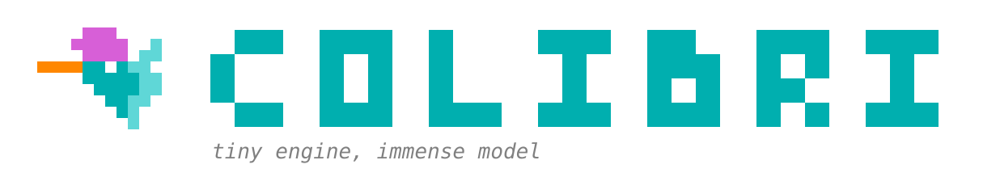
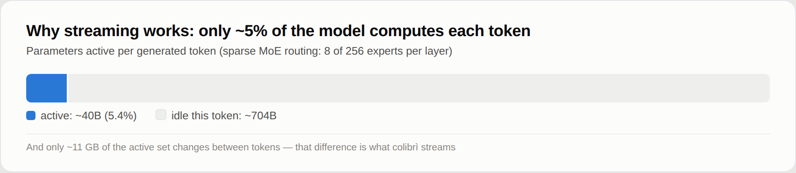
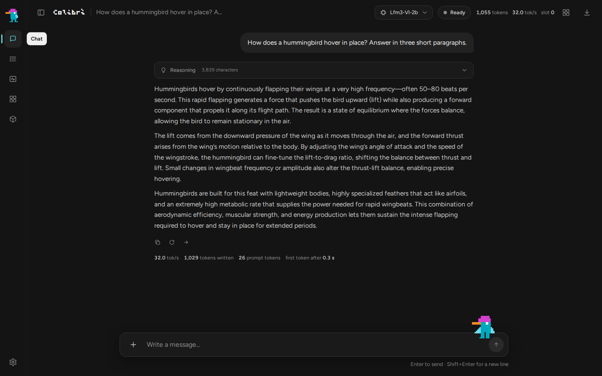
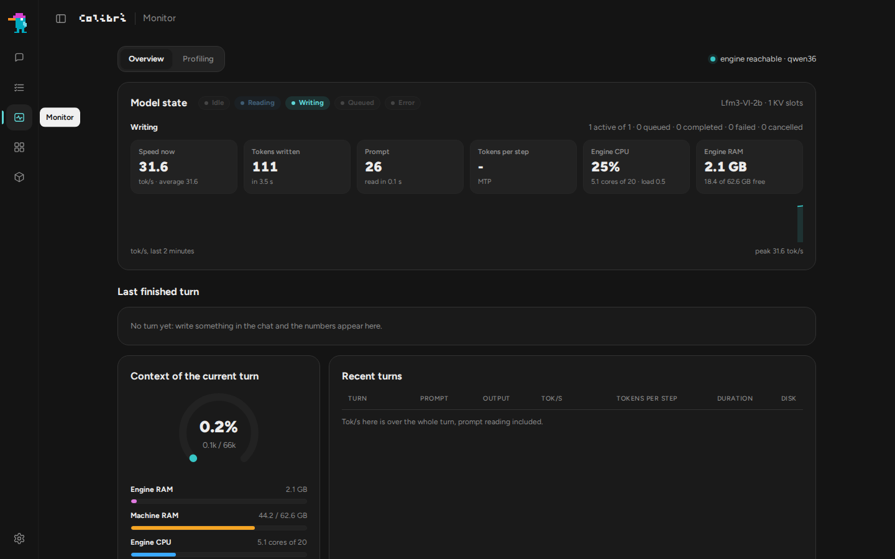
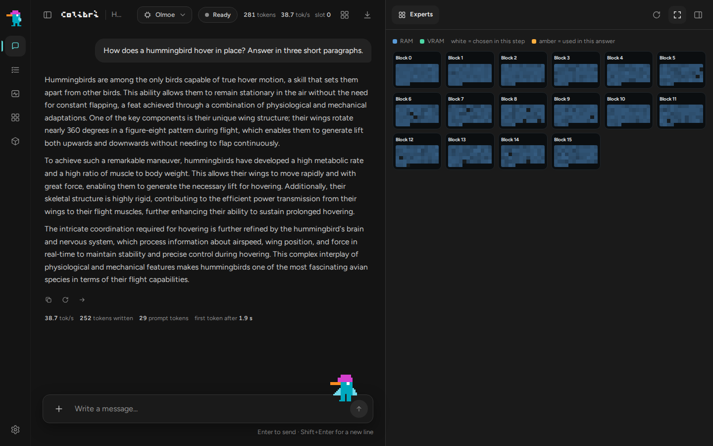
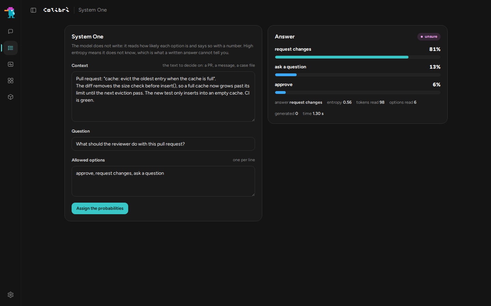
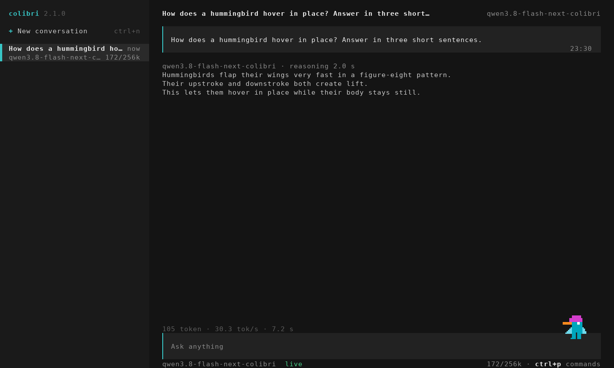
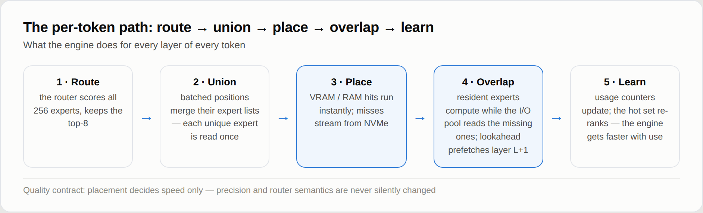
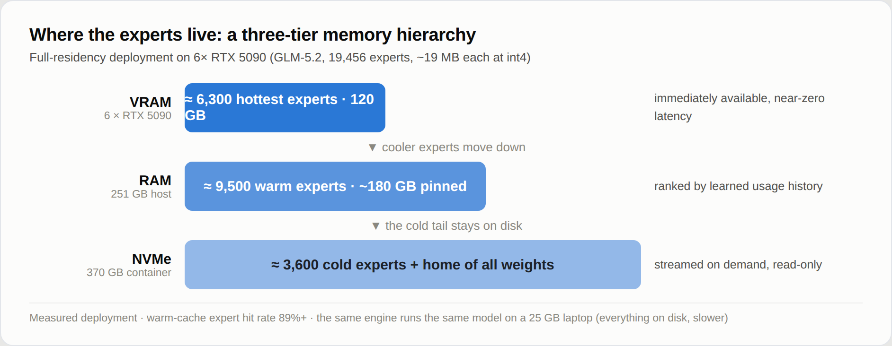
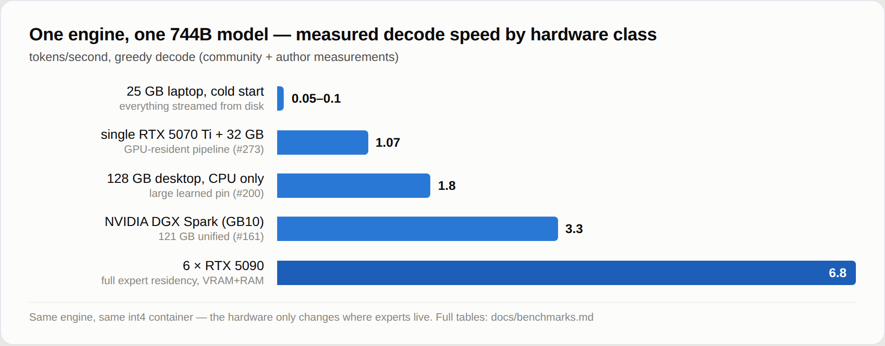

<p align="center">
  
</p>

<p align="center">
  <a href="https://justvugg.github.io/colibri"></a>
  <a href="https://github.com/JustVugg/colibri/releases"></a>
</p>

<p align="center">
  <a href="https://justvugg.github.io/colibri"><b>Sitio web</b></a> ·
  <a href="https://discord.gg/RXV83nSZdk"><b>Discord</b></a> ·
  <a href="README.md">English</a> · <a href="README.zh-CN.md">简体中文</a> · <a href="README.zh-TW.md">繁體中文</a> · <a href="README.it.md">Italiano</a> · <a href="README.ja.md">日本語</a> · <a href="README.id.md">Bahasa Indonesia</a> · <a href="README.pt-BR.md">Português (Brasil)</a> · Español · <a href="README.fr.md">Français</a> · <a href="README.de.md">Deutsch</a> · <a href="README.ru.md">Русский</a>
</p>

**Motor diminuto, modelo inmenso.** colibri ejecuta modelos abiertos muy grandes
en la máquina que ya tienes. Un modelo de mezcla de expertos con cientos de miles
de millones de parámetros usa solo una pequeña parte de sí mismo en cada token:
colibri mantiene esa parte en RAM y lee el resto, los expertos, desde el disco
cuando el modelo los pide. C puro, un archivo por familia de modelos, sin necesidad
de GPU.

Hoy funcionan trece motores. Diez son para modelos de lenguaje: **GLM-5.2/5.3** (que
también ejecuta **Mistral-Large-4**), **GLM-5.3-Flash**, **Inkling**, **Kimi K3** (y
K3.1 Pro), **DeepSeek V4 Flash**, **DeepSeek V4.1 Flash**, **MiMo-V2.6 Flash** (y
Pro), **Qwen3.8-Flash-Next**, **Qwen3.6** (que también ejecuta Qwen3-Coder, el denso
Qwen3.8-27B, **Flint**, **Muse Spark Open** y **LFM3-VL**) y **OLMoE**. Uno dibuja
imágenes: **Qwen-Image-2.1**. Dos toman decisiones: **Laya** y
**GLiNER2.5-Decide**, con un tercer modelo de decisión, **Clef**, sobre el motor de
Qwen3.6. Los modelos de lenguaje también funcionan con los archivos GGUF ya
publicados, leídos tal cual están ([GGUF](docs/gguf.md)), en la CPU, en cualquier
GPU mediante Vulkan y en las tarjetas NVIDIA mediante CUDA. [Cuál elegir para mi máquina](#which-model-for-my-machine)

```
$ ./coli chat
  colibri v2.1.0 · GLM-5.2 · 744B MoE · int4 · streaming CPU
  ✓ ready in 32s · resident 9.9 GB
  › ciao!
  ◆ Ciao! Come posso aiutarti oggi?
```

<p align="center">
  <a href="https://www.buymeacoffee.com/justvugg"></a>
  <br>
  <sub>colibri es gratuito y de código abierto. Si se ha ganado un sitio en tu máquina, un café ayuda a pagar el próximo motor y el próximo salto de velocidad.</sub>
</p>

<a id="get-started"></a>
<a id="the-one-step-way"></a>

## Empieza en un solo paso

Necesitas un ordenador con **8 GB de RAM** como mínimo absoluto (mejor 16 GB o
más), **22 GB libres en el disco** para el modelo más pequeño y una conexión a
internet. La tarjeta gráfica es opcional.

**Windows**

1. En esta página haz clic en **Code**, luego en **Download ZIP**, y descomprime
   el archivo.
2. Haz doble clic en **`START-HERE.bat`** en la carpeta descomprimida. Si falta
   Python, se ofrece a instalarlo por ti.

**Linux** (Ubuntu y Debian; las demás distribuciones tienen los mismos paquetes
con sus propios nombres)

```bash
sudo apt install git python3 build-essential
git clone https://github.com/JustVugg/colibri
cd colibri
./start-here.sh
```

**macOS** (con [Homebrew](https://brew.sh))

```bash
xcode-select --install
brew install libomp git python
git clone https://github.com/JustVugg/colibri
cd colibri
./start-here.sh
```

Respondes a una sola pregunta, qué modelo, y Intro acepta la recomendación. Luego
la instalación:

1. **revisa tu máquina**: RAM, disco libre, CPU y GPU;
2. **recomienda un modelo que cabe**: la parte del modelo que siempre se queda en
   RAM, más una caché mínima de expertos, debe caber en tu RAM, y la descarga en
   tu disco;
3. **prepara el motor**: lo compila para tu máquina si hay un compilador; si no,
   descarga el ya compilado, que funciona en la CPU y, en Linux y Windows, también
   en una GPU Vulkan. Lo compila para tu GPU cuando compensa: CUDA para una tarjeta
   NVIDIA en Linux si está instalado el CUDA toolkit, y si no, Vulkan. En una GPU
   dedicada lo hace siempre; en una GPU integrada, que comparte la RAM de la CPU,
   solo para los modelos que en las mediciones resultaron más rápidos allí (Qwen3.6,
   Qwen3-Coder y Qwen3.8-Flash-Next). Si falta un paquete, imprime el comando exacto
   para instalarlo y sigue con la CPU; después vuelve a ejecutar la instalación y el
   motor se recompila para la GPU;
4. **descarga el modelo** mostrando el progreso y con reanudación: detenla cuando
   quieras, vuelve a ejecutarla y continúa donde se había parado;
5. **arranca colibri y abre el panel** en el navegador, e imprime las direcciones
   que pueden usar otras apps:

```
Starting colibri
  Browser:             http://127.0.0.1:8000/
  OpenAI base URL:     http://127.0.0.1:8000/v1
  Anthropic base URL:  http://127.0.0.1:8000
  stop: press Ctrl+C here (or close this window)
```

**La próxima vez**, vuelve a ejecutar `START-HERE.bat` o `./start-here.sh`: colibri
arranca enseguida, sin descarga ni compilación. `c/coli status` muestra qué está
instalado y si se está ejecutando, `c/coli stop` lo detiene (`c\coli.cmd status` y
`c\coli.cmd stop` en Windows).

Las opciones van después de `./start-here.sh` o `START-HERE.bat`:

| Opción | Qué hace |
|---|---|
| `--list` | cada modelo comparado con esta máquina, y por qué uno no cabe |
| `--model ID` | instala ese modelo (los ids están en [las tablas de abajo](#which-model-for-my-machine)) |
| `--yes` | sin preguntas: acepta la recomendación |
| `--dir DIR` | pone los modelos en otro disco (por defecto `~/colibri-models`) |
| `--backend vulkan`, `cuda` o `cpu` | elige tú la compilación del motor; `--no-gpu` equivale a `--backend cpu` |
| `--model-dir DIR` | usa un modelo que ya has descargado |
| `--reconfigure` | para elegir otro modelo |

Qué hace cada paso, en detalle: [docs/quickstart.md](docs/quickstart.md#the-one-step-way).

### Si algo sale mal

| Qué ves | Qué hacer |
|---|---|
| se detuvo durante la descarga | ejecuta el mismo comando otra vez: reanuda desde los bytes que ya están en el disco |
| `to use the GPU through ..., first run: <command>` | ejecuta ese comando, luego la instalación otra vez: recompila para la GPU y no vuelve a descargar nada |
| `the ... build failed`, por ejemplo `Unsupported gpu architecture` cuando el CUDA toolkit instalado ya no admite la tarjeta | la instalación comprueba primero el toolkit frente a la tarjeta y elige Vulkan por sí misma, explicando por qué; si una compilación sigue fallando, ofrece la siguiente (Vulkan, y después la CPU). `./start-here.sh --backend vulkan` fuerza Vulkan; `--no-gpu` se queda en la CPU |
| `needs N GB free for the download` | `--dir` con una carpeta en un disco más grande |
| en WSL, la carpeta del modelo está bajo `/mnt/c` | guárdala en el disco de Linux (el valor por defecto, `~/colibri-models`): `/mnt/c` es muchas veces más lento |
| actualizaste el checkout (`git pull`) | vuelve a ejecutar `./start-here.sh`: recompila el motor si cambiaron los fuentes, y luego lo arranca |
| cualquier otra cosa | `c/coli logs -n 50` muestra el registro de un servidor arrancado en segundo plano (el que se arranca en primer plano escribe en su propia terminal) y `c/coli logs --install` el de la instalación; abre una [issue](https://github.com/JustVugg/colibri/issues) con las últimas líneas que imprimió la instalación |

### Deja que tu asistente de IA lo instale

Si usas un asistente de IA para programar, puede hacer todo esto por ti.
Pídele:

> Instala colibri en esta máquina siguiendo docs/AI_SETUP.md desde https://github.com/JustVugg/colibri

[docs/AI_SETUP.md](docs/AI_SETUP.md) da al asistente cada paso en forma de comando
con un resultado legible por máquina, y le indica que te pida confirmación antes de
descargar un modelo o instalar un paquete del sistema. Los asistentes que hablan el
Model Context Protocol pueden usar en cambio el servidor MCP de colibri: `coli mcp`
ofrece herramientas para detectar el hardware, recomendar un modelo, instalarlo,
arrancarlo, detenerlo y comprobarlo ([docs/MCP_SERVER.md](docs/MCP_SERVER.md)).

### O a mano

Para elegir tú cada paso (una versión ya compilada o una compilación desde los
fuentes, cualquier modelo de las tablas de abajo, y después `coli chat`, `coli web`
o `coli serve`), consulta [Instalación a mano](#install-by-hand), o la
[guía Quick Start](docs/quickstart.md), paso a paso para cada plataforma.

## Qué es colibri, y por qué

Un modelo de mezcla de expertos es enorme en disco y pequeño por token. GLM-5.2 tiene
744B parámetros, usa unos 40B en cada token, y solo unos 11 GB de esos cambian de un
token al siguiente: los expertos enrutados.

<p align="center">
  
</p>

Así que el modelo no tiene que caber en memoria rápida; tiene que ser **ubicado**.
La parte densa (atención, expertos compartidos, embeddings) se queda en RAM. Los
expertos enrutados se quedan en el disco y se leen cuando el router los pide, a
través de una caché que aprende qué expertos usa tu trabajo. Una GPU, cuando la hay,
mantiene los expertos más calientes y las capas densas. Dónde está un peso cambia la
velocidad a la que llega la respuesta, no qué pesos ni qué decisiones del router la
producen.

Por qué: para ejecutar modelos de este tamaño en el hardware que la gente ya posee,
para verlos trabajar (el panel muestra cada experto en el momento en que se activa),
y para mantener el motor lo bastante pequeño como para que cualquiera pueda medirlo
y hacerlo más rápido. colibri es también una plataforma de investigación abierta: una
optimización se gana su sitio con una medición reproducible de extremo a extremo, y
la política por defecto nunca cambia en silencio la precisión del modelo ni la
semántica del router. Menos memoria rápida puede costar velocidad; no debe redefinir
el modelo en secreto. [Cómo funciona](#how-it-works) tiene los detalles.

<a id="which-model-for-my-machine"></a>

## Qué modelo para mi máquina

La instalación recomienda el modelo más capaz que funciona desde la RAM de tu
máquina, y justo debajo enumera los más grandes, que se leen del disco en
streaming. `./start-here.sh --list` los muestra todos comparados con tu máquina.
Las tablas siguen el catálogo propio de la instalación
([`c/setup_catalog.py`](c/setup_catalog.py)); las descargas son los tamaños que
Hugging Face indica para cada repositorio.

- **RAM** son dos números: por debajo del primero el modelo no arranca; desde el
  segundo en adelante funciona como en las mediciones.
- **GPU** es lo que la instalación puede compilar para ese motor ([GPU](#gpus)).
  *También integrada* significa que usa también una GPU integrada, donde estos
  motores resultaron más rápidos en las mediciones; los demás usan solo una GPU
  dedicada.
- **Medido** es lo que se cronometró en la máquina indicada: para los modelos de
  chat, la velocidad de decodificación. Las letras son las máquinas enumeradas
  debajo de las tablas. Una celda vacía significa que nadie lo ha medido todavía.

**Modelos pequeños, que funcionan desde la RAM**

| Modelo | `--model` | Descarga | RAM | GPU | Medido |
|---|---|---|---|---|---|
| **Qwen3.6-35B-A3B**: chat con razonamiento y herramientas | `qwen36-35b` | 23 GB | 10 / 20 GB | CUDA, Vulkan (también integrada) | 6.0 tok/s en la CPU, 9.9 con Vulkan en la GPU integrada (A); 30.0 con CUDA (C) |
| Qwen3-Coder-30B-A3B: código y llamadas a herramientas, sin razonamiento | `qwen3-coder-30b` | 19 GB | 8 / 18 GB | CUDA, Vulkan (también integrada) | 8.5-9.6 tok/s con todos los expertos en RAM, 5.1 con 32 por capa (A, CPU) |
| **Qwen-Image-2.1**: de texto a imagen, licencia no comercial | `qwen-image-2.1` | 33 GB | 12 / 18 GB | Vulkan | una imagen de 768x512 en 2 min 40 s (8 núcleos Zen 4, CPU) |

**Modelos grandes, cuyos expertos se leen del disco en streaming** (la velocidad
la decide el disco: un NVMe rápido es lo que más ayuda)

| Modelo | `--model` | Descarga | RAM | GPU | Medido |
|---|---|---|---|---|---|
| DeepSeek V4 Flash REAP 150B: 132 de los 256 expertos | `deepseek-v4-flash-reap` | 85 GB | 16 / 32 GB | CUDA, Vulkan | |
| **DeepSeek V4 Flash** (284B): herramientas | `deepseek-v4-flash` | 167 GB | 16 / 32 GB | CUDA, Vulkan | 0.93 tok/s con 32 GB (Ryzen 7 5800X), 1.24 con 63 GB (Ryzen 9 5950X), solo CPU; 1.5-1.6 con CUDA (RTX 5080, 32 GB, dos NVMe) |
| **MiMo-V2.6 Flash** (309B): visión y herramientas | `mimo-v2.6-flash` | 172 GB | 32 / 52 GB | Vulkan | 2.34-3.37 tok/s (A, CPU) |
| **Qwen3.8-Flash-Next** (125B + 51B n-gram): visión y herramientas | `qwen38-flash-next` | 186 GB | 24 / 32 GB | CUDA, Vulkan (también integrada) | 1.91-2.56 tok/s con 32-96 expertos por capa; 3.99 con los expertos int4 opcionales (A, CPU) |
| **GLM-5.2** (744B): el modelo de referencia, con la cabeza MTP | `glm-5.2` | 429 GB | 16 / 24 GB | CUDA, Vulkan | 0.05-0.1 tok/s en frío en un portátil de 25 GB; 1.83 en un Ryzen AI Max+ 395 de 128 GB; 9.0-9.2 en 6x RTX 5090 |
| GLM-5.3 (744B): el mismo motor, sin cabeza MTP | `glm-5.3` | 419 GB | 16 / 24 GB | CUDA, Vulkan | |
| **Inkling** (975B): expertos int4, pesos densos bf16 | `inkling` | 514 GB | 120 / 128 GB tal como se descarga; 25 GB tras una [conversión de la parte densa](docs/inkling.md) | CUDA, Vulkan | 0.25 tok/s (Ryzen 9 7900, 187 GB, RTX A6000) |
| MiMo-V2.6 Pro (1.02T): visión y herramientas | `mimo-v2.6-pro` | 564 GB | 54 / 64 GB | Vulkan | 0.66-0.79 tok/s (A, CPU) |
| **Kimi K3** (2.8T): el más grande | `kimi-k3` | 1.56 TB | 32 / 64 GB | CUDA, Vulkan | unos 9.4 s por token, expertos leídos a 6.3 GB/s |
| **Kimi K3.1 Pro** (2.8T): K3 con atención dispersa más allá de 2048 tokens | `kimi-k3.1-pro` | 1.56 TB | 32 / 64 GB | CUDA, Vulkan | |

<a id="other-supported-models"></a>

**A mano: un paso de conversión o de preparación tras la descarga**

| Modelo | Descarga, luego en disco | RAM | GPU | Medido |
|---|---|---|---|---|
| **OLMoE** (7B): pequeño, para familiarizarse con las herramientas | 14 GB, 7 GB tras la conversión a int8 | 8 GB | Vulkan | 22-23 tok/s (A, CPU) |
| Qwen3.8-27B (denso): texto e imágenes | 56 GB, 51 GB tras la conversión | 20 GB en int4, 30 GB en int8 | Vulkan | 3.45 tok/s en int4, 2.1 en int8 (servidor CPU de 16 hilos) |
| **GLM-5.3-Flash** (321B): visión y herramientas | 328 GB, convertidos shard a shard en 195 GB | 25 GB | CUDA, Vulkan | unos 20 s por token en caliente, 44 s en frío (6 núcleos, 25 GB, disco normal) |
| **DeepSeek V4.1 Flash** (552B): visión y herramientas, sin conversión sino una preparación única | 510 GB | unos 18 GB más la caché de expertos (24.8 GB en el pico con 8 por capa) | Vulkan | 0.21-0.24 tok/s (servidor CPU de 16 hilos que retiene el 68% de los expertos) |

<a id="from-a-gguf"></a>

**Desde un GGUF: los archivos publicados, leídos tal cual están**

`./coli import` toma el primer archivo de un GGUF (las demás partes junto a él) y
escribe una carpeta del modelo al lado; luego se pasa esa carpeta a `--model`, como
con cualquier otro ([gguf.md](docs/gguf.md)). Nada se convierte ni se vuelve a
cuantizar: los bloques funcionan tal como los contiene el archivo, desde IQ1_S hasta
Q8_0, F16, BF16 y MXFP4. Los motores de todos los modelos de chat de arriba también
leen GGUF ([las arquitecturas](docs/gguf.md#supported-architectures)); estos modelos
llegan como GGUF:

| Modelo | GGUF | GPU | Medido |
|---|---|---|---|
| **Mistral-Large-4** (1T, 52B activos): texto, imágenes, razonamiento y herramientas | unsloth, UD-IQ1_S 233 GB | CUDA, Vulkan | 1.34-1.36 tok/s con CUDA, 1.16-1.17 con Vulkan (D) |
| **Muse Spark Open** (816B, 42B activos): texto y herramientas, con el acuerdo de licencia de Meta | unsloth, de UD-IQ1_S 176 GB a UD-Q4_K_XL 505 GB | CUDA, Vulkan | 1.55-1.58 tok/s con Vulkan, 1.34-1.40 con CUDA, 0.83-0.89 en la CPU (D) |
| **Flint** (40B, 2.5B activos): texto y herramientas, Apache 2.0 | unsloth, de UD-IQ1_M 11.4 GB a BF16 79.6 GB | CUDA, Vulkan | UD-Q4_K_XL: 77.4 tok/s con CUDA, 77.7 con Vulkan, 15.8 en la CPU (D) |
| **LFM3-VL-2B**: texto, imágenes y herramientas, LFM Open License | LiquidAI, de QAD-Q4_0 a BF16 (o el checkpoint, convertido) | CUDA, Vulkan | Q4_K_M: 235.1 tok/s con CUDA, 214.1 con Vulkan, 34.5 en la CPU (D) |
| **Qwen-Image-2.1** y su **Turbo**: de texto a imagen, licencia no comercial ([qwen-image.md](docs/qwen-image.md#gguf-unsloth)) | unsloth, de Q2_K 2.5 GB a F16 14.2 GB, con un GGUF de Qwen3-VL-8B-Instruct como codificador de texto | Vulkan | Turbo Q4_K_M, 1024x1024 en 8 pasos: 37 s de eliminación de ruido con Vulkan (D); a 512x512, 8.4-9.3 s por paso en la CPU (A) |

Los modelos más grandes de las tablas de arriba desde sus GGUF, en la misma
máquina: [Benchmarks](#large-models-on-the-same-machine).

**Modelos de decisión** (responden a las preguntas de [System One](#system-one-a-decision-with-a-probability), no chatean)

| Modelo | Descarga, luego en disco | RAM | GPU | Medido |
|---|---|---|---|---|
| **Laya** (Convai Innovations), inglés | 0.85 GB | 1.7 GB | CPU, CUDA | 219 ms por una pregunta, 882 ms por tres (B); doce en 0.69 s con CUDA, 11.4-13.0 s en la CPU (D) |
| **GLiNER2.5-Decide** (fastino), inglés | 1.95 GB | 1.9 GB | CPU, CUDA | 294 ms por una pregunta, 897 ms por tres (B, bajo carga); doce en 0.16-0.21 s con CUDA, 2.0-2.6 s en la CPU (D) |
| **Clef** (Cloudflare): Qwen3.8-27B con una cabeza de decisión, también chatea | 55 GB, 52 GB tras la conversión | de 19 GB en int4 a 55 GB en f16 | CPU | 20.4 s por petición en int8 (A) |

Las máquinas:
**A** un ordenador de sobremesa Ryzen 7 PRO 8700GE (8 núcleos, 61-64 GB DDR5, NVMe,
Radeon 780M integrada);
**B** un portátil i7-1355U;
**C** una RTX 3070 de 8 GB en una máquina Threadripper 3945WX, con las capas densas
y las capas DeltaNet en la tarjeta (contenedor int4 por fila);
**D** un i5-13500 con 62 GB de RAM, una RTX PRO 4000 Blackwell SFF (24 GB) y dos
NVMe en una matriz md: la máquina de [las tablas de benchmarks](#benchmarks).
Cada número procede de la página de su modelo en [docs/](docs/) o de
[las tablas de benchmarks](docs/benchmarks.md), con los ajustes exactos.

Cada familia tiene su página: [qwen36.md](docs/qwen36.md) (Qwen3.6, Qwen3-Coder,
Qwen3.8-27B, Flint, Muse Spark Open, LFM3-VL), [mistral-large4.md](docs/mistral-large4.md),
[gguf.md](docs/gguf.md), [qwen38.md](docs/qwen38.md), [deepseek-v4.md](docs/deepseek-v4.md),
[deepseek-v41.md](docs/deepseek-v41.md), [mimo.md](docs/mimo.md),
[glm53-flash.md](docs/glm53-flash.md), [inkling.md](docs/inkling.md),
[kimi_k3.md](docs/kimi_k3.md), [qwen-image.md](docs/qwen-image.md),
[laya.md](docs/laya.md), [gliner_decide.md](docs/gliner_decide.md),
[clef.md](docs/clef.md), y GLM-5.2 en la [Quick Start](docs/quickstart.md#3-get-the-model).
Los checkpoints con la misma arquitectura que uno soportado, como KAT-Coder v2.5 en el
motor de Qwen3.6, funcionan sin cambios.

<a id="gpus"></a>

## GPU

### No hace falta GPU

Cada motor funciona en la CPU sin instalar nada más. Una GPU es un lugar más rápido
donde guardar los pesos, no un requisito: para los modelos grandes la velocidad la
decide el disco, para los pequeños, la RAM.

### Vulkan: cualquier GPU

Cada motor MoE puede usar cualquier GPU con un driver Vulkan 1.2 (AMD, Intel,
NVIDIA, integrada o dedicada) de dos maneras:

- **el nivel de expertos**: una caché de expertos enrutados en la memoria de la GPU,
  llenada al arrancar con los expertos que usaron tus conversaciones pasadas y que se
  adapta mientras chateas. La GPU calcula los expertos que contiene mientras la CPU
  calcula el resto;
- **la cadena densa**: una capa entera registrada como un único envío a la GPU, con
  el estado en curso del modelo mantenido en la GPU de una capa a la siguiente.

Medido en la Radeon 780M integrada de la máquina A, con los archivos del modelo
retirados de la caché de páginas antes de cada ejecución, 100 tokens decodificados
([vulkan.md](docs/vulkan.md#the-chain-on-a-radeon-780m)):

| | CPU | Vulkan, nivel de expertos | Vulkan, nivel y cadena densa |
|---|---|---|---|
| Qwen3.6-35B-A3B, decodificación | 6.0 tok/s | 8.0 tok/s | **9.9 tok/s** |
| Qwen3.6-35B-A3B, un prompt de 512 tokens | 35.7 s | 12.2 s | **9.5 s** |
| Qwen3.8-Flash-Next (expertos int4), decodificación | 3.5 tok/s | **3.8 tok/s** | 3.2 tok/s |
| Qwen3.8-Flash-Next, un prompt de 512 tokens | 43.6 s | 38.7 s | **30.1 s** |
| OLMoE, decodificación (en caliente) | **23.1 tok/s** | 12.8 tok/s | 17.3 tok/s |

Una GPU integrada comparte la RAM de la CPU. Lo que ahorra es el trabajo y las
lecturas de disco de los expertos que contiene: por eso compensa con un modelo como
Qwen3.6, mientras que un modelo pequeño cuyos expertos ya están en RAM, como OLMoE,
puede perder. Por eso la instalación activa Vulkan en una GPU integrada solo para
Qwen3.6, Qwen3-Coder y Qwen3.8-Flash-Next, y por eso cada motor decide por sí mismo si
usar allí la cadena densa (Qwen3.6 sí, Qwen3.8 no). `--backend vulkan` lo pide de
todos modos.

**Encender o apagar la GPU.** `coli setup --backend vulkan` usa la GPU para cualquier
modelo, y `coli setup --backend cpu` (o `--no-gpu`) mantiene todo en la CPU. Un motor
compilado con Vulkan usa la GPU solo con `COLI_VULKAN=1` en el entorno de `coli chat`,
`serve` o `web` (la instalación lo define cuando eligió Vulkan); sin eso, el motor
funciona en la CPU. Con la GPU encendida, `COLI_VK_CHAIN=0` mantiene el nivel de
expertos y ejecuta las capas densas en la CPU. En una GPU integrada prueba ambos
caminos: en un portátil con una Intel Iris Xe (Core i7-1355U), Qwen3.6 decodificó a
2.1 tok/s en la CPU, de 1.7 a 1.9 con Vulkan, y 2.1 con la cadena densa apagada.

En una GPU dedicada la instalación compila Vulkan para cada motor (primero CUDA, donde
el motor lo tiene y el toolkit está instalado), con las capas densas en la tarjeta.
Es el caso para el que está pensado el proyecto. En una RTX PRO 4000 (24 GB, máquina D)
Qwen3.6-35B-A3B decodifica a 92.9 tok/s y lee un prompt de 2,076, OLMoE a 299.4 y
6,867 ([la tabla](#three-backends-on-one-machine)). Un modelo más grande que la tarjeta
mantiene los expertos que la tarjeta no contiene en un pool en la RAM, y en cada paso
la CPU calcula esos mientras la tarjeta calcula los suyos, en el mismo fotograma:
Qwen3.8-Flash-Next IQ2_XS (68 GB) decodifica a 50.6 tok/s ahí
([vulkan.md](docs/vulkan.md#the-routed-experts-in-the-frame-vk_dmoeh)). Un usuario
midió Qwen3.6 entre 17 y 19 tok/s en una Tesla V100 de 16 GB
([#1852](https://github.com/JustVugg/colibri/issues/1852)). Los números de tu tarjeta
son bienvenidos.

**Las tarjetas sin Resizable BAR** ahora funcionan. Una tarjeta así (todas las Turing,
las Ampere con el firmware de lanzamiento, las AMD más antiguas con la opción
desactivada) deja que la CPU escriba directamente solo unos 256 MB de su memoria;
ahora colibri copia los pesos pasando por un búfer de staging, por sí solo. La ruta
está probada forzándola y emulando la ventana pequeña en tres dispositivos, y no cuesta
nada medible en la 780M; no se ha medido en una tarjeta sin Resizable BAR
([vulkan.md](docs/vulkan.md#memory-placement-without-resizable-bar)).

La CI comprueba la ruta Vulkan de cada motor frente a los tokens de la CPU en un driver
por software. La GPU suma los números en un orden distinto y mantiene algunas
activaciones en f32 donde la CPU las redondea, así que una respuesta larga puede
desviarse de la de la CPU en una palabra
([vulkan.md](docs/vulkan.md#the-other-engines)).

### CUDA: tarjetas NVIDIA

La instalación compila CUDA en Linux cuando está instalado el CUDA toolkit, para los
motores que tienen una ruta CUDA: GLM-5.2/5.3 y Mistral-Large-4, GLM-5.3-Flash,
Inkling, Kimi K3, DeepSeek V4 Flash, DeepSeek V4.1 Flash, MiMo-V2.6,
Qwen3.8-Flash-Next, y Qwen3.6 con los modelos que ejecuta; OLMoE y los motores de
decisión se compilan con `make <engine> CUDA=1`. En Windows el motor CUDA es una DLL
aparte ([windows.md](docs/windows.md)), y cada versión lo distribuye ya compilado:
`colibri-<version>-windows-x86_64-cuda.zip` contiene `coli_cuda.dll` (tarjetas con
compute capability 8.0 o superior) y los motores colibri, glm53, qwen36 y kimi_k3 que
lo cargan, con las DLL CUDA propias de DeepSeek V4. Descomprímelo sobre el archivo
principal y la instalación elige CUDA.

- **Cada capa en la tarjeta** para Qwen3.6, Qwen3.8 y OLMoE: las capas densas, la
  atención y los expertos enrutados que la tarjeta contiene funcionan como una sola
  cadena, y los que no contiene se ejecutan en la CPU. En una RTX PRO 4000,
  Qwen3.6-35B-A3B UD-Q4_K_M decodifica a 104.8 tok/s y lee un prompt de 3,491, OLMoE a
  354.6 y 10,418 ([la tabla](#three-backends-on-one-machine)).
- **Un nivel de expertos en la tarjeta para cada motor** (`cu_tier.h`), y las matrices
  densas en la tarjeta para DeepSeek V4, V4.1, Kimi K3, GLM-5.3 y MiMo (`cu_dense.h`).
- **Los bloques de un GGUF en la tarjeta** (`cuda_bd.cuh`): cada tipo de bloque ggml de
  32 pesos o más, cada fila tal como la tiene el archivo; un prompt pasa por los tensor
  cores ([gguf.md](docs/gguf.md)).
- **El nivel de expertos en VRAM** mantiene en la tarjeta los expertos más calientes,
  elegidos según el enrutamiento medido; los fallos se calculan en la CPU al mismo
  tiempo. Qwen3.6 en dos tarjetas de 8 GB (RTX 3070 y Quadro RTX 4000) decodificó
  11.3 tok/s con un historial en caliente
  ([qwen36-cuda-tier.md](docs/qwen36-cuda-tier.md)); GLM-5.2 en seis RTX 5090 con todos
  los expertos residentes, 9.0-9.2 tok/s ([benchmarks.md](docs/benchmarks.md));
  DeepSeek V4 Flash en una RTX 5080, 1.5-1.6 tok/s y un prompt de 3,324 tokens en 90 s
  ([deepseek-v4.md](docs/deepseek-v4.md)).
- **Novedad para Qwen3.6: las capas DeltaNet en la tarjeta** (`Q36_DN_GPU=1`, opcional).
  Cada una de las 30 capas DeltaNet de Qwen3.6 copiaba sus datos entre la tarjeta y la
  CPU cuatro veces por token; ahora un token de decodificación ejecuta la capa entera
  en la tarjeta, con su estado recurrente mantenido en VRAM. En una RTX 3070 con las
  capas densas en VRAM: de 25.4 a 30.0 tok/s
  ([qwen36-cuda-tier.md](docs/qwen36-cuda-tier.md#the-deltanet-layer-on-the-card-q36_dn_gpu1)).
- **Tarjetas más antiguas.** Si el CUDA toolkit ya no compila para tu tarjeta (CUDA 13 y
  una V100, en [#1852](https://github.com/JustVugg/colibri/issues/1852)), la instalación
  lo detecta antes de compilar y usa la tarjeta mediante Vulkan, explicando por qué; un
  CUDA toolkit 12.x devuelve la ruta CUDA. El nivel CUDA de DeepSeek V4 también se
  compila para Pascal y Turing (`CUDA_ARCH=portable-pre-ampere NO_TC=1`).

Todos los detalles: [docs/cuda.md](docs/cuda.md).

### Apple Silicon

Un backend Metal ejecuta los cálculos de los expertos en la GPU de memoria unificada
para varios motores ([docs/metal.md](docs/metal.md)). En el archivo macOS de la versión,
`colibri`, `inkling` y `kimi_k3` están compilados con Metal: `COLI_METAL=1`
(`K3_METAL=1` para Kimi K3) lo activa, y sin eso funcionan en la CPU. Desde los fuentes
compila con `METAL=1`; la instalación en un paso compila para la CPU.

<a id="system-one-mode-ask-a-closed-question"></a>
<a id="system-one-a-decision-with-a-probability"></a>

## System One: una decisión con una probabilidad

Gran parte de lo que se pide a un modelo es una elección, no un párrafo: qué cola,
qué veredicto, sí o no. `POST /v1/systemone` recibe un estado (texto o JSON) y
preguntas tipadas, y responde a cada una con la probabilidad de cada opción permitida
y una confianza. No se genera nada, así que ninguna respuesta puede salirse de tu
lista, y "el modelo no está seguro" es un número sobre el que puedes poner un umbral.

```bash
curl -s http://127.0.0.1:8000/v1/systemone -H 'Content-Type: application/json' -d '{
  "state": "340 lines, 8 files, no tests. CI is green but nothing covers that path.",
  "questions": {
    "review": {"type": "choice", "instructions": "What should the reviewer do?",
               "criteria": {"merge": null, "request changes": null, "close": null}},
    "risky":  {"type": "noul", "instructions": "Is this change risky?"}}}'
```

Un `choice` devuelve la etiqueta elegida, una probabilidad para cada etiqueta y una
`confidence` de 0 (plana) a 1 (segura); un `noul` devuelve la probabilidad del sí; un
`score` devuelve el nivel esperado.

Quién responde:

- **Cualquier modelo de chat que colibri ejecute**, puntuando: lee la probabilidad de
  cada opción en lugar de escribir una respuesta. Varias preguntas sobre el mismo
  documento leen el documento una sola vez: en Qwen3.6, cuatro preguntas sobre un
  documento volvieron 5.7x más rápido que generando las mismas respuestas en la misma
  máquina con CPU.
- **Tres modelos de decisión**, de forma nativa, en un solo pase hacia delante con la
  calibración que estimaron sus autores: [Laya](docs/laya.md) (Convai Innovations),
  [GLiNER2.5-Decide](docs/gliner_decide.md) (fastino) y [Clef](docs/clef.md)
  (Cloudflare; también sabe chatear). Sus tamaños y velocidades están en
  [la tabla de modelos de decisión](#which-model-for-my-machine).

**Pasar desde Jev.** La petición y la respuesta son las de la API Jev de TypeSafe, así
que un cliente Jev pasa a colibri cambiando el base URL y nada más:
`TYPESAFE_BASE_URL=http://127.0.0.1:8000` (la clave que ya envía la acepta un servidor
arrancado sin `COLI_API_KEY`). Los dos SDK oficiales, sin modificar, están probados
contra `coli serve`.

El mismo modo está en la terminal (`/decide merge | request changes | close` en
`coli chat`) y en la página System One del panel. La petición y la respuesta completas,
las reglas de puntuación y los casos en que no ayuda:
[docs/systemone.md](docs/systemone.md).

## El panel

`coli web` lo abre, y también lo abre la instalación en un paso: el chat, la página
System One, el Brain y la página Profiling, en tema claro o oscuro.

### La interfaz de chat

`coli ui` abre el nuevo chat junto a un `coli serve` en ejecución: el razonamiento en
su propio bloque, las imágenes para los modelos con torre visual, la búsqueda web, el
mapa de expertos, un monitor en vivo y los agentes de programación ya apuntados a
colibri. Siete idiomas. Consulta [ui/README.md](ui/README.md).

<p align="center">
  
</p>
<p align="center"><em>LFM3-VL-2B en la CPU de un i5-13500, 32 tok/s.</em></p>

<p align="center">
  
</p>
<p align="center"><em>El <strong>monitor</strong> mientras LFM3-VL-2B escribe: 31,6 tok/s, el prompt leído en 0,1 s, 2,1 GB de RAM.</em></p>

<p align="center">
  
</p>
<p align="center"><em>OLMoE con el <strong>mapa de expertos</strong> abierto junto al chat: una celda por experto en cada bloque, blanca si se eligió en este paso,
ámbar si se usó en esta respuesta.</em></p>

<p align="center">
  
</p>
<p align="center"><em><strong>System One</strong>: dale al modelo un documento y las únicas respuestas que puede elegir. Aquí Qwen3.6-35B en una RTX PRO 4000
lee una pull request que rompe el límite de tamaño de una caché: <strong>request changes al 81%</strong>, entropía 0,56 (incierto), 98 tokens leídos, 0 generados.</em></p>

La página **Profiling** muestra dónde gasta cada turno su tiempo, fase por fase, con
los últimos 30 turnos como tendencia. Con [julios](https://pypi.org/project/landauer-gap/)
instalados junto al gateway (`pip install landauer-gap`) también muestra los vatios de
la máquina y los julios por token del último turno.

### La interfaz de terminal

`coli tui` es el mismo chat en una terminal, un solo archivo C sin bibliotecas: las
conversaciones, la respuesta en streaming con el razonamiento plegado, el monitor
(`F2`) con la CPU y la RAM del motor, la GPU y su VRAM y el perfil de cada turno, el
mapa de expertos (`ctrl+e`) y el colibrí de la página de chat, dibujado como imagen
donde la terminal dibuja sixel (Terminal de Windows, foot, WezTerm). Se conecta a un
`coli serve` encendido, o arranca uno con `--model`. Consulta [docs/tui.md](docs/tui.md).

<p align="center">
  
</p>
<p align="center"><em>Qwen3.8-Flash-Next en una RTX PRO 4000 mediante <code>coli serve</code>, con un contexto de 256K.</em></p>

## Usarlo desde otras apps

`coli serve` (que la instalación arranca por ti) es un único servidor con varias APIs:

- **compatible con OpenAI**: `/v1/chat/completions`, `/v1/completions` y `/v1/models`,
  con streaming, respuestas JSON, secuencias de parada y logprobs;
- **compatible con Anthropic**: `/v1/messages`, así que Claude Code y los SDK de
  Anthropic funcionan con él;
- **llamadas a herramientas** en cada motor de chat excepto Inkling y OLMoE, cada una
  en el formato nativo de su modelo ([la tabla por motor](docs/api.md#tool-calling-support));
- **imágenes de entrada** en GLM-5.3-Flash, DeepSeek V4.1 Flash, MiMo-V2.6,
  Qwen3.8-Flash-Next, Qwen3.8-27B, LFM3-VL y Mistral-Large-4 (desde un GGUF, con el
  archivo `mmproj` junto a él): una ruta en un mensaje de `coli chat`, un adjunto en
  `coli web` o `coli ui`, o una parte `image_url`;
- **documentos de entrada** en cada motor de chat: `/file PATH` en `coli chat` (o
  `coli chat --file PATH`) envía el texto de un archivo de texto o de un PDF junto con
  el siguiente mensaje. Solo se lee un archivo nombrado de esa forma, nunca una ruta
  dentro de un mensaje; debe ser un archivo regular con sufijo de texto o `.pdf`, de
  hasta 64 MiB y 2 millones de caracteres. Un PDF se analiza en un proceso aparte con
  un límite de tiempo y de memoria, mediante `pdftotext` (poppler) o `pypdf`;
- **imágenes de salida** con Qwen-Image-2.1 en `POST /v1/images/generations`, y dibujadas
  dentro de la terminal por `coli chat` ([qwen-image.md](docs/qwen-image.md));
- **decisiones** en `POST /v1/systemone` ([arriba](#system-one-a-decision-with-a-probability));
- **varias conversaciones a la vez** en cada motor de texto: `coli serve
  --kv-slots N` mantiene hasta 16, cada una con su propia caché, y decodifica juntos
  sus siguientes tokens ([api.md](docs/api.md#isolated-kv-contexts)).

Las CLI de programación y los editores se conectan como a cualquier proveedor
compatible con OpenAI: base URL `http://127.0.0.1:8000/v1`, el id del modelo que
imprime `coli status`, cualquier clave no vacía
([docs/api.md](docs/api.md#connect-a-coding-cli-or-editor)).

<a id="how-it-works"></a>

## Cómo funciona

<p align="center">
  
</p>

Cada capa de cada token recorre los mismos cinco pasos: enrutar, unir, ubicar, solapar,
aprender. El objetivo de diseño es que **la ubicación decida solo la velocidad**: las
decisiones del router y la precisión de los pesos son las mismas tanto si un experto
responde desde la VRAM, desde la RAM o desde el disco.

<p align="center">
  
</p>

- **Un JIT para los pesos.** Un JIT de compilador nunca compila el programa entero:
  observa lo que se ejecuta y compila los caminos calientes. colibri hace la misma
  apuesta con los pesos. El calor de enrutamiento medido decide qué expertos se ganan
  la VRAM, la RAM o el disco: una caché LRU por capa, más un conjunto caliente fijado en
  memoria, aprendido de tus propias conversaciones (`.coli_usage`, actualizado en cada
  turno). colibri se vuelve más rápido cuanto más lo usas. Funciona porque el
  enrutamiento tiene una estructura medible (el
  [atlas de expertos](https://github.com/JustVugg/colibri/issues/175)).
- **Nunca esperar al disco dos veces.** Las tres matrices de un experto se leen con un
  solo `pread`; un pool de cargadores lee los expertos que faltan mientras los residentes
  calculan; un lote de posiciones lee cada experto una sola vez; un hilo de anticipación
  del router puede precargar la capa siguiente (el enrutamiento de GLM-5.2 es predecible
  al 71.6% con una capa de antelación). `DIRECT=1` (O_DIRECT) suele ser una gran ventaja
  en los NVMe rápidos y neutro o peor en los demás: mídelo en el tuyo
  ([tuning.md](docs/tuning.md)).
- **Más de un SSD.** `COLI_MODEL_MIRROR=/second/glm52_i4 ./coli chat --model /fast/glm52_i4`
  lee desde una copia en un segundo disco. Dos NVMe en controladores independientes
  midieron +37.5% en decodificación; también funciona un espejo parcial en un disco más
  pequeño ([multidisk.md](docs/multidisk.md)).
- **Desde el portátil hasta el rack.** En un portátil de 25 GB cada experto se lee del
  disco en streaming, lento pero correctamente; en un host grande cada experto es
  residente (`CUDA_EXPERT_GB=auto PIN_GB=all`) y el disco deja de intervenir en la
  decodificación. `COLI_NUMA=1` reparte los pesos residentes entre los controladores de
  memoria de un host multisocket, y un modo de clúster local ejecuta los expertos
  enrutados en otras máquinas ([cluster.md](docs/cluster.md)).
- **Un modelo fiel.** Cada motor se verifica en CI contra la implementación de referencia
  de su modelo sobre un fixture diminuto. La atención MLA de GLM-5.2 mantiene un estado
  KV comprimido (576 floats por token en lugar de 32,768, 57x más pequeño) que sobrevive
  a los reinicios, así que una conversación se reabre sin un prompt que volver a leer.
- **Especulación que se paga.** La cabeza MTP int8 de GLM-5.2 propone 2.2-2.8 tokens por
  pase hacia delante cuando compensa; la cabeza MTP de Qwen3.8-Flash-Next, activada por
  defecto, añade un 16-20% con la misma salida, y el lookup sobre el prompt un 6-7% en
  las ediciones de código. La cabeza de Qwen3.6 (`Q36_MTP=1`) lleva la decodificación de
  99.7-104.5 a 115.8-120.1 tok/s con CUDA, y de 83.2-83.8 a 99.9-109.3 con Vulkan (una
  RTX PRO 4000). La cabeza DSpark de DeepSeek V4.1 propone tan profundo como dice su
  confianza, y una compuerta descarta las propuestas que no pueden pagarse. Donde el
  borrador cuesta más de lo que ahorra (DeepSeek V4) permanece apagada
  ([speculative.md](docs/speculative.md),
  [tuning.md](docs/tuning.md#speculation-and-reproducibility)).

El motor es un archivo C por familia de modelos (`c/colibri.c` para GLM-5.2) sobre
cabeceras compartidas, sin BLAS y sin Python en tiempo de ejecución: Python solo ejecuta
la instalación, el lanzador, los convertidores y el gateway de la API.

<a id="what-it-achieves"></a>
<a id="benchmarks"></a>

## Benchmarks

<p align="center">
  
</p>

El mismo motor y el mismo contenedor int4: el hardware solo cambia dónde viven los
expertos. Decodificación de GLM-5.2, de [las tablas completas](docs/benchmarks.md):

- **6x RTX 5090, todos los expertos residentes:** 5.8-6.8 tok/s, 9.0-9.2 con el
  interleave NUMA selectivo ([registro del experimento](docs/experiments/glm52-6x5090-2026-07-12.md));
- **128 GB, solo CPU** (Ryzen AI Max+ 395): 1.83 tok/s en caliente
  ([#200](https://github.com/JustVugg/colibri/issues/200));
- **una sola RTX 5070 Ti, máquina de clase portátil:** 1.07 tok/s
  ([#273](https://github.com/JustVugg/colibri/issues/273));
- **el portátil de 25 GB con el que empezó todo:** 0.05-0.1 tok/s en frío, el mínimo
  honesto.

<a id="three-backends-on-one-machine"></a>

### Tres backends en una máquina

Un i5-13500 con 62 GB de RAM y una RTX PRO 4000 Blackwell SFF (24 GB, 70 W), cada modelo
servido por `coli serve`: un prompt nuevo de 450 tokens, luego una respuesta en
streaming de 128 tokens, incluido el HTTP de la petición; la mejor de dos pruebas, tok/s.

| GGUF | prompt CUDA | decodificación CUDA | prompt Vulkan | decodificación Vulkan | prompt CPU | decodificación CPU |
|---|---:|---:|---:|---:|---:|---:|
| Qwen3.6-35B-A3B UD-Q4_K_M | 3,491 | 104.8 | 2,076 | 92.9 | 122.6 | 13.9 |
| LFM3-VL-2B Q4_K_M | 12,317 | 235.1 | 8,174 | 214.1 | 286.5 | 34.5 |
| OLMoE-1B-7B-0125-Instruct Q4_K_M | 10,418 | 354.6 | 6,867 | 299.4 | 279.9 | 47.4 |
| LFM3-VL-2B F16 | 11,524 | 103.4 | 7,767 | 99.3 | 49.7 | 6.4 |
| Qwen3.8-Flash-Next IQ2_XS (68 GB: los expertos que la tarjeta no puede contener permanecen en la RAM) | 217.1 | 51.4 | 214.3 | 50.6 | 38.3 | 9.3 |

<a id="large-models-on-the-same-machine"></a>

### Modelos grandes en la misma máquina

De nuevo la máquina D, cada modelo desde su GGUF publicado mediante `coli serve`: lo
que ni la tarjeta ni la RAM contienen llega desde los dos NVMe. Tokens por segundo, de
la página de cada modelo:

| GGUF | tamaño | backend | prompt | decodificación |
|---|---:|---|---:|---:|
| Inkling-Small UD-IQ2_XXS | 77 GB | Vulkan | 15.1-33.1 | 10.92-11.53 ([vulkan.md](docs/vulkan.md)) |
| MiMo-V2.6-Flash Q2_K_S | 106 GB | Vulkan | 8.2 | 7.8 ([gguf.md](docs/gguf.md)) |
| DeepSeek V4 Flash 0731 UD-IQ2_XXS | 85 GB | Vulkan | 19.7-20.4 | 6.18-6.25 ([vulkan.md](docs/vulkan.md)) |
| DeepSeek V4.1 Flash UD-IQ1_S | | Vulkan | 31.8 sobre 3,403 tokens | 5.01-5.29 ([deepseek-v41.md](docs/deepseek-v41.md)) |
| GLM-5.3-Flash UD-IQ2_XXS | 95 GB | Vulkan | 9.3 | 2.92-3.40 ([vulkan.md](docs/vulkan.md)) |
| Muse Spark Open UD-IQ1_S | 176 GB | Vulkan | 5.0-5.3 | 1.55-1.58 ([qwen36.md](docs/qwen36.md#muse-spark-open)) |
| Mistral-Large-4 UD-IQ1_S | 233 GB | CUDA | 240 tokens en 66-82 s | 1.34-1.36 ([mistral-large4.md](docs/mistral-large4.md)) |
| GLM-5.2 UD-IQ1_S | 202 GB | Vulkan | | 0.633-0.658 ([gguf.md](docs/gguf.md)) |
| Kimi K3 UD-IQ1_S | 594 GB | Vulkan | 31 tokens en 46.5 s | 0.349 ([gguf.md](docs/gguf.md)) |

### Contextos largos y agentes

- **Un contexto de 256k a la velocidad de 64k.** Qwen3.8-Flash-Next IQ2_XS en la cadena
  CUDA de la máquina D, con un contexto de 262,144 tokens: prompt de 15.6 -> 151 tok/s,
  decodificación de 9.6 -> 42.9 (el plan de RAM con un segmento de prompt, K/V en
  float16 en la tarjeta; a 65,536 lee a 208 y decodifica 52.2, a 131,072 190 y 51.9)
  ([qwen38.md](docs/qwen38.md)).
- **Los turnos de un agente leen solo lo nuevo.** Una petición breve entre dos turnos
  (un agente que pide el título de la conversación) aparca la conversación en lugar de
  tomar su estado, en cada motor (`COLI_PARK`). El segundo turno de Hermes Agent en
  Qwen3.8-Flash-Next, 14,810 tokens: de 86 s -> 4.9 s
  ([qwen38.md](docs/qwen38.md#an-agents-turns)).
- **Cachés KV en float16**: GLM-5.3 con 131,072 tokens ocupa 11.9 GB en lugar de 23.9
  ([CHANGELOG](CHANGELOG.md)).

La calidad se mide, no se supone: el coste del contenedor int4 y las ablaciones de la
cuantización están en
[benchmarks.md](docs/benchmarks.md#quality-benchmark). Para añadir tu máquina, sigue
[el protocolo de benchmark](docs/benchmarking.md) y abre una issue con los números.

<a id="install-by-hand"></a>

## Instalación a mano

<a id="1-get-colibri"></a>

**1. El programa.** Toma el archivo para tu plataforma desde
[Releases](https://github.com/JustVugg/colibri/releases) (Linux x86_64, macOS,
Windows; no hace falta compilador, solo [Python 3](https://www.python.org/downloads/)
para el lanzador y la API) y descomprímelo, luego `python3 coli info`. Los motores de
Linux y Windows llevan Vulkan incluido, con sus `shaders/` al lado, y los de macOS
llevan Metal; para una tarjeta NVIDIA en Windows añade el archivo CUDA. O compila desde
los fuentes con `gcc` (o clang) y OpenMP:

```bash
git clone https://github.com/JustVugg/colibri && cd colibri/c
./setup.sh                                # checks gcc/OpenMP, builds, self-tests
make qwen36 VK=1                          # one engine, here with Vulkan (CUDA=1 for CUDA)
```

<a id="2-get-the-model"></a>

**2. Un modelo.** Cualquier descarga de [las tablas de arriba](#which-model-for-my-machine):
los ids de la instalación se corresponden con repositorios de Hugging Face, y la página
de cada modelo tiene el comando de descarga y conversión. Para GLM-5.2 usa el contenedor
escalado por grupos (gs64) con la cabeza MTP int8,
[`mastouri/GLM-5.2-colibri-int4-g64-with-int8-mtp`](https://huggingface.co/mastouri/GLM-5.2-colibri-int4-g64-with-int8-mtp)
(429 GB), o [`Justvugg/GLM-5.3-colibri-int4-g64`](https://huggingface.co/Justvugg/GLM-5.3-colibri-int4-g64)
para GLM-5.3 (419 GB, sin cabeza MTP). No los espejos int4 por fila más antiguos: miden
unos 9 puntos peor en calidad y causaron las respuestas en bucle de
[#455](https://github.com/JustVugg/colibri/issues/455). `./coli convert --model
/nvme/glm52_i4` construye el mismo contenedor desde la versión FP8, shard a shard, sin
necesitar nunca sus 756 GB en el disco a la vez. Cómo comprobar la cabeza MTP y el resto:
[quickstart.md](docs/quickstart.md#3-get-the-model). Un GGUF que ya tengas no necesita
conversión: `./coli import` su primer archivo ([arriba](#from-a-gguf)).

<a id="3-run-it"></a>

**3. Ejecútalo.** Desde `c/` en un checkout de los fuentes, o desde la versión
descomprimida. El lanzador lee el `config.json` del modelo y elige el motor y su plantilla
de chat, así que los comandos son los mismos para cada modelo:

```bash
./coli chat  --model /nvme/qwen36          # chat in the terminal
./coli web   --model /nvme/qwen36          # API + dashboard, opens a browser
./coli serve --model /nvme/qwen36          # API + dashboard, no browser
./coli plan  --model /nvme/qwen36          # where the model will live: VRAM, RAM, disk
./coli doctor --model /nvme/qwen36         # read-only check: is everything ready?
./coli tune  --model /nvme/qwen36          # measure and save this machine's fastest safe settings
./coli import /nvme/Flint-UD-Q4_K_XL.gguf  # a GGUF: writes Flint-UD-Q4_K_XL.colibri next to it
./coli ui                                  # the chat UI, next to a running coli serve
./coli tui                                 # the chat in the terminal, on a running coli serve (or --model)
```

En Windows, un archivo de la versión trae `coli.cmd` (`coli.cmd chat --model
D:\qwen36`); desde un checkout de los fuentes usa `py -3 c\coli`. Los archivos `.exe`
son los motores, no el lanzador. Cada opción y variable:
[SETTINGS.md](docs/SETTINGS.md), [ENVIRONMENT.md](docs/ENVIRONMENT.md).

## Investigación, y cómo ayudar

colibri quiere que los modelos de frontera dependan menos de hardware escaso y cuesten
menos de ejecutar. Eso significa cambiar cómo se almacenan y mueven los pesos, decidir
qué vive en VRAM, RAM o almacenamiento, solapar el trabajo de CPU y GPU, y probar nuevas
formas de decodificar. Nada se conserva porque sea convencional, y nada se adopta porque
un microbenchmark parezca rápido: el resultado decisivo es la inferencia de extremo a
extremo en máquinas reales, con la calidad medida junto a la velocidad. Las preguntas
abiertas:

| hipótesis | evidencia hasta ahora | experimento aún necesario |
|---|---|---|
| El historial de enrutamiento puede ubicar los expertos mejor que un LRU simple | los pines aprendidos mejoran las cargas repetidas, pero pueden sobreajustarse a un prompt | A/B held-out y entre sesiones en cargas de programación, chat, multilingües y de contexto largo |
| Varios SSD pueden convertir el ancho de banda independiente en velocidad de decodificación | dos NVMe independientes midieron +37.5% en decodificación; un tercer disco más lento fue neutro tras el striping ponderado ([mediciones](docs/multidisk.md#what-has-been-measured)) | reproducir con distintas velocidades de disco, disposiciones de controladores y estados de caché |
| Un planificador consciente del hardware puede acercarse automáticamente a la mejor configuración de cada máquina | hoy se detectan presupuestos de RAM/VRAM y varios backends, y la instalación elige la compilación | comparar el plan generado con un barrido controlado de parámetros en portátiles, estaciones de trabajo, hosts NUMA y sistemas multi-GPU |
| Las representaciones sin pérdida o con calidad acotada pueden reducir el movimiento de pesos lo bastante como para importar | existen ablaciones de formato y cuantización, con puertas de corrección y calidad | reproducir calidad, bytes movidos, latencia y coste por token útil conjuntamente, no solo la tasa de compresión |
| La especulación consciente del enrutamiento puede compensar antes de una residencia casi completa | los borradores MTP y de gramática funcionan, pero MTP también midió una pérdida del 32% alrededor de un acierto de expertos del 85% | trazar la superficie de punto de equilibrio entre aceptación, tasa de acierto de expertos, unión de lotes y profundidad del borrador |
| El solapamiento CPU/GPU puede ocultar la transferencia y la sincronización en lugar de solo mover el cuello de botella | existen victorias con CUDA, Metal y Vulkan, pero las CPU rápidas, las GPU integradas y la baja residencia pueden anularlas | perfiles por etapa y A/B de una sola variable en máquinas con PCIe, memoria unificada y residencia completa, y más tarjetas dedicadas para el nivel y la cadena de Vulkan que la medida (una RTX PRO 4000) |

¿Quieres ayudar? Elige una fila y publica también los resultados negativos. Registra el
hardware, el commit, el modelo, el comando exacto, el prompt, el estado de la caché, el
rendimiento, el tiempo hasta el primer token, la tasa de acierto de expertos, los bytes
leídos y una comprobación de calidad; cambia una variable, repite y adjunta los registros
en bruto. Empieza por [CONTRIBUTING.md](CONTRIBUTING.md) y [el protocolo de
benchmark](docs/benchmarking.md), y luego [abre una issue](https://github.com/JustVugg/colibri/issues/new).
Un fallo bien controlado vale más aquí que un número rápido sin explicar.

## Documentación

| tema | documento |
|---|---|
| La instalación en un paso y la instalación manual, en cada plataforma | [quickstart.md](docs/quickstart.md) |
| La instalación a través de un asistente de IA, y el servidor MCP | [AI_SETUP.md](docs/AI_SETUP.md), [MCP_SERVER.md](docs/MCP_SERVER.md) |
| La API: OpenAI, Anthropic, herramientas, slots KV, panel | [api.md](docs/api.md) |
| System One y los modelos de decisión | [systemone.md](docs/systemone.md), [laya.md](docs/laya.md), [gliner_decide.md](docs/gliner_decide.md), [clef.md](docs/clef.md) |
| Archivos GGUF: las arquitecturas, los dos modos, qué hace cada motor con los bloques | [gguf.md](docs/gguf.md) |
| Los modelos del motor de Qwen3.6 (Flint, Muse Spark Open, LFM3-VL) y Mistral-Large-4 | [qwen36.md](docs/qwen36.md), [mistral-large4.md](docs/mistral-large4.md) |
| La interfaz de chat (`coli ui`) | [ui/README.md](ui/README.md) |
| La interfaz de terminal (`coli tui`) | [tui.md](docs/tui.md) |
| Vulkan: el nivel de expertos, la cadena densa, las tarjetas sin Resizable BAR | [vulkan.md](docs/vulkan.md) |
| CUDA, y el nivel CUDA de Qwen3.6 | [cuda.md](docs/cuda.md), [qwen36-cuda-tier.md](docs/qwen36-cuda-tier.md) |
| Apple Silicon, Windows | [metal.md](docs/metal.md), [windows.md](docs/windows.md) |
| Ajuste, la caché de aprendizaje, la precarga | [tuning.md](docs/tuning.md) |
| Decodificación especulativa: las cabezas MTP, el lookup sobre el prompt, la compuerta | [speculative.md](docs/speculative.md) |
| Varios SSD, varias máquinas | [multidisk.md](docs/multidisk.md), [cluster.md](docs/cluster.md) |
| Benchmarks y cómo medir | [benchmarks.md](docs/benchmarks.md), [benchmarking.md](docs/benchmarking.md) |
| Cada opción y variable de entorno | [SETTINGS.md](docs/SETTINGS.md), [ENVIRONMENT.md](docs/ENVIRONMENT.md) |
| Borradores forzados por gramática, y las ABI experimentales de embeddings | [grammar-draft.md](docs/grammar-draft.md), [segment-runtime.md](docs/segment-runtime.md), [edge-runtime.md](docs/edge-runtime.md) |

## Estructura del repositorio

```
start-here.sh, START-HERE.bat   the one-step setup (Linux and macOS, Windows)
Makefile                        root build/check entry point
c/
├── colibri.c             GLM-5.2/5.3, Mistral-Large-4  (make glm)
├── glm53.c               GLM-5.3-Flash  (make glm53)
├── inkling.c             Inkling  (make inkling)
├── kimi_k3.c             Kimi K3  (make kimi_k3)
├── deepseek_v4.c         DeepSeek V4 Flash  (make deepseek-v4)
├── deepseek_v41.c        DeepSeek V4.1 Flash  (make deepseek_v41)
├── mimo.c                MiMo-V2.6 Flash and Pro  (make mimo)
├── qwen38.c              Qwen3.8-Flash-Next  (make qwen38)
├── qwen36.c              Qwen3.6, Qwen3-Coder, Qwen3.8-27B, Flint, Muse Spark,
│                         LFM3-VL, Clef  (make qwen36)
├── olmoe.c               OLMoE  (make olmoe)
├── qwenimage.c           Qwen-Image-2.1  (make qwenimage)
├── laya.c                Laya  (make laya)
├── gliner_decide.c       GLiNER2.5-Decide  (make gliner_decide)
├── tui.c                 the terminal UI, a client of coli serve  (make colibri-tui)
│
├── st.h, quant.h, idot.h        safetensors reads, container decoders, integer kernels
├── expert_ffn.h, expert_store.h routed-expert kernel and streaming expert cache
├── tok.h, json.h, compat.h      tokenizer, JSON, Windows/macOS shims
├── route_trace.h, kv_prefix.h   routing telemetry (.coli_usage), KV prefix reuse
├── gguf.h, park.h               GGUF reader, a conversation parked between an agent's turns
├── decide_serve.h               the decision engines' side of System One
│
├── backend_cuda.*, cu_tier.h, cuda_chain.cu   optional CUDA tier and chains (CUDA=1)
├── backend_metal.*       optional Metal tier  (METAL=1)
├── backend_vulkan.*, vk_tier.c, vk_chain.c   optional Vulkan tier and dense chain (VK=1)
│
├── coli                  user-facing CLI
├── setup_*.py            the one-step setup: hardware, catalog, downloads, flow
├── mcp_server.py         the MCP server (coli mcp)
├── openai_server.py      OpenAI- and Anthropic-compatible HTTP gateway
├── resource_plan.py      RAM/VRAM planner behind coli plan and coli doctor
├── tools/                conversion, fixtures and benchmarks
└── tests/                dependency-free C and Python tests
ui/                       the chat UI (coli ui)
web/                      the dashboard (a pure API client)
desktop/                  Tauri desktop shell around the dashboard
docker/                   container images
docs/                     reference docs, experiments, media
site/                     the website
```

**Un `.c` por familia de modelos, sobre cabeceras únicas compartidas.** Un motor posee
su arquitectura y nada más; lo que necesitan dos motores vive en una cabecera que ambos
incluyen, así que una corrección llega a todos a la vez. Desde la raíz del repositorio,
`make`, `make check` y `make clean` delegan en el Makefile del motor.

## Apoyar el proyecto

colibri empezó como un proyecto de una sola persona en un portátil de 12 núcleos con
25 GB de RAM; hoy sus números proceden de una comunidad de máquinas reales. Si te resulta
útil:

- marca el repositorio con una estrella y compártelo;
- abre issues con números de benchmark de tu hardware: los datos mueven este proyecto
  más que cualquier otra cosa;
- únete a la [comunidad de Discord](https://discord.gg/RXV83nSZdk) para hablar de
  experimentos, resultados de hardware y líneas de investigación;
- ponte en contacto mediante issues de GitHub para patrocinar el desarrollo o donar
  hardware.

## Por qué "colibrì"

El colibrí pesa unos pocos gramos, se mantiene suspendido en el aire y visita mil flores
al día. Este motor mantiene vivo a un gigante de 744 000 millones de parámetros con
raciones de colibrí: 25 GB de RAM, doce núcleos de CPU y mucha paciencia con el disco.

## Agradecimientos

colibri es un motor; las mentes que ejecuta son un regalo. Gracias a los equipos que
publican sus pesos en abierto: **Z.ai** (GLM), **Moonshot AI** (Kimi), **Alibaba Qwen**,
**DeepSeek**, **Xiaomi** (MiMo), **Thinking Machines** (Inkling), **Allen AI** (OLMoE),
**Convai Innovations** (Laya), **fastino** (GLiNER2.5-Decide) y **Cloudflare** (Clef); a
las personas que publican contenedores convertidos; y a cada colaborador que hizo
benchmarks, bisecciones, replicó una ejecución de atlas o envió un parche. El código de
terceros de este repositorio y sus licencias: [THIRD_PARTY_NOTICES.md](THIRD_PARTY_NOTICES.md).

Los experimentos del proyecto sobre ubicación de expertos, compresión y enrutamiento
también se basan en ideas y evidencias de los siguientes trabajos abiertos de
investigación y sistemas:

- [REAP](https://github.com/CerebrasResearch/reap) y
  [EASY-EP](https://github.com/RUCAIBox/EASYEP) para la importancia de expertos con
  conciencia de la salida y específica de dominio.
- [SERE](https://github.com/JL-Cheng/SERE) para el reenrutamiento de expertos basado en
  similitud, y [ReMoE](https://github.com/BUAA-OSCAR/ReMoE) para el ajuste fino del
  router consciente de la localidad de caché.
- [MC-SMoE](https://github.com/UNITES-Lab/MC-SMoE) para la fusión y compresión de
  expertos guiada por el enrutamiento.
- [MoBE](https://github.com/inclusionAI/MoBE) y
  [D²-MoE](https://github.com/lliai/D2MoE) para las bases de expertos compartidos y los
  deltas de expertos de bajo rango.
- [HybriMoE](https://github.com/PKU-SEC-Lab/HybriMoE) para la planificación híbrida de
  expertos entre CPU y GPU, [ScMoE](https://arxiv.org/abs/2404.05019) para solapar la
  comunicación de expertos con el cómputo, y
  [OD-MoE](https://arxiv.org/abs/2512.03927) para la carga distribuida de expertos bajo
  demanda.
- [vLLM](https://github.com/vllm-project/vllm),
  [llama.cpp](https://github.com/ggml-org/llama.cpp) y
  [kTransformers](https://github.com/kvcache-ai/ktransformers) por los sistemas abiertos
  de inferencia y el trabajo de descarga de expertos que hacen reproducibles las
  comparaciones.

El motor también se apoya en trabajo de ingeniería concreto, no solo en ideas. Cada uno
de estos se usa o se reimplementa hoy en el árbol:

- [safetensors](https://github.com/huggingface/safetensors): el contenedor que lee cada
  motor (`c/st.h`), incluidos sus tipos fp8 e I64.
- [tiktoken](https://github.com/openai/tiktoken): `c/tok.h` reimplementa su
  `byte_pair_encode` exactamente, fusionando el par adyacente cuya concatenación tiene el
  id de vocabulario más bajo, de modo que un vocabulario derivado de tiktoken no necesita
  una lista de fusiones.
- [llama.cpp](https://github.com/ggml-org/llama.cpp): el subconjunto de gramática GBNF en
  `c/grammar.h` sigue su sintaxis y su PDA de conjunto de pilas, y la ruta de Metal toma
  prestado su truco de residencia `newBufferWithBytesNoCopy`.
- [vLLM](https://github.com/vllm-project/vllm): la referencia para la semántica de salida
  que el motor iguala posición por posición (por ejemplo, dónde cae la norma final
  respecto a la cabeza LM).
- [transformers](https://github.com/huggingface/transformers): el oráculo: la CI reproduce
  un modelo de inicialización aleatoria token por token frente a él.
- [DietGPU](https://github.com/facebookresearch/dietgpu): el códec ANS de GPU detrás del
  nivel experimental de expertos comprimidos (`COLI_ANS`).
- [rocWMMA](https://github.com/ROCm/rocWMMA): el backend HIP mapea la API
  `nvcuda::wmma` fragment/mma_sync de CUDA sobre ella (`c/backend_gpu_compat.h`), y eso es
  lo que permite que un mismo fuente .cu compile para ambos fabricantes.

## Licencia

Apache 2.0, Copyright 2026 Vincenzo Fornaro. Consulta [LICENSE](LICENSE) y [NOTICE](NOTICE).
Cada modelo conserva la licencia que le dieron sus autores (los pesos de GLM-5.2 los
publica Z.ai bajo MIT; Qwen-Image-2.1 es solo para uso no comercial).
