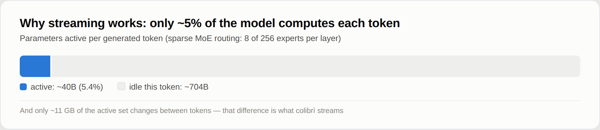
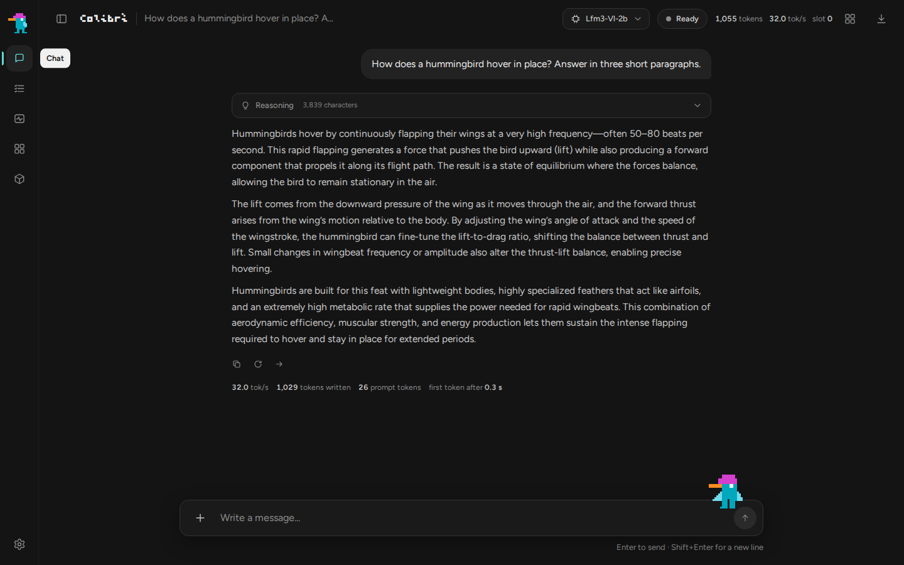
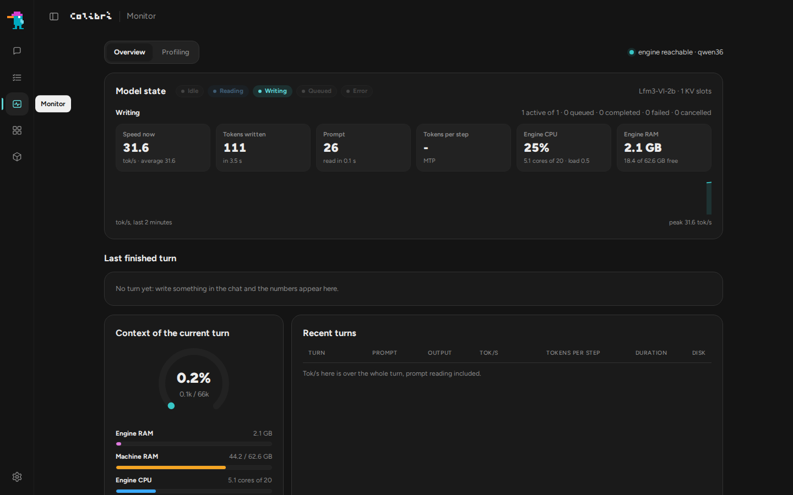
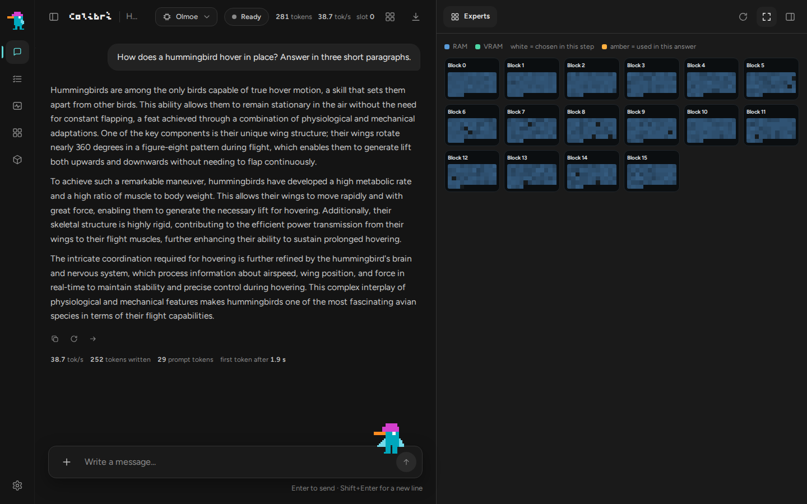
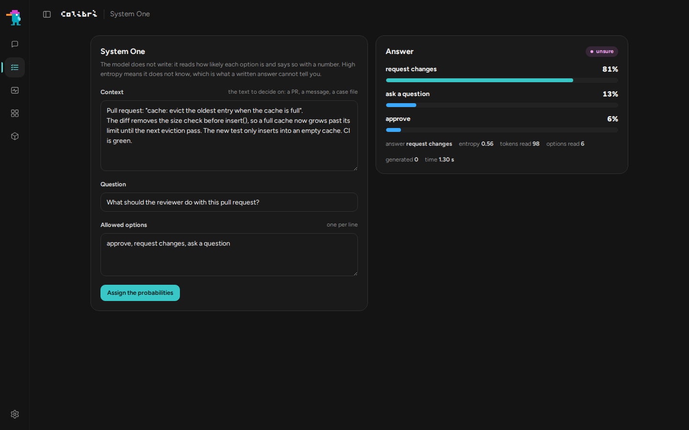
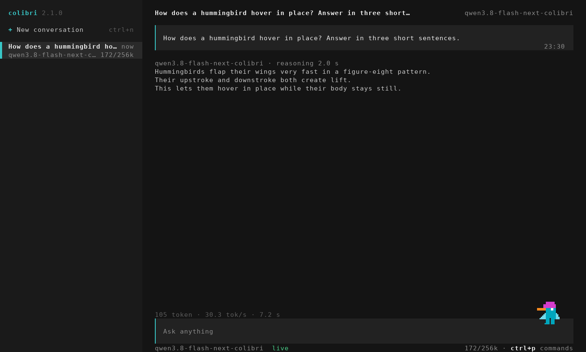
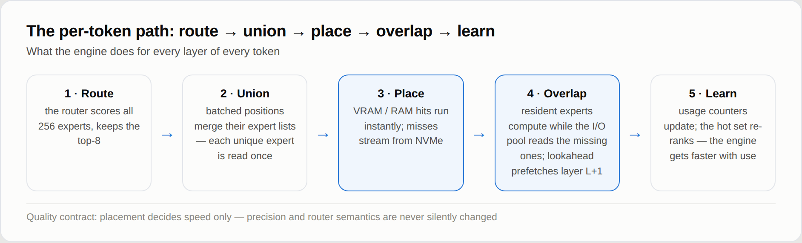
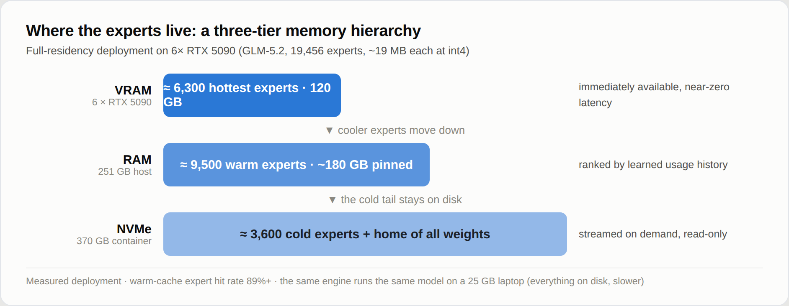
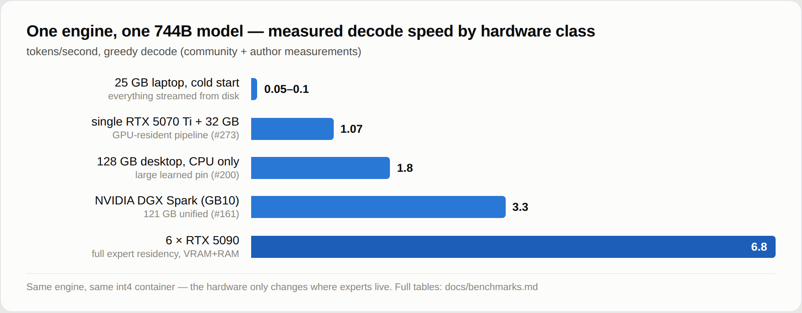

<p align="center">
  
</p>

<p align="center">
  <a href="https://justvugg.github.io/colibri"></a>
  <a href="https://github.com/JustVugg/colibri/releases"></a>
</p>

<p align="center">
  <a href="https://justvugg.github.io/colibri"><b>Site web</b></a> ·
  <a href="https://discord.gg/RXV83nSZdk"><b>Discord</b></a> ·
  <a href="README.md">English</a> · <a href="README.zh-CN.md">简体中文</a> · <a href="README.zh-TW.md">繁體中文</a> · <a href="README.it.md">Italiano</a> · <a href="README.ja.md">日本語</a> · <a href="README.id.md">Bahasa Indonesia</a> · <a href="README.pt-BR.md">Português (Brasil)</a> · <a href="README.es.md">Español</a> · Français · <a href="README.de.md">Deutsch</a> · <a href="README.ru.md">Русский</a>
</p>

**Moteur minuscule, modèle immense.** colibri fait tourner de très grands modèles
ouverts sur la machine que vous avez déjà. Un modèle mixture-of-experts de
centaines de milliards de paramètres n'utilise qu'une petite partie de lui-même
pour chaque token : colibri garde cette partie en RAM et lit le reste, les
experts, depuis le disque quand le modèle les demande. C pur, un fichier par
famille de modèles, aucun GPU requis.

Treize moteurs fonctionnent aujourd'hui. Dix sont pour les modèles de langage :
**GLM-5.2/5.3** (qui fait aussi tourner **Mistral-Large-4**), **GLM-5.3-Flash**,
**Inkling**, **Kimi K3** (et K3.1 Pro), **DeepSeek V4 Flash**, **DeepSeek V4.1
Flash**, **MiMo-V2.6 Flash** (et Pro), **Qwen3.8-Flash-Next**, **Qwen3.6** (qui
fait aussi tourner Qwen3-Coder, le Qwen3.8-27B dense, **Flint**, **Muse Spark
Open** et **LFM3-VL**) et **OLMoE**. Un dessine des images : **Qwen-Image-2.1**.
Deux répondent à des décisions : **Laya** et **GLiNER2.5-Decide**, avec un
troisième modèle de décision, **Clef**, sur le moteur Qwen3.6. Les modèles de
langage fonctionnent aussi à partir des fichiers GGUF déjà publiés, lus tels
quels ([GGUF](docs/gguf.md)), sur le CPU, sur n'importe quel GPU via Vulkan et
sur les cartes NVIDIA via CUDA. [Lequel pour ma machine](#which-model-for-my-machine)

```
$ ./coli chat
  colibri v2.1.0 · GLM-5.2 · 744B MoE · int4 · streaming CPU
  ✓ ready in 32s · resident 9.9 GB
  › ciao!
  ◆ Ciao! Come posso aiutarti oggi?
```

<p align="center">
  <a href="https://www.buymeacoffee.com/justvugg"></a>
  <br>
  <sub>colibri est gratuit et open source. S'il a gagné une place sur votre machine, un café aide à financer le prochain moteur et la prochaine accélération.</sub>
</p>

<a id="get-started"></a>
<a id="the-one-step-way"></a>

## Démarrer en une seule étape

Il vous faut un ordinateur avec **8 GB de RAM** au minimum (16 GB ou plus, c'est
mieux), **22 GB libres sur le disque** pour le plus petit modèle, et une connexion
Internet. Une carte graphique est facultative.

**Windows**

1. Sur cette page, cliquez sur **Code**, puis **Download ZIP**, et décompressez l'archive.
2. Double-cliquez sur **`START-HERE.bat`** dans le dossier décompressé. Si Python
   est absent, il propose de l'installer pour vous.

**Linux** (Ubuntu et Debian ; les autres distributions ont les mêmes paquets sous
leurs propres noms)

```bash
sudo apt install git python3 build-essential
git clone https://github.com/JustVugg/colibri
cd colibri
./start-here.sh
```

**macOS** (avec [Homebrew](https://brew.sh))

```bash
xcode-select --install
brew install libomp git python
git clone https://github.com/JustVugg/colibri
cd colibri
./start-here.sh
```

Vous répondez à une question, quel modèle, et Entrée accepte la recommandation.
Ensuite, l'installation :

1. **analyse votre machine** : RAM, disque libre, CPU et GPU ;
2. **recommande un modèle qui tient** : la partie du modèle qui reste toujours en
   RAM, plus un cache minimal d'experts, doit tenir dans votre RAM, et le
   téléchargement sur votre disque ;
3. **obtient le moteur** : elle le compile pour votre machine quand un compilateur
   est présent, sinon elle télécharge la version précompilée, qui fonctionne sur
   le CPU et, sous Linux et Windows, aussi sur un GPU Vulkan. Elle compile pour
   votre GPU quand cela en vaut la peine : CUDA pour une carte NVIDIA sous Linux
   quand le CUDA toolkit est installé, sinon Vulkan. Sur un GPU dédié, elle le fait
   toujours ; sur un GPU intégré, qui partage la RAM du CPU, seulement pour les
   modèles mesurés plus rapides là-bas (Qwen3.6, Qwen3-Coder et
   Qwen3.8-Flash-Next). Si un paquet manque, elle affiche la commande exacte pour
   l'installer et continue avec le CPU ; relancez ensuite l'installation et elle
   recompile pour le GPU ;
4. **télécharge le modèle** avec progression et reprise : arrêtez-le quand vous
   voulez, relancez-le et il reprend là où il s'était arrêté ;
5. **démarre colibri et ouvre le tableau de bord** dans votre navigateur, et
   affiche les adresses que les autres applications peuvent utiliser :

```
Starting colibri
  Browser:             http://127.0.0.1:8000/
  OpenAI base URL:     http://127.0.0.1:8000/v1
  Anthropic base URL:  http://127.0.0.1:8000
  stop: press Ctrl+C here (or close this window)
```

**La fois suivante**, relancez `START-HERE.bat` ou `./start-here.sh` : colibri
démarre tout de suite, sans téléchargement ni compilation. `c/coli status` indique
ce qui est installé et si cela fonctionne, `c/coli stop` l'arrête (`c\coli.cmd status`
et `c\coli.cmd stop` sous Windows).

Les options se placent après `./start-here.sh` ou `START-HERE.bat` :

| Option | Ce qu'elle fait |
|---|---|
| `--list` | chaque modèle comparé à cette machine, et la raison pour laquelle un modèle ne convient pas |
| `--model ID` | installe ce modèle (les identifiants figurent dans [les tableaux ci-dessous](#which-model-for-my-machine)) |
| `--yes` | sans questions : accepte la recommandation |
| `--dir DIR` | place les modèles sur un autre disque (par défaut `~/colibri-models`) |
| `--backend vulkan`, `cuda` ou `cpu` | choisit vous-même la version du moteur ; `--no-gpu` équivaut à `--backend cpu` |
| `--model-dir DIR` | utilise un modèle que vous avez déjà téléchargé |
| `--reconfigure` | choisit un autre modèle |

Le détail de chaque étape : [docs/quickstart.md](docs/quickstart.md#the-one-step-way).

### En cas de problème

| Ce que vous voyez | Quoi faire |
|---|---|
| elle s'est arrêtée pendant le téléchargement | relancez la même commande : elle reprend à partir des octets déjà sur le disque |
| `to use the GPU through ..., first run: <command>` | lancez cette commande, puis l'installation à nouveau : elle recompile pour le GPU et ne télécharge pas une seconde fois |
| `the ... build failed`, par exemple `Unsupported gpu architecture` quand le CUDA toolkit installé ne prend plus en charge la carte | l'installation vérifie d'abord le toolkit par rapport à la carte et choisit Vulkan toute seule, en indiquant pourquoi ; si une compilation échoue encore, elle passe à la suivante (Vulkan, puis le CPU). `./start-here.sh --backend vulkan` force Vulkan ; `--no-gpu` reste sur le CPU |
| `needs N GB free for the download` | `--dir` avec un dossier sur un disque plus grand |
| sous WSL, le dossier du modèle est sous `/mnt/c` | gardez-le sur le disque Linux (par défaut `~/colibri-models`) : `/mnt/c` est beaucoup plus lent |
| vous avez mis à jour le dépôt (`git pull`) | relancez `./start-here.sh` : il recompile le moteur si les sources ont changé, puis le démarre |
| autre chose | `c/coli logs -n 50` affiche le journal d'un serveur lancé en arrière-plan (celui lancé au premier plan écrit dans son propre terminal), et `c/coli logs --install` celui de l'installation ; ouvrez une [issue](https://github.com/JustVugg/colibri/issues) avec les dernières lignes affichées par l'installation |

### Laissez votre assistant IA l'installer

Si vous utilisez un assistant de programmation IA, il peut tout faire pour vous.
Demandez-lui :

> Installe colibri sur cette machine en suivant docs/AI_SETUP.md depuis https://github.com/JustVugg/colibri

[docs/AI_SETUP.md](docs/AI_SETUP.md) donne à l'assistant chaque étape sous forme
de commande avec un résultat lisible par une machine, et lui demande de vous
interroger avant de télécharger un modèle ou d'installer un paquet système. Les
assistants compatibles avec le Model Context Protocol peuvent utiliser le serveur
MCP de colibri : `coli mcp` propose des outils pour détecter le matériel,
recommander un modèle, installer, démarrer, arrêter et vérifier
([docs/MCP_SERVER.md](docs/MCP_SERVER.md)).

### Ou à la main

Pour choisir chaque étape vous-même (une version précompilée ou une compilation
depuis les sources, n'importe quel modèle des tableaux ci-dessous, puis `coli chat`,
`coli web` ou `coli serve`), voir [Installer à la main](#install-by-hand), ou le
[guide de démarrage rapide](docs/quickstart.md) pour chaque plateforme, pas à pas.

## Ce qu'est colibri, et pourquoi

Un modèle mixture-of-experts est énorme sur le disque et petit par token.
GLM-5.2 compte 744B paramètres, en utilise environ 40B pour chaque token, et seuls
environ 11 GB de ces paramètres changent d'un token à l'autre : les experts routés.

<p align="center">
  
</p>

Le modèle n'a donc pas besoin de tenir dans une mémoire rapide : il doit être
**placé**. La partie dense (attention, experts partagés, embeddings) reste en RAM.
Les experts routés restent sur le disque et sont lus quand le routeur les demande,
à travers un cache qui apprend quels experts votre travail utilise. Un GPU, quand
il y en a un, garde les experts les plus sollicités et les couches denses. L'endroit
où se trouve un poids change la vitesse de la réponse, pas les poids ni les
décisions du routeur qui la produisent.

Pourquoi : faire tourner des modèles de cette taille sur le matériel que les gens
possèdent déjà, les regarder travailler (le tableau de bord montre chaque expert au
moment où il s'active), et garder le moteur assez petit pour que chacun puisse le
mesurer et l'accélérer. colibri est aussi une plateforme de recherche ouverte : une
optimisation mérite sa place grâce à une mesure reproductible de bout en bout, et
la politique par défaut ne modifie jamais en silence la précision du modèle ni la
sémantique du routeur. Moins de mémoire rapide peut coûter de la vitesse ; elle ne
doit pas redéfinir discrètement le modèle. [Comment ça marche](#how-it-works)
donne les détails.

<a id="which-model-for-my-machine"></a>

## Quel modèle pour ma machine

L'installation recommande le modèle le plus capable qui tourne depuis la RAM de
votre machine, et liste juste en dessous les plus grands qui se diffusent depuis le
disque.
`./start-here.sh --list` les affiche tous par rapport à votre machine. Les tableaux
suivent le catalogue de l'installation ([`c/setup_catalog.py`](c/setup_catalog.py)) ;
les téléchargements correspondent aux tailles que Hugging Face indique pour chaque
dépôt.

- **RAM** se compose de deux nombres : en dessous du premier, le modèle ne démarre
  pas ; à partir du second, il tourne comme mesuré.
- **GPU** désigne ce que l'installation peut compiler pour ce moteur ([GPU](#gpus)).
  *Intégré aussi* signifie qu'il utilise aussi un GPU intégré, là où ces moteurs
  ont été mesurés plus rapides ; les autres n'utilisent qu'un GPU dédié.
- **Mesuré** correspond à ce qui a été chronométré sur la machine indiquée, la
  vitesse de décodage pour les modèles de chat. Les lettres désignent les machines
  listées sous les tableaux. Une case vide signifie que personne ne l'a encore
  mesuré.

**Petits modèles, qui tournent depuis la RAM**

| Modèle | `--model` | Téléchargement | RAM | GPU | Mesuré |
|---|---|---|---|---|---|
| **Qwen3.6-35B-A3B** : chat avec réflexion et outils | `qwen36-35b` | 23 GB | 10 / 20 GB | CUDA, Vulkan (intégré aussi) | 6.0 tok/s sur le CPU, 9.9 avec Vulkan sur le GPU intégré (A) ; 30.0 avec CUDA (C) |
| Qwen3-Coder-30B-A3B : code et appels d'outils, sans réflexion | `qwen3-coder-30b` | 19 GB | 8 / 18 GB | CUDA, Vulkan (intégré aussi) | 8.5-9.6 tok/s avec tous les experts en RAM, 5.1 avec 32 par couche (A, CPU) |
| **Qwen-Image-2.1** : texte vers image, licence non commerciale | `qwen-image-2.1` | 33 GB | 12 / 18 GB | Vulkan | une image 768x512 en 2 min 40 s (8 cœurs Zen 4, CPU) |

**Grands modèles, dont les experts sont lus depuis le disque** (le disque fixe la
vitesse : un SSD NVMe rapide aide le plus)

| Modèle | `--model` | Téléchargement | RAM | GPU | Mesuré |
|---|---|---|---|---|---|
| DeepSeek V4 Flash REAP 150B : 132 des 256 experts | `deepseek-v4-flash-reap` | 85 GB | 16 / 32 GB | CUDA, Vulkan | |
| **DeepSeek V4 Flash** (284B) : outils | `deepseek-v4-flash` | 167 GB | 16 / 32 GB | CUDA, Vulkan | 0.93 tok/s avec 32 GB (Ryzen 7 5800X), 1.24 avec 63 GB (Ryzen 9 5950X), CPU seul ; 1.5-1.6 avec CUDA (RTX 5080, 32 GB, deux NVMe) |
| **MiMo-V2.6 Flash** (309B) : vision et outils | `mimo-v2.6-flash` | 172 GB | 32 / 52 GB | Vulkan | 2.34-3.37 tok/s (A, CPU) |
| **Qwen3.8-Flash-Next** (125B + 51B n-gram) : vision et outils | `qwen38-flash-next` | 186 GB | 24 / 32 GB | CUDA, Vulkan (intégré aussi) | 1.91-2.56 tok/s avec 32 à 96 experts par couche ; 3.99 avec les experts int4 optionnels (A, CPU) |
| **GLM-5.2** (744B) : le modèle de référence, avec la tête MTP | `glm-5.2` | 429 GB | 16 / 24 GB | CUDA, Vulkan | 0.05-0.1 tok/s à froid sur un portable de 25 GB ; 1.83 sur un Ryzen AI Max+ 395 de 128 GB ; 9.0-9.2 sur 6x RTX 5090 |
| GLM-5.3 (744B) : le même moteur, sans tête MTP | `glm-5.3` | 419 GB | 16 / 24 GB | CUDA, Vulkan | |
| **Inkling** (975B) : experts int4, poids denses bf16 | `inkling` | 514 GB | 120 / 128 GB tel quel ; 25 GB après une [conversion dense](docs/inkling.md) | CUDA, Vulkan | 0.25 tok/s (Ryzen 9 7900, 187 GB, RTX A6000) |
| MiMo-V2.6 Pro (1.02T) : vision et outils | `mimo-v2.6-pro` | 564 GB | 54 / 64 GB | Vulkan | 0.66-0.79 tok/s (A, CPU) |
| **Kimi K3** (2.8T) : le plus grand | `kimi-k3` | 1.56 TB | 32 / 64 GB | CUDA, Vulkan | environ 9.4 s par token, experts lus à 6.3 GB/s |
| **Kimi K3.1 Pro** (2.8T) : K3 avec attention creuse au-delà de 2048 tokens | `kimi-k3.1-pro` | 1.56 TB | 32 / 64 GB | CUDA, Vulkan | |

<a id="other-supported-models"></a>

**À la main : une étape de conversion ou de préparation après le téléchargement**

| Modèle | Téléchargement, puis sur le disque | RAM | GPU | Mesuré |
|---|---|---|---|---|
| **OLMoE** (7B) : petit, pour apprendre les outils | 14 GB, 7 GB après conversion en int8 | 8 GB | Vulkan | 22-23 tok/s (A, CPU) |
| Qwen3.8-27B (dense) : texte et images | 56 GB, 51 GB après conversion | 20 GB en int4, 30 GB en int8 | Vulkan | 3.45 tok/s en int4, 2.1 en int8 (serveur CPU à 16 threads) |
| **GLM-5.3-Flash** (321B) : vision et outils | 328 GB, converti shard par shard en 195 GB | 25 GB | CUDA, Vulkan | environ 20 s par token à chaud, 44 s à froid (6 cœurs, 25 GB, disque ordinaire) |
| **DeepSeek V4.1 Flash** (552B) : vision et outils, sans conversion mais avec une préparation unique | 510 GB | environ 18 GB plus le cache d'experts (pic de 24.8 GB avec 8 par couche) | Vulkan | 0.21-0.24 tok/s (serveur CPU à 16 threads détenant 68% des experts) |

<a id="from-a-gguf"></a>

**Depuis un GGUF : les fichiers publiés, lus tels quels**

`./coli import` prend le premier fichier d'un GGUF (ses autres parties à côté de
lui) et écrit un dossier de modèle à côté ; passez ce dossier avec `--model`,
comme pour tout autre ([gguf.md](docs/gguf.md)). Rien n'est reconverti ni
requantifié : les blocs s'exécutent tels que le fichier les contient, de IQ1_S à
Q8_0, F16, BF16 et MXFP4. Les moteurs de chaque modèle de langage ci-dessus lisent
aussi les GGUF ([les architectures](docs/gguf.md#supported-architectures)) ; ces
modèles sont publiés sous forme de GGUF :

| Modèle | GGUF | GPU | Mesuré |
|---|---|---|---|
| **Mistral-Large-4** (1T, 52B actifs) : texte, images, raisonnement et outils | unsloth, UD-IQ1_S 233 GB | CUDA, Vulkan | 1.34-1.36 tok/s avec CUDA, 1.16-1.17 avec Vulkan (D) |
| **Muse Spark Open** (816B, 42B actifs) : texte et outils, sous l'accord de licence de Meta | unsloth, de UD-IQ1_S 176 GB à UD-Q4_K_XL 505 GB | CUDA, Vulkan | 1.55-1.58 tok/s avec Vulkan, 1.34-1.40 avec CUDA, 0.83-0.89 sur le CPU (D) |
| **Flint** (40B, 2.5B actifs) : texte et outils, Apache 2.0 | unsloth, de UD-IQ1_M 11.4 GB à BF16 79.6 GB | CUDA, Vulkan | UD-Q4_K_XL : 77.4 tok/s avec CUDA, 77.7 avec Vulkan, 15.8 sur le CPU (D) |
| **LFM3-VL-2B** : texte, images et outils, LFM Open License | LiquidAI, de QAD-Q4_0 à BF16 (ou le checkpoint, converti) | CUDA, Vulkan | Q4_K_M : 235.1 tok/s avec CUDA, 214.1 avec Vulkan, 34.5 sur le CPU (D) |
| **Qwen-Image-2.1** et sa version **Turbo** : texte vers image, licence non commerciale ([qwen-image.md](docs/qwen-image.md#gguf-unsloth)) | unsloth, de Q2_K 2.5 GB à F16 14.2 GB, avec un GGUF Qwen3-VL-8B-Instruct comme encodeur de texte | Vulkan | Turbo Q4_K_M, 1024x1024 en 8 étapes : 37 s de débruitage avec Vulkan (D) ; à 512x512, 8.4-9.3 s par étape sur le CPU (A) |

Les modèles plus grands des tableaux ci-dessus, depuis leurs GGUF, sur la même
machine : [Benchmarks](#large-models-on-the-same-machine).

**Modèles de décision** (ils répondent aux questions de [System One](#system-one-a-decision-with-a-probability), ils ne conversent pas)

| Modèle | Téléchargement, puis sur le disque | RAM | GPU | Mesuré |
|---|---|---|---|---|
| **Laya** (Convai Innovations), anglais | 0.85 GB | 1.7 GB | CPU, CUDA | 219 ms pour une question, 882 ms pour trois (B) ; douze en 0.69 s avec CUDA, 11.4-13.0 s sur le CPU (D) |
| **GLiNER2.5-Decide** (fastino), anglais | 1.95 GB | 1.9 GB | CPU, CUDA | 294 ms pour une question, 897 ms pour trois (B, sous charge) ; douze en 0.16-0.21 s avec CUDA, 2.0-2.6 s sur le CPU (D) |
| **Clef** (Cloudflare) : Qwen3.8-27B avec une tête de décision, il converse aussi | 55 GB, 52 GB après conversion | 19 GB en int4 à 55 GB en f16 | CPU | 20.4 s par requête en int8 (A) |

Les machines :
**A** un ordinateur de bureau Ryzen 7 PRO 8700GE (8 cœurs, 61-64 GB DDR5, NVMe,
Radeon 780M intégrée) ;
**B** un portable i7-1355U ;
**C** une RTX 3070 8 GB dans une machine Threadripper 3945WX, avec les couches
denses et les couches DeltaNet sur la carte (conteneur int4 par ligne) ;
**D** un i5-13500 avec 62 GB de RAM, une RTX PRO 4000 Blackwell SFF (24 GB) et deux
disques NVMe en réseau md : la machine des [tableaux de benchmarks](#benchmarks).
Chaque chiffre provient de la page de son modèle dans [docs/](docs/) ou des
[tableaux de benchmarks](docs/benchmarks.md), avec les réglages exacts.

Chaque famille a sa page : [qwen36.md](docs/qwen36.md) (Qwen3.6, Qwen3-Coder,
Qwen3.8-27B, Flint, Muse Spark Open, LFM3-VL), [mistral-large4.md](docs/mistral-large4.md),
[gguf.md](docs/gguf.md), [qwen38.md](docs/qwen38.md), [deepseek-v4.md](docs/deepseek-v4.md),
[deepseek-v41.md](docs/deepseek-v41.md), [mimo.md](docs/mimo.md),
[glm53-flash.md](docs/glm53-flash.md), [inkling.md](docs/inkling.md),
[kimi_k3.md](docs/kimi_k3.md), [qwen-image.md](docs/qwen-image.md),
[laya.md](docs/laya.md), [gliner_decide.md](docs/gliner_decide.md),
[clef.md](docs/clef.md), et GLM-5.2 dans le [Démarrage rapide](docs/quickstart.md#3-get-the-model).
Les checkpoints ayant la même architecture qu'un modèle pris en charge, comme
KAT-Coder v2.5 sur le moteur Qwen3.6, fonctionnent sans modification.

<a id="gpus"></a>

## GPU

### Aucun GPU requis

Chaque moteur fonctionne sur le CPU sans rien d'autre à installer. Un GPU est un
endroit plus rapide où garder les poids, pas une condition : pour les grands
modèles, c'est le disque qui fixe la vitesse ; pour les petits, c'est la RAM.

### Vulkan : n'importe quel GPU

Chaque moteur MoE peut utiliser n'importe quel GPU doté d'un pilote Vulkan 1.2
(AMD, Intel, NVIDIA, intégré ou dédié) de deux façons :

- **le niveau experts** : un cache des experts routés dans la mémoire du GPU,
  rempli au démarrage à partir des experts utilisés par vos conversations passées,
  et qui s'adapte pendant que vous discutez. Le GPU calcule les experts qu'il
  détient pendant que le CPU calcule les autres ;
- **la chaîne dense** : une couche entière enregistrée comme une seule soumission
  au GPU, avec l'état courant du modèle conservé sur le GPU d'une couche à la
  suivante.

Mesuré sur le Radeon 780M intégré de la machine A, les fichiers du modèle retirés
du cache de pages avant chaque exécution, 100 tokens décodés
([vulkan.md](docs/vulkan.md#the-chain-on-a-radeon-780m)) :

| | CPU | Vulkan, niveau experts | Vulkan, niveau et chaîne dense |
|---|---|---|---|
| Qwen3.6-35B-A3B, décodage | 6.0 tok/s | 8.0 tok/s | **9.9 tok/s** |
| Qwen3.6-35B-A3B, un prompt de 512 tokens | 35.7 s | 12.2 s | **9.5 s** |
| Qwen3.8-Flash-Next (experts int4), décodage | 3.5 tok/s | **3.8 tok/s** | 3.2 tok/s |
| Qwen3.8-Flash-Next, un prompt de 512 tokens | 43.6 s | 38.7 s | **30.1 s** |
| OLMoE, décodage (à chaud) | **23.1 tok/s** | 12.8 tok/s | 17.3 tok/s |

Un GPU intégré partage la RAM du CPU. Ce qu'il économise, ce sont le calcul et les
lectures disque des experts qu'il détient : cela rapporte sur un modèle comme
Qwen3.6, et un petit modèle dont les experts sont déjà en RAM, comme OLMoE, peut y
perdre. C'est pourquoi l'installation n'active Vulkan sur un GPU intégré que pour
Qwen3.6, Qwen3-Coder et Qwen3.8-Flash-Next, et pourquoi chaque moteur décide lui-même
s'il exécute la chaîne dense là (Qwen3.6 oui, Qwen3.8 non). `--backend vulkan`
demande Vulkan quand même.

**Activer ou désactiver le GPU.** `coli setup --backend vulkan` utilise le GPU pour
n'importe quel modèle, et `coli setup --backend cpu` (ou `--no-gpu`) garde tout sur
le CPU. Un moteur compilé avec Vulkan n'utilise le GPU qu'avec `COLI_VULKAN=1` dans
l'environnement de `coli chat`, `serve` ou `web` (l'installation le définit quand
elle a choisi Vulkan) ; sans cela, le moteur tourne sur le CPU. GPU activé,
`COLI_VK_CHAIN=0` garde le niveau experts et exécute les couches denses sur le CPU.
Sur un GPU intégré, essayez les deux : sur un portable avec un Intel Iris Xe
(Core i7-1355U), Qwen3.6 décodait à 2.1 tok/s sur le CPU, 1.7 à 1.9 avec Vulkan, et
2.1 avec la chaîne dense désactivée.

Sur un GPU dédié, l'installation compile Vulkan pour chaque moteur (CUDA d'abord,
quand le moteur le propose et que le toolkit est installé), avec les couches denses
sur la carte. C'est le cas pour lequel la conception a été faite. Sur une RTX PRO
4000 (24 GB, machine D), Qwen3.6-35B-A3B décode à 92.9 tok/s et lit un prompt à
2,076, OLMoE à 299.4 et 6,867 ([le tableau](#three-backends-on-one-machine)). Un
modèle plus grand que la carte garde dans un pool hôte en RAM les experts que la
carte ne peut pas contenir, et à chaque étape le CPU calcule ceux-là pendant que la
carte calcule les siens, dans la même trame : Qwen3.8-Flash-Next IQ2_XS (68 GB) y
décode à 50.6 tok/s ([vulkan.md](docs/vulkan.md#the-routed-experts-in-the-frame-vk_dmoeh)).
Un utilisateur a mesuré Qwen3.6 à 17 à 19 tok/s sur une Tesla V100 16 GB
([#1852](https://github.com/JustVugg/colibri/issues/1852)). Les mesures de votre
carte sont les bienvenues.

**Les cartes sans Resizable BAR fonctionnent désormais.** Une telle carte (toutes les
cartes Turing, les cartes Ampere avec leur firmware de lancement, les anciennes
cartes AMD avec l'option désactivée) ne laisse le CPU écrire directement que
environ 256 MB de sa mémoire ; colibri copie désormais les poids à travers un tampon
de transit, de lui-même. Le chemin est testé en le forçant et en émulant la petite
fenêtre sur trois appareils ; il ne coûte rien de mesurable sur le 780M. Il n'a pas
été mesuré sur une carte sans Resizable BAR
([vulkan.md](docs/vulkan.md#memory-placement-without-resizable-bar)).

La CI vérifie le chemin Vulkan de chaque moteur contre les tokens du CPU sur un
pilote logiciel. Le GPU additionne les nombres dans un autre ordre et garde certaines
activations en f32 là où le CPU les arrondit ; une longue réponse peut donc s'écarter
de celle du CPU d'un mot ([vulkan.md](docs/vulkan.md#the-other-engines)).

### CUDA : cartes NVIDIA

L'installation compile CUDA sous Linux quand le CUDA toolkit est installé, pour les
moteurs qui ont un chemin CUDA : GLM-5.2/5.3 et Mistral-Large-4, GLM-5.3-Flash,
Inkling, Kimi K3, DeepSeek V4 Flash, DeepSeek V4.1 Flash, MiMo-V2.6,
Qwen3.8-Flash-Next, et Qwen3.6 avec les modèles qu'il fait tourner ; OLMoE et les
moteurs de décision se compilent avec `make <engine> CUDA=1`. Sous Windows, le moteur
CUDA est une DLL séparée ([windows.md](docs/windows.md)), et chaque version publiée
l'embarque déjà compilée : `colibri-<version>-windows-x86_64-cuda.zip` contient
`coli_cuda.dll` (cartes de capacité de calcul 8.0 et plus récentes) et les moteurs
colibri, glm53, qwen36 et kimi_k3 qui le chargent, avec les DLL CUDA propres à
DeepSeek V4. Décompressez-la par-dessus l'archive principale et l'installation
choisit CUDA.

- **Chaque couche sur la carte** pour Qwen3.6, Qwen3.8 et OLMoE : les couches
  denses, l'attention et les experts routés que la carte détient s'exécutent comme
  une seule chaîne, et les experts qu'elle ne détient pas s'exécutent sur le CPU.
  Sur une RTX PRO 4000, Qwen3.6-35B-A3B UD-Q4_K_M décode à 104.8 tok/s et lit un
  prompt à 3,491, OLMoE à 354.6 et 10,418 ([le tableau](#three-backends-on-one-machine)).
- **Un niveau d'experts routés sur la carte pour chaque moteur** (`cu_tier.h`), et
  les matrices denses dessus pour DeepSeek V4, V4.1, Kimi K3, GLM-5.3 et MiMo
  (`cu_dense.h`).
- **Les blocs d'un GGUF sur la carte** (`cuda_bd.cuh`) : chaque type de bloc ggml
  de 32 poids ou plus, chaque ligne telle que le fichier la contient ; un prompt
  passe par les tensor cores ([gguf.md](docs/gguf.md)).
- **Le niveau d'experts en VRAM** garde sur la carte les experts les plus sollicités,
  choisis à partir du routage mesuré ; les défauts sont calculés sur le CPU en même
  temps. Qwen3.6 sur deux cartes de 8 GB (RTX 3070 et Quadro RTX 4000) a décodé à
  11.3 tok/s avec un historique chaud ([qwen36-cuda-tier.md](docs/qwen36-cuda-tier.md)) ;
  GLM-5.2 sur six RTX 5090 avec chaque expert résident, 9.0-9.2 tok/s
  ([benchmarks.md](docs/benchmarks.md)) ; DeepSeek V4 Flash sur une RTX 5080,
  1.5-1.6 tok/s et un prompt de 3,324 tokens en 90 s
  ([deepseek-v4.md](docs/deepseek-v4.md)).
- **Les couches DeltaNet de Qwen3.6 sur la carte** (`Q36_DN_GPU=1`, sur option).
  Chacune des 30 couches DeltaNet de Qwen3.6 copiait auparavant ses données entre la
  carte et le CPU quatre fois par token ; désormais, un token de décodage exécute la
  couche entière sur la carte, avec son état récurrent conservé en VRAM. Sur une RTX
  3070 avec les couches denses en VRAM : 25.4 à 30.0 tok/s
  ([qwen36-cuda-tier.md](docs/qwen36-cuda-tier.md#the-deltanet-layer-on-the-card-q36_dn_gpu1)).
- **Cartes plus anciennes.** Si le CUDA toolkit ne compile plus pour votre carte
  (CUDA 13 et une V100, dans [#1852](https://github.com/JustVugg/colibri/issues/1852)),
  l'installation le constate avant de compiler et utilise la carte via Vulkan, en
  indiquant pourquoi ; un CUDA toolkit 12.x rétablit le chemin CUDA. Le niveau CUDA
  de DeepSeek V4 se compile aussi pour Pascal et Turing
  (`CUDA_ARCH=portable-pre-ampere NO_TC=1`).

Tout cela : [docs/cuda.md](docs/cuda.md).

### Apple Silicon

Un backend Metal effectue les calculs d'experts sur le GPU à mémoire unifiée pour
plusieurs moteurs ([docs/metal.md](docs/metal.md)). L'archive macOS de la version
contient `colibri`, `inkling` et `kimi_k3` compilés avec lui : `COLI_METAL=1`
(`K3_METAL=1` pour Kimi K3) l'active, et sans cela ils tournent sur le CPU. Depuis
les sources, compilez avec `METAL=1` ; l'installation en une étape compile pour le
CPU.

<a id="system-one-mode-ask-a-closed-question"></a>
<a id="system-one-a-decision-with-a-probability"></a>

## System One : une décision avec une probabilité

La plupart de ce qu'on demande à un modèle relève du choix, pas du paragraphe :
quelle file, quel verdict, oui ou non. `POST /v1/systemone` accepte un état (texte
ou JSON) et des questions typées, et répond à chacune par la probabilité de chaque
option autorisée et une confiance. Rien n'est généré : aucune réponse ne peut sortir
de votre liste, et « le modèle n'est pas sûr » est un nombre sur lequel on peut
poser un seuil.

```bash
curl -s http://127.0.0.1:8000/v1/systemone -H 'Content-Type: application/json' -d '{
  "state": "340 lines, 8 files, no tests. CI is green but nothing covers that path.",
  "questions": {
    "review": {"type": "choice", "instructions": "What should the reviewer do?",
               "criteria": {"merge": null, "request changes": null, "close": null}},
    "risky":  {"type": "noul", "instructions": "Is this change risky?"}}}'
```

Un `choice` renvoie l'étiquette choisie, une probabilité pour chaque étiquette et une
`confidence` de 0 (plat) à 1 (certain) ; un `noul` renvoie la probabilité de oui ;
un `score` renvoie le niveau attendu.

Qui répond :

- **N'importe quel modèle de chat que colibri fait tourner**, par scoring : il lit la
  probabilité de chaque option au lieu d'écrire une réponse. Plusieurs questions sur
  un même document ne lisent le document qu'une fois : sur Qwen3.6, quatre questions
  sur un même document sont revenues 5.7x plus vite que la génération des mêmes
  réponses sur la même machine CPU.
- **Trois modèles de décision**, nativement, en une seule passe avant avec la
  calibration ajustée par leurs auteurs : [Laya](docs/laya.md) (Convai Innovations),
  [GLiNER2.5-Decide](docs/gliner_decide.md) (fastino) et [Clef](docs/clef.md)
  (Cloudflare ; il converse aussi). Leurs tailles et vitesses figurent dans
  [le tableau des modèles de décision](#which-model-for-my-machine).

**Passer depuis Jev.** La requête et la réponse sont celles de l'API Jev de TypeSafe ;
un client Jev passe donc à colibri en changeant seulement son URL de base, rien
d'autre : `TYPESAFE_BASE_URL=http://127.0.0.1:8000` (la clé qu'il envoie déjà est
acceptée par un serveur démarré sans `COLI_API_KEY`). Les deux SDK officiels, sans
modification, sont testés contre `coli serve`.

Le même mode existe dans le terminal (`/decide merge | request changes | close` dans
`coli chat`) et sur la page System One du tableau de bord. La requête et la réponse
complètes, les règles de scoring et les cas où cela n'aide pas :
[docs/systemone.md](docs/systemone.md).

## Le tableau de bord

`coli web` l'ouvre, et l'installation en une étape aussi : le chat, la page System One,
le Brain et la page Profiling, en thème clair ou sombre.

### L'interface de chat

`coli ui` ouvre le nouveau chat à côté d'un `coli serve` en cours d'exécution : le
raisonnement dans son propre bloc, des images pour les modèles dotés d'une tour de
vision, la recherche web, la carte des experts, un moniteur en direct, et des agents
de programmation déjà pointés vers colibri à l'ouverture. Sept langues. Voir
[ui/README.md](ui/README.md).

<p align="center">
  
</p>
<p align="center"><em>LFM3-VL-2B sur le CPU d'un i5-13500, 32 tok/s.</em></p>

<p align="center">
  
</p>
<p align="center"><em>Le <strong>moniteur</strong> pendant que LFM3-VL-2B écrit : 31.6 tok/s, le prompt lu en 0.1 s, 2.1 GB de RAM.</em></p>

<p align="center">
  
</p>
<p align="center"><em>OLMoE avec la <strong>carte des experts</strong> ouverte à côté du chat : une case par expert dans chaque bloc, blanche quand elle est choisie à cette étape,
ambre quand elle est utilisée dans cette réponse.</em></p>

<p align="center">
  
</p>
<p align="center"><em><strong>System One</strong> : donnez au modèle un document et les seules réponses qu'il peut choisir. Ici Qwen3.6-35B sur une RTX PRO 4000
lit une pull request qui dépasse la limite de taille d'un cache : <strong>request changes à 81%</strong>, entropie 0.56 (incertain), 98 tokens lus, 0 généré.</em></p>

La page **Profiling** montre où chaque tour consacre son temps, phase par phase,
avec les 30 derniers tours en tendance. Avec [joules](https://pypi.org/project/landauer-gap/)
installé à côté de la passerelle (`pip install landauer-gap`), elle affiche aussi les
watts de la machine et les joules par token du dernier tour.

### L'interface du terminal

`coli tui` est le même chat dans un terminal, un seul fichier C sans bibliothèques :
les conversations, la réponse diffusée avec son raisonnement replié, le moniteur
(`F2`) avec le CPU et la RAM du moteur, le GPU et sa VRAM ainsi que le profil de
chaque tour, la carte des experts (`ctrl+e`), et le colibri de la page de chat, dessiné
en image là où le terminal affiche du sixel (Windows Terminal, foot, WezTerm). Il se
rattache à un `coli serve` en cours d'exécution, ou en démarre un avec `--model`. Voir
[docs/tui.md](docs/tui.md).

<p align="center">
  
</p>
<p align="center"><em>Qwen3.8-Flash-Next sur une RTX PRO 4000 via <code>coli serve</code>, avec un contexte de 256K.</em></p>

## Utiliser depuis d'autres applications

`coli serve` (que l'installation démarre pour vous) est un serveur unique avec
plusieurs API :

- **compatible OpenAI** : `/v1/chat/completions`, `/v1/completions` et `/v1/models`,
  avec streaming, réponses JSON, séquences d'arrêt et logprobs ;
- **compatible Anthropic** : `/v1/messages`, donc Claude Code et les SDK Anthropic
  fonctionnent avec lui ;
- **appels d'outils** sur chaque moteur de chat sauf Inkling et OLMoE, chacun dans le
  format natif de son modèle ([le tableau par moteur](docs/api.md#tool-calling-support)) ;
- **images en entrée** sur GLM-5.3-Flash, DeepSeek V4.1 Flash, MiMo-V2.6,
  Qwen3.8-Flash-Next, Qwen3.8-27B, LFM3-VL et Mistral-Large-4 (depuis un GGUF, avec le
  fichier `mmproj` à côté) : un chemin dans un message de `coli chat`, une pièce jointe
  dans `coli web` ou `coli ui`, ou une partie `image_url` ;
- **documents en entrée** sur chaque moteur de chat : `/file PATH` dans `coli chat`
  (ou `coli chat --file PATH`) envoie le texte d'un fichier texte ou d'un PDF avec le
  message suivant. Seul un fichier nommé ainsi est lu, jamais un chemin à l'intérieur
  d'un message ; il doit être un fichier ordinaire avec un suffixe texte ou `.pdf`,
  dans la limite de 64 MiB et de 2 millions de caractères. Un PDF est analysé dans un
  processus séparé avec une limite de temps et de mémoire, par `pdftotext` (poppler)
  ou `pypdf` ;
- **images en sortie** avec Qwen-Image-2.1 sur `POST /v1/images/generations`, et
  dessinées dans le terminal par `coli chat` ([qwen-image.md](docs/qwen-image.md)) ;
- **décisions** sur `POST /v1/systemone` ([ci-dessus](#system-one-a-decision-with-a-probability)) ;
- **plusieurs conversations à la fois** sur chaque moteur de texte : `coli serve
  --kv-slots N` en garde jusqu'à 16, chacune avec son propre cache, et décode leurs
  prochains tokens ensemble ([api.md](docs/api.md#isolated-kv-contexts)).

Les CLI de programmation et les éditeurs se connectent comme à n'importe quel
fournisseur compatible OpenAI : URL de base `http://127.0.0.1:8000/v1`, l'identifiant
de modèle affiché par `coli status`, n'importe quelle clé non vide
([docs/api.md](docs/api.md#connect-a-coding-cli-or-editor)).

<a id="how-it-works"></a>

## Comment ça marche

<p align="center">
  
</p>

Chaque couche de chaque token suit les mêmes cinq étapes : routage, union, placement,
chevauchement, apprentissage. L'objectif de conception est que **le placement ne
décide jamais que de la vitesse** : les décisions du routeur et la précision des
poids sont les mêmes, qu'un expert ait répondu depuis la VRAM, depuis la RAM ou
depuis le disque.

<p align="center">
  
</p>

- **Un JIT pour les poids.** Un JIT de compilateur ne compile jamais tout le
  programme : il observe ce qui s'exécute et compile les chemins chauds. colibri fait
  le même pari sur les poids. La chaleur de routage mesurée décide quels experts
  méritent la VRAM, la RAM ou le disque : un cache LRU par couche, plus un ensemble
  chaud épinglé appris à partir de vos propres conversations (`.coli_usage`, mis à
  jour à chaque tour). colibri devient plus rapide plus vous l'utilisez. Cela
  fonctionne parce que le routage a une structure mesurable (l'
  [atlas des experts](https://github.com/JustVugg/colibri/issues/175)).
- **Ne jamais attendre le disque deux fois.** Les trois matrices d'un expert sont
  lues en un seul `pread` ; un pool de chargeurs lit les experts manquants pendant
  que les experts résidents calculent ; un lot de positions lit chaque expert une
  seule fois ; un thread de lookahead du routeur peut précharger la couche suivante
  (le routage de GLM-5.2 est prévisible à 71.6% une couche à l'avance). `DIRECT=1`
  (O_DIRECT) apporte souvent un gain important sur les SSD NVMe rapides, et il est
  neutre, voire pire, sur d'autres : mesurez sur le vôtre ([tuning.md](docs/tuning.md)).
- **Plus d'un SSD.** `COLI_MODEL_MIRROR=/second/glm52_i4 ./coli chat --model /fast/glm52_i4`
  lit depuis une copie sur un second disque. Deux disques NVMe sur des contrôleurs
  indépendants ont mesuré +37.5% de décodage ; un miroir partiel sur un disque plus
  petit fonctionne aussi ([multidisk.md](docs/multidisk.md)).
- **D'un portable à une baie.** Sur un portable de 25 GB, chaque expert est lu depuis
  le disque, lentement mais correctement ; sur un grand hôte, chaque expert est
  résident (`CUDA_EXPERT_GB=auto PIN_GB=all`) et le disque disparaît du décodage.
  `COLI_NUMA=1` répartit les poids résidents sur les contrôleurs mémoire d'un hôte
  multi-socket, et un mode de cluster local fait exécuter les experts routés sur
  d'autres machines ([cluster.md](docs/cluster.md)).
- **Un modèle fidèle.** Chaque moteur est vérifié en CI contre l'implémentation de
  référence de son modèle, sur un petit jeu de test. L'attention MLA de GLM-5.2
  conserve un état KV compressé (576 floats par token au lieu de 32,768, 57 fois plus
  petit) qui survit aux redémarrages, si bien qu'une conversation se rouvre sans prompt
  à relire.
- **La spéculation qui se justifie.** La tête MTP int8 de GLM-5.2 propose 2.2-2.8
  tokens par passe avant quand cela rapporte ; la tête MTP de Qwen3.8-Flash-Next,
  activée par défaut, ajoute 16-20% avec la même sortie, et la recherche par prompt
  6-7% sur les modifications de code. La tête de Qwen3.6 (`Q36_MTP=1`) fait passer son
  décodage de 99.7-104.5 à 115.8-120.1 tok/s sur CUDA, et de 83.2-83.8 à 99.9-109.3 sur
  Vulkan (une RTX PRO 4000). La tête DSpark de DeepSeek V4.1 propose des brouillons
  aussi profonds que sa confiance le permet, et une porte écarte les brouillons qui ne
  peuvent pas rapporter. Quand le brouillonnage coûte plus qu'il ne fait gagner
  (DeepSeek V4), il reste désactivé ([speculative.md](docs/speculative.md),
  [tuning.md](docs/tuning.md#speculation-and-reproducibility)).

Le moteur est un fichier C par famille de modèles (`c/colibri.c` pour GLM-5.2) au-dessus
d'en-têtes partagés, sans BLAS et sans Python à l'exécution : Python ne sert qu'à
l'installation, au lanceur, aux convertisseurs et à la passerelle API.

<a id="what-it-achieves"></a>
<a id="benchmarks"></a>

## Benchmarks

<p align="center">
  
</p>

Le même moteur et le même conteneur int4 : le matériel ne change que l'endroit où
vivent les experts. Décodage de GLM-5.2, depuis [les tableaux complets](docs/benchmarks.md) :

- **6x RTX 5090, chaque expert résident :** 5.8-6.8 tok/s, 9.0-9.2 avec l'entrelacement
  NUMA sélectif ([journal d'expérience](docs/experiments/glm52-6x5090-2026-07-12.md)) ;
- **128 GB, CPU seul** (Ryzen AI Max+ 395) : 1.83 tok/s à chaud
  ([#200](https://github.com/JustVugg/colibri/issues/200)) ;
- **une machine de classe portable avec une RTX 5070 Ti :** 1.07 tok/s
  ([#273](https://github.com/JustVugg/colibri/issues/273)) ;
- **le portable de 25 GB d'où tout est parti :** 0.05-0.1 tok/s à froid, le plancher honnête.

<a id="three-backends-on-one-machine"></a>

### Trois backends sur une machine

Un i5-13500 avec 62 GB de RAM et une RTX PRO 4000 Blackwell SFF (24 GB, 70 W), chaque
modèle servi par `coli serve` : un prompt neuf de 450 tokens, puis une réponse diffusée
de 128 tokens, HTTP de la requête compris ; le meilleur de deux passages, en tok/s.

| GGUF | prompt CUDA | décodage CUDA | prompt Vulkan | décodage Vulkan | prompt CPU | décodage CPU |
|---|---:|---:|---:|---:|---:|---:|
| Qwen3.6-35B-A3B UD-Q4_K_M | 3,491 | 104.8 | 2,076 | 92.9 | 122.6 | 13.9 |
| LFM3-VL-2B Q4_K_M | 12,317 | 235.1 | 8,174 | 214.1 | 286.5 | 34.5 |
| OLMoE-1B-7B-0125-Instruct Q4_K_M | 10,418 | 354.6 | 6,867 | 299.4 | 279.9 | 47.4 |
| LFM3-VL-2B F16 | 11,524 | 103.4 | 7,767 | 99.3 | 49.7 | 6.4 |
| Qwen3.8-Flash-Next IQ2_XS (68 GB : les experts que la carte ne peut pas contenir restent en RAM) | 217.1 | 51.4 | 214.3 | 50.6 | 38.3 | 9.3 |

<a id="large-models-on-the-same-machine"></a>

### Grands modèles sur la même machine

Encore la machine D, chaque modèle depuis son GGUF publié, via `coli serve` : ce que
ne contiennent ni la carte ni la RAM vient des deux disques NVMe. Tokens par seconde,
depuis la page de chaque modèle :

| GGUF | taille | backend | prompt | décodage |
|---|---:|---|---:|---:|
| Inkling-Small UD-IQ2_XXS | 77 GB | Vulkan | 15.1-33.1 | 10.92-11.53 ([vulkan.md](docs/vulkan.md)) |
| MiMo-V2.6-Flash Q2_K_S | 106 GB | Vulkan | 8.2 | 7.8 ([gguf.md](docs/gguf.md)) |
| DeepSeek V4 Flash 0731 UD-IQ2_XXS | 85 GB | Vulkan | 19.7-20.4 | 6.18-6.25 ([vulkan.md](docs/vulkan.md)) |
| DeepSeek V4.1 Flash UD-IQ1_S | | Vulkan | 31.8 sur 3,403 tokens | 5.01-5.29 ([deepseek-v41.md](docs/deepseek-v41.md)) |
| GLM-5.3-Flash UD-IQ2_XXS | 95 GB | Vulkan | 9.3 | 2.92-3.40 ([vulkan.md](docs/vulkan.md)) |
| Muse Spark Open UD-IQ1_S | 176 GB | Vulkan | 5.0-5.3 | 1.55-1.58 ([qwen36.md](docs/qwen36.md#muse-spark-open)) |
| Mistral-Large-4 UD-IQ1_S | 233 GB | CUDA | 240 tokens en 66-82 s | 1.34-1.36 ([mistral-large4.md](docs/mistral-large4.md)) |
| GLM-5.2 UD-IQ1_S | 202 GB | Vulkan | | 0.633-0.658 ([gguf.md](docs/gguf.md)) |
| Kimi K3 UD-IQ1_S | 594 GB | Vulkan | 31 tokens en 46.5 s | 0.349 ([gguf.md](docs/gguf.md)) |

### Contextes longs et agents

- **Un contexte de 256k à la vitesse de 64k.** Qwen3.8-Flash-Next IQ2_XS sur la chaîne
  CUDA de la machine D, avec un contexte de 262,144 tokens : prompt 15.6 -> 151 tok/s,
  décodage 9.6 -> 42.9 (le plan RAM sur un seul segment de prompt, K/V en float16 sur la
  carte ; à 65,536 il lit 208 et décode 52.2, à 131,072 190 et 51.9)
  ([qwen38.md](docs/qwen38.md)).
- **Les tours d'un agent ne lisent que ce qui est nouveau.** Une requête courte entre
  deux tours (un agent qui demande le titre de la conversation) met la conversation en
  attente au lieu de prendre son état, sur chaque moteur (`COLI_PARK`). Deuxième tour de
  Hermes Agent sur Qwen3.8-Flash-Next, 14,810 tokens : 86 s -> 4.9 s
  ([qwen38.md](docs/qwen38.md#an-agents-turns)).
- **Caches KV en float16** : GLM-5.3 à 131,072 tokens occupe 11.9 GB au lieu de 23.9
  ([CHANGELOG](CHANGELOG.md)).

La qualité se mesure, elle ne se suppose pas : le coût du conteneur int4 et les
ablations de quantification sont dans
[benchmarks.md](docs/benchmarks.md#quality-benchmark). Pour ajouter votre machine,
suivez [le protocole de benchmark](docs/benchmarking.md) et ouvrez une issue avec les
chiffres.

<a id="install-by-hand"></a>

## Installer à la main

<a id="1-get-colibri"></a>

**1. Le programme.** Prenez l'archive de votre plateforme sur
[Releases](https://github.com/JustVugg/colibri/releases) (Linux x86_64, macOS,
Windows ; aucun compilateur requis, seulement [Python 3](https://www.python.org/downloads/)
pour le lanceur et l'API) et décompressez-la, puis `python3 coli info`. Les moteurs
Linux et Windows ont Vulkan intégré, avec leurs `shaders/` à côté, et ceux de macOS
ont Metal ; pour une carte NVIDIA sous Windows, ajoutez l'archive CUDA. Ou compilez
depuis les sources avec `gcc` (ou clang) et OpenMP :

```bash
git clone https://github.com/JustVugg/colibri && cd colibri/c
./setup.sh                                # checks gcc/OpenMP, builds, self-tests
make qwen36 VK=1                          # one engine, here with Vulkan (CUDA=1 for CUDA)
```

<a id="2-get-the-model"></a>

**2. Un modèle.** N'importe quel téléchargement des [tableaux ci-dessus](#which-model-for-my-machine) :
les identifiants de l'installation correspondent à des dépôts Hugging Face, et la page
de chaque modèle donne la commande de téléchargement et de conversion. Pour GLM-5.2,
utilisez le conteneur à échelle par groupe (gs64) avec la tête MTP int8,
[`mastouri/GLM-5.2-colibri-int4-g64-with-int8-mtp`](https://huggingface.co/mastouri/GLM-5.2-colibri-int4-g64-with-int8-mtp)
(429 GB), ou [`Justvugg/GLM-5.3-colibri-int4-g64`](https://huggingface.co/Justvugg/GLM-5.3-colibri-int4-g64)
pour GLM-5.3 (419 GB, sans tête MTP). Pas les anciens miroirs int4 par ligne : ils
mesurent environ 9 points de moins en qualité et ont provoqué les réponses en boucle de
[#455](https://github.com/JustVugg/colibri/issues/455). `./coli convert --model
/nvme/glm52_i4` construit le même conteneur à partir de la version FP8, shard par shard,
sans jamais avoir besoin de ses 756 GB sur le disque en même temps. Pour vérifier la
tête MTP et le reste : [quickstart.md](docs/quickstart.md#3-get-the-model). Un GGUF que
vous avez déjà n'a pas besoin de conversion : faites `./coli import` sur son premier
fichier ([ci-dessus](#from-a-gguf)).

<a id="3-run-it"></a>

**3. Lancez-le.** Depuis `c/` dans une copie des sources, ou depuis la version
décompressée. Le lanceur lit le `config.json` du modèle et choisit le moteur et son
gabarit de chat, donc les commandes sont les mêmes pour chaque modèle :

```bash
./coli chat  --model /nvme/qwen36          # chat in the terminal
./coli web   --model /nvme/qwen36          # API + dashboard, opens a browser
./coli serve --model /nvme/qwen36          # API + dashboard, no browser
./coli plan  --model /nvme/qwen36          # where the model will live: VRAM, RAM, disk
./coli doctor --model /nvme/qwen36         # read-only check: is everything ready?
./coli tune  --model /nvme/qwen36          # measure and save this machine's fastest safe settings
./coli import /nvme/Flint-UD-Q4_K_XL.gguf  # a GGUF: writes Flint-UD-Q4_K_XL.colibri next to it
./coli ui                                  # the chat UI, next to a running coli serve
./coli tui                                 # the chat in the terminal, on a running coli serve (or --model)
```

Sous Windows, une archive de version contient `coli.cmd` (`coli.cmd chat --model
D:\qwen36`); depuis une copie des sources, utilisez `py -3 c\coli`. Les fichiers `.exe`
sont les moteurs, pas le lanceur. Chaque option et variable :
[SETTINGS.md](docs/SETTINGS.md), [ENVIRONMENT.md](docs/ENVIRONMENT.md).

<a id="research-and-how-to-help"></a>

## Recherche, et comment aider

colibri veut que les modèles de pointe dépendent moins d'un matériel rare et coûtent
moins cher à faire tourner. Cela suppose de changer la façon dont les poids sont
stockés et déplacés, de décider ce qui vit en VRAM, en RAM ou sur le stockage, de
faire se chevaucher le travail du CPU et celui du GPU, et de tester de nouvelles
façons de décoder. Rien n'est conservé parce que c'est conventionnel, et rien n'est
adopté parce qu'un microbenchmark semble rapide : le résultat décisif est l'inférence
de bout en bout sur de vraies machines, avec la qualité mesurée en parallèle de la
vitesse. Les questions ouvertes :

| hypothèse | preuves à ce jour | expérience encore nécessaire |
|---|---|---|
| L'historique de routage peut placer les experts mieux qu'un simple LRU | les épinglages appris améliorent les charges répétées, mais peuvent sur-apprendre un prompt | A/B hors échantillon et entre sessions, sur du code, du chat, du multilingue et des charges à contexte long |
| Plusieurs SSD peuvent transformer une bande passante indépendante en vitesse de décodage | deux disques NVMe indépendants ont mesuré +37.5% de décodage ; un troisième disque plus lent était neutre après striping pondéré ([measurements](docs/multidisk.md#what-has-been-measured)) | reproduire avec différentes vitesses de disque, dispositions de contrôleurs et états de cache |
| Un planificateur sensible au matériel peut approcher automatiquement la meilleure configuration de chaque machine | les budgets RAM/VRAM et plusieurs backends sont détectés aujourd'hui, et l'installation choisit la compilation | comparer le plan généré avec un balayage contrôlé de paramètres sur portables, stations de travail, hôtes NUMA et systèmes multi-GPU |
| Des représentations sans perte ou à qualité bornée peuvent réduire assez le déplacement des poids pour compter | des ablations de format et de quantification existent, avec des portes de correction et de qualité | reproduire qualité, octets déplacés, latence et coût par token utile ensemble, et pas seulement le taux de compression |
| La spéculation sensible au routage peut rapporter avant une résidence presque complète | les brouillons MTP et grammaticaux fonctionnent, mais le MTP a aussi mesuré une perte de 32% autour de 85% de succès des experts | cartographier la surface de seuil de rentabilité selon l'acceptation, le taux de succès des experts, l'union de lot et la profondeur du brouillon |
| Le recouvrement CPU/GPU peut masquer transferts et synchronisation au lieu de simplement déplacer le goulot | des gains CUDA, Metal et Vulkan existent, mais des CPU rapides, des GPU intégrés et une faible résidence peuvent les effacer | profils par étape et A/B à une seule variable sur des machines PCIe, à mémoire unifiée et à résidence complète, et davantage de cartes dédiées pour le niveau Vulkan et la chaîne que la seule mesurée (une RTX PRO 4000) |

Vous voulez aider ? Choisissez une ligne et publiez aussi les résultats négatifs.
Notez le matériel, le commit, le modèle, la commande exacte, le prompt, l'état du
cache, le débit, le temps jusqu'au premier token, le taux de succès des experts, les
octets lus et un contrôle de qualité ; changez une seule variable, répétez, et joignez
les journaux bruts. Commencez par [CONTRIBUTING.md](CONTRIBUTING.md) et
[le protocole de benchmark](docs/benchmarking.md), puis
[ouvrez une issue](https://github.com/JustVugg/colibri/issues/new). Un échec bien
contrôlé vaut plus ici qu'un chiffre rapide sans explication.

## Documentation

| sujet | document |
|---|---|
| L'installation en une étape et l'installation à la main, toutes plateformes | [quickstart.md](docs/quickstart.md) |
| Installer via un assistant IA, et le serveur MCP | [AI_SETUP.md](docs/AI_SETUP.md), [MCP_SERVER.md](docs/MCP_SERVER.md) |
| L'API : OpenAI, Anthropic, outils, slots KV, tableau de bord | [api.md](docs/api.md) |
| System One et les modèles de décision | [systemone.md](docs/systemone.md), [laya.md](docs/laya.md), [gliner_decide.md](docs/gliner_decide.md), [clef.md](docs/clef.md) |
| Fichiers GGUF : les architectures, les deux modes, ce que fait chaque moteur des blocs | [gguf.md](docs/gguf.md) |
| Les modèles du moteur Qwen3.6 (Flint, Muse Spark Open, LFM3-VL) et Mistral-Large-4 | [qwen36.md](docs/qwen36.md), [mistral-large4.md](docs/mistral-large4.md) |
| L'interface de chat (`coli ui`) | [ui/README.md](ui/README.md) |
| L'interface du terminal (`coli tui`) | [tui.md](docs/tui.md) |
| Vulkan : le niveau d'experts, la chaîne dense, les cartes sans Resizable BAR | [vulkan.md](docs/vulkan.md) |
| CUDA, et le niveau CUDA de Qwen3.6 | [cuda.md](docs/cuda.md), [qwen36-cuda-tier.md](docs/qwen36-cuda-tier.md) |
| Apple Silicon, Windows | [metal.md](docs/metal.md), [windows.md](docs/windows.md) |
| Réglages, cache d'apprentissage, préchargement | [tuning.md](docs/tuning.md) |
| Décodage spéculatif : les têtes MTP, la recherche par prompt, la porte | [speculative.md](docs/speculative.md) |
| Plusieurs SSD, plusieurs machines | [multidisk.md](docs/multidisk.md), [cluster.md](docs/cluster.md) |
| Benchmarks et comment mesurer | [benchmarks.md](docs/benchmarks.md), [benchmarking.md](docs/benchmarking.md) |
| Chaque option et variable d'environnement | [SETTINGS.md](docs/SETTINGS.md), [ENVIRONMENT.md](docs/ENVIRONMENT.md) |
| Brouillons contraints par grammaire, et les ABI d'intégration expérimentales | [grammar-draft.md](docs/grammar-draft.md), [segment-runtime.md](docs/segment-runtime.md), [edge-runtime.md](docs/edge-runtime.md) |

## Organisation du dépôt

```
start-here.sh, START-HERE.bat   the one-step setup (Linux and macOS, Windows)
Makefile                        root build/check entry point
c/
├── colibri.c             GLM-5.2/5.3, Mistral-Large-4  (make glm)
├── glm53.c               GLM-5.3-Flash  (make glm53)
├── inkling.c             Inkling  (make inkling)
├── kimi_k3.c             Kimi K3  (make kimi_k3)
├── deepseek_v4.c         DeepSeek V4 Flash  (make deepseek-v4)
├── deepseek_v41.c        DeepSeek V4.1 Flash  (make deepseek_v41)
├── mimo.c                MiMo-V2.6 Flash and Pro  (make mimo)
├── qwen38.c              Qwen3.8-Flash-Next  (make qwen38)
├── qwen36.c              Qwen3.6, Qwen3-Coder, Qwen3.8-27B, Flint, Muse Spark,
│                         LFM3-VL, Clef  (make qwen36)
├── olmoe.c               OLMoE  (make olmoe)
├── qwenimage.c           Qwen-Image-2.1  (make qwenimage)
├── laya.c                Laya  (make laya)
├── gliner_decide.c       GLiNER2.5-Decide  (make gliner_decide)
├── tui.c                 the terminal UI, a client of coli serve  (make colibri-tui)
│
├── st.h, quant.h, idot.h        safetensors reads, container decoders, integer kernels
├── expert_ffn.h, expert_store.h routed-expert kernel and streaming expert cache
├── tok.h, json.h, compat.h      tokenizer, JSON, Windows/macOS shims
├── route_trace.h, kv_prefix.h   routing telemetry (.coli_usage), KV prefix reuse
├── gguf.h, park.h               GGUF reader, a conversation parked between an agent's turns
├── decide_serve.h               the decision engines' side of System One
│
├── backend_cuda.*, cu_tier.h, cuda_chain.cu   optional CUDA tier and chains (CUDA=1)
├── backend_metal.*       optional Metal tier  (METAL=1)
├── backend_vulkan.*, vk_tier.c, vk_chain.c   optional Vulkan tier and dense chain (VK=1)
│
├── coli                  user-facing CLI
├── setup_*.py            the one-step setup: hardware, catalog, downloads, flow
├── mcp_server.py         the MCP server (coli mcp)
├── openai_server.py      OpenAI- and Anthropic-compatible HTTP gateway
├── resource_plan.py      RAM/VRAM planner behind coli plan and coli doctor
├── tools/                conversion, fixtures and benchmarks
└── tests/                dependency-free C and Python tests
ui/                       the chat UI (coli ui)
web/                      the dashboard (a pure API client)
desktop/                  Tauri desktop shell around the dashboard
docker/                   container images
docs/                     reference docs, experiments, media
site/                     the website
```

**Un `.c` par famille de modèles, au-dessus d'en-têtes partagés.** Un moteur possède son
architecture et rien d'autre ; tout ce dont deux moteurs ont besoin vit dans un en-tête
qu'ils incluent tous les deux, si bien qu'une correction les atteint tous d'un coup.
Depuis la racine du dépôt, `make`, `make check` et `make clean` délèguent au Makefile du
moteur.

## Soutenir le projet

colibri a commencé comme projet d'une seule personne sur un portable à 12 cœurs avec
25 GB de RAM ; aujourd'hui, ses chiffres viennent d'une communauté de vraies machines.
Si le projet vous est utile :

- mettez une étoile au dépôt et partagez-le ;
- ouvrez des issues avec des chiffres de benchmark de votre matériel : ces données font
  avancer ce projet plus que tout le reste ;
- rejoignez la [communauté Discord](https://discord.gg/RXV83nSZdk) pour discuter
  d'expériences, de résultats matériels et de pistes de recherche ;
- contactez-nous via les issues GitHub pour sponsoriser le développement ou donner du
  matériel.

## Pourquoi « colibrì »

Le colibri pèse quelques grammes, reste immobile dans les airs et visite mille fleurs
par jour. Ce moteur fait vivre un géant de 744 milliards de paramètres avec des rations
de colibri : 25 GB de RAM, douze cœurs de CPU, et beaucoup de patience envers le disque.

## Remerciements

colibri n'est qu'un moteur ; les modèles qu'il fait tourner sont un cadeau. Merci aux
équipes qui publient leurs poids en accès libre : **Z.ai** (GLM), **Moonshot AI** (Kimi),
**Alibaba Qwen**, **DeepSeek**, **Xiaomi** (MiMo), **Thinking Machines** (Inkling),
**Allen AI** (OLMoE), **Convai Innovations** (Laya), **fastino** (GLiNER2.5-Decide) et
**Cloudflare** (Clef) ; aux personnes qui publient des conteneurs convertis ; et à chaque
contributeur qui a mesuré, localisé des régressions par bisection, reproduit un run de
l'atlas ou envoyé un correctif. Le code tiers de ce dépôt et ses licences :
[THIRD_PARTY_NOTICES.md](THIRD_PARTY_NOTICES.md).

Les expériences de placement, de compression et de routage des experts du projet
s'appuient aussi sur des idées et des résultats des travaux de recherche et systèmes
ouverts suivants :

- [REAP](https://github.com/CerebrasResearch/reap) et
  [EASY-EP](https://github.com/RUCAIBox/EASYEP) pour l'importance des experts tenant
  compte de la sortie et spécifique au domaine.
- [SERE](https://github.com/JL-Cheng/SERE) pour le re-routage des experts par similarité,
  et [ReMoE](https://github.com/BUAA-OSCAR/ReMoE) pour le fine-tuning du routeur sensible
  à la localité du cache.
- [MC-SMoE](https://github.com/UNITES-Lab/MC-SMoE) pour la fusion et la compression
  d'experts guidées par le routage.
- [MoBE](https://github.com/inclusionAI/MoBE) et
  [D²-MoE](https://github.com/lliai/D2MoE) pour les bases d'experts partagées et les
  deltas d'experts de bas rang.
- [HybriMoE](https://github.com/PKU-SEC-Lab/HybriMoE) pour l'ordonnancement hybride des
  experts CPU/GPU, [ScMoE](https://arxiv.org/abs/2404.05019) pour recouvrir la
  communication des experts avec le calcul, et
  [OD-MoE](https://arxiv.org/abs/2512.03927) pour le chargement distribué des experts à
  la demande.
- [vLLM](https://github.com/vllm-project/vllm),
  [llama.cpp](https://github.com/ggml-org/llama.cpp) et
  [kTransformers](https://github.com/kvcache-ai/ktransformers) pour les systèmes
  d'inférence ouverts et les travaux de déchargement d'experts qui rendent les
  comparaisons reproductibles.

Le moteur repose aussi sur des travaux d'ingénierie concrets, pas seulement sur des
idées. Chacun de ces éléments est utilisé ou réimplémenté dans l'arbre aujourd'hui :

- [safetensors](https://github.com/huggingface/safetensors) : le conteneur que lit
  chaque moteur (`c/st.h`), y compris ses dtypes fp8 et I64.
- [tiktoken](https://github.com/openai/tiktoken) : `c/tok.h` réimplémente exactement son
  `byte_pair_encode`, en fusionnant la paire adjacente dont la concaténation a le plus
  petit identifiant de vocabulaire ; un vocabulaire dérivé de tiktoken n'a donc pas
  besoin de liste de fusions.
- [llama.cpp](https://github.com/ggml-org/llama.cpp) : le sous-ensemble de grammaire GBNF
  de `c/grammar.h` suit sa syntaxe et son PDA à ensemble de piles, et le chemin Metal
  emprunte son astuce de résidence `newBufferWithBytesNoCopy`.
- [vLLM](https://github.com/vllm-project/vllm) : la référence pour la sémantique de
  sortie que le moteur reproduit position par position (par exemple l'endroit où la
  norme finale se place par rapport à la tête LM).
- [transformers](https://github.com/huggingface/transformers) : l'oracle : la CI reproduit
  un modèle à initialisation aléatoire token pour token par rapport à lui.
- [DietGPU](https://github.com/facebookresearch/dietgpu) : le codec ANS GPU derrière le
  niveau d'experts compressé expérimental (`COLI_ANS`).
- [rocWMMA](https://github.com/ROCm/rocWMMA) : le backend HIP projette dessus l'API
  `nvcuda::wmma` fragment/mma_sync de CUDA (`c/backend_gpu_compat.h`), ce qui permet à un
  même source .cu de compiler pour les deux fournisseurs.

## Licence

Apache 2.0, Copyright 2026 Vincenzo Fornaro. Voir [LICENSE](LICENSE) et [NOTICE](NOTICE).
Chaque modèle conserve la licence que ses auteurs lui ont donnée (les poids de GLM-5.2
sont publiés par Z.ai sous MIT ; Qwen-Image-2.1 est réservé à un usage non commercial).
