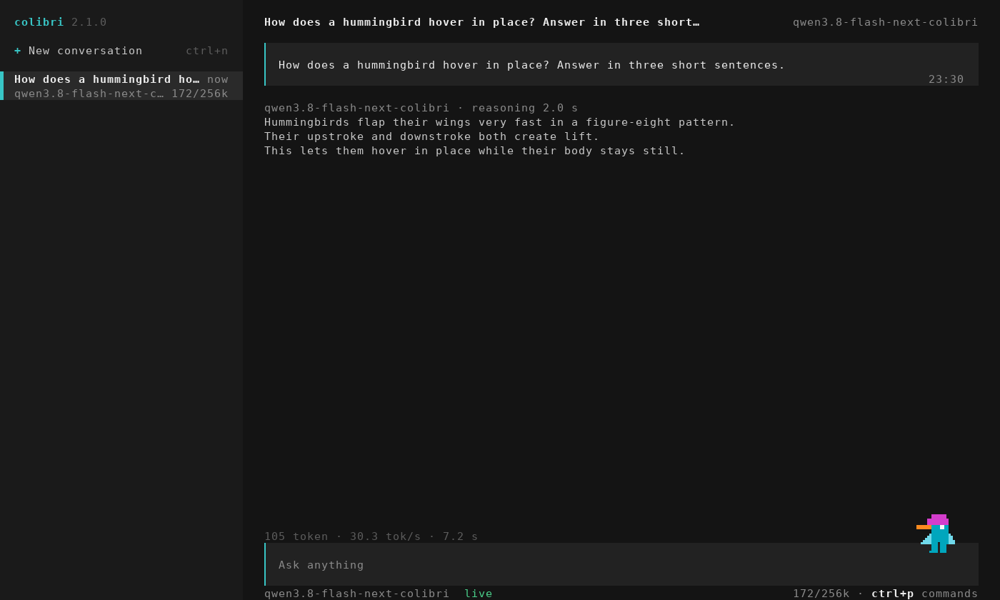

<p align="center">
  
</p>

<p align="center">
  <a href="https://justvugg.github.io/colibri"></a>
  <a href="https://github.com/JustVugg/colibri/releases"></a>
</p>

<p align="center">
  <a href="https://justvugg.github.io/colibri"><b>Sito web</b></a> ·
  <a href="https://discord.gg/RXV83nSZdk"><b>Discord</b></a> ·
  <a href="README.md">English</a> · <a href="README.zh-CN.md">简体中文</a> · <a href="README.zh-TW.md">繁體中文</a> · Italiano · <a href="README.ja.md">日本語</a> · <a href="README.id.md">Bahasa Indonesia</a> · <a href="README.pt-BR.md">Português (Brasil)</a>
</p>

**Motore piccolo, modello immenso.** colibri fa girare modelli aperti molto
grandi sulla macchina che hai già. Un modello mixture-of-experts da centinaia di
miliardi di parametri usa solo una piccola parte di sé per ogni token: colibri
tiene quella parte in RAM e legge il resto, gli expert, dal disco quando il
modello li chiede. C puro, un file per famiglia di modelli, nessuna GPU
necessaria.

Oggi girano tredici motori. Dieci sono per modelli linguistici: **GLM-5.2/5.3** (che
esegue anche **Mistral-Large-4**), **GLM-5.3-Flash**, **Inkling**, **Kimi K3**,
**DeepSeek V4 Flash**, **DeepSeek V4.1 Flash**, **MiMo-V2.6 Flash** (e Pro),
**Qwen3.8-Flash-Next**, **Qwen3.6** (che esegue anche Qwen3-Coder, il denso
Qwen3.8-27B, **Flint**, **Muse Spark Open** e **LFM3-VL**) e **OLMoE**. Uno disegna
immagini: **Qwen-Image-2.1**. Due prendono decisioni: **Laya** e
**GLiNER2.5-Decide**, con un terzo modello di decisione, **Clef**, sul motore
Qwen3.6. I modelli linguistici girano anche dai file GGUF già pubblicati, letti così
come sono ([GGUF](docs/gguf.md)), sulla CPU, su qualsiasi GPU con Vulkan e sulle
schede NVIDIA con CUDA. [Quale scegliere per la mia macchina](#which-model-for-my-machine)

```
$ ./coli chat
  colibri v2.1.0 · GLM-5.2 · 744B MoE · int4 · streaming CPU
  ✓ ready in 32s · resident 9.9 GB
  › ciao!
  ◆ Ciao! Come posso aiutarti oggi?
```

<p align="center">
  <a href="https://www.buymeacoffee.com/justvugg"></a>
  <br>
  <sub>colibri è gratuito e open source. Se si è guadagnato un posto sulla tua macchina, un caffè aiuta a pagare il prossimo motore e il prossimo salto di velocità.</sub>
</p>

<a id="get-started"></a>
<a id="the-one-step-way"></a>

## Inizia in un solo passo

Ti serve un computer con **8 GB di RAM** come minimo assoluto (meglio 16 GB o
più), **22 GB liberi sul disco** per il modello più piccolo e una connessione a
internet. La scheda grafica è facoltativa.

**Windows**

1. In questa pagina fai clic su **Code**, poi su **Download ZIP**, ed estrai
   l'archivio.
2. Fai doppio clic su **`START-HERE.bat`** nella cartella estratta. Se manca
   Python, si offre di installarlo per te.

**Linux** (Ubuntu e Debian; le altre distribuzioni hanno gli stessi pacchetti
con i loro nomi)

```bash
sudo apt install git python3 build-essential
git clone https://github.com/JustVugg/colibri
cd colibri
./start-here.sh
```

**macOS** (con [Homebrew](https://brew.sh))

```bash
xcode-select --install
brew install libomp git python
git clone https://github.com/JustVugg/colibri
cd colibri
./start-here.sh
```

Rispondi a una sola domanda, quale modello, e Invio accetta il consiglio. Poi
l'installazione:

1. **esamina la tua macchina**: RAM, disco libero, CPU e GPU;
2. **consiglia un modello che ci sta**: la parte del modello che resta sempre in
   RAM, più una cache minima di expert, deve entrare nella tua RAM, e il
   download sul tuo disco;
3. **prepara il motore**: lo compila per la tua macchina se c'è un compilatore,
   altrimenti scarica quello già compilato, che gira sulla CPU e, su Linux e
   Windows, anche su una GPU Vulkan. Lo compila per
   la tua GPU quando conviene: CUDA per una scheda NVIDIA su Linux se è
   installato il CUDA toolkit, altrimenti Vulkan. Su una GPU dedicata lo fa
   sempre; su una GPU integrata, che condivide la RAM della CPU, solo per i
   modelli che lì sono risultati più veloci nelle misure (Qwen3.6, Qwen3-Coder
   e Qwen3.8-Flash-Next). Se manca un pacchetto, stampa il comando esatto per
   installarlo e prosegue con la CPU; rilancia poi l'installazione e il motore
   viene ricompilato per la GPU;
4. **scarica il modello** mostrando l'avanzamento e con la ripresa: interrompilo
   quando vuoi, rilancialo e riparte da dove si era fermato;
5. **avvia colibri e apre la dashboard** nel browser, e stampa gli indirizzi
   che le altre app possono usare:

```
Starting colibri
  Browser:             http://127.0.0.1:8000/
  OpenAI base URL:     http://127.0.0.1:8000/v1
  Anthropic base URL:  http://127.0.0.1:8000
  stop: press Ctrl+C here (or close this window)
```

**La volta successiva**, rilancia `START-HERE.bat` o `./start-here.sh`: colibri
parte subito, senza download e senza compilazione. `c/coli status` mostra cosa è
installato e se è in esecuzione, `c/coli stop` lo ferma (`c\coli.cmd status` e
`c\coli.cmd stop` su Windows).

Le opzioni vanno dopo `./start-here.sh` o `START-HERE.bat`:

| Opzione | Cosa fa |
|---|---|
| `--list` | ogni modello confrontato con questa macchina, e il motivo per cui uno non ci sta |
| `--model ID` | installa quel modello (gli id sono nelle [tabelle qui sotto](#which-model-for-my-machine)) |
| `--yes` | nessuna domanda: accetta il consiglio |
| `--dir DIR` | mette i modelli su un altro disco (predefinito `~/colibri-models`) |
| `--backend vulkan`, `cuda` o `cpu` | scegli tu la build del motore; `--no-gpu` equivale a `--backend cpu` |
| `--model-dir DIR` | usa un modello che hai già scaricato |
| `--reconfigure` | per scegliere un altro modello |

Cosa fa ogni passo, nel dettaglio: [docs/quickstart.md](docs/quickstart.md#the-one-step-way).

### Se qualcosa va storto

| Cosa vedi | Cosa fare |
|---|---|
| si è fermato durante il download | rilancia lo stesso comando: riprende dai byte già presenti sul disco |
| `to use the GPU through ..., first run: <command>` | esegui quel comando, poi di nuovo l'installazione: ricompila per la GPU e non riscarica nulla |
| `the ... build failed`, per esempio `Unsupported gpu architecture` quando il CUDA toolkit installato non supporta più la scheda | l'installazione controlla prima il toolkit rispetto alla scheda e sceglie Vulkan da sé, spiegando perché; se una compilazione fallisce ancora, offre la prossima (Vulkan, poi la CPU). `./start-here.sh --backend vulkan` forza Vulkan; `--no-gpu` resta sulla CPU |
| `needs N GB free for the download` | `--dir` con una cartella su un disco più grande |
| su WSL, la cartella del modello è sotto `/mnt/c` | tienila sul disco Linux (il predefinito, `~/colibri-models`): `/mnt/c` è molte volte più lento |
| hai aggiornato il checkout (`git pull`) | rilancia `./start-here.sh`: ricompila il motore se i sorgenti sono cambiati, poi lo avvia |
| qualsiasi altra cosa | `c/coli logs -n 50` mostra il log del server avviato in background (quello avviato in primo piano scrive nel suo terminale) e `c/coli logs --install` quello dell'installazione; apri una [issue](https://github.com/JustVugg/colibri/issues) con le ultime righe stampate dall'installazione |

### Lascia che sia il tuo assistente AI a installarlo

Se usi un assistente AI per programmare, può fare tutto questo al posto tuo.
Chiedigli:

> Installa colibri su questa macchina seguendo docs/AI_SETUP.md da https://github.com/JustVugg/colibri

[docs/AI_SETUP.md](docs/AI_SETUP.md) dà all'assistente ogni passo sotto forma di
comando con un risultato leggibile da una macchina, e gli dice di chiederti
conferma prima di scaricare un modello o di installare un pacchetto di sistema.
Gli assistenti che parlano il Model Context Protocol possono invece usare il
server MCP di colibri: `coli mcp` offre strumenti per rilevare l'hardware,
consigliare un modello, installarlo, avviarlo, fermarlo e controllarlo
([docs/MCP_SERVER.md](docs/MCP_SERVER.md)).

### Oppure a mano

Per scegliere tu ogni passo (una release già compilata o una build dai sorgenti,
qualsiasi modello dalle tabelle qui sotto, poi `coli chat`, `coli web` o
`coli serve`), vedi [Installazione a mano](#install-by-hand), oppure la
[guida Quick Start](docs/quickstart.md), passo passo per ogni piattaforma.

## Cos'è colibri, e perché

Un modello mixture-of-experts è enorme sul disco e piccolo per token. GLM-5.2 ha
744B parametri, ne usa circa 40B per ogni token, e solo circa 11 GB di questi
cambiano da un token all'altro: gli expert instradati.

<p align="center">
  
</p>

Quindi il modello non deve stare in memoria veloce; deve essere **piazzato**. La
parte densa (attenzione, expert condivisi, embedding) resta in RAM. Gli expert
instradati restano sul disco e vengono letti quando il router li chiede,
attraverso una cache che impara quali expert usa il tuo lavoro. Una GPU, quando
c'è, tiene gli expert più caldi e i layer densi. Dove si trova un peso cambia la
velocità con cui arriva la risposta, non quali pesi o quali decisioni del router
la producono.

Perché: per far girare modelli di queste dimensioni sull'hardware che le persone
già possiedono, per guardarli lavorare (la dashboard mostra ogni expert nel
momento in cui si attiva) e per tenere il motore abbastanza piccolo da permettere
a chiunque di misurarlo e renderlo più veloce. colibri è anche una piattaforma di
ricerca aperta: un'ottimizzazione si guadagna il suo posto con una misura
end-to-end riproducibile, e la policy predefinita non cambia mai silenziosamente
la precisione del modello né la semantica del router. Meno memoria veloce può
costare velocità; non deve ridefinire il modello di nascosto. I dettagli sono in
[Come funziona](#how-it-works).

<a id="which-model-for-my-machine"></a>

## Quale modello per la mia macchina

L'installazione consiglia il modello più capace che gira dalla RAM sulla tua
macchina, e subito sotto elenca quelli più grandi, che vengono letti dal disco in
streaming. `./start-here.sh --list` li mostra tutti confrontati con la tua
macchina. Le tabelle seguono il catalogo dell'installazione stessa
([`c/setup_catalog.py`](c/setup_catalog.py)); i download sono le dimensioni che
Hugging Face indica per ciascun repository.

- **RAM** sono due numeri: sotto il primo il modello non parte, dal secondo in
  su gira come nelle misure.
- **GPU** è ciò che l'installazione può compilare per quel motore ([GPU](#gpus)).
  *Anche integrata* significa che usa anche una GPU integrata, dove questi
  motori sono risultati più veloci nelle misure; gli altri usano solo una GPU
  dedicata.
- **Misurato** è ciò che è stato cronometrato sulla macchina indicata: per i
  modelli di chat, la velocità di decode. Le lettere sono le macchine elencate
  sotto le tabelle. Una cella vuota significa che nessuno l'ha ancora misurato.

**Modelli piccoli, che girano dalla RAM**

| Modello | `--model` | Download | RAM | GPU | Misurato |
|---|---|---|---|---|---|
| **Qwen3.6-35B-A3B**: chat con thinking e tool | `qwen36-35b` | 23 GB | 10 / 20 GB | CUDA, Vulkan (anche integrata) | 6.0 tok/s sulla CPU, 9.9 con Vulkan sulla GPU integrata (A); 30.0 con CUDA (C) |
| Qwen3-Coder-30B-A3B: codice e chiamate ai tool, senza thinking | `qwen3-coder-30b` | 19 GB | 8 / 18 GB | CUDA, Vulkan (anche integrata) | 8.5-9.6 tok/s con tutti gli expert in RAM, 5.1 con 32 per layer (A, CPU) |
| **Qwen-Image-2.1**: da testo a immagine, licenza non commerciale | `qwen-image-2.1` | 33 GB | 12 / 18 GB | Vulkan | un'immagine 768x512 in 2 min 40 s (8 core Zen 4, CPU) |

**Modelli grandi, i cui expert vengono letti dal disco in streaming** (la
velocità la decide il disco: un NVMe veloce è ciò che aiuta di più)

| Modello | `--model` | Download | RAM | GPU | Misurato |
|---|---|---|---|---|---|
| DeepSeek V4 Flash REAP 150B: 132 dei 256 expert | `deepseek-v4-flash-reap` | 85 GB | 16 / 32 GB | CUDA, Vulkan | |
| **DeepSeek V4 Flash** (284B): tool | `deepseek-v4-flash` | 167 GB | 16 / 32 GB | CUDA, Vulkan | 0.93 tok/s con 32 GB (Ryzen 7 5800X), 1.24 con 63 GB (Ryzen 9 5950X), solo CPU; 1.5-1.6 con CUDA (RTX 5080, 32 GB, due NVMe) |
| **MiMo-V2.6 Flash** (309B): visione e tool | `mimo-v2.6-flash` | 172 GB | 32 / 52 GB | Vulkan | 2.34-3.37 tok/s (A, CPU) |
| **Qwen3.8-Flash-Next** (125B + 51B n-gram): visione e tool | `qwen38-flash-next` | 186 GB | 24 / 32 GB | CUDA, Vulkan (anche integrata) | 1.91-2.56 tok/s con 32-96 expert per layer; 3.99 con gli expert int4 opzionali (A, CPU) |
| **GLM-5.2** (744B): il modello di riferimento, con la testa MTP | `glm-5.2` | 429 GB | 16 / 24 GB | CUDA, Vulkan | 0.05-0.1 tok/s a freddo su un portatile da 25 GB; 1.83 su un Ryzen AI Max+ 395 da 128 GB; 9.0-9.2 su 6x RTX 5090 |
| GLM-5.3 (744B): lo stesso motore, senza testa MTP | `glm-5.3` | 419 GB | 16 / 24 GB | CUDA, Vulkan | |
| **Inkling** (975B): expert int4, pesi densi bf16 | `inkling` | 514 GB | 120 / 128 GB così come scaricato; 25 GB dopo una [conversione della parte densa](docs/inkling.md) | CUDA, Vulkan | 0.25 tok/s (Ryzen 9 7900, 187 GB, RTX A6000) |
| MiMo-V2.6 Pro (1.02T): visione e tool | `mimo-v2.6-pro` | 564 GB | 54 / 64 GB | Vulkan | 0.66-0.79 tok/s (A, CPU) |
| **Kimi K3** (2.8T): il più grande | `kimi-k3` | 1.56 TB | 32 / 64 GB | CUDA, Vulkan | circa 9.4 s per token, expert letti a 6.3 GB/s |

<a id="other-supported-models"></a>

**A mano: un passo di conversione o di preparazione dopo il download**

| Modello | Download, poi su disco | RAM | GPU | Misurato |
|---|---|---|---|---|
| **OLMoE** (7B): piccolo, per prendere confidenza con gli strumenti | 14 GB, 7 GB dopo la conversione in int8 | 8 GB | Vulkan | 22-23 tok/s (A, CPU) |
| Qwen3.8-27B (denso): testo e immagini | 56 GB, 51 GB dopo la conversione | 20 GB in int4, 30 GB in int8 | Vulkan | 3.45 tok/s in int4, 2.1 in int8 (server CPU a 16 thread) |
| **GLM-5.3-Flash** (321B): visione e tool | 328 GB, convertiti shard per shard in 195 GB | 25 GB | CUDA, Vulkan | circa 20 s per token a caldo, 44 s a freddo (6 core, 25 GB, disco normale) |
| **DeepSeek V4.1 Flash** (552B): visione e tool, nessuna conversione ma una preparazione una tantum | 510 GB | circa 18 GB più la cache degli expert (24.8 GB di picco con 8 per layer) | Vulkan | 0.21-0.24 tok/s (server CPU a 16 thread che tiene il 68% degli expert) |

<a id="from-a-gguf"></a>

**Da un GGUF: i file pubblicati, letti così come sono**

`./coli import` prende il primo file di un GGUF (le altre parti accanto) e scrive una
cartella del modello lì vicino; poi si passa quella cartella a `--model`, come per ogni altro
([gguf.md](docs/gguf.md)). Niente viene convertito né quantizzato di nuovo: i blocchi girano come
il file li contiene, da IQ1_S a Q8_0, F16, BF16 e MXFP4. Anche i motori di tutti i modelli di chat
qui sopra leggono i GGUF ([le architetture](docs/gguf.md#supported-architectures)); questi quattro
modelli arrivano come GGUF:

| Modello | GGUF | GPU | Misurato |
|---|---|---|---|
| **Mistral-Large-4** (1T, 52B attivi): testo, immagini, ragionamento e tool | unsloth, UD-IQ1_S 233 GB | CUDA, Vulkan | 1.34-1.36 tok/s con CUDA, 1.16-1.17 con Vulkan (D) |
| **Muse Spark Open** (816B, 42B attivi): testo e tool, con l'accordo di licenza di Meta | unsloth, da UD-IQ1_S 176 GB a UD-Q4_K_XL 505 GB | CUDA, Vulkan | 1.55-1.58 tok/s con Vulkan, 1.34-1.40 con CUDA, 0.83-0.89 sulla CPU (D) |
| **Flint** (40B, 2.5B attivi): testo e tool, Apache 2.0 | unsloth, da UD-IQ1_M 11.4 GB a BF16 79.6 GB | CUDA, Vulkan | UD-Q4_K_XL: 77.4 tok/s con CUDA, 77.7 con Vulkan, 15.8 sulla CPU (D) |
| **LFM3-VL-2B**: testo, immagini e tool, LFM Open License | LiquidAI, da QAD-Q4_0 a BF16 (o il checkpoint, convertito) | CUDA, Vulkan | Q4_K_M: 235.1 tok/s con CUDA, 214.1 con Vulkan, 34.5 sulla CPU (D) |

I modelli più grandi delle tabelle qui sopra dai loro GGUF, sulla stessa macchina: [Benchmark](#large-models-on-the-same-machine).

**Modelli di decisione** (rispondono alle domande di [System One](#system-one-a-decision-with-a-probability), non chattano)

| Modello | Download, poi su disco | RAM | GPU | Misurato |
|---|---|---|---|---|
| **Laya** (Convai Innovations), inglese | 0.85 GB | 1.7 GB | CPU, CUDA | 219 ms per una domanda, 882 ms per tre (B); dodici in 0.69 s con CUDA, 11.4-13.0 s sulla CPU (D) |
| **GLiNER2.5-Decide** (fastino), inglese | 1.95 GB | 1.9 GB | CPU, CUDA | 294 ms per una domanda, 897 ms per tre (B, sotto carico); dodici in 0.16-0.21 s con CUDA, 2.0-2.6 s sulla CPU (D) |
| **Clef** (Cloudflare): Qwen3.8-27B con una testa di decisione, sa anche chattare | 55 GB, 52 GB dopo la conversione | da 19 GB in int4 a 55 GB in f16 | CPU | 20.4 s per richiesta in int8 (A) |

Le macchine:
**A** un desktop Ryzen 7 PRO 8700GE (8 core, 61-64 GB DDR5, NVMe, Radeon 780M
integrata);
**B** un portatile i7-1355U;
**C** una RTX 3070 da 8 GB in una macchina Threadripper 3945WX, con i layer densi
e i layer DeltaNet sulla scheda (container int4 per-row);
**D** un i5-13500 con 62 GB di RAM, una RTX PRO 4000 Blackwell SFF (24 GB) e due
NVMe in un array md: la macchina delle [tabelle dei benchmark](#benchmarks).
Ogni numero viene dalla pagina del suo modello in [docs/](docs/) o dalle
[tabelle dei benchmark](docs/benchmarks.md), con le impostazioni esatte.

Ogni famiglia ha la sua pagina: [qwen36.md](docs/qwen36.md) (Qwen3.6, Qwen3-Coder,
Qwen3.8-27B, Flint, Muse Spark Open, LFM3-VL), [mistral-large4.md](docs/mistral-large4.md), [gguf.md](docs/gguf.md), [qwen38.md](docs/qwen38.md), [deepseek-v4.md](docs/deepseek-v4.md),
[deepseek-v41.md](docs/deepseek-v41.md), [mimo.md](docs/mimo.md),
[glm53-flash.md](docs/glm53-flash.md), [inkling.md](docs/inkling.md),
[kimi_k3.md](docs/kimi_k3.md), [qwen-image.md](docs/qwen-image.md),
[laya.md](docs/laya.md), [gliner_decide.md](docs/gliner_decide.md),
[clef.md](docs/clef.md), e GLM-5.2 nella [Quick Start](docs/quickstart.md#3-get-the-model).
I checkpoint con la stessa architettura di uno supportato, come KAT-Coder v2.5
sul motore Qwen3.6, girano senza modifiche.

<a id="gpus"></a>

## GPU

### Nessuna GPU necessaria

Ogni motore gira sulla CPU senza installare nient'altro. Una GPU è un posto più
veloce dove tenere i pesi, non un requisito: per i modelli grandi la velocità la
decide il disco, per quelli piccoli la RAM.

### Vulkan: qualsiasi GPU

Ogni motore MoE può usare qualsiasi GPU con un driver Vulkan 1.2 (AMD, Intel,
NVIDIA, integrata o dedicata) in due modi:

- **il livello degli expert**: una cache di expert instradati nella memoria
  della GPU, riempita all'avvio con gli expert usati dalle tue conversazioni
  passate e che si adatta mentre chatti. La GPU calcola gli expert che contiene
  mentre la CPU calcola il resto;
- **la catena densa**: un intero layer registrato come un unico invio alla GPU,
  con lo stato corrente del modello tenuto sulla GPU da un layer al successivo.

Misurato sulla Radeon 780M integrata della macchina A, con i file del modello
tolti dalla page cache prima di ogni esecuzione, 100 token in decode
([vulkan.md](docs/vulkan.md#the-chain-on-a-radeon-780m)):

| | CPU | Vulkan, livello degli expert | Vulkan, livello e catena densa |
|---|---|---|---|
| Qwen3.6-35B-A3B, decode | 6.0 tok/s | 8.0 tok/s | **9.9 tok/s** |
| Qwen3.6-35B-A3B, un prompt di 512 token | 35.7 s | 12.2 s | **9.5 s** |
| Qwen3.8-Flash-Next (expert int4), decode | 3.5 tok/s | **3.8 tok/s** | 3.2 tok/s |
| Qwen3.8-Flash-Next, un prompt di 512 token | 43.6 s | 38.7 s | **30.1 s** |
| OLMoE, decode (a caldo) | **23.1 tok/s** | 12.8 tok/s | 17.3 tok/s |

Una GPU integrata condivide la RAM della CPU. Quello che fa risparmiare è il
lavoro e le letture dal disco degli expert che contiene: per questo conviene su
un modello come Qwen3.6, mentre un modello piccolo i cui expert stanno già in
RAM, come OLMoE, può perderci. Ecco perché l'installazione attiva Vulkan su una
GPU integrata solo per Qwen3.6, Qwen3-Coder e Qwen3.8-Flash-Next, e perché ogni
motore decide da sé se usare lì la catena densa (Qwen3.6 sì, Qwen3.8 no).
`--backend vulkan` chiede Vulkan comunque.

**Accendere o spegnere la GPU.** `coli setup --backend vulkan` usa la GPU per
qualunque modello, e `coli setup --backend cpu` (o `--no-gpu`) tiene tutto sulla
CPU. Un motore compilato con Vulkan usa la GPU solo con `COLI_VULKAN=1`
nell'ambiente di `coli chat`, `serve` o `web` (l'installazione lo imposta quando ha
scelto Vulkan); senza, il motore gira sulla CPU. Con la GPU accesa, `COLI_VK_CHAIN=0`
tiene il tier degli expert e fa girare gli strati densi sulla CPU. Su una GPU
integrata prova entrambe le strade: su un portatile con una Intel Iris Xe (Core
i7-1355U) Qwen3.6 ha decodificato a 2,1 tok/s sulla CPU, da 1,7 a 1,9 con Vulkan
e 2,1 con la catena densa spenta.

Su una GPU dedicata l'installazione compila Vulkan per ogni motore (prima CUDA,
dove il motore ce l'ha e il toolkit è installato), con i layer densi sulla
scheda. È il caso per cui il progetto è pensato. Su una RTX PRO 4000 (24 GB,
macchina D) Qwen3.6-35B-A3B fa 92.9 tok/s in decode e legge un prompt a 2076,
OLMoE a 299.4 e 6867 ([la tabella](#three-backends-on-one-machine)). Un modello
più grande della scheda tiene gli expert che la scheda non contiene in un pool
nella RAM, e a ogni passo la CPU calcola quelli mentre la scheda calcola i suoi,
nello stesso frame: Qwen3.8-Flash-Next IQ2_XS (68 GB) fa 50.6 tok/s in decode
([vulkan.md](docs/vulkan.md#the-routed-experts-in-the-frame-vk_dmoeh)). Un utente
ha misurato Qwen3.6 da 17 a 19 tok/s su una Tesla V100 16 GB
([#1852](https://github.com/JustVugg/colibri/issues/1852)). I numeri della tua
scheda sono benvenuti.

**Le schede senza Resizable BAR** ora funzionano. Una scheda così (tutte le
Turing, le Ampere con il firmware di lancio, le AMD più vecchie con l'opzione
disattivata) lascia scrivere direttamente alla CPU solo circa 256 MB della sua
memoria; ora colibri copia i pesi passando per un buffer di staging, da solo. Il
percorso è testato forzandolo ed emulando la finestra piccola su tre
dispositivi, e non costa nulla di misurabile sulla 780M; non è stato misurato su
una scheda senza Resizable BAR
([vulkan.md](docs/vulkan.md#memory-placement-without-resizable-bar)).

La CI verifica il percorso Vulkan di ogni motore contro i token della CPU su un
driver software. La GPU somma i numeri in un ordine diverso e tiene alcune
attivazioni in f32 dove la CPU le arrotonda, quindi una risposta lunga può
discostarsi da quella della CPU di una parola
([vulkan.md](docs/vulkan.md#the-other-engines)).

### CUDA: schede NVIDIA

L'installazione compila CUDA su Linux quando è installato il CUDA toolkit, per i
motori che hanno un percorso CUDA: GLM-5.2/5.3 e Mistral-Large-4, GLM-5.3-Flash,
Inkling, Kimi K3, DeepSeek V4 Flash, DeepSeek V4.1 Flash, MiMo-V2.6,
Qwen3.8-Flash-Next, e Qwen3.6 con i modelli che esegue; OLMoE e i motori di
decisione si compilano con `make <motore> CUDA=1`. Su Windows il motore CUDA è
una DLL separata ([windows.md](docs/windows.md)), e ogni release la porta già
compilata: `colibri-<versione>-windows-x86_64-cuda.zip` contiene `coli_cuda.dll`
(schede con compute capability 8.0 o superiore) e i motori colibri, qwen36 e
kimi_k3 che la caricano, con le DLL CUDA di DeepSeek V4. Estrailo sopra
l'archivio principale e l'installazione sceglie CUDA.

- **Ogni layer sulla scheda** per Qwen3.6, Qwen3.8 e OLMoE: i layer densi,
  l'attention e gli expert che la scheda contiene girano come una sola catena, e
  quelli che non contiene girano sulla CPU. Su una RTX PRO 4000 Qwen3.6-35B-A3B
  UD-Q4_K_M fa 104.8 tok/s in decode e legge un prompt a 3491, OLMoE a 354.6 e
  10418 ([la tabella](#three-backends-on-one-machine)).
- **Un livello di expert sulla scheda per ogni motore** (`cu_tier.h`), e le
  matrici dense sulla scheda per DeepSeek V4, V4.1, Kimi K3, GLM-5.3 e MiMo
  (`cu_dense.h`).
- **I blocchi di un GGUF sulla scheda** (`cuda_bd.cuh`): ogni tipo di blocco
  ggml da 32 pesi in su, ogni riga come la tiene il file; un prompt passa dai
  tensor core ([gguf.md](docs/gguf.md)).
- **Il livello degli expert in VRAM** tiene sulla scheda gli expert più caldi,
  scelti in base al routing misurato; i miss vengono calcolati sulla CPU nello
  stesso momento. Qwen3.6 su due schede da 8 GB (RTX 3070 e Quadro RTX 4000) ha
  fatto 11.3 tok/s in decode con una cronologia calda
  ([qwen36-cuda-tier.md](docs/qwen36-cuda-tier.md)); GLM-5.2 su sei RTX 5090
  con tutti gli expert residenti, 9.0-9.2 tok/s
  ([benchmarks.md](docs/benchmarks.md)); DeepSeek V4 Flash su una RTX 5080,
  1.5-1.6 tok/s e un prompt di 3,324 token in 90 s
  ([deepseek-v4.md](docs/deepseek-v4.md)).
- **Novità per Qwen3.6: i layer DeltaNet sulla scheda** (`Q36_DN_GPU=1`,
  opt-in). Ognuno dei 30 layer DeltaNet di Qwen3.6 copiava i suoi dati tra la
  scheda e la CPU quattro volte per token; ora un token di decode esegue l'intero
  layer sulla scheda, con il suo stato ricorrente tenuto in VRAM. Su una RTX
  3070 con i layer densi in VRAM: da 25.4 a 30.0 tok/s
  ([qwen36-cuda-tier.md](docs/qwen36-cuda-tier.md#the-deltanet-layer-on-the-card-q36_dn_gpu1)).
- **Schede più vecchie.** Se il CUDA toolkit non compila più per la tua scheda
  (CUDA 13 e una V100, in [#1852](https://github.com/JustVugg/colibri/issues/1852)),
  l'installazione lo vede prima di compilare e usa la scheda tramite Vulkan,
  spiegando perché; un CUDA toolkit 12.x riporta il percorso CUDA. Il livello
  CUDA di DeepSeek V4 si compila anche per Pascal e Turing
  (`CUDA_ARCH=portable-pre-ampere NO_TC=1`).

Tutti i dettagli: [docs/cuda.md](docs/cuda.md).

### Apple Silicon

Un backend Metal esegue i calcoli degli expert sulla GPU a memoria unificata per
diversi motori ([docs/metal.md](docs/metal.md)). Nell'archivio macOS della release
`colibri`, `inkling` e `kimi_k3` sono compilati con Metal: `COLI_METAL=1`
(`K3_METAL=1` per Kimi K3) lo accende, e senza girano sulla CPU. Dai sorgenti
compila con `METAL=1`; l'installazione in un passo compila per la CPU.

<a id="system-one-mode-ask-a-closed-question"></a>
<a id="system-one-a-decision-with-a-probability"></a>

## System One: una decisione con una probabilità

Gran parte di ciò che si chiede a un modello è una scelta, non un paragrafo:
quale coda, quale verdetto, sì o no. `POST /v1/systemone` riceve uno stato (testo
o JSON) e domande tipizzate, e risponde a ciascuna con la probabilità di ogni
opzione ammessa e una confidenza. Non si genera nulla, quindi nessuna risposta
può uscire dalla tua lista, e "il modello non è sicuro" è un numero su cui puoi
mettere una soglia.

```bash
curl -s http://127.0.0.1:8000/v1/systemone -H 'Content-Type: application/json' -d '{
  "state": "340 lines, 8 files, no tests. CI is green but nothing covers that path.",
  "questions": {
    "review": {"type": "choice", "instructions": "What should the reviewer do?",
               "criteria": {"merge": null, "request changes": null, "close": null}},
    "risky":  {"type": "noul", "instructions": "Is this change risky?"}}}'
```

Un `choice` torna con l'etichetta scelta, una probabilità per ogni etichetta e
una `confidence` da 0 (piatta) a 1 (certa); un `noul` con la probabilità del sì;
uno `score` con il livello atteso.

Chi risponde:

- **Qualsiasi modello di chat che colibri fa girare**, dando un punteggio: legge
  la probabilità di ogni opzione invece di scrivere una risposta. Più domande
  sullo stesso documento leggono il documento una volta sola: su Qwen3.6,
  quattro domande su un documento sono tornate 5.7x più velocemente che
  generando le stesse risposte sulla stessa macchina CPU.
- **Tre modelli di decisione**, in modo nativo, in un solo forward pass con la
  calibrazione stimata dai loro autori: [Laya](docs/laya.md) (Convai
  Innovations), [GLiNER2.5-Decide](docs/gliner_decide.md) (fastino) e
  [Clef](docs/clef.md) (Cloudflare; sa anche chattare). Dimensioni e velocità
  sono nella [tabella dei modelli di decisione](#which-model-for-my-machine).

**Passare da Jev.** La richiesta e la risposta sono quelle dell'API Jev di
TypeSafe, quindi un client Jev passa a colibri cambiando il base URL e
nient'altro: `TYPESAFE_BASE_URL=http://127.0.0.1:8000` (la chiave che già invia
viene accettata da un server avviato senza `COLI_API_KEY`). I due SDK ufficiali,
senza modifiche, sono testati contro `coli serve`.

La stessa modalità c'è nel terminale (`/decide merge | request changes | close`
in `coli chat`) e nella pagina System One della dashboard. Richiesta e risposta
complete, le regole di scoring e dove non aiuta:
[docs/systemone.md](docs/systemone.md).

## La dashboard

La apre `coli web`, e la apre anche l'installazione in un passo: la chat, la
pagina System One, il Brain e la pagina Profiling, in tema chiaro o scuro.

### La nuova chat

`coli ui` apre la nuova chat accanto a un `coli serve` in esecuzione: il ragionamento nel suo blocco, le
immagini per i modelli con la torre visiva, la ricerca web, la mappa degli expert, un monitor dal vivo e gli
agenti di programmazione già puntati su colibri. Sette lingue. Vedi [ui/README.md](ui/README.md).

<p align="center">
  
</p>
<p align="center"><em>LFM3-VL-2B sulla CPU di un i5-13500, 32 tok/s.</em></p>

<p align="center">
  
</p>
<p align="center"><em>Il <strong>monitor</strong> mentre LFM3-VL-2B scrive: 31,6 tok/s, il prompt letto in 0,1 s, 2,1 GB di RAM.</em></p>

<p align="center">
  
</p>
<p align="center"><em>OLMoE con la <strong>mappa degli expert</strong> aperta accanto alla chat: una cella per expert in ogni blocco, bianca se scelto
in questo passo, ambra se usato in questa risposta.</em></p>

<p align="center">
  
</p>
<p align="center"><em><strong>System One</strong>: dai al modello un documento e le sole risposte che può scegliere. Qui Qwen3.6-35B su una RTX PRO 4000
legge una pull request che rompe il limite di una cache: <strong>request changes all'81%</strong>, entropia 0,56 (incerto), 98 token letti, 0 generati.</em></p>

La pagina **Profiling** mostra dove ogni turno spende il suo tempo, fase per
fase, con gli ultimi 30 turni come tendenza.

### L'interfaccia nel terminale

`coli tui` è la stessa chat in un terminale, un solo file C senza librerie: le
conversazioni, la risposta in streaming con il ragionamento chiuso, il monitor (`F2`)
con CPU e RAM del motore, la GPU e la sua VRAM e il profilo di ogni turno, la mappa
degli expert (`ctrl+e`) e il colibrì della pagina chat, disegnato come immagine dove
il terminale disegna sixel (Terminale di Windows, foot, WezTerm). Si collega a un
`coli serve` acceso, o ne avvia uno con `--model`. Vedi [docs/tui.md](docs/tui.md).

<p align="center">
  
</p>
<p align="center"><em>Qwen3.8-Flash-Next su una RTX PRO 4000 attraverso <code>coli serve</code>, con un contesto da 256K.</em></p>

## Usarlo da altre app

`coli serve` (che l'installazione avvia per te) è un unico server con diverse
API:

- **compatibile OpenAI**: `/v1/chat/completions`, `/v1/completions` e
  `/v1/models`, con streaming, risposte JSON, sequenze di stop e logprobs;
- **compatibile Anthropic**: `/v1/messages`, quindi Claude Code e gli SDK di
  Anthropic funzionano con esso;
- **tool calling** su ogni motore di chat tranne Inkling e OLMoE, ciascuno nel
  formato nativo del suo modello ([la tabella per motore](docs/api.md#tool-calling-support));
- **immagini in ingresso** su GLM-5.3-Flash, DeepSeek V4.1 Flash, MiMo-V2.6,
  Qwen3.8-Flash-Next, Qwen3.8-27B, LFM3-VL e Mistral-Large-4 (da un GGUF, con il
  file `mmproj` accanto): un percorso in un messaggio di `coli chat`, un allegato
  in `coli web` o `coli ui`, o una parte `image_url`;
- **immagini in uscita** con Qwen-Image-2.1 su `POST /v1/images/generations`,
  disegnate anche dentro il terminale da `coli chat`
  ([qwen-image.md](docs/qwen-image.md));
- **decisioni** su `POST /v1/systemone` ([sopra](#system-one-a-decision-with-a-probability));
- **più conversazioni insieme** su ogni motore di testo: `coli serve --kv-slots N`
  ne tiene fino a 16, ognuna con la sua cache, e decodifica insieme i loro token
  successivi ([api.md](docs/api.md#isolated-kv-contexts)).

Le CLI di programmazione e gli editor si collegano come a qualsiasi provider
compatibile OpenAI: base URL `http://127.0.0.1:8000/v1`, l'id del modello che
stampa `coli status`, una chiave qualsiasi purché non vuota
([docs/api.md](docs/api.md#connect-a-coding-cli-or-editor)).

<a id="how-it-works"></a>

## Come funziona

<p align="center">
  
</p>

Ogni layer di ogni token percorre gli stessi cinque passi: instrada, unisci,
piazza, sovrapponi, impara. L'obiettivo progettuale è che **il piazzamento decida
soltanto la velocità**: le decisioni del router e la precisione dei pesi sono le
stesse sia che un expert risponda dalla VRAM, dalla RAM o dal disco.

<p align="center">
  
</p>

- **Un JIT per i pesi.** Un compilatore JIT non compila mai l'intero programma:
  osserva cosa viene eseguito e compila i percorsi caldi. colibri fa la stessa
  scommessa sui pesi. Il calore di routing misurato decide quali expert si
  guadagnano la VRAM, la RAM o il disco: una cache LRU per layer, più un insieme
  caldo fissato in memoria, appreso dalle tue conversazioni (`.coli_usage`,
  aggiornato a ogni turno). colibri diventa più veloce più lo usi. Funziona
  perché il routing ha una struttura misurabile
  (l'[atlante degli expert](https://github.com/JustVugg/colibri/issues/175)).
- **Mai aspettare il disco due volte.** Le tre matrici di un expert si leggono
  con un solo `pread`; un pool di loader legge gli expert mancanti mentre quelli
  residenti calcolano; un batch di posizioni legge ogni expert una volta sola; un
  thread di lookahead del router può fare il prefetch del layer successivo (il
  routing di GLM-5.2 è prevedibile al 71.6% un layer in anticipo). `DIRECT=1`
  (O_DIRECT) spesso è un grande vantaggio sui dischi NVMe veloci e neutro o
  peggiore sugli altri: misuralo sul tuo ([tuning.md](docs/tuning.md)).
- **Più di un SSD.** `COLI_MODEL_MIRROR=/second/glm52_i4 ./coli chat --model /fast/glm52_i4`
  legge da una copia su un secondo disco. Due NVMe su controller indipendenti
  hanno misurato +37.5% in decode; funziona anche un mirror parziale su un disco
  più piccolo ([multidisk.md](docs/multidisk.md)).
- **Dal portatile al rack.** Su un portatile da 25 GB ogni expert viene letto
  dal disco in streaming, lentamente e correttamente; su un host grande ogni
  expert è residente (`CUDA_EXPERT_GB=auto PIN_GB=all`) e il disco esce dal
  decode. `COLI_NUMA=1` distribuisce i pesi residenti tra i controller di
  memoria di un host multi-socket, e una modalità cluster locale esegue gli
  expert instradati su altre macchine ([cluster.md](docs/cluster.md)).
- **Un modello fedele.** Ogni motore è verificato in CI contro l'implementazione
  di riferimento del suo modello su una fixture minuscola. L'attenzione MLA di
  GLM-5.2 tiene uno stato KV compresso (576 float per token invece di 32,768,
  57x più piccolo) che sopravvive ai riavvii, quindi una conversazione si riapre
  senza un prompt da rileggere.
- **Speculazione che si ripaga.** La testa MTP int8 di GLM-5.2 propone 2.2-2.8
  token per forward quando conviene; la testa MTP di Qwen3.8-Flash-Next,
  accesa di default, aggiunge il 16-20% con lo stesso output, e il lookup sul
  prompt il 6-7% sulle modifiche al codice. La testa di Qwen3.6
  (`Q36_MTP=1`) porta il decode da 99.7-104.5 a 115.8-120.1 tok/s con CUDA e da
  83.2-83.8 a 99.9-109.3 con Vulkan (una RTX PRO 4000). La testa DSpark di
  DeepSeek V4.1 propone quanto in profondità dice la sua confidenza, e un
  controllo salta le proposte che non possono ripagarsi. Dove il drafting costa
  più di quanto fa risparmiare (DeepSeek V4) resta spento
  ([speculative.md](docs/speculative.md),
  [tuning.md](docs/tuning.md#speculation-and-reproducibility)).

Il motore è un file C per famiglia di modelli (`c/colibri.c` per GLM-5.2) sopra
header condivisi, senza BLAS e senza Python a runtime: Python esegue solo
l'installazione, il launcher, i convertitori e il gateway API.

<a id="what-it-achieves"></a>
<a id="benchmarks"></a>

## Benchmark

<p align="center">
  
</p>

Stesso motore e stesso container int4: l'hardware cambia solo dove risiedono gli
expert. Decode di GLM-5.2, dalle [tabelle complete](docs/benchmarks.md):

- **6x RTX 5090, tutti gli expert residenti:** 5.8-6.8 tok/s, 9.0-9.2 con
  l'interleave NUMA selettivo
  ([log dell'esperimento](docs/experiments/glm52-6x5090-2026-07-12.md));
- **128 GB, solo CPU** (Ryzen AI Max+ 395): 1.83 tok/s a caldo
  ([#200](https://github.com/JustVugg/colibri/issues/200));
- **una singola RTX 5070 Ti, macchina di classe laptop:** 1.07 tok/s
  ([#273](https://github.com/JustVugg/colibri/issues/273));
- **il portatile da 25 GB da cui tutto è cominciato:** 0.05-0.1 tok/s a freddo,
  il minimo onesto.

<a id="three-backends-on-one-machine"></a>

### Tre backend su una macchina

Un i5-13500 con 62 GB di RAM e una RTX PRO 4000 Blackwell SFF (24 GB, 70 W),
ogni modello servito da `coli serve`: un prompt nuovo di 450 token, poi una
risposta di 128 token in streaming, l'HTTP della richiesta compreso; la migliore
di due prove, tok/s.

| GGUF | CUDA prompt | CUDA decode | Vulkan prompt | Vulkan decode | CPU prompt | CPU decode |
|---|---:|---:|---:|---:|---:|---:|
| Qwen3.6-35B-A3B UD-Q4_K_M | 3491 | 104.8 | 2076 | 92.9 | 122.6 | 13.9 |
| LFM3-VL-2B Q4_K_M | 12317 | 235.1 | 8174 | 214.1 | 286.5 | 34.5 |
| OLMoE-1B-7B-0125-Instruct Q4_K_M | 10418 | 354.6 | 6867 | 299.4 | 279.9 | 47.4 |
| LFM3-VL-2B F16 | 11524 | 103.4 | 7767 | 99.3 | 49.7 | 6.4 |
| Qwen3.8-Flash-Next IQ2_XS (68 GB: gli expert che la scheda non contiene restano nella RAM) | 217.1 | 51.4 | 214.3 | 50.6 | 38.3 | 9.3 |

<a id="large-models-on-the-same-machine"></a>

### Modelli grandi sulla stessa macchina

Ancora la macchina D, ogni modello dal suo GGUF pubblicato con `coli serve`: quello
che né la scheda né la RAM contengono arriva dai due NVMe. Token al secondo, dalla
pagina di ogni modello:

| GGUF | dimensione | backend | prompt | decode |
|---|---:|---|---:|---:|
| Inkling-Small UD-IQ2_XXS | 77 GB | Vulkan | 15.1-33.1 | 10.92-11.53 ([vulkan.md](docs/vulkan.md)) |
| MiMo-V2.6-Flash Q2_K_S | 106 GB | Vulkan | 8.2 | 7.8 ([gguf.md](docs/gguf.md)) |
| DeepSeek V4 Flash 0731 UD-IQ2_XXS | 85 GB | Vulkan | 19.7-20.4 | 6.18-6.25 ([vulkan.md](docs/vulkan.md)) |
| DeepSeek V4.1 Flash UD-IQ1_S |  | Vulkan | 31.8 su 3403 token | 5.01-5.29 ([deepseek-v41.md](docs/deepseek-v41.md)) |
| GLM-5.3-Flash UD-IQ2_XXS | 95 GB | Vulkan | 9.3 | 2.92-3.40 ([vulkan.md](docs/vulkan.md)) |
| Muse Spark Open UD-IQ1_S | 176 GB | Vulkan | 5.0-5.3 | 1.55-1.58 ([qwen36.md](docs/qwen36.md#muse-spark-open)) |
| Mistral-Large-4 UD-IQ1_S | 233 GB | CUDA | 240 token in 66-82 s | 1.34-1.36 ([mistral-large4.md](docs/mistral-large4.md)) |
| GLM-5.2 UD-IQ1_S | 202 GB | Vulkan |  | 0.633-0.658 ([gguf.md](docs/gguf.md)) |
| Kimi K3 UD-IQ1_S | 594 GB | Vulkan | 31 token in 46.5 s | 0.349 ([gguf.md](docs/gguf.md)) |

### Contesti lunghi e agenti

- **Un contesto da 256k alla velocità di 64k.** Qwen3.8-Flash-Next IQ2_XS sulla
  catena CUDA della macchina D, con un contesto di 262144 token: prompt da 15.6 a
  151 tok/s, decode da 9.6 a 42.9 (il piano della RAM a un segmento del prompt,
  K/V in float16 sulla scheda; a 65536 legge a 208 e fa 52.2 in decode, a 131072 190 e 51.9)
  ([qwen38.md](docs/qwen38.md)).
- **I turni di un agente leggono solo ciò che è nuovo.** Una richiesta breve tra
  due turni (un agente che chiede il titolo della conversazione) parcheggia la
  conversazione invece di prenderne lo stato, su ogni motore (`COLI_PARK`). Il
  secondo turno di Hermes Agent su Qwen3.8-Flash-Next, 14810 token: da 86 s a
  4.9 s ([qwen38.md](docs/qwen38.md#an-agents-turns)).
- **Cache KV in float16**: GLM-5.3 a 131072 token occupa 11.9 GB invece di 23.9
  ([CHANGELOG](CHANGELOG.md)).

La qualità è misurata, non presunta: il costo del container int4 e le ablazioni
sulla quantizzazione sono in
[benchmarks.md](docs/benchmarks.md#quality-benchmark). Per aggiungere la tua
macchina, segui il [protocollo di benchmark](docs/benchmarking.md) e apri una
issue con i numeri.

<a id="install-by-hand"></a>

## Installazione a mano

<a id="1-get-colibri"></a>

**1. Il programma.** Prendi l'archivio per la tua piattaforma da
[Releases](https://github.com/JustVugg/colibri/releases) (Linux x86_64, macOS,
Windows; non serve un compilatore, solo [Python 3](https://www.python.org/downloads/)
per il launcher e l'API) ed estrailo, poi `python3 coli info`. I motori Linux e
Windows hanno Vulkan dentro, con le loro `shaders/` accanto, quelli macOS Metal;
per una scheda NVIDIA su Windows aggiungi l'archivio CUDA. Oppure compila dai
sorgenti con `gcc` (o clang) e OpenMP:

```bash
git clone https://github.com/JustVugg/colibri && cd colibri/c
./setup.sh                                # checks gcc/OpenMP, builds, self-tests
make qwen36 VK=1                          # one engine, here with Vulkan (CUDA=1 for CUDA)
```

<a id="2-get-the-model"></a>

**2. Un modello.** Qualsiasi download delle [tabelle qui sopra](#which-model-for-my-machine):
gli id dell'installazione corrispondono a repository Hugging Face, e la pagina di
ogni modello riporta il comando di download e di conversione. Per GLM-5.2 usa il
container group-scaled (gs64) con la testa MTP int8,
[`mastouri/GLM-5.2-colibri-int4-g64-with-int8-mtp`](https://huggingface.co/mastouri/GLM-5.2-colibri-int4-g64-with-int8-mtp)
(429 GB), oppure [`Justvugg/GLM-5.3-colibri-int4-g64`](https://huggingface.co/Justvugg/GLM-5.3-colibri-int4-g64)
per GLM-5.3 (419 GB, senza testa MTP). Non i vecchi mirror int4 per-row:
misurano circa 9 punti in meno sulla qualità e hanno causato le risposte in loop
di [#455](https://github.com/JustVugg/colibri/issues/455).
`./coli convert --model /nvme/glm52_i4` costruisce lo stesso container dalla
release FP8, shard per shard, senza mai aver bisogno di tutti i suoi 756 GB su
disco nello stesso momento. Come controllare la testa MTP e il resto:
[quickstart.md](docs/quickstart.md#3-get-the-model). Un GGUF che hai già non ha bisogno di conversione: `./coli import` sul suo primo
file ([sopra](#from-a-gguf)).

<a id="3-run-it"></a>

**3. Avvialo.** Da `c/` in un checkout dei sorgenti, o dalla release estratta.
Il launcher legge il `config.json` del modello e sceglie il motore e il suo chat
template, quindi i comandi sono gli stessi per ogni modello:

```bash
./coli chat  --model /nvme/qwen36          # chat in the terminal
./coli web   --model /nvme/qwen36          # API + dashboard, opens a browser
./coli serve --model /nvme/qwen36          # API + dashboard, no browser
./coli plan  --model /nvme/qwen36          # where the model will live: VRAM, RAM, disk
./coli doctor --model /nvme/qwen36         # read-only check: is everything ready?
./coli tune  --model /nvme/qwen36          # measure and save this machine's fastest safe settings
./coli import /nvme/Flint-UD-Q4_K_XL.gguf  # a GGUF: writes Flint-UD-Q4_K_XL.colibri next to it
./coli ui                                  # the chat UI, next to a running coli serve
./coli tui                                 # the chat in the terminal, on a running coli serve (or --model)
```

Su Windows un archivio di release include `coli.cmd` (`coli.cmd chat --model
D:\qwen36`); da un checkout dei sorgenti usa `py -3 c\coli`. I file `.exe` sono
i motori, non il launcher. Tutte le opzioni e le variabili:
[SETTINGS.md](docs/SETTINGS.md), [ENVIRONMENT.md](docs/ENVIRONMENT.md).

## Ricerca, e come aiutare

colibri vuole che i modelli di frontiera dipendano meno da hardware scarso e
costino meno da far girare. Questo significa cambiare il modo in cui i pesi sono
memorizzati e spostati, decidere cosa sta in VRAM, in RAM o nello storage,
sovrapporre il lavoro di CPU e GPU, e provare nuovi modi di fare decode. Niente
si tiene perché è convenzionale, e niente si adotta perché un microbenchmark
sembra veloce: il risultato che decide è l'inferenza end-to-end su macchine
reali, con la qualità misurata insieme alla velocità. Le domande aperte:

| ipotesi | evidenza finora | esperimento ancora necessario |
|---|---|---|
| La cronologia di routing può piazzare gli expert meglio di una semplice LRU | i pin appresi migliorano i carichi ripetuti, ma possono sovradattarsi a un prompt | A/B cross-session su dati esclusi dall'apprendimento, con carichi di codice, chat, multilingua e contesto lungo |
| Più SSD possono trasformare banda indipendente in velocità di decode | due NVMe indipendenti hanno misurato +37.5% in decode; un terzo disco più lento è risultato neutro dopo lo striping pesato ([misure](docs/multidisk.md#what-has-been-measured)) | riprodurre con dischi di velocità diverse, disposizioni diverse dei controller e diversi stati della cache |
| Un planner consapevole dell'hardware può avvicinarsi automaticamente alla configurazione migliore di ogni macchina | oggi si rilevano i budget di RAM/VRAM e diversi backend, e l'installazione sceglie la build | confrontare il piano generato con uno sweep controllato dei parametri su portatili, workstation, host NUMA e sistemi multi-GPU |
| Rappresentazioni lossless o a qualità limitata possono ridurre il movimento dei pesi abbastanza da fare la differenza | esistono ablazioni di formato e di quantizzazione, con gate di correttezza/qualità | riprodurre insieme qualità, byte spostati, latenza e costo per token utile, non solo il rapporto di compressione |
| La speculazione consapevole del routing può convenire prima della residenza quasi completa | MTP e draft da grammatica funzionano, ma MTP ha anche misurato una perdita del 32% intorno all'85% di expert hit | mappare la superficie di pareggio tra accettazione, hit rate degli expert, batch union e profondità del draft |
| La sovrapposizione CPU/GPU può nascondere trasferimenti e sincronizzazione invece di spostare soltanto il collo di bottiglia | esistono vantaggi con CUDA, Metal e Vulkan, ma CPU veloci, GPU integrate e bassa residenza possono annullarli | profili per fase e A/B a una variabile su macchine PCIe, a memoria unificata e a residenza completa, e più schede dedicate, per il livello e la catena Vulkan, di quella misurata (una RTX PRO 4000) |

Vuoi aiutare? Scegli una riga e pubblica anche i risultati negativi. Registra
hardware, commit, modello, comando esatto, prompt, stato della cache,
throughput, tempo al primo token, hit rate degli expert, byte letti e un
controllo di qualità; cambia una sola variabile, ripeti e allega i log grezzi.
Parti da [CONTRIBUTING.md](CONTRIBUTING.md) e dal [protocollo di benchmark](docs/benchmarking.md),
poi [apri una issue](https://github.com/JustVugg/colibri/issues/new). Qui un
fallimento ben controllato vale più di un numero veloce senza spiegazione.

## Documentazione

| argomento | documento |
|---|---|
| L'installazione in un passo e quella manuale, per ogni piattaforma | [quickstart.md](docs/quickstart.md) |
| Installare tramite un assistente AI, e il server MCP | [AI_SETUP.md](docs/AI_SETUP.md), [MCP_SERVER.md](docs/MCP_SERVER.md) |
| L'API: OpenAI, Anthropic, tool, slot KV, dashboard | [api.md](docs/api.md) |
| System One e i modelli di decisione | [systemone.md](docs/systemone.md), [laya.md](docs/laya.md), [gliner_decide.md](docs/gliner_decide.md), [clef.md](docs/clef.md) |
| I file GGUF: le architetture, i due modi, cosa fa ogni motore con i blocchi | [gguf.md](docs/gguf.md) |
| I modelli sul motore Qwen3.6 (Flint, Muse Spark Open, LFM3-VL) e Mistral-Large-4 | [qwen36.md](docs/qwen36.md), [mistral-large4.md](docs/mistral-large4.md) |
| La chat (`coli ui`) | [ui/README.md](ui/README.md) |
| L'interfaccia nel terminale (`coli tui`) | [tui.md](docs/tui.md) |
| Vulkan: il livello degli expert, la catena densa, le schede senza Resizable BAR | [vulkan.md](docs/vulkan.md) |
| CUDA, e il livello CUDA di Qwen3.6 | [cuda.md](docs/cuda.md), [qwen36-cuda-tier.md](docs/qwen36-cuda-tier.md) |
| Apple Silicon, Windows | [metal.md](docs/metal.md), [windows.md](docs/windows.md) |
| Tuning, la cache che impara, prefetch, speculazione | [tuning.md](docs/tuning.md) |
| La decodifica speculativa: le teste MTP, il lookup sul prompt, il controllo | [speculative.md](docs/speculative.md) |
| Più SSD, più macchine | [multidisk.md](docs/multidisk.md), [cluster.md](docs/cluster.md) |
| Benchmark e come misurare | [benchmarks.md](docs/benchmarks.md), [benchmarking.md](docs/benchmarking.md) |
| Ogni opzione e variabile d'ambiente | [SETTINGS.md](docs/SETTINGS.md), [ENVIRONMENT.md](docs/ENVIRONMENT.md) |
| Draft forzati da grammatica, e le ABI sperimentali di embedding | [grammar-draft.md](docs/grammar-draft.md), [segment-runtime.md](docs/segment-runtime.md), [edge-runtime.md](docs/edge-runtime.md) |

## Struttura del repository

```
start-here.sh, START-HERE.bat   the one-step setup (Linux and macOS, Windows)
Makefile                        root build/check entry point
c/
├── colibri.c             GLM-5.2/5.3, Mistral-Large-4  (make glm)
├── glm53.c               GLM-5.3-Flash  (make glm53)
├── inkling.c             Inkling  (make inkling)
├── kimi_k3.c             Kimi K3  (make kimi_k3)
├── deepseek_v4.c         DeepSeek V4 Flash  (make deepseek-v4)
├── deepseek_v41.c        DeepSeek V4.1 Flash  (make deepseek_v41)
├── mimo.c                MiMo-V2.6 Flash and Pro  (make mimo)
├── qwen38.c              Qwen3.8-Flash-Next  (make qwen38)
├── qwen36.c              Qwen3.6, Qwen3-Coder, Qwen3.8-27B, Flint, Muse Spark,
│                         LFM3-VL, Clef  (make qwen36)
├── olmoe.c               OLMoE  (make olmoe)
├── qwenimage.c           Qwen-Image-2.1  (make qwenimage)
├── laya.c                Laya  (make laya)
├── gliner_decide.c       GLiNER2.5-Decide  (make gliner_decide)
├── tui.c                 the terminal UI, a client of coli serve  (make colibri-tui)
│
├── st.h, quant.h, idot.h        safetensors reads, container decoders, integer kernels
├── expert_ffn.h, expert_store.h routed-expert kernel and streaming expert cache
├── tok.h, json.h, compat.h      tokenizer, JSON, Windows/macOS shims
├── route_trace.h, kv_prefix.h   routing telemetry (.coli_usage), KV prefix reuse
├── gguf.h, park.h               GGUF reader, a conversation parked between an agent's turns
├── decide_serve.h               the decision engines' side of System One
│
├── backend_cuda.*, cu_tier.h, cuda_chain.cu   optional CUDA tier and chains (CUDA=1)
├── backend_metal.*       optional Metal tier  (METAL=1)
├── backend_vulkan.*, vk_tier.c, vk_chain.c   optional Vulkan tier and dense chain (VK=1)
│
├── coli                  user-facing CLI
├── setup_*.py            the one-step setup: hardware, catalog, downloads, flow
├── mcp_server.py         the MCP server (coli mcp)
├── openai_server.py      OpenAI- and Anthropic-compatible HTTP gateway
├── resource_plan.py      RAM/VRAM planner behind coli plan and coli doctor
├── tools/                conversion, fixtures and benchmarks
└── tests/                dependency-free C and Python tests
ui/                       the chat UI (coli ui)
web/                      the dashboard (a pure API client)
desktop/                  Tauri desktop shell around the dashboard
docker/                   container images
docs/                     reference docs, experiments, media
site/                     the website
```

**Un `.c` per famiglia di modelli, sopra header singoli condivisi.** Un motore
possiede la sua architettura e nient'altro; tutto ciò che serve a due motori vive
in un header che entrambi includono, così una correzione li raggiunge tutti
insieme. Dalla radice del repository, `make`, `make check` e `make clean`
delegano al Makefile del motore.

## Sostenere il progetto

colibri è nato come progetto di una sola persona su un portatile con 12 core e
25 GB di RAM; oggi i suoi numeri arrivano da una comunità di macchine reali. Se
ti è utile:

- metti una stella al repository e condividilo;
- apri issue con i numeri di benchmark del tuo hardware: i datapoint fanno
  avanzare questo progetto più di qualsiasi altra cosa;
- entra nella [comunità Discord](https://discord.gg/RXV83nSZdk) per discutere
  esperimenti, risultati hardware e direzioni di ricerca;
- contattaci tramite le issue di GitHub per sponsorizzare lo sviluppo o donare
  hardware.

## Perché "colibrì"

Il colibrì pesa pochi grammi, resta sospeso in volo e visita un migliaio di fiori
al giorno. Questo motore tiene in vita un gigante da 744 miliardi di parametri
con le razioni di un colibrì: 25 GB di RAM, dodici core CPU e tanta pazienza col
disco.

## Ringraziamenti

colibri è un motore; le menti che fa girare sono un dono. Grazie ai team che
rilasciano apertamente i loro pesi: **Z.ai** (GLM), **Moonshot AI** (Kimi),
**Alibaba Qwen**, **DeepSeek**, **Xiaomi** (MiMo), **Thinking Machines**
(Inkling), **Allen AI** (OLMoE), **Convai Innovations** (Laya), **fastino**
(GLiNER2.5-Decide) e **Cloudflare** (Clef); a chi pubblica i container
convertiti; e a ogni contributore che ha fatto benchmark, bisect, replicato
un'esecuzione dell'atlante o mandato una patch. Il codice di terze parti in
questo repository e le sue licenze: [THIRD_PARTY_NOTICES.md](THIRD_PARTY_NOTICES.md).

Gli esperimenti del progetto su piazzamento, compressione e routing degli expert si
basano anche su idee ed evidenze dei seguenti lavori aperti di ricerca e di sistemi:

- [REAP](https://github.com/CerebrasResearch/reap) e
  [EASY-EP](https://github.com/RUCAIBox/EASYEP) per l'importanza degli expert
  consapevole dell'output e specifica del dominio.
- [SERE](https://github.com/JL-Cheng/SERE) per il re-routing degli expert basato
  sulla similarità, e [ReMoE](https://github.com/BUAA-OSCAR/ReMoE) per il
  fine-tuning del router consapevole della località della cache.
- [MC-SMoE](https://github.com/UNITES-Lab/MC-SMoE) per il merging e la compressione
  degli expert guidati dal routing.
- [MoBE](https://github.com/inclusionAI/MoBE) e
  [D²-MoE](https://github.com/lliai/D2MoE) per le basi di expert condivise e i
  delta di expert a basso rango.
- [HybriMoE](https://github.com/PKU-SEC-Lab/HybriMoE) per lo scheduling ibrido
  CPU/GPU degli expert, [ScMoE](https://arxiv.org/abs/2404.05019) per la
  sovrapposizione tra comunicazione degli expert e calcolo, e
  [OD-MoE](https://arxiv.org/abs/2512.03927) per il caricamento distribuito degli
  expert su richiesta.
- [vLLM](https://github.com/vllm-project/vllm),
  [llama.cpp](https://github.com/ggml-org/llama.cpp) e
  [kTransformers](https://github.com/kvcache-ai/ktransformers) per i sistemi di
  inferenza aperti e il lavoro sull'offload degli expert che rendono riproducibili i
  confronti.

Il motore poggia anche su lavoro di ingegneria concreto, non solo su idee. Ognuno
di questi è usato o reimplementato oggi nel repository:

- [safetensors](https://github.com/huggingface/safetensors): il container che ogni
  motore legge (`c/st.h`), compresi i suoi dtype fp8 e I64.
- [tiktoken](https://github.com/openai/tiktoken): `c/tok.h` reimplementa
  esattamente il suo `byte_pair_encode`, unendo la coppia adiacente la cui
  concatenazione ha l'id di vocabolario più basso, così un vocabolario derivato da
  tiktoken non ha bisogno di una lista di merge.
- [llama.cpp](https://github.com/ggml-org/llama.cpp): il sottoinsieme della
  grammatica GBNF in `c/grammar.h` segue la sua sintassi e il suo PDA a insieme di
  stack, e il percorso Metal prende in prestito il suo trucco di residenza
  `newBufferWithBytesNoCopy`.
- [vLLM](https://github.com/vllm-project/vllm): il riferimento per la semantica
  dell'output che il motore riproduce posizione per posizione (per esempio dove cade
  la norma finale rispetto alla LM head).
- [transformers](https://github.com/huggingface/transformers): l'oracle; la CI
  riproduce token per token contro di esso un modello inizializzato a caso.
- [DietGPU](https://github.com/facebookresearch/dietgpu): il codec ANS su GPU dietro
  il livello sperimentale di expert compressi (`COLI_ANS`).
- [rocWMMA](https://github.com/ROCm/rocWMMA): il backend HIP mappa su di esso l'API
  di frammenti e mma_sync `nvcuda::wmma` di CUDA (`c/backend_gpu_compat.h`), ed è
  ciò che permette a un unico sorgente .cu di compilare per entrambi i produttori.

## Licenza

Apache 2.0, Copyright 2026 Vincenzo Fornaro. Vedi [LICENSE](LICENSE) e [NOTICE](NOTICE). Ogni modello mantiene la licenza che gli hanno dato i suoi autori (i pesi di GLM-5.2 sono rilasciati da Z.ai sotto licenza MIT; Qwen-Image-2.1 è solo per uso non commerciale).
