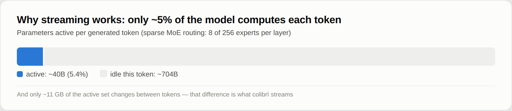
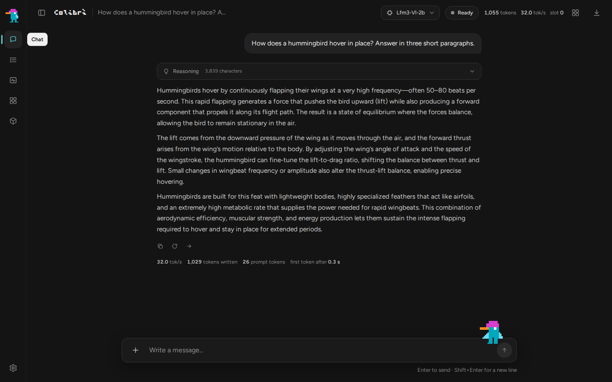
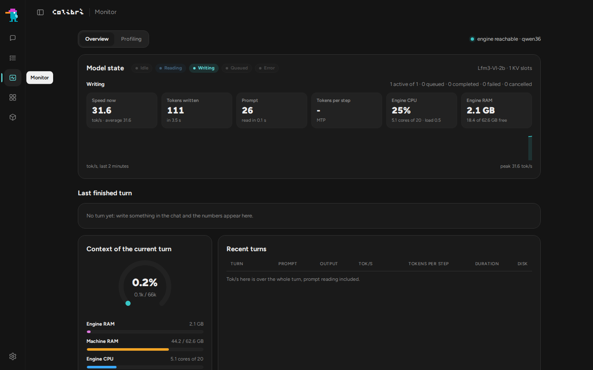
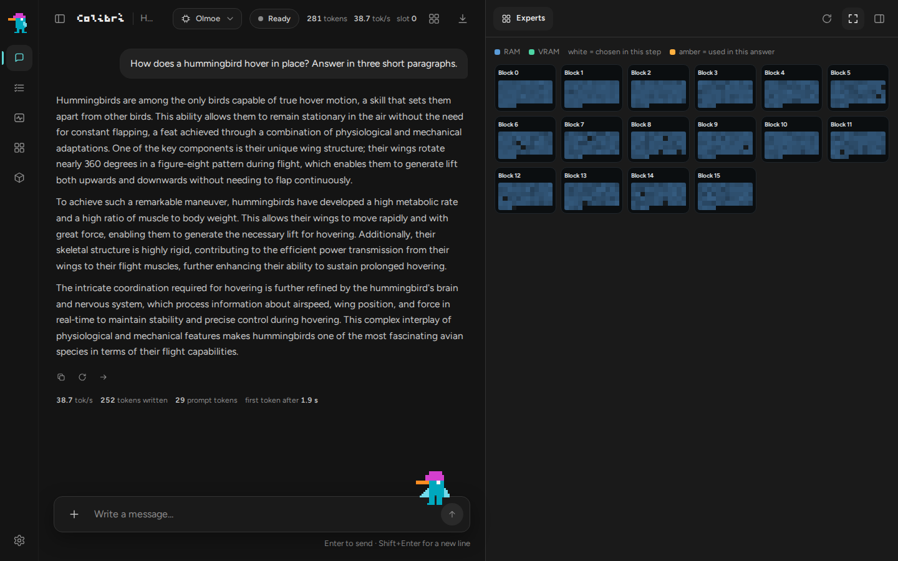
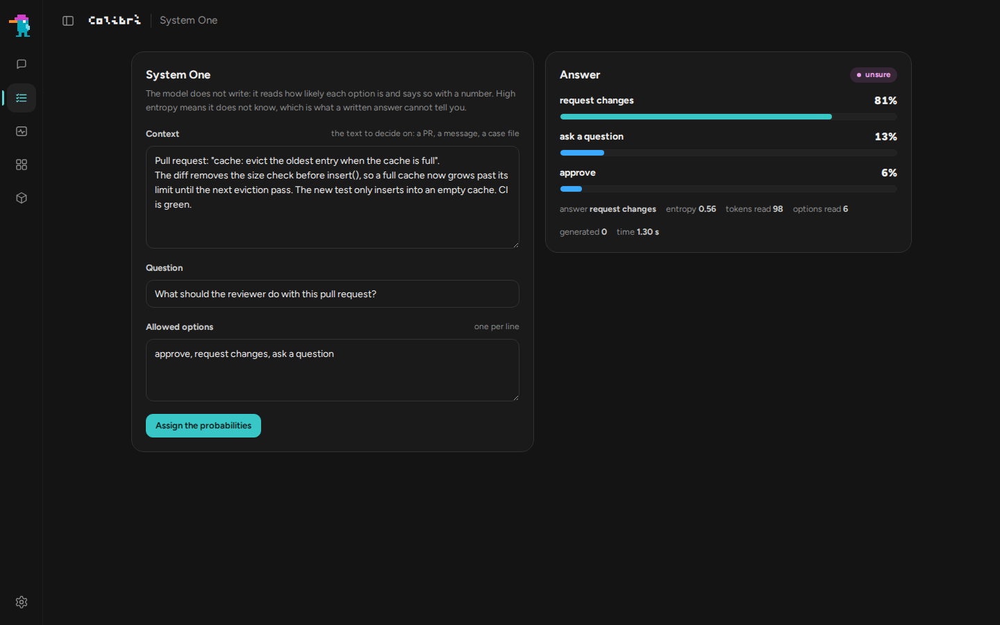
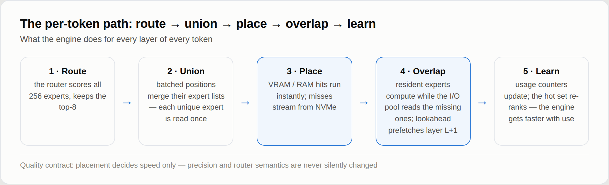
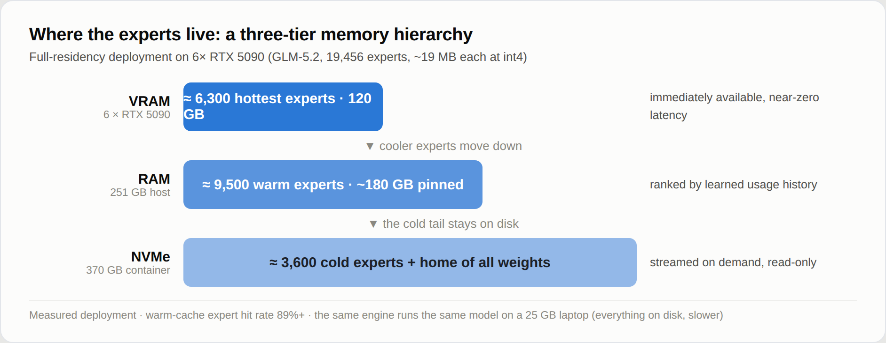
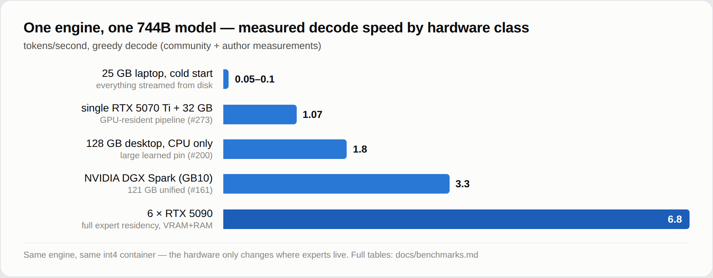

<p align="center">
  
</p>

<p align="center">
  <a href="https://justvugg.github.io/colibri"></a>
  <a href="https://github.com/JustVugg/colibri/releases"></a>
</p>

<p align="center">
  <a href="https://justvugg.github.io/colibri"><b>Website</b></a> ·
  <a href="https://discord.gg/RXV83nSZdk"><b>Discord</b></a> ·
  <a href="README.md">English</a> · <a href="README.zh-CN.md">简体中文</a> · <a href="README.zh-TW.md">繁體中文</a> · <a href="README.it.md">Italiano</a> · <a href="README.ja.md">日本語</a> · <a href="README.id.md">Bahasa Indonesia</a> · <a href="README.pt-BR.md">Português (Brasil)</a> · 한국어
</p>

**작은 엔진, 거대한 모델.** colibri는 매우 큰 오픈 모델을 여러분이 이미 가지고 있는 컴퓨터에서 돌립니다. 수천억 개의 파라미터를 가진 Mixture-of-Experts 모델은 토큰 하나를 생성할 때 자신의 극히 일부만 사용합니다. 그래서 colibri는 그 부분을 RAM에 유지하고, 나머지 부분, 즉 엑스퍼트는 모델이 필요로 할 때 디스크에서 읽어옵니다. C 언어로만 작성됐고, 모델 계열마다 파일이 하나이고, GPU가 필요 없습니다.

현재 13개의 엔진을 지원합니다. 언어 모델용 10개: **GLM-5.2/5.3**(**Mistral-Large-4**도 지원), **GLM-5.3-Flash**, **Inkling**, **Kimi K3**, **DeepSeek V4 Flash**, **DeepSeek V4.1 Flash**, **MiMo-V2.6 Flash**(Pro 포함), **Qwen3.8-Flash-Next**, **Qwen3.6**(Qwen3-Coder, dense 모델인 Qwen3.8-27B, **Flint**, **Muse Spark Open**, **LFM3-VL**도 지원), **OLMoE**. 이미지 생성 엔진이 1개: **Qwen-Image-2.1**. 판단에 답하는 엔진이 2개: **Laya**와 **GLiNER2.5-Decide**, 세 번째 판단 모델인 **Clef**가 Qwen3.6 엔진 위에서 동작합니다. 언어 모델들은 이미 공개된 GGUF 파일도 변환 없이 그대로 읽어서([GGUF](docs/gguf.md)) CPU, Vulkan을 통한 모든 GPU, CUDA를 통한 NVIDIA 카드에서 실행됩니다. [내 컴퓨터에는 어떤 모델이 맞나](#which-model-for-my-machine)

```
$ ./coli chat
  colibri v2.1.0 · GLM-5.2 · 744B MoE · int4 · streaming CPU
  ✓ ready in 32s · resident 9.9 GB
  › ciao!
  ◆ Ciao! Come posso aiutarti oggi?
```

<p align="center">
  <a href="https://www.buymeacoffee.com/justvugg"></a>
  <br>
  <sub>colibri는 무료 오픈 소스입니다. 여러분의 컴퓨터에서 사용할 때, 커피 한 잔 정도 사주시면 엔진 개발과 속도 개선에 큰 힘이 됩니다.</sub>
</p>

<a id="get-started"></a>
<a id="the-one-step-way"></a>

## 바로 시작하기

최소 **8GB RAM**(16GB 이상 권장), 가장 작은 모델 기준 **디스크 여유 공간 22GB**, 그리고 인터넷 연결이 필요합니다. 그래픽 카드는 선택 사항입니다.

**Windows**

1. 이 페이지에서 **Code**, **Download ZIP**을 클릭하고 압축을 풉니다.
2. 압축을 푼 폴더의 **`START-HERE.bat`**을 더블 클릭합니다. Python이 없으면
   설치 여부를 물어봅니다.

**Linux**(Ubuntu와 Debian 기준; 다른 배포판도 같은 패키지를 각자의 이름으로 제공합니다)

```bash
sudo apt install git python3 build-essential
git clone https://github.com/JustVugg/colibri
cd colibri
./start-here.sh
```

**macOS**([Homebrew](https://brew.sh) 필요)

```bash
xcode-select --install
brew install libomp git python
git clone https://github.com/JustVugg/colibri
cd colibri
./start-here.sh
```

어떤 모델을 쓸지 질문 하나에 답하면 되고, Enter를 누르면 추천 모델이 선택됩니다. 그 다음 셋업이 진행됩니다.

1. **컴퓨터를 살핍니다**: RAM, 디스크 여유 공간, CPU와 GPU;
2. **알맞은 모델을 추천합니다**: 모델 중 항상 RAM에 상주하는 부분과 최소 엑스퍼트 캐시가
   여러분의 RAM에 들어가야 하고, 다운로드가 디스크에 들어가야 합니다;
3. **엔진을 가져옵니다**: 컴파일러가 있으면 컴퓨터에 맞게 빌드하고, 없으면 사전 빌드된 것을
   다운로드합니다. 사전 빌드 엔진은 CPU에서 동작하고, Linux와 Windows에서는 Vulkan GPU에서도
   동작합니다. 이득이 있을 때는 GPU용으로 빌드합니다. Linux에서 CUDA 툴킷이 설치된 NVIDIA 카드면 CUDA,
   아니면 Vulkan입니다. 디스크리트 GPU에서는 항상 그렇게 하고, CPU의 RAM을 공유하는
   내장 GPU에서는 그곳에서 더 빠르다고 측정된 모델에만 그렇게 합니다
   (Qwen3.6, Qwen3-Coder, Qwen3.8-Flash-Next). 패키지가 없으면 설치 명령을 정확히
   출력하고 CPU로 계속 진행합니다. 나중에 셋업을 다시 실행하면 GPU용으로 다시 빌드합니다;
4. **모델을 다운로드합니다**: 진행률 표시와 이어받기를 지원합니다. 언제든 중단했다가
   다시 실행하면 멈춘 곳에서 이어서 다운로드됩니다;
5. **colibri를 시작하고 브라우저에서 대시보드를 엽니다**. 다른 앱이 사용할 수 있는
   주소도 출력합니다.

```
Starting colibri
  Browser:             http://127.0.0.1:8000/
  OpenAI base URL:     http://127.0.0.1:8000/v1
  Anthropic base URL:  http://127.0.0.1:8000
  stop: press Ctrl+C here (or close this window)
```

**다음부터는** `START-HERE.bat`이나 `./start-here.sh`를 다시 실행하기만 하면 됩니다. 다운로드도 빌드도 없이 colibri가 바로 시작됩니다. `c/coli status`는 무엇이 설치됐고 동작하는지 보여주고, `c/coli stop`은 중지합니다(Windows에서는 `c\coli.cmd status`, `c\coli.cmd stop`).

옵션은 `./start-here.sh`나 `START-HERE.bat` 뒤에 붙입니다.

| 옵션 | 동작 |
|---|---|
| `--list` | 모든 모델을 이 컴퓨터와 비교하고, 맞지 않는 이유를 보여줍니다 |
| `--model ID` | 그 모델을 설치합니다(ID는 [아래 표](#which-model-for-my-machine)에 있습니다) |
| `--yes` | 질문 없이 추천 모델을 선택합니다 |
| `--dir DIR` | 모델을 다른 디스크에 둡니다(기본값 `~/colibri-models`) |
| `--backend vulkan`, `cuda` 또는 `cpu` | 엔진 빌드를 직접 고릅니다; `--no-gpu`는 `--backend cpu`와 같습니다 |
| `--model-dir DIR` | 이미 다운로드한 모델을 사용합니다 |
| `--reconfigure` | 다른 모델을 고릅니다 |

각 단계가 무엇을 하는지 자세한 설명: [docs/quickstart.md](docs/quickstart.md#the-one-step-way).

### 문제가 생겼을 때

| 보이는 것 | 해야 할 것 |
|---|---|
| 다운로드 중에 멈췄다 | 같은 명령을 다시 실행합니다. 이미 디스크에 있는 바이트부터 이어집니다 |
| `to use the GPU through ..., first run: <command>` | 그 명령을 실행한 뒤 셋업을 다시 실행합니다. GPU용으로 다시 빌드하고 다시 다운로드하지 않습니다 |
| `the ... build failed` — 예를 들어 설치된 CUDA 툴킷이 더 이상 카드를 지원하지 않을 때 나오는 `Unsupported gpu architecture` | 셋업이 먼저 툴킷과 카드를 비교해서 알아서 Vulkan을 고르고 이유를 알려줍니다. 그래도 빌드가 실패하면 다음 선택지를 제안합니다(Vulkan, 그다음 CPU). `./start-here.sh --backend vulkan`은 Vulkan을 강제하고, `--no-gpu`는 CPU를 유지합니다 |
| `needs N GB free for the download` | 더 큰 디스크의 폴더를 `--dir`로 지정합니다 |
| WSL에서 모델 폴더가 `/mnt/c` 아래에 있다 | Linux 디스크에 두세요(기본값 `~/colibri-models`): `/mnt/c`는 몇 배나 느립니다 |
| 체크아웃을 업데이트했다(`git pull`) | `./start-here.sh`를 다시 실행합니다. 소스가 바뀌었으면 엔진을 다시 빌드한 뒤 시작합니다 |
| 그 외의 문제 | `c/coli logs -n 50`은 백그라운드로 시작한 서버의 로그를 보여주고(포그라운드는 자기 터미널에 출력), `c/coli logs --install`은 셋업의 로그를 보여줍니다. 셋업이 마지막에 출력한 줄들과 함께 [이슈](https://github.com/JustVugg/colibri/issues)를 열어주세요 |

### AI 어시스턴트에게 맡기기

AI 코딩 어시스턴트를 쓰고 있다면 이 전체 과정을 대신하게 할 수 있습니다. 이렇게 물어보세요:

> Set up colibri on this machine following docs/AI_SETUP.md from https://github.com/JustVugg/colibri

[docs/AI_SETUP.md](docs/AI_SETUP.md)는 어시스턴트에게 모든 단계를 명령어와 기계 판독 가능한 결과로 제공하고, 모델 다운로드나 시스템 패키지 설치 전에 사용자에게 물어보라고 지시합니다. Model Context Protocol을 지원하는 어시스턴트는 colibri의 MCP 서버를 대신 쓸 수 있습니다. `coli mcp`는 하드웨어 감지, 모델 추천, 설치, 시작, 중지, 상태 확인 도구를 제공합니다([docs/MCP_SERVER.md](docs/MCP_SERVER.md)).

### 또는 수동으로

각 단계를 직접 고르고 싶다면(사전 빌드 릴리스 또는 소스 빌드, 아래 표의 모델, 그리고 `coli chat`, `coli web`, `coli serve`) [수동 설치](#install-by-hand)를 보거나, 플랫폼별 단계별 안내는 [퀵스타트 가이드](docs/quickstart.md)를 참고하세요.

## colibri는 무엇이고, 왜 만드는가

Mixture-of-Experts 모델은 디스크에서는 용량이 크지만 토큰당 실제 사용량은 적습니다. GLM-5.2는 파라미터가 744B지만 토큰 하나에 약 40B만 사용하고, 그중 토큰마다 바뀌는 것은 약 11GB뿐입니다. 바로 라우팅된 엑스퍼트입니다.

<p align="center">
  
</p>

그래서 모델이 빠른 메모리에 통째로 들어갈 필요가 없고, **배치**만 잘하면 됩니다. dense 파트(어텐션, 공유 엑스퍼트, 임베딩)는 RAM에 둡니다. 라우팅된 엑스퍼트는 디스크에 두고 라우터가 필요로 할 때 읽어옵니다. 이때 캐시를 이용하는데, 이 캐시는 사용자의 작업에서 어떤 엑스퍼트가 쓰이는지 학습합니다. GPU가 있으면 가장 자주 쓰이는 엑스퍼트와 dense 레이어를 거기에 둡니다. 가중치가 어디 놓여 있는가는 답이 얼마나 빨리 나오는지만 바꿀 뿐, 어떤 가중치와 어떤 라우터 판단이 답을 만드는지는 바꾸지 않습니다.

왜 만드는가: 사람들이 이미 가진 하드웨어로 이 크기의 모델을 돌리기 위해, 모델이 일하는 모습을 보기 위해(대시보드는 엑스퍼트가 활성화되는 순간을 하나하나 보여줍니다), 그리고 누구나 측정해서 더 빠르게 만들 수 있을 만큼 엔진을 작게 유지하기 위해서입니다. colibri는 오픈 리서치 플랫폼이기도 합니다. 최적화는 재현 가능한 end-to-end 측정으로만 채택되고, 기본 정책은 모델의 정밀도나 라우터의 동작을 절대 몰래 바꾸지 않습니다. 빠른 메모리가 적으면 속도가 떨어질 수는 있어도, 모델 자체를 슬그머니 바꿔서는 안 됩니다. 자세한 내용은 [작동 방식](#how-it-works)을 참고하세요.

<a id="which-model-for-my-machine"></a>

## 내 컴퓨터에 맞는 모델

셋업에서는 여러분 컴퓨터에서 RAM으로 돌아가는 가장 성능 좋은 모델을 추천하고, 그 아래에 디스크에서 스트리밍되는 더 큰 모델들을 나열합니다. `./start-here.sh --list`는 전체를 여러분의 컴퓨터와 비교해 보여줍니다. 표는 셋업 자체의 카탈로그([`c/setup_catalog.py`](c/setup_catalog.py))를 따르며, 다운로드 크기는 Hugging Face가 각 리포지토리에 표시한 크기입니다.

- **RAM**은 숫자가 두 개입니다. 첫 번째 값보다 작으면 모델이 시작되지 않고, 두 번째 값부터는 측정된 대로 돌아갑니다.
- **GPU**는 셋업이 해당 엔진용으로 빌드할 수 있는 GPU입니다([GPU](#gpus)).
  *내장 GPU도*라고 적힌 것은 내장 GPU도 사용한다는 뜻으로, 이 엔진들은 내장 GPU에서 더 빠른 것으로 측정됐습니다. 나머지 엔진은 디스크리트 GPU만 사용합니다.
- **측정치**는 표시된 컴퓨터에서 측정한 값으로, 채팅 모델의 디코드 속도입니다. 괄호 안 알파벳은 표 아래에 나열된 컴퓨터입니다. 빈칸은 아직 아무도 측정하지 않았다는 뜻입니다.

**RAM으로 돌아가는 작은 모델**

| 모델 | `--model` | 다운로드 | RAM | GPU | 측정치 |
|---|---|---|---|---|---|
| **Qwen3.6-35B-A3B**: 추론과 도구 호출을 갖춘 채팅 | `qwen36-35b` | 23 GB | 10 / 20 GB | CUDA, Vulkan (내장 GPU도) | CPU에서 6.0 tok/s, 내장 GPU Vulkan에서 9.9 (A); CUDA에서 30.0 (C) |
| Qwen3-Coder-30B-A3B: 코드와 도구 호출, 추론 없음 | `qwen3-coder-30b` | 19 GB | 8 / 18 GB | CUDA, Vulkan (내장 GPU도) | 모든 엑스퍼트를 RAM에 둘 때 8.5-9.6 tok/s, 레이어당 32개만 둘 때 5.1 (A, CPU) |
| **Qwen-Image-2.1**: 텍스트로 이미지 생성, 비상업적 라이선스 | `qwen-image-2.1` | 33 GB | 12 / 18 GB | Vulkan | 768x512 이미지 한 장 생성에 2분 40초 (Zen 4 8코어, CPU) |

**엑스퍼트가 디스크에서 스트리밍되는 큰 모델**(속도는 디스크가 좌우하므로 빠른 NVMe 드라이브가 가장 도움이 됩니다.)

| 모델 | `--model` | 다운로드 | RAM | GPU | 측정치 |
|---|---|---|---|---|---|
| DeepSeek V4 Flash REAP 150B: 256개 중 132개 엑스퍼트 | `deepseek-v4-flash-reap` | 85 GB | 16 / 32 GB | CUDA, Vulkan | |
| **DeepSeek V4 Flash** (284B): 도구 호출 | `deepseek-v4-flash` | 167 GB | 16 / 32 GB | CUDA, Vulkan | 32 GB 환경에서 0.93 tok/s (Ryzen 7 5800X), 63 GB 환경에서 1.24 (Ryzen 9 5950X), CPU 전용; CUDA에서 1.5-1.6 (RTX 5080, 32 GB, NVMe 2개) |
| **MiMo-V2.6 Flash** (309B): 비전과 도구 호출 | `mimo-v2.6-flash` | 172 GB | 32 / 52 GB | Vulkan | 2.34-3.37 tok/s (A, CPU) |
| **Qwen3.8-Flash-Next** (125B + 51B n-gram): 비전과 도구 호출 | `qwen38-flash-next` | 186 GB | 24 / 32 GB | CUDA, Vulkan (내장 GPU도) | 레이어당 엑스퍼트 32~96개로 1.91-2.56 tok/s; 선택적 int4 엑스퍼트로 3.99 (A, CPU) |
| **GLM-5.2** (744B): 기준 모델, MTP 헤드 포함 | `glm-5.2` | 429 GB | 16 / 24 GB | CUDA, Vulkan | 25 GB 노트북에서 콜드 0.05-0.1 tok/s; 128 GB Ryzen AI Max+ 395에서 1.83; RTX 5090 6장에서 9.0-9.2 |
| GLM-5.3 (744B): 같은 엔진, MTP 헤드 없음 | `glm-5.3` | 419 GB | 16 / 24 GB | CUDA, Vulkan | |
| **Inkling** (975B): int4 엑스퍼트, bf16 dense 가중치 | `inkling` | 514 GB | 다운로드 그대로 120 / 128 GB; [dense 변환](docs/inkling.md) 후 25 GB | CUDA, Vulkan | 0.25 tok/s (Ryzen 9 7900, 187 GB, RTX A6000) |
| MiMo-V2.6 Pro (1.02T): 비전과 도구 호출 | `mimo-v2.6-pro` | 564 GB | 54 / 64 GB | Vulkan | 0.66-0.79 tok/s (A, CPU) |
| **Kimi K3** (2.8T): 가장 큰 모델 | `kimi-k3` | 1.56 TB | 32 / 64 GB | CUDA, Vulkan | 토큰당 약 9.4초, 엑스퍼트를 6.3 GB/s로 읽음 |

<a id="other-supported-models"></a>

**수동: 다운로드 후 변환 또는 준비 단계가 있는 모델**

| 모델 | 다운로드 후 디스크 | RAM | GPU | 측정치 |
|---|---|---|---|---|
| **OLMoE** (7B): 작고 도구 호출을 익히기 좋다 | 14 GB, int8 변환 후 7 GB | 8 GB | Vulkan | 22-23 tok/s (A, CPU) |
| Qwen3.8-27B (dense): 텍스트와 이미지 | 56 GB, 변환 후 51 GB | int4에서 20 GB, int8에서 30 GB | Vulkan | int4에서 3.45 tok/s, int8에서 2.1 (16스레드 CPU 서버) |
| **GLM-5.3-Flash** (321B): 비전과 도구 호출 | 328 GB, 샤드 단위 변환 후 195 GB | 25 GB | CUDA, Vulkan | 웜 상태 토큰당 약 20초, 콜드 44초 (6코어, 25 GB, 일반 디스크) |
| **DeepSeek V4.1 Flash** (552B): 비전과 도구 호출, 변환은 없지만 일회성 준비 필요 | 510 GB | 약 18 GB + 엑스퍼트 캐시 (레이어당 8개 기준 피크 24.8 GB) | Vulkan | 0.21-0.24 tok/s (엑스퍼트의 68%를 RAM에 둔 16스레드 CPU 서버) |

<a id="from-a-gguf"></a>

**GGUF에서: 공개된 파일을 있는 그대로 읽기**

`./coli import`는 GGUF의 첫 번째 파일을 입력으로 받아(나머지 파트는 같은 위치에 있어야 합니다) 그 옆에 모델 디렉터리를 만듭니다. 그 디렉터리를 다른 모델처럼 `--model`로 지정하면 됩니다([gguf.md](docs/gguf.md)). 변환이나 재양자화는 하지 않습니다. IQ1_S부터 Q8_0, F16, BF16, MXFP4까지 블록이 파일에 있는 그대로 실행됩니다. 위의 모든 채팅 모델의 엔진도 GGUF를 읽습니다([아키텍처 목록](docs/gguf.md#supported-architectures)). 이 4개 모델은 GGUF로 제공됩니다.

| 모델 | GGUF | GPU | 측정치 |
|---|---|---|---|
| **Mistral-Large-4** (1T, 활성 52B): 텍스트, 이미지, 추론, 도구 호출 | unsloth, UD-IQ1_S 233 GB | CUDA, Vulkan | CUDA에서 1.34-1.36 tok/s, Vulkan에서 1.16-1.17 (D) |
| **Muse Spark Open** (816B, 활성 42B): 텍스트와 도구 호출, Meta의 라이선스 계약 적용 | unsloth, UD-IQ1_S 176 GB ~ UD-Q4_K_XL 505 GB | CUDA, Vulkan | Vulkan에서 1.55-1.58 tok/s, CUDA에서 1.34-1.40, CPU에서 0.83-0.89 (D) |
| **Flint** (40B, 활성 2.5B): 텍스트와 도구 호출, Apache 2.0 | unsloth, UD-IQ1_M 11.4 GB ~ BF16 79.6 GB | CUDA, Vulkan | UD-Q4_K_XL: CUDA에서 77.4 tok/s, Vulkan에서 77.7, CPU에서 15.8 (D) |
| **LFM3-VL-2B**: 텍스트, 이미지, 도구 호출, LFM Open License | LiquidAI, QAD-Q4_0 ~ BF16 (또는 체크포인트 변환) | CUDA, Vulkan | Q4_K_M: CUDA에서 235.1 tok/s, Vulkan에서 214.1, CPU에서 34.5 (D) |


위 표의 큰 모델들을 같은 컴퓨터에서 GGUF로 돌린 결과: [벤치마크](#large-models-on-the-same-machine).

**판단 모델**([System One](#system-one-a-decision-with-a-probability) 질문에 답하며, 채팅은 하지 않습니다)

| 모델 | 다운로드 후 디스크에서의 크기 | RAM | GPU | 측정치 |
|---|---|---|---|---|
| **Laya** (Convai Innovations), 영어 | 0.85 GB | 1.7 GB | CPU, CUDA | 질문 1개에 219 ms, 3개에 882 ms (B), 12개가 CUDA에서 0.69초, CPU에서 11.4-13.0초 (D) |
| **GLiNER2.5-Decide** (fastino), 영어 | 1.95 GB | 1.9 GB | CPU, CUDA | 질문 1개에 294 ms, 3개에 897 ms (B, 부하가 걸린 상태에서); 12개가 CUDA에서 0.16-0.21초, CPU에서 2.0-2.6초 (D) |
| **Clef** (Cloudflare): 판단 헤드를 단 Qwen3.8-27B, 채팅도 가능 | 55 GB, 변환 후 52 GB | int4에서 19 GB ~ f16에서 55 GB | CPU | int8에서 요청당 20.4초 (A) |

측정에 사용된 컴퓨터 목록:
- **A** Ryzen 7 PRO 8700GE 데스크톱(8코어, 61-64 GB DDR5, NVMe, 내장 Radeon 780M);
- **B** i7-1355U 노트북;
- **C** Threadripper 3945WX 박스의 RTX 3070 8 GB, dense 레이어와 DeltaNet 레이어를 카드에 올림(행 단위 int4 컨테이너);
- **D** RAM 62 GB의 i5-13500에 RTX PRO 4000 Blackwell SFF(24 GB)와 md 어레이로 묶은 NVMe 2개, [벤치마크 표](#benchmarks)의 컴퓨터입니다.

각 숫자는 [docs/](docs/)의 모델별 페이지나 정확한 셋업이 있는 [벤치마크 표](docs/benchmarks.md)에서 가져왔습니다.

모델 계열마다 전용 문서가 있습니다. [qwen36.md](docs/qwen36.md)(Qwen3.6, Qwen3-Coder, Qwen3.8-27B, Flint, Muse Spark Open, LFM3-VL), [mistral-large4.md](docs/mistral-large4.md), [gguf.md](docs/gguf.md), [qwen38.md](docs/qwen38.md), [deepseek-v4.md](docs/deepseek-v4.md), [deepseek-v41.md](docs/deepseek-v41.md), [mimo.md](docs/mimo.md), [glm53-flash.md](docs/glm53-flash.md), [inkling.md](docs/inkling.md), [kimi_k3.md](docs/kimi_k3.md), [qwen-image.md](docs/qwen-image.md), [laya.md](docs/laya.md), [gliner_decide.md](docs/gliner_decide.md), [clef.md](docs/clef.md), 그리고 GLM-5.2는 [퀵스타트](docs/quickstart.md#3-get-the-model)에 있습니다. 지원하는 모델과 같은 아키텍처를 사용하는 체크포인트(예: Qwen3.6 엔진의 KAT-Coder v2.5)는 수정 없이 실행됩니다.

<a id="gpus"></a>

## GPU

### GPU 없이도 됩니다

모든 엔진은 추가 설치 없이 CPU에서 실행됩니다. GPU는 가중치를 놓아 둘 수 있는 더 빠른 장소일 뿐 필수가 아닙니다. 큰 모델은 디스크가, 작은 모델은 RAM이 속도를 좌우합니다.

### Vulkan: 모든 GPU

모든 MoE 엔진은 Vulkan 1.2 드라이버가 있는 모든 GPU(AMD, Intel, NVIDIA, 내장 또는 디스크리트)를 두 가지 방식으로 사용할 수 있습니다.

- **엑스퍼트 티어**: GPU 메모리 안의 라우팅 엑스퍼트 캐시. 시작할 때 과거 대화에서 쓴 엑스퍼트로 채우고 대화하면서 적응합니다. GPU가 자신이 가진 엑스퍼트를 계산하는 동안 CPU가 나머지를 계산합니다.
- **dense 체인**: 레이어들 전체의 연산을 GPU에 한 번으로 기록하고, 모델의 진행 상태를 레이어에서 레이어로 넘길 때도 GPU에 그대로 둡니다.

컴퓨터 A의 내장 Radeon 780M에서 측정(매 실행 전 페이지 캐시에서 모델 파일을 비우고 100 토큰 디코드, [vulkan.md](docs/vulkan.md#the-chain-on-a-radeon-780m)):

| | CPU | Vulkan, 엑스퍼트 티어 | Vulkan, 티어와 dense 체인 |
|---|---|---|---|
| Qwen3.6-35B-A3B, 디코드 | 6.0 tok/s | 8.0 tok/s | **9.9 tok/s** |
| Qwen3.6-35B-A3B, 512 토큰 프롬프트 | 35.7 초 | 12.2 초 | **9.5 초** |
| Qwen3.8-Flash-Next (int4 엑스퍼트), 디코드 | 3.5 tok/s | **3.8 tok/s** | 3.2 tok/s |
| Qwen3.8-Flash-Next, 512 토큰 프롬프트 | 43.6 초 | 38.7 초 | **30.1 초** |
| OLMoE, 디코드 (웜) | **23.1 tok/s** | 12.8 tok/s | 17.3 tok/s |

내장 GPU는 CPU의 RAM을 공유합니다. 절약하는 것은 자신이 가진 엑스퍼트의 연산과 디스크 읽기이므로 Qwen3.6 같은 모델에서는 이득이지만, OLMoE처럼 엑스퍼트가 이미 RAM에 있는 작은 모델에서는 손해 볼 수 있습니다. 그래서 셋업이 내장 GPU에는 Qwen3.6, Qwen3-Coder, Qwen3.8-Flash-Next에만 Vulkan을 켜고, 각 엔진이 dense 체인을 거기서 돌릴지 스스로 결정하는 것입니다(Qwen3.6은 예, Qwen3.8은 아니오). 그래도 Vulkan을 쓰려면 `--backend vulkan`입니다.

**GPU 켜기와 끄기.** `coli setup --backend vulkan`은 모든 모델에 GPU를 쓰도록 하고, `coli setup --backend cpu`(또는 `--no-gpu`)는 전부 CPU에 둡니다. Vulkan으로 빌드된 엔진은 `coli chat`, `serve`, `web`을 실행하는 환경에 `COLI_VULKAN=1`이 있을 때만 GPU를 씁니다(셋업이 Vulkan을 선택했다면 자동으로 켭니다). 없으면 엔진은 CPU에서 돌립니다. GPU를 켠 상태에서 `COLI_VK_CHAIN=0`을 지정하면 엑스퍼트 티어는 유지하면서 dense 레이어를 CPU에서 돌립니다. 내장 GPU에서는 둘 다 시험해보세요: Intel Iris Xe(Core i7-1355U) 노트북에서 Qwen3.6은 CPU에서 2.1 tok/s, Vulkan에서 1.7-1.9, dense 체인을 끄면 2.1이었습니다.

디스크리트 GPU에서는 셋업이 모든 엔진을 Vulkan으로 빌드합니다(엔진에 CUDA 경로가 있고 툴킷이 있으면 CUDA 우선), dense 레이어는 카드에 둡니다. 이것이 이 설계가 겨냥하고 있는 경우입니다. RTX PRO 4000(24 GB, 컴퓨터 D)에서 Qwen3.6-35B-A3B는 92.9 tok/s로 디코드하고 프롬프트는 초당 2,076 토큰으로 읽으며, OLMoE는 각각 299.4 tok/s와 6,867 tok/s 입니다([표](#three-backends-on-one-machine)). 카드보다 큰 모델은 카드에 들어가지 않는 엑스퍼트를 RAM의 호스트 풀에 두고, 매 스텝 카드가 자기 몫을 계산하는 동안 CPU가 그것들을 같은 프레임 안에서 계산합니다. Qwen3.8-Flash-Next IQ2_XS(68 GB)가 같은 방식으로 50.6 tok/s로 디코드합니다([vulkan.md](docs/vulkan.md#the-routed-experts-in-the-frame-vk_dmoeh)). 한 사용자가 Tesla V100 16 GB에서 Qwen3.6을 17-19 tok/s로 측정한 결과를 공유했습니다([#1852](https://github.com/JustVugg/colibri/issues/1852)). 여러분의 측정 수치도 환영합니다.

**Resizable BAR가 없는 카드도 이제 동작합니다.** 그런 카드(모든 Turing 카드, 출시 펌웨어의 Ampere 카드, 해당 옵션을 끈 오래된 AMD 카드)는 CPU가 자기 메모리에 직접 약 256MB만 쓸 수 있습니다. 이제 colibri는 스테이징 버퍼를 통해 가중치를 스스로 복사합니다. 이 경로는 강제로 켜서 테스트했고 세 장치에서 작은 창을 에뮬레이션해 검증했으며, 780M에서는 측정 가능한 속도 저하가 없습니다. Resizable BAR가 없는 카드에서는 아직 측정하지 않았습니다([vulkan.md](docs/vulkan.md#memory-placement-without-resizable-bar)).

CI는 소프트웨어 드라이버 위에서 모든 엔진의 Vulkan 경로를 CPU가 내놓는 토큰과 비교 검사합니다. GPU는 수를 더하는 순서가 다르고, CPU가 반올림하는 곳에서 일부 활성값을 f32로 유지하므로, 긴 답변은 CPU의 것과 한 단어 정도 달라질 수 있습니다([vulkan.md](docs/vulkan.md#the-other-engines)).

### CUDA: NVIDIA 카드

셋업은 CUDA 툴킷이 설치된 Linux에서 CUDA 경로가 있는 엔진을 CUDA로 빌드합니다. GLM-5.2/5.3과 Mistral-Large-4, GLM-5.3-Flash, Inkling, Kimi K3, DeepSeek V4 Flash, DeepSeek V4.1 Flash, MiMo-V2.6, Qwen3.8-Flash-Next, 그리고 Qwen3.6과 그 엔진이 돌리는 모델들. OLMoE와 판단 엔진은 `make <engine> CUDA=1`로 빌드합니다. Windows에서는 CUDA 엔진이 별도 DLL입니다([windows.md](docs/windows.md)). 모든 릴리스에 빌드된 DLL이 포함됩니다. `colibri-<version>-windows-x86_64-cuda.zip`에는 `coli_cuda.dll`(컴퓨트 능력 8.0 이상 카드용)과 그것을 로드하는 colibri, qwen36, kimi_k3 엔진, 그리고 DeepSeek V4 전용 CUDA DLL이 있습니다. 메인 아카이브 위에 풀면 셋업이 CUDA를 고릅니다.

- **모든 레이어를 카드 위에서**(Qwen3.6, Qwen3.8, OLMoE): dense 레이어, 어텐션, 카드가 가진 라우팅 엑스퍼트가 하나의 체인으로 실행되고, 카드에 없는 엑스퍼트는 CPU에서 실행됩니다. RTX PRO 4000에서 Qwen3.6-35B-A3B UD-Q4_K_M은 104.8 tok/s로 디코드하고 프롬프트를 초당 3,491토큰으로 읽으며, OLMoE는 354.6과 10,418입니다([표](#three-backends-on-one-machine)).
- **모든 엔진에 카드 위 라우팅 엑스퍼트 티어**(`cu_tier.h`), 그리고 DeepSeek V4, V4.1, Kimi K3, GLM-5.3, MiMo용 카드 위 dense 행렬(`cu_dense.h`).
- **GGUF의 블록을 카드에서**(`cuda_bd.cuh`): 가중치 32개 이상인 모든 ggml 블록 타입을 각 행 파일 그대로; 프롬프트는 텐서 코어를 통과합니다([gguf.md](docs/gguf.md)).
- **VRAM 엑스퍼트 티어**는 측정된 라우팅으로 고른 가장 뜨거운 엑스퍼트를 카드에 둡니다. 미스는 CPU에서 동시에 계산됩니다. 8 GB 카드 두 장(RTX 3070과 Quadro RTX 4000)의 Qwen3.6이 웜 히스토리로 11.3 tok/s를 냈습니다([qwen36-cuda-tier.md](docs/qwen36-cuda-tier.md)); RTX 5090 6장에서 모든 엑스퍼트가 상주한 GLM-5.2는 9.0-9.2 tok/s([benchmarks.md](docs/benchmarks.md)); RTX 5080의 DeepSeek V4 Flash는 1.5-1.6 tok/s와 3,324 토큰 프롬프트를 90초에([deepseek-v4.md](docs/deepseek-v4.md)).
- **Qwen3.6의 DeltaNet 레이어를 카드에서**(`Q36_DN_GPU=1`, 옵트인). Qwen3.6의 30개 DeltaNet 레이어는 토큰마다 데이터를 카드와 CPU 사이에 4번 복사했는데, 이제 디코드 토큰이 레이어 전체를 카드에서 실행하고 리커런트 상태는 VRAM에 둡니다. dense 레이어가 VRAM에 있는 RTX 3070에서: 25.4에서 30.0 tok/s([qwen36-cuda-tier.md](docs/qwen36-cuda-tier.md#the-deltanet-layer-on-the-card-q36_dn_gpu1)).
- **오래된 카드.** CUDA 툴킷이 더 이상 여러분 카드를 컴파일하지 못하면([#1852](https://github.com/JustVugg/colibri/issues/1852)의 CUDA 13과 V100) 셋업이 빌드 전에 알아채고 이유를 알리며 Vulkan으로 카드를 씁니다. CUDA 12.x 툴킷은 CUDA 경로를 되살립니다. DeepSeek V4의 CUDA 티어는 Pascal과 Turing도 빌드됩니다(`CUDA_ARCH=portable-pre-ampere NO_TC=1`).

이 내용에 대한 모든 것: [docs/cuda.md](docs/cuda.md).

### Apple Silicon

Metal 백엔드가 여러 엔진의 유니파이드 메모리 GPU에서 엑스퍼트 연산을 합니다([docs/metal.md](docs/metal.md)). 릴리스의 macOS 아카이브에는 `colibri`, `inkling`, `kimi_k3`가 그렇게 빌드돼 있습니다. `COLI_METAL=1`(Kimi K3는 `K3_METAL=1`)로 켭니다. 없으면 CPU에서 돌립니다. 소스에서는 `METAL=1`로 빌드하세요. 한 단계 셋업은 CPU용으로 빌드합니다.

<a id="system-one-mode-ask-a-closed-question"></a>
<a id="system-one-a-decision-with-a-probability"></a>

## System One: 확률이 붙은 판단

사람들이 모델에 요구하는 것 대부분은 문단이 아니라 선택입니다. 어느 큐인지, 어느 판정인지, 예인지 아닌지. `POST /v1/systemone`은 상태(텍스트 또는 JSON)와 타입 있는 질문을 받아 각각에 허용된 옵션별 확률과 신뢰도를 답합니다. 생성이 없으므로 답이 목록 밖으로 벗어날 수 없고, "모델이 확신하지 못함"도 임계값을 걸 수 있는 숫자입니다.

```bash
curl -s http://127.0.0.1:8000/v1/systemone -H 'Content-Type: application/json' -d '{
  "state": "340 lines, 8 files, no tests. CI is green but nothing covers that path.",
  "questions": {
    "review": {"type": "choice", "instructions": "What should the reviewer do?",
               "criteria": {"merge": null, "request changes": null, "close": null}},
    "risky":  {"type": "noul", "instructions": "Is this change risky?"}}}'
```

`choice`는 선택된 라벨, 모든 라벨의 확률, 0(무작위)~1(확실)의 `confidence`를 돌려주고, `noul`은 yes의 확률을, `score`는 기대 수준을 돌려줍니다.

누가 답하나:

- **colibri가 도는 모든 채팅 모델** — 스코어링으로: 답을 쓰는 대신 각 옵션의 확률을 읽습니다. 문서 하나에 대한 질문 여러 개는 문서를 한 번만 읽습니다. Qwen3.6에서 문서 하나에 대한 질문 4개가 같은 CPU 컴퓨터에서 같은 답을 생성하는 것보다 5.7배 빨랐습니다.
- **3개의 판단 모델** — 제작자가 맞춘 보정으로 단일 포워드 패스로 네이티브하게 답합니다. [Laya](docs/laya.md)(Convai Innovations), [GLiNER2.5-Decide](docs/gliner_decide.md)(fastino), [Clef](docs/clef.md)(Cloudflare, 채팅도 가능). 크기와 속도는 [판단 모델 표](#which-model-for-my-machine)에 있습니다.

**Jev에서 전환하기.** 요청과 응답은 TypeSafe의 Jev API와 동일하므로, Jev 클라이언트는 base URL만 바꾸면 됩니다. `TYPESAFE_BASE_URL=http://127.0.0.1:8000`(이미 보내던 키는 `COLI_API_KEY` 없이 시작한 서버가 받아들입니다). 두 공식 SDK는 수정 없이 `coli serve`로 테스트됩니다.

같은 모드가 터미널에도(`coli chat`에서 `/decide merge | request changes | close`), 대시보드의 System One 페이지에도 있습니다. 요청·응답 전체, 스코어링 규칙, 도움이 안 되는 경우: [docs/systemone.md](docs/systemone.md).

## 대시보드

`coli web`이 열고 한 단계 설정도 엽니다. 채팅, System One 페이지, Brain과 Profiling 페이지가 라이트·다크 테마로 있습니다.

### 채팅 UI

`coli ui`는 실행 중인 `coli serve` 옆에 새 채팅을 엽니다. 추론은 별도 블록으로, 비전 타워가 있는 모델은 이미지 표시, 웹 검색, 엑스퍼트 맵, 라이브 모니터, 그리고 colibri를 가리키도록 이미 셋업된 코딩 에이전트들. 7개 언어 지원. [ui/README.md](ui/README.md) 참고.

<p align="center">
  
</p>
<p align="center"><em>i5-13500 CPU의 LFM3-VL-2B, 32 tok/s.</em></p>

<p align="center">
  
</p>
<p align="center"><em>LFM3-VL-2B가 쓰는 동안의 <strong>모니터</strong>: 31.6 tok/s, 프롬프트를 0.1초에 읽고 RAM 2.1 GB 사용.</em></p>

<p align="center">
  
</p>
<p align="center"><em>채팅 옆에 <strong>엑스퍼트 맵</strong>을 연 OLMoE: 블록마다 엑스퍼트 하나당 하나의 셀, 이번 스텝에 선택된 건 흰색, 이 답변에서 쓰인 건 호박색.</em></p>

<p align="center">
  
</p>
<p align="center"><em><strong>System One</strong>: 모델에 문서와 고를 수 있는 답만 줍니다. 여기서 RTX PRO 4000의 Qwen3.6-35B는 캐시 크기 제한을 깨는 풀 리퀘스트를 읽고 있습니다. <strong>request changes 81%</strong>, 엔트로피 0.56(불확실), 읽은 토큰 98, 생성된 토큰 0.</em></p>

**Profiling** 페이지는 각 턴이 어디에 시간을 쓰는지 단계별로 보여주고, 최근 30 턴을 추세로 보여줍니다.

## 다른 앱에서 사용하기

셋업이 시작해주는 `coli serve`는 여러 API를 가진 서버 하나입니다.

- **OpenAI 호환**: `/v1/chat/completions`, `/v1/completions`, `/v1/models`, 스트리밍, JSON 응답, stop 시퀀스, logprobs 지원;
- **Anthropic 호환**: `/v1/messages` — Claude Code와 Anthropic SDK가 그대로 동작합니다;
- **도구 호출** — Inkling과 OLMoE를 제외한 모든 채팅 엔진에서, 각 모델의 네이티브 포맷으로([엔진별 표](docs/api.md#tool-calling-support));
- **이미지 입력** — GLM-5.3-Flash, DeepSeek V4.1 Flash, MiMo-V2.6, Qwen3.8-Flash-Next, Qwen3.8-27B, LFM3-VL, Mistral-Large-4(GGUF에서, `mmproj` 파일을 옆에 둠): `coli chat` 메시지의 경로, `coli web`이나 `coli ui`의 첨부, 또는 `image_url` 파트로;
- **문서 입력** — 모든 채팅 엔진에서: `coli chat`의 `/file PATH`(또는 `coli chat --file PATH`)가 텍스트 파일이나 PDF의 텍스트를 다음 메시지와 함께 보냅니다. 그렇게 지정된 파일만 읽고 메시지 안의 경로는 절대 읽지 않습니다. 텍스트 접미사나 `.pdf`의 일반 파일이어야 하며 64 MiB, 200만 자 이내여야 합니다. PDF는 별도 프로세스에서 시간과 메모리 제한을 두고 `pdftotext`(poppler)나 `pypdf`로 파싱합니다;
- **이미지 출력** — Qwen-Image-2.1로 `POST /v1/images/generations`, 그리고 `coli chat`가 터미널 안에 그립니다([qwen-image.md](docs/qwen-image.md));
- **판단** — `POST /v1/systemone`([위](#system-one-a-decision-with-a-probability) 참고);
- **여러 대화 동시에** — 모든 텍스트 엔진에서: `coli serve --kv-slots N`은 최대 16개까지 각자의 캐시를 가진 대화를 유지하고 다음 토큰들을 함께 디코드합니다([api.md](docs/api.md#isolated-kv-contexts)).

코딩 CLI와 에디터는 어떤 OpenAI 호환 프로바이더에 붙든 똑같이 연결합니다. base URL `http://127.0.0.1:8000/v1`, 모델 ID는 `coli status`가 출력하는 것, 키는 비어있지 않은 아무 값이나([docs/api.md](docs/api.md#connect-a-coding-cli-or-editor)).

<a id="how-it-works"></a>

## 작동 방식

<p align="center">
  
</p>

모든 토큰의 모든 레이어가 같은 다섯 단계를 거칩니다. route, union, place, overlap, learn. 설계 목표는 **배치가 속도만 결정한다**는 것: 엑스퍼트가 VRAM에서 답하든 RAM에서 답하든 디스크에서 답하든, 라우터의 결정과 가중치의 정밀도는 같습니다.

<p align="center">
  
</p>

- **가중치용 JIT.** 컴파일러 JIT은 프로그램 전체를 컴파일하지 않고, 실행되는 걸 보고 핫 패스만 컴파일합니다. colibri도 가중치에 같은 베팅을 합니다. 측정된 라우팅 사용빈도가 어떤 엑스퍼트가 VRAM, RAM, 디스크를 얻을지 결정합니다. 레이어별 LRU 캐시와 대화에서 배운 고정 핫셋(매 턴 갱신되는 `.coli_usage`)을 기준으로 합니다. 쓸수록 colibri는 빨라집니다. 라우팅에 측정 가능한 구조가 있어 가능합니다([엑스퍼트 아틀라스](https://github.com/JustVugg/colibri/issues/175)).
- **디스크를 두 번 기다리지 않기.** 엑스퍼트의 행렬 3개를 한 번의 `pread`로 읽고, 로더 풀이 상주 엑스퍼트가 계산하는 동안 없는 것들을 읽고, 위치 배치는 각 엑스퍼트를 한 번씩 읽고, 라우터 룩어헤드 스레드가 다음 레이어를 프리페치할 수 있습니다(GLM-5.2의 라우팅은 한 레이어 앞을 71.6% 예측 가능). `DIRECT=1`(O_DIRECT)은 빠른 NVMe에서는 대체로 큰 이득이고 다른 곳에서는 중립이거나 나쁩니다. 여러분 것에서 측정해보세요([tuning.md](docs/tuning.md)).
- **SSD 두 개 이상.** `COLI_MODEL_MIRROR=/second/glm52_i4 ./coli chat --model /fast/glm52_i4`는 두 번째 드라이브의 복사본에서 읽습니다. 독립 컨트롤러의 NVMe 2개가 디코드 +37.5%를 측정했고, 작은 드라이브의 부분 미러도 됩니다([multidisk.md](docs/multidisk.md)).
- **노트북에서 랙까지.** 25 GB 노트북에서는 모든 엑스퍼트가 디스크에서 스트리밍됩니다 — 느리지만 정확하게; 큰 호스트에서는 모든 엑스퍼트가 상주하고(`CUDA_EXPERT_GB=auto PIN_GB=all`) 디스크는 디코딩에서 빠집니다. `COLI_NUMA=1`은 상주 가중치를 멀티소켓 호스트의 메모리 컨트롤러에 펼치고, 로컬 클러스터 모드는 라우팅 엑스퍼트를 다른 컴퓨터에서 실행합니다([cluster.md](docs/cluster.md)).
- **충실한 모델.** 모든 엔진은 작은 픽스처에서 모델의 레퍼런스 구현과 비교해 CI로 검증됩니다. GLM-5.2의 MLA 어텐션은 압축된 KV 상태(토큰당 32,768이 아닌 576개의 float, 57배 작음)를 유지하는데 이것이 재시작을 거쳐도 살아남아서, 대화를 다시 열 때 프롬프트를 다시 읽을 필요가 없습니다.
- **가치를 입증하는 추측.** GLM-5.2의 int8 MTP 헤드는 이득일 때 포워드당 2.2-2.8 토큰의 초안을 제안합니다. 기본으로 켜진 Qwen3.8-Flash-Next의 MTP 헤드는 같은 출력에 16-20%를, 코드 편집의 프롬프트 룩업은 6-7%를 더합니다. Qwen3.6의 헤드(`Q36_MTP=1`)는 디코드를 CUDA에서 99.7-104.5에서 115.8-120.1 tok/s로, Vulkan에서 83.2-83.8에서 99.9-109.3으로 올립니다(RTX PRO 4000). DeepSeek V4.1의 DSpark 헤드는 자신감만큼 깊게 초안하고, 게이트가 이득 없는 초안을 건너뜁니다. 초안이 아끼는 것보다 비용이 큰 곳(DeepSeek V4)에서는 꺼져 있습니다([speculative.md](docs/speculative.md), [tuning.md](docs/tuning.md#speculation-and-reproducibility)).

엔진은 모델 계열마다 C 파일 하나(GLM-5.2는 `c/colibri.c`)에 공유 헤더 위에 구성되고, BLAS도 런타임 Python도 없습니다. Python은 설정, 런처, 변환기, API 게이트웨이만 돌립니다.

<a id="what-it-achieves"></a>
<a id="benchmarks"></a>

## 벤치마크

<p align="center">
  
</p>

같은 엔진과 같은 int4 컨테이너: 하드웨어는 엑스퍼트가 사는 곳만 바꿉니다. [전체 표](docs/benchmarks.md)의 GLM-5.2 디코드:

- **RTX 5090 6장, 모든 엑스퍼트 상주:** 5.8-6.8 tok/s, 선택적 NUMA 인터리브로 9.0-9.2 ([실험 로그](docs/experiments/glm52-6x5090-2026-07-12.md));
- **128 GB, CPU 전용**(Ryzen AI Max+ 395): 웜 1.83 tok/s ([#200](https://github.com/JustVugg/colibri/issues/200));
- **RTX 5070 Ti 노트북급 박스 한 대:** 1.07 tok/s ([#273](https://github.com/JustVugg/colibri/issues/273));
- **이 프로젝트가 시작된 25 GB 노트북:** 콜드 0.05-0.1 tok/s, 정직한 하한선.

<a id="three-backends-on-one-machine"></a>

### 한 컴퓨터의 세 백엔드

RAM 62 GB와 RTX PRO 4000 Blackwell SFF(24 GB, 70 W)를 단 i5-13500, 각 모델을 `coli serve`로 서빙: 새 450 토큰 프롬프트 후 128 토큰 스트리밍 답변, 요청의 HTTP 포함; 두 번 중 좋은 값, tok/s.

| GGUF | CUDA 프롬프트 | CUDA 디코드 | Vulkan 프롬프트 | Vulkan 디코드 | CPU 프롬프트 | CPU 디코드 |
|---|---:|---:|---:|---:|---:|---:|
| Qwen3.6-35B-A3B UD-Q4_K_M | 3,491 | 104.8 | 2,076 | 92.9 | 122.6 | 13.9 |
| LFM3-VL-2B Q4_K_M | 12,317 | 235.1 | 8,174 | 214.1 | 286.5 | 34.5 |
| OLMoE-1B-7B-0125-Instruct Q4_K_M | 10,418 | 354.6 | 6,867 | 299.4 | 279.9 | 47.4 |
| LFM3-VL-2B F16 | 11,524 | 103.4 | 7,767 | 99.3 | 49.7 | 6.4 |
| Qwen3.8-Flash-Next IQ2_XS (68 GB: 카드에 못 넣는 엑스퍼트는 RAM에 둠) | 217.1 | 51.4 | 214.3 | 50.6 | 38.3 | 9.3 |

<a id="large-models-on-the-same-machine"></a>

### 같은 컴퓨터의 큰 모델들

다시 컴퓨터 D, 각 모델을 공개된 GGUF로 `coli serve`를 통해: 카드와 RAM이 못 담은 것은 NVMe 2개에서 옵니다. 초당 토큰 수, 각 모델 페이지에서:

| GGUF | 크기 | 백엔드 | 프롬프트 | 디코드 |
|---|---:|---|---:|---:|
| Inkling-Small UD-IQ2_XXS | 77 GB | Vulkan | 15.1-33.1 | 10.92-11.53 ([vulkan.md](docs/vulkan.md)) |
| MiMo-V2.6-Flash Q2_K_S | 106 GB | Vulkan | 8.2 | 7.8 ([gguf.md](docs/gguf.md)) |
| DeepSeek V4 Flash 0731 UD-IQ2_XXS | 85 GB | Vulkan | 19.7-20.4 | 6.18-6.25 ([vulkan.md](docs/vulkan.md)) |
| DeepSeek V4.1 Flash UD-IQ1_S | | Vulkan | 3,403 토큰에 31.8 | 5.01-5.29 ([deepseek-v41.md](docs/deepseek-v41.md)) |
| GLM-5.3-Flash UD-IQ2_XXS | 95 GB | Vulkan | 9.3 | 2.92-3.40 ([vulkan.md](docs/vulkan.md)) |
| Muse Spark Open UD-IQ1_S | 176 GB | Vulkan | 5.0-5.3 | 1.55-1.58 ([qwen36.md](docs/qwen36.md#muse-spark-open)) |
| Mistral-Large-4 UD-IQ1_S | 233 GB | CUDA | 240 토큰을 66-82초에 | 1.34-1.36 ([mistral-large4.md](docs/mistral-large4.md)) |
| GLM-5.2 UD-IQ1_S | 202 GB | Vulkan | | 0.633-0.658 ([gguf.md](docs/gguf.md)) |
| Kimi K3 UD-IQ1_S | 594 GB | Vulkan | 31 토큰을 46.5초에 | 0.349 ([gguf.md](docs/gguf.md)) |

### 긴 컨텍스트와 에이전트

- **64k 속도로 256k 컨텍스트.** 컴퓨터 D의 CUDA 체인 위 Qwen3.8-Flash-Next IQ2_XS, 262,144 토큰 컨텍스트에서: 프롬프트 15.6 -> 149 tok/s, 디코드 9.6 -> 45.7 (한 프롬프트 세그먼트의 RAM 플랜, 카드에 float16 K/V; 65,536에서는 188 읽고 48.4 디코드) ([qwen38.md](docs/qwen38.md)).
- **에이전트의 턴은 새것만 읽음.** 두 턴 사이의 짧은 요청(대화 제목을 묻는 에이전트)은 상태를 가져가는 대신 대화를 파킹시킵니다 — 모든 엔진에서(`COLI_PARK`). Qwen3.8-Flash-Next의 Hermes Agent 두 번째 턴, 14,810 토큰: 86초 -> 4.9초 ([qwen38.md](docs/qwen38.md#an-agents-turns)).
- **float16 KV 캐시**: GLM-5.3은 131,072 토큰에서 23.9 GB 대신 11.9 GB를 잡습니다([CHANGELOG](CHANGELOG.md)).

품질은 추정이 아니라 측정입니다. int4 컨테이너의 비용과 양자화 어블레이션은 [benchmarks.md](docs/benchmarks.md#quality-benchmark)에 있습니다. 여러분의 컴퓨터를 추가하려면 [벤치마크 프로토콜](docs/benchmarking.md)을 따라 수치와 함께 이슈를 여세요.

<a id="install-by-hand"></a>

## 수동 설치

<a id="1-get-colibri"></a>

**1. 프로그램.** [Releases](https://github.com/JustVugg/colibri/releases)에서 플랫폼용 아카이브를 받습니다(Linux x86_64, macOS, Windows; 컴파일러 불필요, 런처와 API용 [Python 3](https://www.python.org/downloads/)만 필요) 풀고 `python3 coli info`를 실행합니다. Linux와 Windows 엔진에는 `shaders/`와 함께 Vulkan이, macOS에는 Metal이 들어있고, Windows의 NVIDIA 카드는 CUDA 아카이브를 추가하세요. 아니면 `gcc`(또는 clang)와 OpenMP로 소스에서 빌드합니다.

```bash
git clone https://github.com/JustVugg/colibri && cd colibri/c
./setup.sh                                # checks gcc/OpenMP, builds, self-tests
make qwen36 VK=1                          # one engine, here with Vulkan (CUDA=1 for CUDA)
```

<a id="2-get-the-model"></a>

**2. 모델.** [위 표](#which-model-for-my-machine)의 아무 다운로드나: 셋업의 ID는 Hugging Face 리포지토리에 대응하고 각 모델 페이지에 다운로드와 변환 명령이 있습니다. GLM-5.2는 int8 MTP 헤드가 붙은 그룹 스케일(gs64) 컨테이너 [`mastouri/GLM-5.2-colibri-int4-g64-with-int8-mtp`](https://huggingface.co/mastouri/GLM-5.2-colibri-int4-g64-with-int8-mtp)(429 GB)를, GLM-5.3은 [`Justvugg/GLM-5.3-colibri-int4-g64`](https://huggingface.co/Justvugg/GLM-5.3-colibri-int4-g64)(419 GB, MTP 헤드 없음)를 쓰세요. 오래된 행 단위 int4 미러는 쓰지 마세요: 품질이 약 9 포인트 나쁘게 측정됐고 [#455](https://github.com/JustVugg/colibri/issues/455)의 루핑 답변 원인이었습니다. `./coli convert --model /nvme/glm52_i4`는 FP8 릴리스에서 샤드 단위로 같은 컨테이너를 만들어서 756 GB 전체를 한 번에 디스크에 둘 필요가 없습니다. MTP 헤드 등 확인 방법: [quickstart.md](docs/quickstart.md#3-get-the-model). 이미 가진 GGUF는 변환 불필요: 첫 파일에 `./coli import`([위](#from-a-gguf)).

<a id="3-run-it"></a>

**3. 실행.** 소스 체크아웃의 `c/`에서, 또는 푼 릴리스에서. 런처가 모델의 `config.json`을 읽어 엔진과 채팅 템플릿을 고르므로 명령은 모든 모델에서 같습니다.

```bash
./coli chat  --model /nvme/qwen36          # chat in the terminal
./coli web   --model /nvme/qwen36          # API + dashboard, opens a browser
./coli serve --model /nvme/qwen36          # API + dashboard, no browser
./coli plan  --model /nvme/qwen36          # where the model will live: VRAM, RAM, disk
./coli doctor --model /nvme/qwen36         # read-only check: is everything ready?
./coli tune  --model /nvme/qwen36          # measure and save this machine's fastest safe settings
./coli import /nvme/Flint-UD-Q4_K_XL.gguf  # a GGUF: writes Flint-UD-Q4_K_XL.colibri next to it
./coli ui                                  # the chat UI, next to a running coli serve
```

Windows에서는 릴리스 아카이브에 `coli.cmd`가 있습니다(`coli.cmd chat --model D:\qwen36`); 소스 체크아웃에서는 `py -3 c\coli`를 쓰세요. `.exe` 파일들은 런처가 아닌 엔진입니다. 모든 옵션과 변수: [SETTINGS.md](docs/SETTINGS.md), [ENVIRONMENT.md](docs/ENVIRONMENT.md).

## 연구와 돕는 방법

colibri는 프론티어 모델이 하드웨어에 덜 의존하고 실행 비용이 더 싸지기를 바랍니다. 그것은 가중치의 저장과 이동 방식을 바꾸고, VRAM·RAM·스토리지 중 어디에 둘지 결정하고, CPU와 GPU 작업을 겹치고, 디코드의 새 방법을 시험한다는 뜻입니다. 관습이라는 이유로 유지되는 것도 없고, 마이크로벤치마크가 빨라 보인다고 채택되는 것도 없습니다. 결정적 결과는 실제 컴퓨터의 end-to-end 추론이며, 품질은 속도와 함께 측정됩니다. 미해결 질문들:

| 가설 | 지금까지의 증거 | 아직 필요한 실험 |
|---|---|---|
| 라우팅 히스토리가 단순 LRU보다 엑스퍼트를 더 잘 배치할 수 있다 | 학습된 핀이 반복 워크로드를 개선하지만 프롬프트에 과적합할 수 있다 | 코딩, 채팅, 다국어, 긴 컨텍스트 워크로드에 걸친 홀드아웃 크로스 세션 A/B |
| 여러 SSD가 독립 대역폭을 디코드 속도로 바꿀 수 있다 | 독립 NVMe 2개가 디코드 +37.5% 측정; 느린 세 번째 드라이브는 가중 스트라이핑 후 중립 ([측정](docs/multidisk.md#what-has-been-measured)) | 드라이브 속도, 컨트롤러 구성, 캐시 상태에 걸친 재현 |
| 하드웨어 인식 플래너가 각 컴퓨터의 최적 구성에 자동으로 근접할 수 있다 | RAM/VRAM 예산과 여러 백엔드가 오늘 감지되고 셋업이 빌드를 고른다 | 생성된 플랜을 노트북, 워크스테이션, NUMA 호스트, 멀티 GPU 시스템의 통제된 파라미터 스윕과 비교 |
| 무손실 또는 품질 제한 표현이 의미 있을 만큼 가중치 이동을 줄일 수 있다 | 포맷과 양자화 어블레이션이 정확성/품질 게이트와 함께 존재 | 압축률 단독이 아니라 품질, 이동 바이트, 지연, 유용 토큰당 비용을 함께 재현 |
| 라우팅 인식 추측이 거의 완전 상주 전에도 이득일 수 있다 | MTP와 문법 초안은 동작하지만 MTP가 85% 엑스퍼트 히트 부근에서 32% 손실도 측정 | 수용률, 엑스퍼트 히트율, 배치 유니온, 초안 깊이에 걸친 손익분기 면 매핑 |
| CPU/GPU 중첩이 병목을 옮기는 대신 전송과 동기화를 숨길 수 있다 | CUDA, Metal, Vulkan 이득이 있지만 빠른 CPU, 내장 GPU, 낮은 상주율이 그것을 지울 수 있다 | PCIe, 유니파이드 메모리, 완전 상주 컴퓨터에 걸친 단계별 프로파일과 단일 변수 A/B, 그리고 측정된 1장(RTX PRO 4000)보다 많은 디스크리트 카드에서의 Vulkan 티어와 체인 |

돕고 싶다면? 한 행을 골라서 부정적 결과도 발표해주세요. 하드웨어, 커밋, 모델, 정확한 명령, 프롬프트, 캐시 상태, 처리량, 첫 토큰까지의 시간, 엑스퍼트 히트율, 읽은 바이트, 품질 체크를 기록하고; 변수 하나를 바꾸고 반복한 뒤 원시 로그를 첨부합니다. [CONTRIBUTING.md](CONTRIBUTING.md)와 [벤치마크 프로토콜](docs/benchmarking.md)로 시작해서 [이슈를 여세요](https://github.com/JustVugg/colibri/issues/new). 여기서는 잘 통제된 실패가 설명 없는 빠른 숫자보다 가치 있습니다.

## 문서

| 주제 | 문서 |
|---|---|
| 한 단계 셋업과 수동 설치, 모든 플랫폼 | [quickstart.md](docs/quickstart.md) |
| AI 어시스턴트를 통한 설정과 MCP 서버 | [AI_SETUP.md](docs/AI_SETUP.md), [MCP_SERVER.md](docs/MCP_SERVER.md) |
| API: OpenAI, Anthropic, 도구, KV 슬롯, 대시보드 | [api.md](docs/api.md) |
| System One과 판단 모델 | [systemone.md](docs/systemone.md), [laya.md](docs/laya.md), [gliner_decide.md](docs/gliner_decide.md), [clef.md](docs/clef.md) |
| GGUF 파일: 아키텍처, 두 모드, 각 엔진이 블록으로 하는 일 | [gguf.md](docs/gguf.md) |
| Qwen3.6 엔진의 모델들(Flint, Muse Spark Open, LFM3-VL)과 Mistral-Large-4 | [qwen36.md](docs/qwen36.md), [mistral-large4.md](docs/mistral-large4.md) |
| 채팅 UI(`coli ui`) | [ui/README.md](ui/README.md) |
| Vulkan: 엑스퍼트 티어, dense 체인, Resizable BAR 없는 카드 | [vulkan.md](docs/vulkan.md) |
| CUDA와 Qwen3.6의 CUDA 티어 | [cuda.md](docs/cuda.md), [qwen36-cuda-tier.md](docs/qwen36-cuda-tier.md) |
| Apple Silicon, Windows | [metal.md](docs/metal.md), [windows.md](docs/windows.md) |
| 튜닝, 학습 캐시, 프리페치 | [tuning.md](docs/tuning.md) |
| 추측 디코딩: MTP 헤드, 프롬프트 룩업, 게이트 | [speculative.md](docs/speculative.md) |
| 여러 SSD, 여러 컴퓨터 | [multidisk.md](docs/multidisk.md), [cluster.md](docs/cluster.md) |
| 벤치마크와 측정 방법 | [benchmarks.md](docs/benchmarks.md), [benchmarking.md](docs/benchmarking.md) |
| 모든 옵션과 환경 변수 | [SETTINGS.md](docs/SETTINGS.md), [ENVIRONMENT.md](docs/ENVIRONMENT.md) |
| 문법 강제 초안과 실험적 임베딩 ABI | [grammar-draft.md](docs/grammar-draft.md), [segment-runtime.md](docs/segment-runtime.md), [edge-runtime.md](docs/edge-runtime.md) |

## 리포지터리 구성

```
start-here.sh, START-HERE.bat   the one-step setup (Linux and macOS, Windows)
Makefile                        root build/check entry point
c/
├── colibri.c             GLM-5.2/5.3, Mistral-Large-4  (make glm)
├── glm53.c               GLM-5.3-Flash  (make glm53)
├── inkling.c             Inkling  (make inkling)
├── kimi_k3.c             Kimi K3  (make kimi_k3)
├── deepseek_v4.c         DeepSeek V4 Flash  (make deepseek-v4)
├── deepseek_v41.c        DeepSeek V4.1 Flash  (make deepseek_v41)
├── mimo.c                MiMo-V2.6 Flash and Pro  (make mimo)
├── qwen38.c              Qwen3.8-Flash-Next  (make qwen38)
├── qwen36.c              Qwen3.6, Qwen3-Coder, Qwen3.8-27B, Flint, Muse Spark,
│                         LFM3-VL, Clef  (make qwen36)
├── olmoe.c               OLMoE  (make olmoe)
├── qwenimage.c           Qwen-Image-2.1  (make qwenimage)
├── laya.c                Laya  (make laya)
├── gliner_decide.c       GLiNER2.5-Decide  (make gliner_decide)
│
├── st.h, quant.h, idot.h        safetensors reads, container decoders, integer kernels
├── expert_ffn.h, expert_store.h routed-expert kernel and streaming expert cache
├── tok.h, json.h, compat.h      tokenizer, JSON, Windows/macOS shims
├── route_trace.h, kv_prefix.h   routing telemetry (.coli_usage), KV prefix reuse
├── gguf.h, park.h               GGUF reader, a conversation parked between an agent's turns
├── decide_serve.h               the decision engines' side of System One
│
├── backend_cuda.*, cu_tier.h, cuda_chain.cu   optional CUDA tier and chains (CUDA=1)
├── backend_metal.*       optional Metal tier  (METAL=1)
├── backend_vulkan.*, vk_tier.c, vk_chain.c   optional Vulkan tier and dense chain (VK=1)
│
├── coli                  user-facing CLI
├── setup_*.py            the one-step setup: hardware, catalog, downloads, flow
├── mcp_server.py         the MCP server (coli mcp)
├── openai_server.py      OpenAI- and Anthropic-compatible HTTP gateway
├── resource_plan.py      RAM/VRAM planner behind coli plan and coli doctor
├── tools/                conversion, fixtures and benchmarks
└── tests/                dependency-free C and Python tests
ui/                       the chat UI (coli ui)
web/                      the dashboard (a pure API client)
desktop/                  Tauri desktop shell around the dashboard
docker/                   container images
docs/                     reference docs, experiments, media
site/                     the website
```

**모델 패밀리마다 `.c` 하나, 공유 단일 헤더 위.** 엔진은 자기 아키텍처만 소유하고 그 외에는 아무것도 갖지 않습니다. 둘 이상의 엔진이 필요한 것은 둘 다 포함하는 헤더에 있어서, 수정 하나가 한 번에 모두에게 닿습니다. 리포지터리 루트의 `make`, `make check`, `make clean`은 엔진 Makefile에 위임합니다.

## 프로젝트 지원하기

colibri는 RAM 25 GB의 12코어 노트북에서 1인 프로젝트로 시작했고, 오늘날 그 수치는 실제 컴퓨터들의 커뮤니티에서 나옵니다. 유용하다면:

- 리포지터리에 스타를 누르고 공유해주세요;
- 여러분 하드웨어의 벤치마크 수치로 이슈를 열어주세요: 데이터포인트가 이 프로젝트를 무엇보다 움직입니다;
- [Discord 커뮤니티](https://discord.gg/RXV83nSZdk)에 참여해 실험, 하드웨어 결과, 연구 방향을 논의하세요;
- 개발 후원이나 하드웨어 기부는 GitHub 이슈로 연락해주세요.

## 왜 "colibrì"인가

벌새는 몇 그램의 무게로 제자리에 떠서 하루에 천 송이 꽃을 찾습니다. 이 엔진은 7,440억 파라미터의 거인을 벌새의 식량으로 살려 둡니다. 필요한 건 RAM 25GB, CPU 코어 12개, 그리고 디스크를 기다려주는 인내심뿐입니다.

## 감사의 글

colibri는 엔진일 뿐이고, 이 엔진 위에서 돌아가는 모델들은 선물입니다. 가중치를 공개하는 팀들에게 감사합니다. **Z.ai**(GLM), **Moonshot AI**(Kimi), **Alibaba Qwen**, **DeepSeek**, **Xiaomi**(MiMo), **Thinking Machines**(Inkling), **Allen AI**(OLMoE), **Convai Innovations**(Laya), **fastino**(GLiNER2.5-Decide), **Cloudflare**(Clef); 변환 컨테이너를 공개하는 분들에게; 그리고 벤치마크하고, 바이섹트하고, 아틀라스 실행을 재현하거나 패치를 보낸 모든 기여자에게. 이 리포지터리의 서드파티 코드와 라이선스: [THIRD_PARTY_NOTICES.md](THIRD_PARTY_NOTICES.md).

프로젝트의 엑스퍼트 배치, 압축, 라우팅 실험은 다음 오픈 리서치와 시스템 작업의 아이디어와 증거 위에 서 있습니다.

- 출력 인식·도메인 특화 엑스퍼트 중요도를 위한 [REAP](https://github.com/CerebrasResearch/reap)과 [EASY-EP](https://github.com/RUCAIBox/EASYEP).
- 유사도 기반 엑스퍼트 리라우팅을 위한 [SERE](https://github.com/JL-Cheng/SERE), 캐시 지역성 인식 라우터 파인튜닝을 위한 [ReMoE](https://github.com/BUAA-OSCAR/ReMoE).
- 라우팅 가이드 엑스퍼트 병합과 압축을 위한 [MC-SMoE](https://github.com/UNITES-Lab/MC-SMoE).
- 공유 엑스퍼트 베이스와 저랭크 엑스퍼트 델타를 위한 [MoBE](https://github.com/inclusionAI/MoBE)와 [D²-MoE](https://github.com/lliai/D2MoE).
- 하이브리드 CPU/GPU 엑스퍼트 스케줄링을 위한 [HybriMoE](https://github.com/PKU-SEC-Lab/HybriMoE), 계산과 엑스퍼트 통신 중첩을 위한 [ScMoE](https://arxiv.org/abs/2404.05019), 분산 온디맨드 엑스퍼트 로딩을 위한 [OD-MoE](https://arxiv.org/abs/2512.03927).
- 비교를 재현 가능하게 하는 오픈 추론 시스템과 엑스퍼트 오프로드 작업을 위한 [vLLM](https://github.com/vllm-project/vllm), [llama.cpp](https://github.com/ggml-org/llama.cpp), [kTransformers](https://github.com/kvcache-ai/ktransformers).

엔진은 또한 아이디어뿐 아니라 구체적인 엔지니어링 작업 위에 서 있습니다. 다음 각각은 오늘날 트리에서 사용되거나 재구현됐습니다.

- [safetensors](https://github.com/huggingface/safetensors): 모든 엔진이 읽는 컨테이너(`c/st.h`), fp8과 I64 dtype 포함.
- [tiktoken](https://github.com/openai/tiktoken): `c/tok.h`가 `byte_pair_encode`를 정확히 재구현 — 연결 결과가 가장 낮은 vocab id를 가진 인접 쌍을 병합해서, tiktoken 유래 어휘에 merges 리스트가 필요 없습니다.
- [llama.cpp](https://github.com/ggml-org/llama.cpp): `c/grammar.h`의 GBNF 문법 부분집합은 그 문법과 스택 집합 PDA를 따르고, Metal 경로는 `newBufferWithBytesNoCopy` 상주 트릭을 빌립니다.
- [vLLM](https://github.com/vllm-project/vllm): 엔진이 위치별로 맞추는 출력 의미의 레퍼런스(예: 최종 norm이 LM 헤드 기준 어디에 놓이는지).
- [transformers](https://github.com/huggingface/transformers): 오라클 — CI가 랜덤 초기화 모델을 토큰 단위로 비교합니다.
- [DietGPU](https://github.com/facebookresearch/dietgpu): 실험적 압축 엑스퍼트 티어(`COLI_ANS`) 뒤의 GPU ANS 코덱.
- [rocWMMA](https://github.com/ROCm/rocWMMA): HIP 백엔드가 CUDA의 `nvcuda::wmma` 프래그먼트/mma_sync API를 그 위로 매핑(`c/backend_gpu_compat.h`) — 이 덕분에 .cu 소스 하나가 양쪽 벤더로 컴파일됩니다.

## 라이선스

Apache 2.0, Copyright 2026 Vincenzo Fornaro. [LICENSE](LICENSE)와 [NOTICE](NOTICE) 참고. 각 모델은 제작자가 부여한 라이선스를 그대로 가집니다(GLM-5.2 가중치는 Z.ai가 MIT로 배포; Qwen-Image-2.1은 비상업적 용도 전용).
