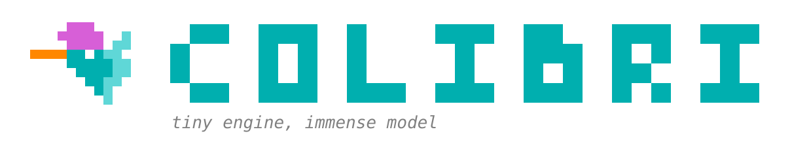
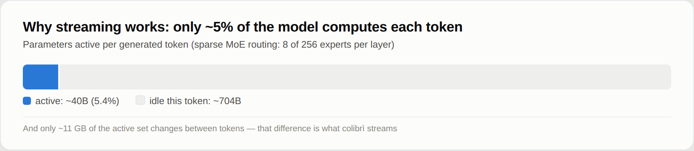
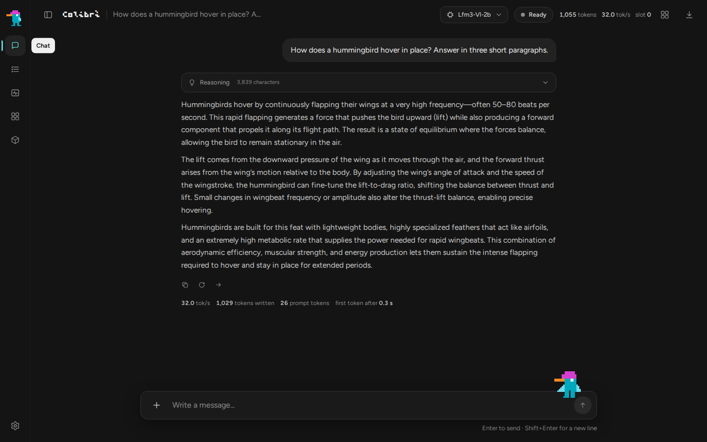
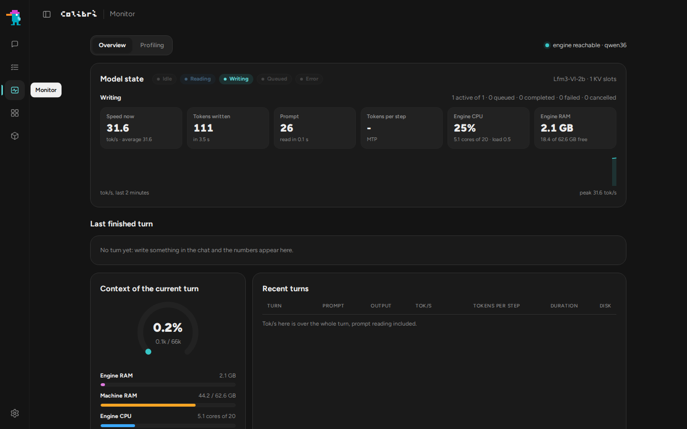
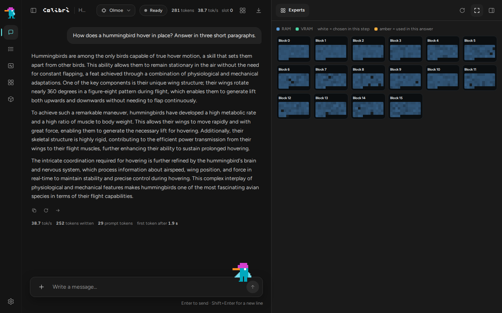
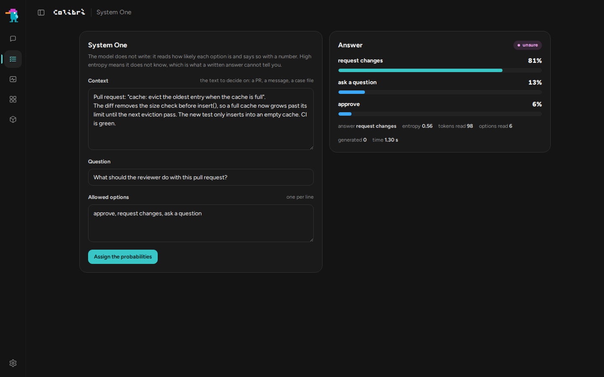
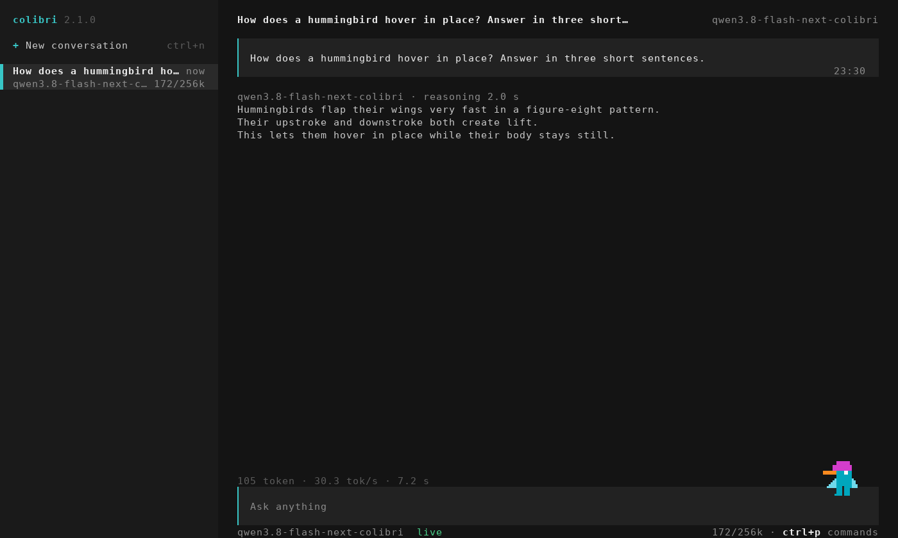
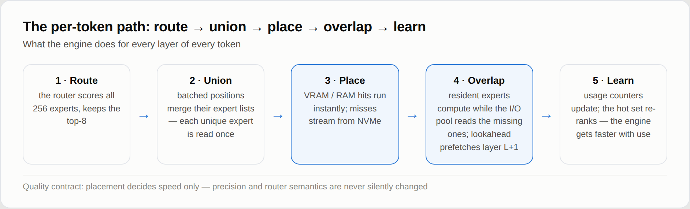
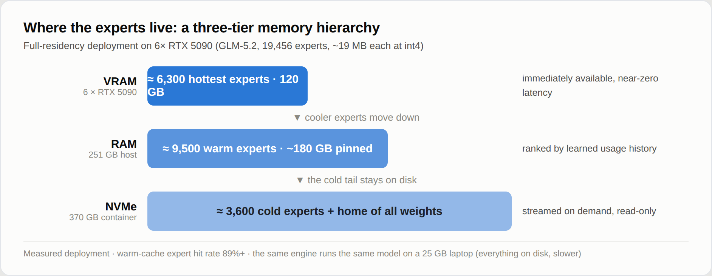
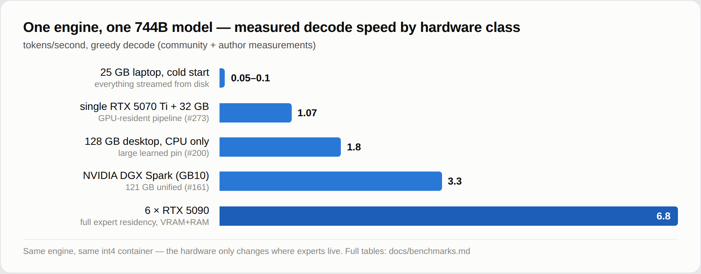

<p align="center">
  
</p>

<p align="center">
  <a href="https://justvugg.github.io/colibri"></a>
  <a href="https://github.com/JustVugg/colibri/releases"></a>
</p>

<p align="center">
  <a href="https://justvugg.github.io/colibri"><b>Сайт</b></a> ·
  <a href="https://discord.gg/RXV83nSZdk"><b>Discord</b></a> ·
  <a href="README.md">English</a> · <a href="README.zh-CN.md">简体中文</a> · <a href="README.zh-TW.md">繁體中文</a> · <a href="README.it.md">Italiano</a> · <a href="README.ja.md">日本語</a> · <a href="README.id.md">Bahasa Indonesia</a> · <a href="README.pt-BR.md">Português (Brasil)</a> · <a href="README.es.md">Español</a> · <a href="README.fr.md">Français</a> · <a href="README.de.md">Deutsch</a> · Русский
</p>

**Крошечный движок, огромная модель.** colibri запускает очень большие открытые модели на машине, которая у вас уже есть. Модель mixture-of-experts (смесь экспертов) с сотнями миллиардов параметров использует для каждого токена лишь небольшую часть себя: colibri держит эту часть в RAM, а остальное, то есть эксперты, читает с диска, когда модель их запрашивает. Чистый C, один файл на семейство моделей, GPU не нужна.

Сегодня работают тринадцать движков. Десять предназначены для языковых моделей: **GLM-5.2/5.3** (он также запускает **Mistral-Large-4**), **GLM-5.3-Flash**, **Inkling**, **Kimi K3** (и K3.1 Pro), **DeepSeek V4 Flash**, **DeepSeek V4.1 Flash**, **MiMo-V2.6 Flash** (и Pro), **Qwen3.8-Flash-Next**, **Qwen3.6** (он также запускает Qwen3-Coder, плотную модель Qwen3.8-27B, **Flint**, **Muse Spark Open** и **LFM3-VL**) и **OLMoE**. Один рисует картинки: **Qwen-Image-2.1**. Два принимают решения: **Laya** и **GLiNER2.5-Decide**, а третья модель решений, **Clef**, работает на движке Qwen3.6. Языковые модели также запускаются из уже опубликованных файлов GGUF, которые читаются как есть ([GGUF](docs/gguf.md)), на CPU, на любой GPU через Vulkan и на картах NVIDIA через CUDA. [Какой выбрать для моей машины](#which-model-for-my-machine)

```
$ ./coli chat
  colibri v2.1.0 · GLM-5.2 · 744B MoE · int4 · streaming CPU
  ✓ ready in 32s · resident 9.9 GB
  › ciao!
  ◆ Ciao! Come posso aiutarti oggi?
```

<p align="center">
  <a href="https://www.buymeacoffee.com/justvugg"></a>
  <br>
  <sub>colibri бесплатен и имеет открытый исходный код. Если он заслужил место на вашей машине, чашка кофе поможет оплатить следующий движок и следующий скачок скорости.</sub>
</p>

<a id="get-started"></a>
<a id="the-one-step-way"></a>

## Начало работы в один шаг

Вам нужен компьютер с **8 ГБ оперативной памяти** как минимум (лучше 16 ГБ или больше), **22 ГБ свободного места на диске** для самой маленькой модели и подключение к интернету. Видеокарта необязательна.

**Windows**

1. На этой странице нажмите **Code**, затем **Download ZIP**, и распакуйте архив.
2. Дважды щёлкните **`START-HERE.bat`** в распакованной папке. Если Python не установлен, программа предложит установить его за вас.

**Linux** (Ubuntu и Debian; в других дистрибутивах те же пакеты называются иначе)

```bash
sudo apt install git python3 build-essential
git clone https://github.com/JustVugg/colibri
cd colibri
./start-here.sh
```

**macOS** (с [Homebrew](https://brew.sh))

```bash
xcode-select --install
brew install libomp git python
git clone https://github.com/JustVugg/colibri
cd colibri
./start-here.sh
```

Ответьте на один вопрос, какую модель выбрать, и Enter примет рекомендацию. Затем установка:

1. **изучает вашу машину**: RAM, свободное место на диске, CPU и GPU;
2. **рекомендует модель, которая подходит**: часть модели, которая всегда остаётся в RAM, плюс минимальный кэш экспертов должны поместиться в вашу RAM, а загрузка на ваш диск;
3. **готовит движок**: собирает его для вашей машины, если есть компилятор, иначе скачивает уже собранный, который работает на CPU и, в Linux и Windows, также на GPU через Vulkan. Сборку под вашу GPU делает, когда это выгодно: CUDA для карты NVIDIA в Linux, если установлен CUDA toolkit, иначе Vulkan. На дискретной GPU это делается всегда; на встроенной, которая делит RAM с CPU, только для моделей, которые по измерениям там быстрее (Qwen3.6, Qwen3-Coder и Qwen3.8-Flash-Next). Если пакета не хватает, установка выводит точную команду для его установки и продолжает на CPU; запустите установку снова после этого, и движок пересоберётся под GPU;
4. **загружает модель** с индикатором прогресса и возобновлением: останавливайте её когда угодно, запустите снова, и она продолжит с того места, где остановилась;
5. **запускает colibri и открывает панель** в браузере, и выводит адреса, которые могут использовать другие приложения:

```
Starting colibri
  Browser:             http://127.0.0.1:8000/
  OpenAI base URL:     http://127.0.0.1:8000/v1
  Anthropic base URL:  http://127.0.0.1:8000
  stop: press Ctrl+C here (or close this window)
```

**В следующий раз** запустите `START-HERE.bat` или `./start-here.sh` снова: colibri стартует сразу, без загрузки и без сборки. `c/coli status` показывает, что установлено и работает ли, `c/coli stop` останавливает его (`c\coli.cmd status` и `c\coli.cmd stop` в Windows).

Параметры указываются после `./start-here.sh` или `START-HERE.bat`:

| Параметр | Что делает |
|---|---|
| `--list` | каждая модель, сверенная с этой машиной, и причина, по которой одна из них не подходит |
| `--model ID` | установить эту модель (идентификаторы в [таблицах ниже](#which-model-for-my-machine)) |
| `--yes` | без вопросов: принять рекомендацию |
| `--dir DIR` | разместить модели на другом диске (по умолчанию `~/colibri-models`) |
| `--backend vulkan`, `cuda` или `cpu` | выбрать сборку движка самостоятельно; `--no-gpu` равносилен `--backend cpu` |
| `--model-dir DIR` | использовать модель, которую вы уже загрузили |
| `--reconfigure` | выбрать другую модель |

Что делает каждый шаг, подробно: [docs/quickstart.md](docs/quickstart.md#the-one-step-way).

### Если что-то пошло не так

| Что вы видите | Что делать |
|---|---|
| остановилось во время загрузки | запустите ту же команду снова: она продолжит с байтов, которые уже лежат на диске |
| `to use the GPU through ..., first run: <command>` | выполните эту команду, затем установку снова: движок пересоберётся под GPU, и ничего не будет загружаться заново |
| `the ... build failed`, например `Unsupported gpu architecture`, когда установленный CUDA toolkit больше не поддерживает карту | установка сначала сверяет toolkit с картой и сама выбирает Vulkan, объясняя почему; если сборка всё равно не удалась, предлагается следующая (Vulkan, затем CPU). `./start-here.sh --backend vulkan` принудительно выбирает Vulkan; `--no-gpu` оставляет работу на CPU |
| `needs N GB free for the download` | `--dir` с папкой на диске побольше |
| в WSL папка модели лежит под `/mnt/c` | держите её на диске Linux (по умолчанию `~/colibri-models`): `/mnt/c` во много раз медленнее |
| вы обновили копию репозитория (`git pull`) | запустите `./start-here.sh` снова: он пересоберёт движок, если исходники изменились, и затем запустит его |
| что-либо другое | `c/coli logs -n 50` показывает журнал сервера, запущенного в фоне (запущенный на переднем плане пишет в свой терминал), а `c/coli logs --install` журнал установки; откройте [issue](https://github.com/JustVugg/colibri/issues) и приложите последние строки, которые вывела установка |

### Пусть установит ваш ИИ-ассистент

Если вы используете ИИ-ассистент для программирования, он может сделать всё это за вас. Попросите его:

> Установи colibri на этой машине по инструкции docs/AI_SETUP.md с https://github.com/JustVugg/colibri

[docs/AI_SETUP.md](docs/AI_SETUP.md) даёт ассистенту каждый шаг в виде команды с результатом, понятным машине, и велит спросить вас, прежде чем загружать модель или устанавливать системный пакет. Ассистенты, которые говорят по протоколу Model Context Protocol, могут вместо этого использовать MCP-сервер colibri: `coli mcp` предлагает инструменты, чтобы определить железо, рекомендовать модель, установить, запустить, остановить и проверить её ([docs/MCP_SERVER.md](docs/MCP_SERVER.md)).

### Или вручную

Чтобы выбрать каждый шаг самостоятельно (готовый релиз или сборку из исходников, любую модель из таблиц ниже, затем `coli chat`, `coli web` или `coli serve`), см. [Установка вручную](#install-by-hand) или [руководство Quick Start](docs/quickstart.md), где каждая платформа расписана по шагам.

## Что такое colibri и зачем он нужен

Модель mixture-of-experts огромна на диске и мала на токен. GLM-5.2 имеет 744B параметров, для каждого токена использует около 40B, и лишь около 11 GB из них меняются от одного токена к другому: маршрутизируемые эксперты.

<p align="center">
  
</p>

Поэтому модели не нужно помещаться в быструю память; её нужно **разместить**. Плотная часть (attention, общие эксперты, эмбеддинги) остаётся в RAM. Маршрутизируемые эксперты остаются на диске и читаются, когда роутер их запрашивает, через кэш, который учится, какие эксперты использует ваша работа. GPU, если она есть, держит самые горячие эксперты и плотные слои. Место, где лежит вес, меняет скорость получения ответа, но не то, какие веса и какие решения роутера его дают.

Зачем: чтобы запускать модели такого размера на железе, которое у людей уже есть, чтобы наблюдать, как они работают (панель показывает каждый эксперт в момент его срабатывания), и держать движок достаточно маленьким, чтобы каждый мог его измерить и ускорить. colibri также открытая исследовательская платформа: оптимизация получает своё место, только если есть воспроизводимое сквозное измерение, а политика по умолчанию никогда молча не меняет точность модели или семантику роутера. Меньше быстрой памяти может стоить скорости, но не должно тихо переопределять модель. Подробности: [Как это работает](#how-it-works).

<a id="which-model-for-my-machine"></a>

## Какую модель выбрать для моей машины

Установка рекомендует самую мощную модель, которая работает из RAM на вашей машине, и сразу под ней перечисляет более крупные, которые читаются с диска потоком. `./start-here.sh --list` показывает их все в сравнении с вашей машиной. Таблицы следуют собственному каталогу установки ([`c/setup_catalog.py`](c/setup_catalog.py)); размеры загрузки — это те, что Hugging Face указывает для каждого репозитория.

- **RAM** — это два числа: ниже первого модель не запускается, а от второго работает так, как в измерениях.
- **GPU** — это то, что установка может собрать для этого движка ([GPU](#gpus)).
  *Integrated too* означает, что движок также использует встроенную GPU, где такие движки оказались быстрее в измерениях; остальные используют только дискретную GPU.
- **Измерено** — это то, что было замерено на указанной машине: для чат-моделей — скорость декодирования. Буквы обозначают машины, перечисленные под таблицами. Пустая ячейка означает, что никто ещё не измерял.

**Небольшие модели, которые работают из RAM**

| Модель | `--model` | Загрузка | RAM | GPU | Измерено |
|---|---|---|---|---|---|
| **Qwen3.6-35B-A3B**: чат с рассуждениями и инструментами | `qwen36-35b` | 23 GB | 10 / 20 GB | CUDA, Vulkan (включая встроенную) | 6.0 tok/s на CPU, 9.9 с Vulkan на встроенной GPU (A); 30.0 с CUDA (C) |
| Qwen3-Coder-30B-A3B: код и вызовы инструментов, без рассуждений | `qwen3-coder-30b` | 19 GB | 8 / 18 GB | CUDA, Vulkan (включая встроенную) | 8.5-9.6 tok/s со всеми экспертами в RAM, 5.1 с 32 на слой (A, CPU) |
| **Qwen-Image-2.1**: из текста в изображение, некоммерческая лицензия | `qwen-image-2.1` | 33 GB | 12 / 18 GB | Vulkan | одно изображение 768x512 за 2 min 40 s (8 ядер Zen 4, CPU) |

**Крупные модели, чьи эксперты читаются с диска потоком** (скорость задаёт диск: больше всего помогает быстрый NVMe)

| Модель | `--model` | Загрузка | RAM | GPU | Измерено |
|---|---|---|---|---|---|
| DeepSeek V4 Flash REAP 150B: 132 из 256 экспертов | `deepseek-v4-flash-reap` | 85 GB | 16 / 32 GB | CUDA, Vulkan | |
| **DeepSeek V4 Flash** (284B): инструменты | `deepseek-v4-flash` | 167 GB | 16 / 32 GB | CUDA, Vulkan | 0.93 tok/s с 32 GB (Ryzen 7 5800X), 1.24 с 63 GB (Ryzen 9 5950X), только CPU; 1.5-1.6 с CUDA (RTX 5080, 32 GB, два NVMe) |
| **MiMo-V2.6 Flash** (309B): зрение и инструменты | `mimo-v2.6-flash` | 172 GB | 32 / 52 GB | Vulkan | 2.34-3.37 tok/s (A, CPU) |
| **Qwen3.8-Flash-Next** (125B + 51B n-gram): зрение и инструменты | `qwen38-flash-next` | 186 GB | 24 / 32 GB | CUDA, Vulkan (включая встроенную) | 1.91-2.56 tok/s с 32-96 экспертами на слой; 3.99 с необязательными int4-экспертами (A, CPU) |
| **GLM-5.2** (744B): эталонная модель, с головой MTP | `glm-5.2` | 429 GB | 16 / 24 GB | CUDA, Vulkan | 0.05-0.1 tok/s на холодную на ноутбуке с 25 GB; 1.83 на Ryzen AI Max+ 395 с 128 GB; 9.0-9.2 на 6x RTX 5090 |
| GLM-5.3 (744B): тот же движок, без головы MTP | `glm-5.3` | 419 GB | 16 / 24 GB | CUDA, Vulkan | |
| **Inkling** (975B): int4-эксперты, плотные веса bf16 | `inkling` | 514 GB | 120 / 128 GB в том виде, как загружено; 25 GB после [конвертации плотной части](docs/inkling.md) | CUDA, Vulkan | 0.25 tok/s (Ryzen 9 7900, 187 GB, RTX A6000) |
| MiMo-V2.6 Pro (1.02T): зрение и инструменты | `mimo-v2.6-pro` | 564 GB | 54 / 64 GB | Vulkan | 0.66-0.79 tok/s (A, CPU) |
| **Kimi K3** (2.8T): самая большая | `kimi-k3` | 1.56 TB | 32 / 64 GB | CUDA, Vulkan | около 9.4 s на токен, эксперты читаются со скоростью 6.3 GB/s |
| **Kimi K3.1 Pro** (2.8T): K3 с разреженным вниманием после 2048 токенов | `kimi-k3.1-pro` | 1.56 TB | 32 / 64 GB | CUDA, Vulkan | |

<a id="other-supported-models"></a>

**Вручную: шаг конвертации или подготовки после загрузки**

| Модель | Загрузка, затем на диске | RAM | GPU | Измерено |
|---|---|---|---|---|
| **OLMoE** (7B): небольшая, чтобы освоиться с инструментами | 14 GB, 7 GB после конвертации в int8 | 8 GB | Vulkan | 22-23 tok/s (A, CPU) |
| Qwen3.8-27B (плотная): текст и изображения | 56 GB, 51 GB после конвертации | 20 GB в int4, 30 GB в int8 | Vulkan | 3.45 tok/s в int4, 2.1 в int8 (сервер CPU на 16 потоков) |
| **GLM-5.3-Flash** (321B): зрение и инструменты | 328 GB, сконвертированы шард за шардом в 195 GB | 25 GB | CUDA, Vulkan | около 20 s на токен на прогретом, 44 s на холодном (6 ядер, 25 GB, обычный диск) |
| **DeepSeek V4.1 Flash** (552B): зрение и инструменты, без конвертации, но с разовой подготовкой | 510 GB | около 18 GB плюс кэш экспертов (пик 24.8 GB при 8 на слой) | Vulkan | 0.21-0.24 tok/s (сервер CPU на 16 потоков, который держит 68% экспертов) |

<a id="from-a-gguf"></a>

**Из GGUF: опубликованные файлы, которые читаются как есть**

`./coli import` берёт первый файл GGUF (остальные его части лежат рядом) и записывает рядом папку модели; затем эту папку передаёте в `--model`, как и для любой другой ([gguf.md](docs/gguf.md)). Ничего не конвертируется и не квантуется заново: блоки работают так, как их содержит файл, от IQ1_S до Q8_0, F16, BF16 и MXFP4. Движки всех чат-моделей выше тоже читают GGUF ([архитектуры](docs/gguf.md#supported-architectures)); эти модели поставляются как GGUF:

| Модель | GGUF | GPU | Измерено |
|---|---|---|---|
| **Mistral-Large-4** (1T, 52B активных): текст, изображения, рассуждения и инструменты | unsloth, UD-IQ1_S 233 GB | CUDA, Vulkan | 1.34-1.36 tok/s с CUDA, 1.16-1.17 с Vulkan (D) |
| **Muse Spark Open** (816B, 42B активных): текст и инструменты, по лицензионному соглашению Meta | unsloth, от UD-IQ1_S 176 GB до UD-Q4_K_XL 505 GB | CUDA, Vulkan | 1.55-1.58 tok/s с Vulkan, 1.34-1.40 с CUDA, 0.83-0.89 на CPU (D) |
| **Flint** (40B, 2.5B активных): текст и инструменты, Apache 2.0 | unsloth, от UD-IQ1_M 11.4 GB до BF16 79.6 GB | CUDA, Vulkan | UD-Q4_K_XL: 77.4 tok/s с CUDA, 77.7 с Vulkan, 15.8 на CPU (D) |
| **LFM3-VL-2B**: текст, изображения и инструменты, LFM Open License | LiquidAI, от QAD-Q4_0 до BF16 (или чекпоинт, сконвертированный) | CUDA, Vulkan | Q4_K_M: 235.1 tok/s с CUDA, 214.1 с Vulkan, 34.5 на CPU (D) |
| **Qwen-Image-2.1** и его **Turbo**: из текста в изображение, некоммерческая лицензия ([qwen-image.md](docs/qwen-image.md#gguf-unsloth)) | unsloth, от Q2_K 2.5 GB до F16 14.2 GB, с Qwen3-VL-8B-Instruct GGUF в качестве текстового энкодера | Vulkan | Turbo Q4_K_M, 1024x1024 за 8 шагов: 37 s денойзинга с Vulkan (D); при 512x512 8.4-9.3 s на шаг на CPU (A) |

Крупные модели из таблиц выше из их GGUF, на той же машине: [Бенчмарки](#large-models-on-the-same-machine).

<a id="system-one-a-decision-with-a-probability"></a>

**Модели решений** (отвечают на вопросы [System One](#system-one-a-decision-with-a-probability), а не ведут чат)

| Модель | Загрузка, затем на диске | RAM | GPU | Измерено |
|---|---|---|---|---|
| **Laya** (Convai Innovations), английский | 0.85 GB | 1.7 GB | CPU, CUDA | 219 ms на один вопрос, 882 ms на три (B); двенадцать за 0.69 s с CUDA, 11.4-13.0 s на CPU (D) |
| **GLiNER2.5-Decide** (fastino), английский | 1.95 GB | 1.9 GB | CPU, CUDA | 294 ms на один вопрос, 897 ms на три (B, под нагрузкой); двенадцать за 0.16-0.21 s с CUDA, 2.0-2.6 s на CPU (D) |
| **Clef** (Cloudflare): Qwen3.8-27B с головой решений, умеет также чатиться | 55 GB, 52 GB после конвертации | от 19 GB в int4 до 55 GB в f16 | CPU | 20.4 s на запрос в int8 (A) |

Машины:
**A** настольный компьютер Ryzen 7 PRO 8700GE (8 ядер, 61-64 GB DDR5, NVMe, встроенная Radeon 780M);
**B** ноутбук i7-1355U;
**C** RTX 3070 8 GB в машине Threadripper 3945WX, с плотными слоями и слоями DeltaNet на карте (int4-контейнер per-row);
**D** i5-13500 с 62 GB RAM, RTX PRO 4000 Blackwell SFF (24 GB) и двумя NVMe в массиве md: машина из [таблиц бенчмарков](#benchmarks).
Каждое число взято со страницы своей модели в [docs/](docs/) или из [таблиц бенчмарков](docs/benchmarks.md), с точными настройками.

Каждое семейство моделей имеет свою страницу: [qwen36.md](docs/qwen36.md) (Qwen3.6, Qwen3-Coder, Qwen3.8-27B, Flint, Muse Spark Open, LFM3-VL), [mistral-large4.md](docs/mistral-large4.md), [gguf.md](docs/gguf.md), [qwen38.md](docs/qwen38.md), [deepseek-v4.md](docs/deepseek-v4.md), [deepseek-v41.md](docs/deepseek-v41.md), [mimo.md](docs/mimo.md), [glm53-flash.md](docs/glm53-flash.md), [inkling.md](docs/inkling.md), [kimi_k3.md](docs/kimi_k3.md), [qwen-image.md](docs/qwen-image.md), [laya.md](docs/laya.md), [gliner_decide.md](docs/gliner_decide.md), [clef.md](docs/clef.md), а также GLM-5.2 в [Quick Start](docs/quickstart.md#3-get-the-model). Чекпоинты с той же архитектурой, что и у поддерживаемой, например KAT-Coder v2.5 на движке Qwen3.6, работают без изменений.

<a id="gpus"></a>

## GPU

### GPU не нужна

Каждый движок работает на CPU без установки чего-либо ещё. GPU — это более быстрое место для хранения весов, а не требование: для крупных моделей скорость задаёт диск, для небольших — RAM.

### Vulkan: любая GPU

Каждый MoE-движок может использовать любую GPU с драйвером Vulkan 1.2 (AMD, Intel, NVIDIA, встроенная или дискретная) двумя способами:

- **уровень экспертов**: кэш маршрутизируемых экспертов в памяти GPU, который при запуске заполняется экспертами, использовавшимися в ваших прошлых разговорах, и адаптируется, пока вы общаетесь с моделью. GPU вычисляет экспертов, которые у неё есть, пока CPU считает остальных;
- **плотная цепочка**: целый слой записывается как одна отправка на GPU, а текущее состояние модели хранится на GPU от слоя к слою.

Измерено на встроенной Radeon 780M машины A, файлы модели убирались из page cache перед каждым запуском, 100 токенов декодирования ([vulkan.md](docs/vulkan.md#the-chain-on-a-radeon-780m)):

| | CPU | Vulkan, уровень экспертов | Vulkan, уровень и плотная цепочка |
|---|---|---|---|
| Qwen3.6-35B-A3B, декодирование | 6.0 tok/s | 8.0 tok/s | **9.9 tok/s** |
| Qwen3.6-35B-A3B, промпт из 512 токенов | 35.7 s | 12.2 s | **9.5 s** |
| Qwen3.8-Flash-Next (int4-эксперты), декодирование | 3.5 tok/s | **3.8 tok/s** | 3.2 tok/s |
| Qwen3.8-Flash-Next, промпт из 512 токенов | 43.6 s | 38.7 s | **30.1 s** |
| OLMoE, декодирование (на прогретом) | **23.1 tok/s** | 12.8 tok/s | 17.3 tok/s |

Встроенная GPU делит RAM с CPU. Выигрыш даёт экономия работы и чтений с диска для экспертов, которые она содержит, поэтому она окупается на модели вроде Qwen3.6, а маленькая модель, чьи эксперты уже лежат в RAM, как OLMoE, может проиграть. Именно поэтому установка включает Vulkan на встроенной GPU только для Qwen3.6, Qwen3-Coder и Qwen3.8-Flash-Next, и поэтому каждый движок сам решает, запускать ли там плотную цепочку (Qwen3.6 — да, Qwen3.8 — нет). `--backend vulkan` всё равно запрашивает Vulkan.

**Включение и выключение GPU.** `coli setup --backend vulkan` использует GPU для любой модели, а `coli setup --backend cpu` (или `--no-gpu`) оставляет всё на CPU. Движок, собранный с Vulkan, использует GPU только при `COLI_VULKAN=1` в окружении `coli chat`, `serve` или `web` (установка выставляет его, когда выбрала Vulkan); без него движок работает на CPU. При включённой GPU `COLI_VK_CHAIN=0` оставляет уровень экспертов и запускает плотные слои на CPU. На встроенной GPU попробуйте оба варианта: на ноутбуке с Intel Iris Xe (Core i7-1355U) Qwen3.6 декодировал 2.1 tok/s на CPU, 1.7-1.9 с Vulkan и 2.1 с выключенной плотной цепочкой.

На дискретной GPU установка собирает Vulkan для каждого движка (сначала CUDA, там, где он у движка есть и установлен toolkit), с плотными слоями на карте. Ради этого случая проект и задуман. На RTX PRO 4000 (24 GB, машина D) Qwen3.6-35B-A3B декодирует со скоростью 92.9 tok/s и читает промпт из 2,076 токенов, OLMoE — 299.4 и 6,867 ([таблица](#three-backends-on-one-machine)). Модель больше карты держит эксперты, которые карта не вмещает, в пуле в RAM, и на каждом шаге CPU вычисляет их, пока карта считает свои, в том же кадре: Qwen3.8-Flash-Next IQ2_XS (68 GB) декодирует со скоростью 50.6 tok/s ([vulkan.md](docs/vulkan.md#the-routed-experts-in-the-frame-vk_dmoeh)). Один пользователь измерил Qwen3.6 на уровне от 17 до 19 tok/s на Tesla V100 16 GB ([#1852](https://github.com/JustVugg/colibri/issues/1852)). Числа с вашей карты приветствуются.

**Карты без Resizable BAR** теперь работают. Такая карта (все Turing, Ampere с прошивкой на момент выпуска, старые AMD с выключенной опцией) позволяет CPU напрямую писать лишь около 256 MB своей памяти; теперь colibri сам копирует веса через промежуточный буфер. Путь проверен принудительным включением и эмуляцией маленького окна на трёх устройствах, и на 780M он не стоит ничего измеримого; на карте без Resizable BAR он не измерялся ([vulkan.md](docs/vulkan.md#memory-placement-without-resizable-bar)).

CI проверяет путь Vulkan каждого движка против токенов CPU на программном драйвере. GPU складывает числа в другом порядке и хранит некоторые активации в f32 там, где CPU их округляет, поэтому длинный ответ может разойтись с ответом CPU на слово ([vulkan.md](docs/vulkan.md#the-other-engines)).

### CUDA: карты NVIDIA

Установка собирает CUDA в Linux, если установлен CUDA toolkit, для движков, у которых есть путь CUDA: GLM-5.2/5.3 и Mistral-Large-4, GLM-5.3-Flash, Inkling, Kimi K3, DeepSeek V4 Flash, DeepSeek V4.1 Flash, MiMo-V2.6, Qwen3.8-Flash-Next, а также Qwen3.6 с моделями, которые он запускает; OLMoE и движки решений собираются командой `make <engine> CUDA=1`. В Windows движок CUDA — это отдельная DLL ([windows.md](docs/windows.md)), и каждый релиз поставляется уже собранным: `colibri-<version>-windows-x86_64-cuda.zip` содержит `coli_cuda.dll` (карты с compute capability 8.0 и новее) и движки colibri, glm53, qwen36 и kimi_k3, которые её загружают, вместе с собственными CUDA DLL для DeepSeek V4. Распакуйте его поверх основного архива, и установка выберет CUDA.

- **Каждый слой на карте** для Qwen3.6, Qwen3.8 и OLMoE: плотные слои, attention и маршрутизируемые эксперты, которые есть на карте, работают как одна цепочка, а те, которых на карте нет, выполняются на CPU. На RTX PRO 4000 Qwen3.6-35B-A3B UD-Q4_K_M декодирует со скоростью 104.8 tok/s и читает промпт из 3,491 токена, OLMoE — 354.6 и 10,418 ([таблица](#three-backends-on-one-machine)).
- **Уровень маршрутизируемых экспертов на карте для каждого движка** (`cu_tier.h`), а плотные матрицы на ней — для DeepSeek V4, V4.1, Kimi K3, GLM-5.3 и MiMo (`cu_dense.h`).
- **Блоки GGUF на карте** (`cuda_bd.cuh`): каждый тип блока ggml из 32 весов и больше, каждая строка так, как её содержит файл; промпт проходит через tensor cores ([gguf.md](docs/gguf.md)).
- **Уровень экспертов в VRAM** хранит на карте самые горячие эксперты, выбранные по измеренной маршрутизации; промахи вычисляются на CPU одновременно. Qwen3.6 на двух картах по 8 GB (RTX 3070 и Quadro RTX 4000) декодировал 11.3 tok/s с прогретой историей ([qwen36-cuda-tier.md](docs/qwen36-cuda-tier.md)); GLM-5.2 на шести RTX 5090 со всеми резидентными экспертами — 9.0-9.2 tok/s ([benchmarks.md](docs/benchmarks.md)); DeepSeek V4 Flash на RTX 5080 — 1.5-1.6 tok/s и промпт из 3,324 токенов за 90 s ([deepseek-v4.md](docs/deepseek-v4.md)).
- **Слои DeltaNet Qwen3.6 на карте** (`Q36_DN_GPU=1`, по выбору). Каждый из 30 слоев DeltaNet Qwen3.6 раньше четыре раза за токен копировал свои данные между картой и CPU; теперь токен декодирования выполняет весь слой на карте, а его рекуррентное состояние хранится в VRAM. На RTX 3070 с плотными слоями в VRAM: с 25.4 до 30.0 tok/s ([qwen36-cuda-tier.md](docs/qwen36-cuda-tier.md#the-deltanet-layer-on-the-card-q36_dn_gpu1)).
- **Старые карты.** Если CUDA toolkit больше не компилируется для вашей карты (CUDA 13 и V100, в [#1852](https://github.com/JustVugg/colibri/issues/1852)), установка замечает это до сборки и использует карту через Vulkan, объясняя почему; CUDA toolkit 12.x возвращает путь CUDA. Уровень CUDA для DeepSeek V4 собирается также для Pascal и Turing (`CUDA_ARCH=portable-pre-ampere NO_TC=1`).

Всё подробно: [docs/cuda.md](docs/cuda.md).

### Apple Silicon

Бэкенд Metal выполняет математику экспертов на GPU с унифицированной памятью для нескольких движков ([docs/metal.md](docs/metal.md)). В macOS-архиве релиза `colibri`, `inkling` и `kimi_k3` собраны с Metal: `COLI_METAL=1` (`K3_METAL=1` для Kimi K3) включает его, а без него они работают на CPU. Из исходников собирайте с `METAL=1`; однострочная установка собирает для CPU.

<a id="system-one-mode-ask-a-closed-question"></a>
<a id="system-one-a-decision-with-a-probability"></a>

## System One: решение с вероятностью

Большая часть того, о чём люди просят модель, — это выбор, а не абзац: какая очередь, какой вердикт, да или нет. `POST /v1/systemone` принимает состояние (текст или JSON) и типизированные вопросы и отвечает на каждый вопросом вероятностью каждого разрешённого варианта и уверенностью. Ничего не генерируется, поэтому ответ не может выйти за пределы вашего списка, а «модель не уверена» — это число, на которое можно поставить порог.

```bash
curl -s http://127.0.0.1:8000/v1/systemone -H 'Content-Type: application/json' -d '{
  "state": "340 lines, 8 files, no tests. CI is green but nothing covers that path.",
  "questions": {
    "review": {"type": "choice", "instructions": "What should the reviewer do?",
               "criteria": {"merge": null, "request changes": null, "close": null}},
    "risky":  {"type": "noul", "instructions": "Is this change risky?"}}}'
```

`choice` возвращается с выбранной меткой, вероятностью для каждой метки и `confidence` от 0 (равномерно) до 1 (уверенно); `noul` — с вероятностью «да»; `score` — с ожидаемым уровнем.

Кто отвечает:

- **Любая чат-модель, которую запускает colibri**, через оценку: она читает вероятность каждого варианта вместо того, чтобы писать ответ. Многие вопросы об одном документе читают документ один раз: на Qwen3.6 четыре вопроса об одном документе вернулись в 5.7x быстрее, чем генерация тех же ответов на той же CPU-машине.
- **Три модели решений** нативно, за один проход вперёд, с калибровкой, которую подобрали их авторы: [Laya](docs/laya.md) (Convai Innovations), [GLiNER2.5-Decide](docs/gliner_decide.md) (fastino) и [Clef](docs/clef.md) (Cloudflare; умеет также чатиться). Их размеры и скорость — в [таблице моделей решений](#which-model-for-my-machine).

**Переход с Jev.** Запрос и ответ — те же, что у API Jev от TypeSafe, поэтому клиент Jev переходит на colibri, меняя только базовый URL и ничего больше: `TYPESAFE_BASE_URL=http://127.0.0.1:8000` (ключ, который он уже отправляет, принимается сервером, запущенным без `COLI_API_KEY`). Два официальных SDK без изменений протестированы против `coli serve`.

Тот же режим есть в терминале (`/decide merge | request changes | close` в `coli chat`) и на странице System One панели. Полные запрос и ответ, правила подсчёта очков и случаи, где это не помогает: [docs/systemone.md](docs/systemone.md).

## Панель управления

Её открывает `coli web`, и её открывает также однострочная установка: чат, страница System One, Brain и страница Profiling, в светлой или тёмной теме.

### Новый чат

`coli ui` открывает новый чат рядом с работающим `coli serve`: рассуждения в собственном блоке, картинки для моделей с визуальной башней, веб-поиск, карта экспертов, живой монитор и агенты для программирования, сразу направленные на colibri. Семь языков. См. [ui/README.md](ui/README.md).

<p align="center">
  
</p>
<p align="center"><em>LFM3-VL-2B на CPU i5-13500, 32 tok/s.</em></p>

<p align="center">
  
</p>
<p align="center"><em><strong>Монитор</strong> во время записи LFM3-VL-2B: 31,6 tok/s, промпт прочитан за 0,1 s, 2,1 GB RAM.</em></p>

<p align="center">
  
</p>
<p align="center"><em>OLMoE с открытой <strong>картой экспертов</strong> рядом с чатом: по ячейке на каждого эксперта в каждом блоке, белая — если выбран на этом шаге, янтарная — если использован в этом ответе.</em></p>

<p align="center">
  
</p>
<p align="center"><em><strong>System One</strong>: дайте модели документ и только те ответы, которые она может выбрать. Здесь Qwen3.6-35B на RTX PRO 4000 читает pull request, который ломает лимит размера кэша: <strong>request changes с вероятностью 81%</strong>, энтропия 0,56 (не уверена), 98 токенов прочитано, 0 сгенерировано.</em></p>

Страница **Profiling** показывает, где каждый ход тратит время, фаза за фазой, с последними 30 ходами как трендом. Если рядом со шлюзом установлены [джоули](https://pypi.org/project/landauer-gap/) (`pip install landauer-gap`), она также показывает ватты машины и джоули на токен последнего хода.

### Терминальный интерфейс

`coli tui` — это тот же чат в терминале, один файл на C без библиотек: разговоры, ответ в потоке со свёрнутыми рассуждениями, монитор (`F2`) с CPU и RAM движка, GPU и её VRAM и профилем каждого хода, карта экспертов (`ctrl+e`), а также колибри со страницы чата, который рисуется картинкой там, где терминал умеет sixel (Windows Terminal, foot, WezTerm). Он подключается к работающему `coli serve` или запускает его с `--model`. См. [docs/tui.md](docs/tui.md).

<p align="center">
  
</p>
<p align="center"><em>Qwen3.8-Flash-Next на RTX PRO 4000 через <code>coli serve</code>, с контекстом 256K.</em></p>

## Использование из других приложений

`coli serve` (который установка запускает за вас) — это один сервер с несколькими API:

- **совместимый с OpenAI**: `/v1/chat/completions`, `/v1/completions` и `/v1/models`, со стримингом, JSON-ответами, стоп-последовательностями и logprobs;
- **совместимый с Anthropic**: `/v1/messages`, так что Claude Code и SDK Anthropic работают с ним;
- **вызов инструментов** на каждом чат-движке, кроме Inkling и OLMoE, каждый в нативном формате своей модели ([таблица по движкам](docs/api.md#tool-calling-support));
- **входные изображения** на GLM-5.3-Flash, DeepSeek V4.1 Flash, MiMo-V2.6, Qwen3.8-Flash-Next, Qwen3.8-27B, LFM3-VL и Mistral-Large-4 (из GGUF, с файлом `mmproj` рядом): путь в сообщении `coli chat`, вложение в `coli web` или `coli ui`, либо часть `image_url`;
- **входные документы** на каждом чат-движке: `/file PATH` в `coli chat` (или `coli chat --file PATH`) отправляет текст текстового файла или PDF вместе со следующим сообщением. Читается только файл, указанный таким образом, никогда путь внутри сообщения; это должен быть обычный файл с текстовым расширением или `.pdf`, размером до 64 MiB и 2 миллионов символов. PDF разбирается в отдельном процессе с ограничением по времени и памяти, с помощью `pdftotext` (poppler) или `pypdf`;
- **выходные изображения** с Qwen-Image-2.1 на `POST /v1/images/generations`, а также рисуются внутри терминала через `coli chat` ([qwen-image.md](docs/qwen-image.md));
- **решения** на `POST /v1/systemone` ([выше](#system-one-a-decision-with-a-probability));
- **несколько разговоров сразу** на каждом текстовом движке: `coli serve --kv-slots N` держит до 16, каждый со своим кэшем, и декодирует их следующие токены вместе ([api.md](docs/api.md#isolated-kv-contexts)).

Программы для кодинга и редакторы подключаются так же, как к любому провайдеру, совместимому с OpenAI: базовый URL `http://127.0.0.1:8000/v1`, id модели, который печатает `coli status`, и любой непустой ключ ([docs/api.md](docs/api.md#connect-a-coding-cli-or-editor)).

<a id="how-it-works"></a>

## Как это работает

<p align="center">
  
</p>

Каждый слой каждого токена проходит одни и те же пять шагов: маршрутизация, объединение, размещение, перекрытие, обучение. Цель проекта в том, что **размещение определяет только скорость**: решения роутера и точность весов одинаковы, отвечает ли эксперт из VRAM, из RAM или с диска.

<p align="center">
  
</p>

- **JIT для весов.** JIT-компилятор никогда не компилирует всю программу: он наблюдает, что выполняется, и компилирует горячие пути. colibri делает ту же ставку на веса. Измеренная «нагрузка» маршрутизации решает, какие эксперты получают место в VRAM, RAM или на диске: LRU-кэш на каждом слое плюс закреплённый горячий набор, выученный из ваших собственных разговоров (`.coli_usage`, обновляется каждый ход). colibri становится быстрее, чем больше вы им пользуетесь. Это работает, потому что у маршрутизации есть измеримая структура ([атлас экспертов](https://github.com/JustVugg/colibri/issues/175)).
- **Никогда не ждать диск дважды.** Три матрицы эксперта читаются одним `pread`; пул загрузчиков читает недостающих экспертов, пока резидентные вычисляются; пакет позиций читает каждого эксперта один раз; поток lookahead роутера может предзагрузить следующий слой (маршрутизация GLM-5.2 предсказуема на 71.6% на один слой вперёд). `DIRECT=1` (O_DIRECT) часто даёт большой выигрыш на быстрых дисках NVMe и нейтрален или хуже на других: измерьте на своём ([tuning.md](docs/tuning.md)).
- **Больше одного SSD.** `COLI_MODEL_MIRROR=/second/glm52_i4 ./coli chat --model /fast/glm52_i4` читает с копии на втором диске. Два NVMe на независимых контроллерах дали +37.5% в декодировании; работает и частичное зеркало на диске поменьше ([multidisk.md](docs/multidisk.md)).
- **От ноутбука до стойки.** На ноутбуке с 25 GB каждый эксперт читается с диска потоком, медленно и корректно; на большом хосте каждый эксперт резидентен (`CUDA_EXPERT_GB=auto PIN_GB=all`), и диск выпадает из декодирования. `COLI_NUMA=1` распределяет резидентные веса по контроллерам памяти многосокетного хоста, а локальный режим кластера выполняет маршрутизируемых экспертов на других машинах ([cluster.md](docs/cluster.md)).
- **Верная модель.** Каждый движок проверяется в CI против эталонной реализации своей модели на крошечной фикстуре. Attention MLA у GLM-5.2 хранит сжатое состояние KV (576 float на токен вместо 32,768, в 57x меньше), которое переживает перезапуски, поэтому разговор открывается снова без промпта, который нужно перечитать.
- **Спекуляция, которая окупается.** Голова MTP int8 у GLM-5.2 предлагает 2.2-2.8 токена за проход, когда это выгодно; голова MTP у Qwen3.8-Flash-Next, включённая по умолчанию, добавляет 16-20% с тем же выводом, а поиск по промпту — 6-7% на правках кода. Голова Qwen3.6 (`Q36_MTP=1`) поднимает декодирование с 99.7-104.5 до 115.8-120.1 tok/s на CUDA и с 83.2-83.8 до 99.9-109.3 на Vulkan (RTX PRO 4000). Голова DSpark у DeepSeek V4.1 предлагает черновики настолько глубокие, насколько позволяет её уверенность, а фильтр пропускает черновики, которые не могут окупиться. Там, где черновики стоят больше, чем экономят (DeepSeek V4), она остаётся выключенной ([speculative.md](docs/speculative.md), [tuning.md](docs/tuning.md#speculation-and-reproducibility)).

Движок — это один файл C на семейство моделей (`c/colibri.c` для GLM-5.2) поверх общих заголовков, без BLAS и без Python во время работы: Python запускает только установку, лаунчер, конвертеры и API-шлюз.

<a id="what-it-achieves"></a>
<a id="benchmarks"></a>

## Бенчмарки

<p align="center">
  
</p>

Тот же движок и тот же контейнер int4: железо меняет только то, где живут эксперты. Декодирование GLM-5.2, из [полных таблиц](docs/benchmarks.md):

- **6x RTX 5090, все эксперты резидентны:** 5.8-6.8 tok/s, 9.0-9.2 с выборочным NUMA-интерливом ([журнал эксперимента](docs/experiments/glm52-6x5090-2026-07-12.md));
- **128 GB, только CPU** (Ryzen AI Max+ 395): 1.83 tok/s на прогретом ([#200](https://github.com/JustVugg/colibri/issues/200));
- **одна RTX 5070 Ti, машина класса ноутбука:** 1.07 tok/s ([#273](https://github.com/JustVugg/colibri/issues/273));
- **ноутбук на 25 GB, с которого всё начиналось:** 0.05-0.1 tok/s на холодную, честный минимум.

<a id="three-backends-on-one-machine"></a>

### Три бэкенда на одной машине

Машина i5-13500 с 62 GB RAM и RTX PRO 4000 Blackwell SFF (24 GB, 70 W), каждая модель обслуживается `coli serve`: новый промпт из 450 токенов, затем ответ из 128 токенов в потоке, включая HTTP-запрос; лучший из двух прогонов, tok/s.

| GGUF | промпт CUDA | декодирование CUDA | промпт Vulkan | декодирование Vulkan | промпт CPU | декодирование CPU |
|---|---:|---:|---:|---:|---:|---:|
| Qwen3.6-35B-A3B UD-Q4_K_M | 3,491 | 104.8 | 2,076 | 92.9 | 122.6 | 13.9 |
| LFM3-VL-2B Q4_K_M | 12,317 | 235.1 | 8,174 | 214.1 | 286.5 | 34.5 |
| OLMoE-1B-7B-0125-Instruct Q4_K_M | 10,418 | 354.6 | 6,867 | 299.4 | 279.9 | 47.4 |
| LFM3-VL-2B F16 | 11,524 | 103.4 | 7,767 | 99.3 | 49.7 | 6.4 |
| Qwen3.8-Flash-Next IQ2_XS (68 GB: эксперты, которых карта не вмещает, остаются в RAM) | 217.1 | 51.4 | 214.3 | 50.6 | 38.3 | 9.3 |

<a id="large-models-on-the-same-machine"></a>

### Большие модели на той же машине

Снова машина D, каждая модель из своего опубликованного GGUF через `coli serve`: то, что не вмещают ни карта, ни RAM, приходит с двух NVMe. Токены в секунду, со страницы каждой модели:

| GGUF | размер | бэкенд | промпт | декодирование |
|---|---:|---|---:|---:|
| Inkling-Small UD-IQ2_XXS | 77 GB | Vulkan | 15.1-33.1 | 10.92-11.53 ([vulkan.md](docs/vulkan.md)) |
| MiMo-V2.6-Flash Q2_K_S | 106 GB | Vulkan | 8.2 | 7.8 ([gguf.md](docs/gguf.md)) |
| DeepSeek V4 Flash 0731 UD-IQ2_XXS | 85 GB | Vulkan | 19.7-20.4 | 6.18-6.25 ([vulkan.md](docs/vulkan.md)) |
| DeepSeek V4.1 Flash UD-IQ1_S |  | Vulkan | 31.8 за 3,403 токена | 5.01-5.29 ([deepseek-v41.md](docs/deepseek-v41.md)) |
| GLM-5.3-Flash UD-IQ2_XXS | 95 GB | Vulkan | 9.3 | 2.92-3.40 ([vulkan.md](docs/vulkan.md)) |
| Muse Spark Open UD-IQ1_S | 176 GB | Vulkan | 5.0-5.3 | 1.55-1.58 ([qwen36.md](docs/qwen36.md#muse-spark-open)) |
| Mistral-Large-4 UD-IQ1_S | 233 GB | CUDA | 240 токенов за 66-82 s | 1.34-1.36 ([mistral-large4.md](docs/mistral-large4.md)) |
| GLM-5.2 UD-IQ1_S | 202 GB | Vulkan |  | 0.633-0.658 ([gguf.md](docs/gguf.md)) |
| Kimi K3 UD-IQ1_S | 594 GB | Vulkan | 31 токен за 46.5 s | 0.349 ([gguf.md](docs/gguf.md)) |

### Длинные контексты и агенты

- **Контекст 256k на скорости 64k.** Qwen3.8-Flash-Next IQ2_XS на CUDA-цепочке машины D, с контекстом 262,144 токена: промпт 15.6 -> 151 tok/s, декодирование 9.6 -> 42.9 (план RAM при одном сегменте промпта, K/V в float16 на карте; при 65,536 читает 208 и декодирует 52.2, при 131,072 — 190 и 51.9) ([qwen38.md](docs/qwen38.md)).
- **Ходы агента читают только новое.** Короткий запрос между двумя ходами (агент, который запрашивает заголовок разговора) паркует разговор вместо того, чтобы взять его состояние, на каждом движке (`COLI_PARK`). Второй ход Hermes Agent на Qwen3.8-Flash-Next, 14,810 токенов: с 86 s до 4.9 s ([qwen38.md](docs/qwen38.md#an-agents-turns)).
- **KV-кэши в float16**: GLM-5.3 на 131,072 токенах занимает 11.9 GB вместо 23.9 ([CHANGELOG](CHANGELOG.md)).

Качество измерено, а не предполагается: стоимость контейнера int4 и аблации квантизации — в [benchmarks.md](docs/benchmarks.md#quality-benchmark). Чтобы добавить вашу машину, следуйте [протоколу бенчмарков](docs/benchmarking.md) и откройте issue с числами.

<a id="install-by-hand"></a>

## Установка вручную

<a id="1-get-colibri"></a>

**1. Программа.** Возьмите архив для своей платформы из [Releases](https://github.com/JustVugg/colibri/releases) (Linux x86_64, macOS, Windows; компилятор не нужен, нужен только [Python 3](https://www.python.org/downloads/) для лаунчера и API), распакуйте его и выполните `python3 coli info`. Движки Linux и Windows имеют Vulkan внутри, с их `shaders/` рядом, а движки macOS — Metal; для карты NVIDIA в Windows добавьте архив CUDA. Или соберите из исходников с `gcc` (или clang) и OpenMP:

```bash
git clone https://github.com/JustVugg/colibri && cd colibri/c
./setup.sh                                # checks gcc/OpenMP, builds, self-tests
make qwen36 VK=1                          # one engine, here with Vulkan (CUDA=1 for CUDA)
```

<a id="2-get-the-model"></a>

**2. Модель.** Любая загрузка из [таблиц выше](#which-model-for-my-machine): id установки соответствуют репозиториям Hugging Face, а на странице каждой модели есть команда загрузки и конвертации. Для GLM-5.2 используйте контейнер с групповым масштабированием (gs64) с головой int8 MTP, [`mastouri/GLM-5.2-colibri-int4-g64-with-int8-mtp`](https://huggingface.co/mastouri/GLM-5.2-colibri-int4-g64-with-int8-mtp) (429 GB), либо [`Justvugg/GLM-5.3-colibri-int4-g64`](https://huggingface.co/Justvugg/GLM-5.3-colibri-int4-g64) для GLM-5.3 (419 GB, без головы MTP). Старые зеркала int4 per-row не берите: по измерениям, они примерно на 9 пунктов хуже по качеству и стали причиной зацикливания ответов в [#455](https://github.com/JustVugg/colibri/issues/455). `./coli convert --model
/nvme/glm52_i4` собирает тот же контейнер из релиза FP8 шард за шардом, не требуя одновременно 756 GB на диске. Как проверить голову MTP и остальное: [quickstart.md](docs/quickstart.md#3-get-the-model). GGUF, который у вас уже есть, не требует конвертации: достаточно `./coli import` его первого файла ([выше](#from-a-gguf)).

<a id="3-run-it"></a>

**3. Запуск.** Из `c/` в копии исходников или из распакованного релиза. Лаунчер читает `config.json` модели и выбирает движок и его шаблон чата, поэтому команды одинаковы для каждой модели:

```bash
./coli chat  --model /nvme/qwen36          # chat in the terminal
./coli web   --model /nvme/qwen36          # API + dashboard, opens a browser
./coli serve --model /nvme/qwen36          # API + dashboard, no browser
./coli plan  --model /nvme/qwen36          # where the model will live: VRAM, RAM, disk
./coli doctor --model /nvme/qwen36         # read-only check: is everything ready?
./coli tune  --model /nvme/qwen36          # measure and save this machine's fastest safe settings
./coli import /nvme/Flint-UD-Q4_K_XL.gguf  # a GGUF: writes Flint-UD-Q4_K_XL.colibri next to it
./coli ui                                  # the chat UI, next to a running coli serve
./coli tui                                 # the chat in the terminal, on a running coli serve (or --model)
```

В Windows архив релиза содержит `coli.cmd` (`coli.cmd chat --model
D:\qwen36`); из копии исходников используйте `py -3 c\coli`. Файлы `.exe` — это движки, а не лаунчер. Все параметры и переменные:
[SETTINGS.md](docs/SETTINGS.md), [ENVIRONMENT.md](docs/ENVIRONMENT.md).

## Исследования и как помочь

colibri хочет, чтобы передовые модели меньше зависели от дефицитного железа и обходились дешевле в работе. Это значит менять способ хранения и перемещения весов, решать, что живёт в VRAM, RAM или на накопителе, перекрывать работу CPU и GPU и проверять новые способы декодирования. Ничего не сохраняется только потому, что это принято, и ничего не принимается только потому, что микробенчмарк выглядит быстрым: решающий результат — это сквозной инференс на реальных машинах, с измеренным качеством вместе со скоростью. Открытые вопросы:

| гипотеза | подтверждения на данный момент | эксперимент, который ещё нужен |
|---|---|---|
| История маршрутизации может размещать экспертов лучше, чем простой LRU | закреплённые по выученной истории эксперты улучшают повторяющиеся нагрузки, но могут переобучиться на конкретном промпте | честные A/B на отложенных данных и между сессиями на нагрузках: код, чат, многоязычие и длинный контекст |
| Несколько SSD могут превратить независимую пропускную способность в скорость декодирования | два независимых NVMe дали +37.5% декодирования; более медленный третий диск после взвешенного striping оказался нейтральным ([измерения](docs/multidisk.md#what-has-been-measured)) | воспроизвести при разных скоростях дисков, раскладках контроллеров и состояниях кэша |
| Планировщик, учитывающий железо, может автоматически приближаться к лучшей конфигурации каждой машины | бюджеты RAM/VRAM и несколько бэкендов обнаруживаются уже сегодня, а установка выбирает сборку | сравнить сгенерированный план с контролируемым перебором параметров на ноутбуках, рабочих станциях, NUMA-хостах и системах с несколькими GPU |
| Представления без потерь или с ограничением по качеству могут сократить перемещение весов достаточно, чтобы это имело значение | существуют аблации формата и квантизации с проверками корректности и качества | воспроизвести качество, объём перемещённых байт, задержку и стоимость на полезный токен вместе, а не только степень сжатия |
| Спекуляция, учитывающая маршрутизацию, может окупиться до почти полной резидентности | черновики MTP и грамматики работают, но MTP также измерялся с потерей 32% около 85% попаданий экспертов | построить карту точки безубыточности по принятию, доле попаданий экспертов, объединению батча и глубине черновика |
| Перекрытие CPU и GPU может скрывать передачу и синхронизацию, а не просто переносить узкое место | есть выигрыши CUDA, Metal и Vulkan, но быстрые CPU, встроенные GPU и низкая резидентность могут их свести на нет | профили по этапам и A/B с одной переменной на машинах с PCIe, с унифицированной памятью и полностью резидентных, а также больше дискретных карт для уровня Vulkan и цепочки, чем одна измеренная (RTX PRO 4000) |

Хотите помочь? Выберите строку и публикуйте также отрицательные результаты. Фиксируйте железо, коммит, модель, точную команду, промпт, состояние кэша, пропускную способность, время до первого токена, долю попаданий экспертов, прочитанные байты и проверку качества; меняйте одну переменную, повторяйте и прикладывайте сырые логи. Начните с [CONTRIBUTING.md](CONTRIBUTING.md) и [протокола бенчмарков](docs/benchmarking.md), затем [откройте issue](https://github.com/JustVugg/colibri/issues/new). Хорошо контролируемая неудача здесь ценнее, чем необъяснённое быстрое число.

## Документация

| тема | документ |
|---|---|
| Установка в один шаг и ручная установка на каждой платформе | [quickstart.md](docs/quickstart.md) |
| Установка через ИИ-ассистента и MCP-сервер | [AI_SETUP.md](docs/AI_SETUP.md), [MCP_SERVER.md](docs/MCP_SERVER.md) |
| API: OpenAI, Anthropic, инструменты, слоты KV, панель | [api.md](docs/api.md) |
| System One и модели решений | [systemone.md](docs/systemone.md), [laya.md](docs/laya.md), [gliner_decide.md](docs/gliner_decide.md), [clef.md](docs/clef.md) |
| Файлы GGUF: архитектуры, два режима, что каждый движок делает с блоками | [gguf.md](docs/gguf.md) |
| Модели на движке Qwen3.6 (Flint, Muse Spark Open, LFM3-VL) и Mistral-Large-4 | [qwen36.md](docs/qwen36.md), [mistral-large4.md](docs/mistral-large4.md) |
| Чат-интерфейс (`coli ui`) | [ui/README.md](ui/README.md) |
| Терминальный интерфейс (`coli tui`) | [tui.md](docs/tui.md) |
| Vulkan: уровень экспертов, плотная цепочка, карты без Resizable BAR | [vulkan.md](docs/vulkan.md) |
| CUDA и уровень CUDA у Qwen3.6 | [cuda.md](docs/cuda.md), [qwen36-cuda-tier.md](docs/qwen36-cuda-tier.md) |
| Apple Silicon, Windows | [metal.md](docs/metal.md), [windows.md](docs/windows.md) |
| Настройка, обучающийся кэш, предзагрузка | [tuning.md](docs/tuning.md) |
| Спекулятивное декодирование: головы MTP, поиск по промпту, фильтр | [speculative.md](docs/speculative.md) |
| Несколько SSD, несколько машин | [multidisk.md](docs/multidisk.md), [cluster.md](docs/cluster.md) |
| Бенчмарки и как измерять | [benchmarks.md](docs/benchmarks.md), [benchmarking.md](docs/benchmarking.md) |
| Каждый параметр и переменная окружения | [SETTINGS.md](docs/SETTINGS.md), [ENVIRONMENT.md](docs/ENVIRONMENT.md) |
| Черновики с принудительной грамматикой и экспериментальные ABI встраивания | [grammar-draft.md](docs/grammar-draft.md), [segment-runtime.md](docs/segment-runtime.md), [edge-runtime.md](docs/edge-runtime.md) |

## Структура репозитория

```
start-here.sh, START-HERE.bat   the one-step setup (Linux and macOS, Windows)
Makefile                        root build/check entry point
c/
├── colibri.c             GLM-5.2/5.3, Mistral-Large-4  (make glm)
├── glm53.c               GLM-5.3-Flash  (make glm53)
├── inkling.c             Inkling  (make inkling)
├── kimi_k3.c             Kimi K3  (make kimi_k3)
├── deepseek_v4.c         DeepSeek V4 Flash  (make deepseek-v4)
├── deepseek_v41.c        DeepSeek V4.1 Flash  (make deepseek_v41)
├── mimo.c                MiMo-V2.6 Flash and Pro  (make mimo)
├── qwen38.c              Qwen3.8-Flash-Next  (make qwen38)
├── qwen36.c              Qwen3.6, Qwen3-Coder, Qwen3.8-27B, Flint, Muse Spark,
│                         LFM3-VL, Clef  (make qwen36)
├── olmoe.c               OLMoE  (make olmoe)
├── qwenimage.c           Qwen-Image-2.1  (make qwenimage)
├── laya.c                Laya  (make laya)
├── gliner_decide.c       GLiNER2.5-Decide  (make gliner_decide)
├── tui.c                 the terminal UI, a client of coli serve  (make colibri-tui)
│
├── st.h, quant.h, idot.h        safetensors reads, container decoders, integer kernels
├── expert_ffn.h, expert_store.h routed-expert kernel and streaming expert cache
├── tok.h, json.h, compat.h      tokenizer, JSON, Windows/macOS shims
├── route_trace.h, kv_prefix.h   routing telemetry (.coli_usage), KV prefix reuse
├── gguf.h, park.h               GGUF reader, a conversation parked between an agent's turns
├── decide_serve.h               the decision engines' side of System One
│
├── backend_cuda.*, cu_tier.h, cuda_chain.cu   optional CUDA tier and chains (CUDA=1)
├── backend_metal.*       optional Metal tier  (METAL=1)
├── backend_vulkan.*, vk_tier.c, vk_chain.c   optional Vulkan tier and dense chain (VK=1)
│
├── coli                  user-facing CLI
├── setup_*.py            the one-step setup: hardware, catalog, downloads, flow
├── mcp_server.py         the MCP server (coli mcp)
├── openai_server.py      OpenAI- and Anthropic-compatible HTTP gateway
├── resource_plan.py      RAM/VRAM planner behind coli plan and coli doctor
├── tools/                conversion, fixtures and benchmarks
└── tests/                dependency-free C and Python tests
ui/                       the chat UI (coli ui)
web/                      the dashboard (a pure API client)
desktop/                  Tauri desktop shell around the dashboard
docker/                   container images
docs/                     reference docs, experiments, media
site/                     the website
```

**Один `.c` на семейство моделей, поверх общих однофайловых заголовков.** Движок владеет своей архитектурой и ничем больше; всё, что нужно двум движкам, живёт в заголовке, который они оба подключают, поэтому исправление доходит до всех сразу. Из корня репозитория `make`, `make check` и `make clean` делегируют работу Makefile движка.

## Поддержка проекта

colibri начинался как проект одного человека на 12-ядерном ноутбуке с 25 GB RAM; сегодня его числа приходят от сообщества реальных машин. Если он вам полезен:

- поставьте звезду репозиторию и поделитесь им;
- открывайте issue с бенчмарками с вашего железа: данные двигают этот проект сильнее всего остального;
- присоединяйтесь к [сообществу Discord](https://discord.gg/RXV83nSZdk), чтобы обсуждать эксперименты, результаты на железе и направления исследований;
- свяжитесь через issues на GitHub, чтобы поддержать разработку или передать железо.

## Почему «colibrì»

Колибри весит несколько граммов, зависает на месте и посещает тысячу цветков в день. Этот движок держит в живых гиганта на 744 миллиарда параметров на колибриных порциях: 25 GB RAM, двенадцать ядер CPU и много терпения к диску.

## Благодарности

colibri — это движок; модели, которые он запускает, — подарок. Спасибо командам, которые открыто публикуют свои веса: **Z.ai** (GLM), **Moonshot AI** (Kimi), **Alibaba Qwen**, **DeepSeek**, **Xiaomi** (MiMo), **Thinking Machines** (Inkling), **Allen AI** (OLMoE), **Convai Innovations** (Laya), **fastino** (GLiNER2.5-Decide) и **Cloudflare** (Clef); людям, которые публикуют сконвертированные контейнеры; и каждому участнику, который делал бенчмарки, bisect, воспроизводил запуск атласа или присылал патч. Сторонний код в этом репозитории и его лицензии: [THIRD_PARTY_NOTICES.md](THIRD_PARTY_NOTICES.md).

Эксперименты проекта по размещению экспертов, сжатию и маршрутизации также опираются на идеи и результаты следующих открытых исследований и систем:

- [REAP](https://github.com/CerebrasResearch/reap) и [EASY-EP](https://github.com/RUCAIBox/EASYEP) — для оценки важности экспертов по выходу и по предметной области.
- [SERE](https://github.com/JL-Cheng/SERE) — для перенаправления маршрутизации экспертов по сходству и [ReMoE](https://github.com/BUAA-OSCAR/ReMoE) — для тонкой настройки роутера с учётом локальности кэша.
- [MC-SMoE](https://github.com/UNITES-Lab/MC-SMoE) — для слияния и сжатия экспертов, направляемых маршрутизацией.
- [MoBE](https://github.com/inclusionAI/MoBE) и [D²-MoE](https://github.com/lliai/D2MoE) — для общих баз экспертов и низкоранговых дельт экспертов.
- [HybriMoE](https://github.com/PKU-SEC-Lab/HybriMoE) — для гибридного планирования экспертов на CPU/GPU, [ScMoE](https://arxiv.org/abs/2404.05019) — для перекрытия коммуникации экспертов с вычислениями и [OD-MoE](https://arxiv.org/abs/2512.03927) — для распределённой загрузки экспертов по требованию.
- [vLLM](https://github.com/vllm-project/vllm), [llama.cpp](https://github.com/ggml-org/llama.cpp) и [kTransformers](https://github.com/kvcache-ai/ktransformers) — за открытые системы инференса и работу по выгрузке экспертов, которые делают сравнения воспроизводимыми.

Движок также опирается на конкретную инженерную работу, а не только на идеи. Каждая из них используется или переписана в дереве исходников сегодня:

- [safetensors](https://github.com/huggingface/safetensors): контейнер, который читает каждый движок (`c/st.h`), включая его типы fp8 и I64.
- [tiktoken](https://github.com/openai/tiktoken): `c/tok.h` заново реализует его `byte_pair_encode` точно, объединяя соседнюю пару с наименьшим id в словаре конкатенации, поэтому словарь, производный от tiktoken, не требует списка слияний.
- [llama.cpp](https://github.com/ggml-org/llama.cpp): подмножество грамматики GBNF в `c/grammar.h` следует его синтаксису и его set-of-stacks PDA, а путь Metal заимствует его трюк резидентности `newBufferWithBytesNoCopy`.
- [vLLM](https://github.com/vllm-project/vllm): эталон семантики вывода, которой движок следует позиция за позицией (например, где финальная нормализация ложится относительно головы LM).
- [transformers](https://github.com/huggingface/transformers): оракул — CI воспроизводит модель с случайной инициализацией токен за токеном относительно него.
- [DietGPU](https://github.com/facebookresearch/dietgpu): кодек ANS на GPU, на котором держится экспериментальный сжатый уровень экспертов (`COLI_ANS`).
- [rocWMMA](https://github.com/ROCm/rocWMMA): бэкенд HIP отображает API `nvcuda::wmma` fragment/mma_sync из CUDA на себя (`c/backend_gpu_compat.h`), что позволяет одному исходнику .cu компилироваться для обоих производителей.

## Лицензия

Apache 2.0, Copyright 2026 Vincenzo Fornaro. См. [LICENSE](LICENSE) и [NOTICE](NOTICE). Каждая модель сохраняет лицензию, которую дали ей авторы (веса GLM-5.2 выпускает Z.ai по лицензии MIT; Qwen-Image-2.1 — только для некоммерческого использования).
