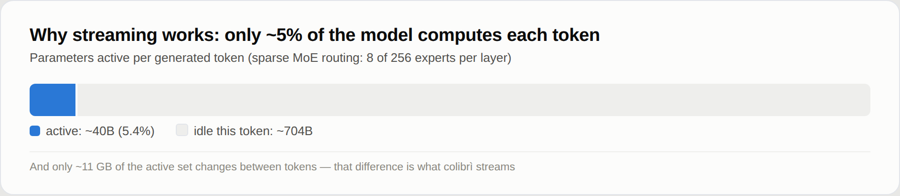
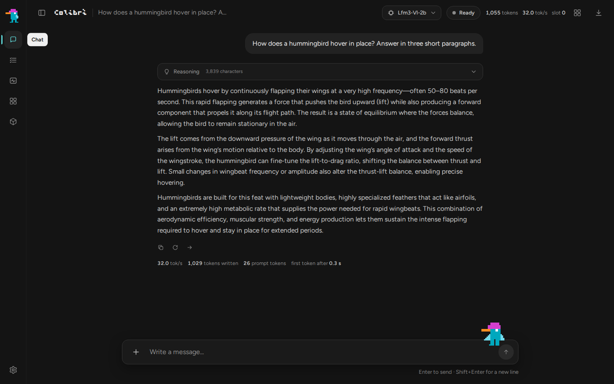
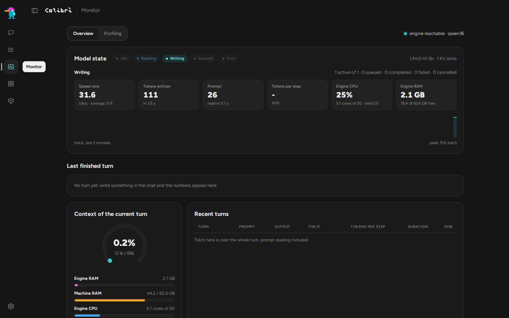
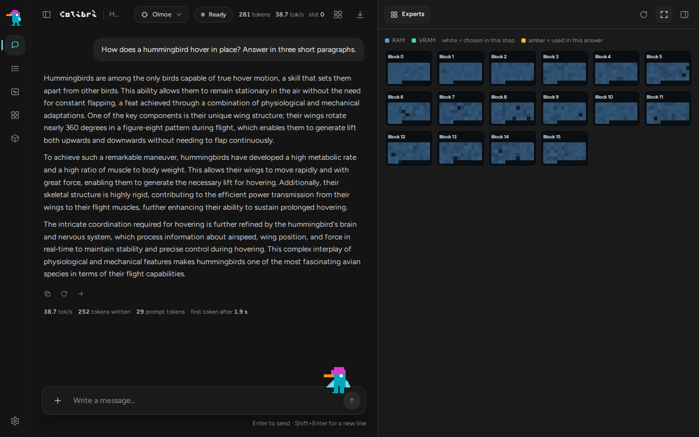
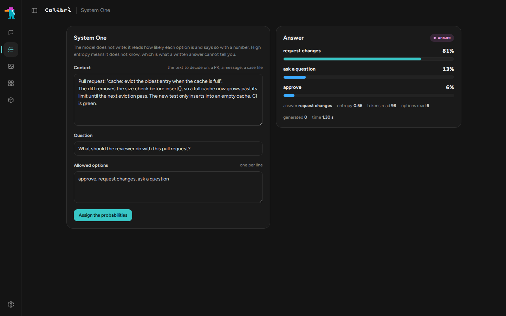
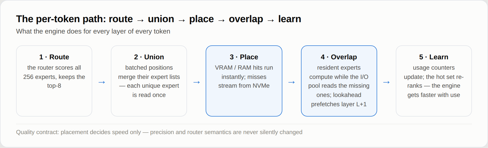
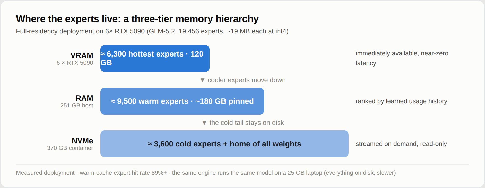
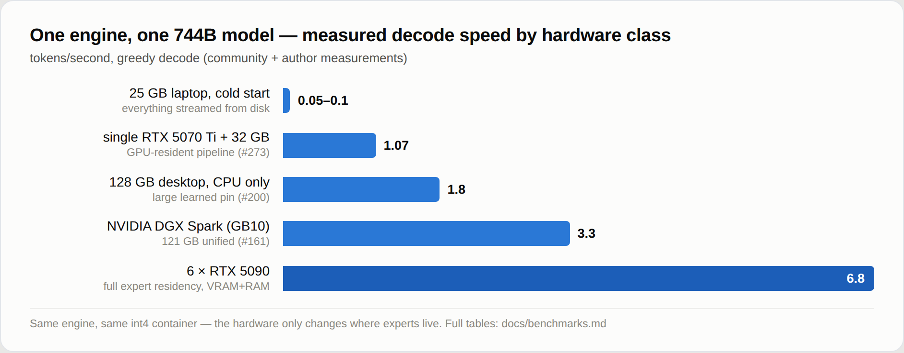

<p align="center">
  
</p>

<p align="center">
  <a href="https://justvugg.github.io/colibri"></a>
  <a href="https://github.com/JustVugg/colibri/releases"></a>
</p>

<p align="center">
  <a href="https://justvugg.github.io/colibri"><b>網站</b></a> ·
  <a href="https://discord.gg/RXV83nSZdk"><b>Discord</b></a> ·
  <a href="README.md">English</a> · <a href="README.zh-CN.md">简体中文</a> · 繁體中文 · <a href="README.it.md">Italiano</a> · <a href="README.ja.md">日本語</a> · <a href="README.id.md">Bahasa Indonesia</a> · <a href="README.pt-BR.md">Português (Brasil)</a>
</p>

**小巧引擎，龐大模型**。colibri 能在你現有的電腦上執行非常大的開放模型。
一個擁有數千億參數的專家混合（mixture-of-experts）模型，每個 token 只會用到自身的一小部分，
因此 colibri 把這一部分留在 RAM 中，其餘的部分，也就是專家，則在模型需要時才從硬碟讀取。
純 C 實作，每個模型家族一個檔案，不需要 GPU。

如今有十三個引擎在執行。其中十個用於語言模型：**GLM-5.2/5.3**（也執行 **Mistral-Large-4**）、**GLM-5.3-Flash**、**Inkling**、**Kimi K3**、**DeepSeek V4 Flash**、**DeepSeek V4.1 Flash**、**MiMo-V2.6 Flash**（以及 Pro）、**Qwen3.8-Flash-Next**、**Qwen3.6**（也執行 Qwen3-Coder、稠密的 Qwen3.8-27B、**Flint**、**Muse Spark Open** 與 **LFM3-VL**）以及 **OLMoE**。一個用來畫圖：**Qwen-Image-2.1**。兩個用來回答決策問題：**Laya** 與 **GLiNER2.5-Decide**，第三個決策模型 **Clef** 執行在 Qwen3.6 引擎上。語言模型也能直接執行已發布的 GGUF 檔案，按原樣讀取（[GGUF](docs/gguf.md)），可在 CPU 上執行，可透過 Vulkan 在任何 GPU 上執行，也可透過 CUDA 在 NVIDIA 顯示卡上執行。[哪一個適合我的機器](#which-model-for-my-machine)

```
$ ./coli chat
  colibri v2.1.0 · GLM-5.2 · 744B MoE · int4 · streaming CPU
  ✓ ready in 32s · resident 9.9 GB
  › ciao!
  ◆ Ciao! Come posso aiutarti oggi?
```

<p align="center">
  <a href="https://www.buymeacoffee.com/justvugg"></a>
  <br>
  <sub>colibri 免費且開源。如果它已經在你的電腦上站穩了腳步，一杯咖啡就能支持下一個引擎和下一次提速。</sub>
</p>

<a id="get-started"></a>
<a id="the-one-step-way"></a>

## 一步開始使用

你需要一台記憶體至少 **8 GB RAM** 的電腦（16 GB 以上更好），
最小的模型需要**硬碟上有 22 GB 可用空間**，另外還需要網路連線。顯示卡不是必要的。

**Windows**

1. 在這個頁面上按 **Code**，再按 **Download ZIP**，然後解壓縮。
2. 在解壓縮後的資料夾中按兩下 **`START-HERE.bat`**。如果缺少 Python，
   它會提議幫你安裝。

**Linux**（Ubuntu 與 Debian；其他發行版也有相同的套件，
只是名稱不同）

```bash
sudo apt install git python3 build-essential
git clone https://github.com/JustVugg/colibri
cd colibri
./start-here.sh
```

**macOS**（需要 [Homebrew](https://brew.sh)）

```bash
xcode-select --install
brew install libomp git python
git clone https://github.com/JustVugg/colibri
cd colibri
./start-here.sh
```

你只需要回答一個問題：要用哪個模型；直接按 Enter 就會採用推薦。
接著安裝程式會：

1. **檢查你的機器**：RAM、硬碟可用空間、CPU 與 GPU；
2. **推薦一個放得下的模型**：模型中永遠留在 RAM 的部分，加上最少量的專家快取，
   必須放得進你的 RAM，下載的檔案也必須放得進你的硬碟；
3. **取得引擎**：有編譯器時，它會針對你的機器建置引擎；沒有的話，
   就下載預先建置好的版本，在 CPU 上執行，在 Linux 與 Windows 上也能在 Vulkan GPU 上執行。
   在值得的情況下，它會為你的 GPU 建置：
   在 Linux 上，若是 NVIDIA 顯示卡且已安裝 CUDA toolkit，就用 CUDA，
   否則用 Vulkan。遇到獨立顯示卡時一律如此；遇到與 CPU 共用 RAM 的內建顯示晶片時，
   則只針對實測在那裡比較快的模型
   （Qwen3.6、Qwen3-Coder 與 Qwen3.8-Flash-Next）。如果缺少某個套件，
   它會印出安裝該套件的確切指令，並先繼續使用 CPU；之後再執行一次安裝程式，
   它就會為 GPU 重新建置；
4. **下載模型**，顯示進度並支援續傳：你隨時可以中斷，
   再執行一次就會從中斷的地方繼續；
5. **啟動 colibri，並在你的瀏覽器中開啟儀表板**，
   同時印出其他應用程式可以使用的位址：

```
Starting colibri
  Browser:             http://127.0.0.1:8000/
  OpenAI base URL:     http://127.0.0.1:8000/v1
  Anthropic base URL:  http://127.0.0.1:8000
  stop: press Ctrl+C here (or close this window)
```

**下一次**，再執行一次 `START-HERE.bat` 或 `./start-here.sh` 即可：colibri 會直接啟動，
不需要下載，也不需要建置。`c/coli status` 會顯示已安裝的內容以及是否正在執行，
`c/coli stop` 則會停止它（在 Windows 上是 `c\coli.cmd status` 與
`c\coli.cmd stop`）。

選項放在 `./start-here.sh` 或 `START-HERE.bat` 後面：

| 選項 | 作用 |
|---|---|
| `--list` | 列出每個模型與這台機器的對照，以及某個模型為什麼放不下 |
| `--model ID` | 安裝指定的模型（id 列在[下面的表格](#which-model-for-my-machine)中） |
| `--yes` | 不詢問任何問題：直接採用推薦 |
| `--dir DIR` | 把模型放在另一顆硬碟上（預設為 `~/colibri-models`） |
| `--backend vulkan`、`cuda` 或 `cpu` | 自行選擇引擎的建置方式；`--no-gpu` 等同於 `--backend cpu` |
| `--model-dir DIR` | 使用你已經下載好的模型 |
| `--reconfigure` | 改選另一個模型 |

每個步驟的詳細說明：[docs/quickstart.md](docs/quickstart.md#the-one-step-way)。

### 如果出了問題

| 你看到的情況 | 該怎麼做 |
|---|---|
| 下載到一半停止了 | 再執行一次相同的指令：它會從硬碟上已有的位元組接著下載 |
| `to use the GPU through ..., first run: <command>` | 執行那條指令，然後再執行一次安裝程式：它會為 GPU 重新建置，不會重新下載 |
| `the ... build failed`，例如已安裝的 CUDA toolkit 不再支援這張顯示卡時出現的 `Unsupported gpu architecture` | 安裝程式會先把 toolkit 和顯示卡對照檢查，自行選擇 Vulkan，並說明原因；如果建置仍然失敗，它會提供下一個選項（先 Vulkan，再 CPU）。`./start-here.sh --backend vulkan` 會強制使用 Vulkan；`--no-gpu` 則留在 CPU 上 |
| `needs N GB free for the download` | 用 `--dir` 指定一個位於較大硬碟上的資料夾 |
| 在 WSL 上，模型資料夾位於 `/mnt/c` 底下 | 把它放在 Linux 磁碟上（預設的 `~/colibri-models`）：`/mnt/c` 慢上好幾倍 |
| 更新了程式碼（`git pull`） | 重新執行 `./start-here.sh`：如果原始碼有變動，它會先重新編譯引擎，再啟動 |
| 其他任何問題 | `c/coli logs -n 50` 會顯示在背景啟動的伺服器日誌（在前景啟動的伺服器會輸出到它自己的終端機），`c/coli logs --install` 則顯示安裝程式的日誌；請附上安裝程式最後印出的幾行，開一個 [issue](https://github.com/JustVugg/colibri/issues) |

### 讓你的 AI 助手幫你安裝

如果你使用 AI 程式設計助手，它可以替你完成上述所有步驟。這樣問它：

> 請依照 https://github.com/JustVugg/colibri 上的 docs/AI_SETUP.md，在這台機器上安裝並設定 colibri

[docs/AI_SETUP.md](docs/AI_SETUP.md) 把每個步驟都寫成一條指令交給助手，
每條指令都會產生機器可讀的結果，並要求助手在下載模型或安裝系統套件之前先詢問你。
支援 Model Context Protocol 的助手則可以改用 colibri 的 MCP 伺服器：
`coli mcp` 提供偵測硬體、推薦模型、安裝、啟動、停止與檢查 colibri 的工具
（[docs/MCP_SERVER.md](docs/MCP_SERVER.md)）。

### 或者手動安裝

若想自己決定每一個步驟（預先建置的發布版本或從原始碼建置、下方表格中的任何模型，
然後是 `coli chat`、`coli web` 或 `coli serve`），
請見[手動安裝](#install-by-hand)，
或參考逐一說明各平台步驟的 [Quick Start 指南](docs/quickstart.md)。

## colibri 是什麼，以及為什麼

專家混合模型在硬碟上非常龐大，但每個 token 用到的部分很小。GLM-5.2 有
744B 參數，每個 token 大約使用 40B，而其中只有約 11 GB 會隨著 token 改變：
也就是路由專家。

<p align="center">
  
</p>

因此，模型不需要完整放進高速記憶體，而是需要被**妥善配置**。
稠密部分（注意力、共享專家、嵌入）留在 RAM 中。路由專家留在硬碟上，
在路由器需要時才讀取，中間經過一個會學習你的工作用到哪些專家的快取。
如果有 GPU，它會存放最熱門的專家與稠密層。權重放在哪裡，只會改變答案出現的速度，
不會改變產生答案的是哪些權重，也不會改變路由器的決策。

為什麼：為了在人們已經擁有的硬體上執行這種規模的模型，為了觀察它們如何運作
（儀表板會在每個專家被觸發時把它顯示出來），也為了讓引擎維持得夠小，
讓任何人都能測量它、讓它變得更快。colibri 同時也是一個開放的研究平台：
一項最佳化必須以可重現的端到端測量來證明自己的價值，
而預設策略絕不會在不告知的情況下改變模型精度或路由語意。
高速記憶體較少可能會犧牲速度，但絕不能悄悄地重新定義模型。
詳細內容請見[運作原理](#how-it-works)。

<a id="which-model-for-my-machine"></a>

## 我的機器適合哪個模型

安裝程式會推薦能在你的機器上從 RAM 執行、能力最強的模型，
並在它正下方列出從硬碟串流讀取的更大模型。
`./start-here.sh --list` 會把所有模型與你的機器逐一對照列出。下面的表格依據安裝程式本身的目錄
（[`c/setup_catalog.py`](c/setup_catalog.py)）；
下載大小是 Hugging Face 為每個儲存庫列出的大小。

- **RAM** 是兩個數字：低於第一個數字時模型無法啟動，
  達到第二個數字時就能以實測的速度執行。
- **GPU** 是安裝程式能為該引擎建置的後端（[GPU](#gpus)）。
  *含內建顯示晶片* 表示它也會使用內建顯示晶片，因為這些引擎在那裡實測比較快；
  其他引擎只使用獨立顯示卡。
- **實測** 是在所列機器上計時的結果，聊天模型指的是解碼速度。
  字母代表表格下方列出的機器。空白表示還沒有人測量過。

**小型模型，從 RAM 執行**

| 模型 | `--model` | 下載 | RAM | GPU | 實測 |
|---|---|---|---|---|---|
| **Qwen3.6-35B-A3B**：支援思考與工具的聊天 | `qwen36-35b` | 23 GB | 10 / 20 GB | CUDA、Vulkan（含內建顯示晶片） | CPU 上 6.0 tok/s，在內建顯示晶片上用 Vulkan 為 9.9（A）；用 CUDA 為 30.0（C） |
| Qwen3-Coder-30B-A3B：程式碼與工具呼叫，不含思考 | `qwen3-coder-30b` | 19 GB | 8 / 18 GB | CUDA、Vulkan（含內建顯示晶片） | 所有專家都在 RAM 中時 8.5-9.6 tok/s，每層 32 個時 5.1（A，CPU） |
| **Qwen-Image-2.1**：文字生成圖片，非商業授權 | `qwen-image-2.1` | 33 GB | 12 / 18 GB | Vulkan | 一張 768x512 的圖片 2 分 40 秒（8 個 Zen 4 核心，CPU） |

**大型模型，專家從硬碟串流讀取**（速度由硬碟決定：
快速的 NVMe 硬碟幫助最大）

| 模型 | `--model` | 下載 | RAM | GPU | 實測 |
|---|---|---|---|---|---|
| DeepSeek V4 Flash REAP 150B：256 個專家中的 132 個 | `deepseek-v4-flash-reap` | 85 GB | 16 / 32 GB | CUDA、Vulkan | |
| **DeepSeek V4 Flash**（284B）：支援工具 | `deepseek-v4-flash` | 167 GB | 16 / 32 GB | CUDA、Vulkan | 32 GB 時 0.93 tok/s（Ryzen 7 5800X），63 GB 時 1.24（Ryzen 9 5950X），僅用 CPU；用 CUDA 為 1.5-1.6（RTX 5080，32 GB，兩顆 NVMe） |
| **MiMo-V2.6 Flash**（309B）：視覺與工具 | `mimo-v2.6-flash` | 172 GB | 32 / 52 GB | Vulkan | 2.34-3.37 tok/s（A，CPU） |
| **Qwen3.8-Flash-Next**（125B + 51B n-gram）：視覺與工具 | `qwen38-flash-next` | 186 GB | 24 / 32 GB | CUDA、Vulkan（含內建顯示晶片） | 每層 32-96 個專家時 1.91-2.56 tok/s；使用選用的 int4 專家時 3.99（A，CPU） |
| **GLM-5.2**（744B）：參考模型，含 MTP head | `glm-5.2` | 429 GB | 16 / 24 GB | CUDA、Vulkan | 25 GB 筆電上冷啟動 0.05-0.1 tok/s；128 GB 的 Ryzen AI Max+ 395 上 1.83；6x RTX 5090 上 9.0-9.2 |
| GLM-5.3（744B）：同一引擎，不含 MTP head | `glm-5.3` | 419 GB | 16 / 24 GB | CUDA、Vulkan | |
| **Inkling**（975B）：int4 專家，bf16 稠密權重 | `inkling` | 514 GB | 按下載格式為 120 / 128 GB；經過[稠密部分轉換](docs/inkling.md)後為 25 GB | CUDA、Vulkan | 0.25 tok/s（Ryzen 9 7900，187 GB，RTX A6000） |
| MiMo-V2.6 Pro（1.02T）：視覺與工具 | `mimo-v2.6-pro` | 564 GB | 54 / 64 GB | Vulkan | 0.66-0.79 tok/s（A，CPU） |
| **Kimi K3**（2.8T）：最大的模型 | `kimi-k3` | 1.56 TB | 32 / 64 GB | CUDA、Vulkan | 每個 token 約 9.4 秒，專家讀取速度 6.3 GB/s |

<a id="other-supported-models"></a>

**手動：下載後還需要一個轉換或準備步驟**

| 模型 | 下載大小，以及在硬碟上的大小 | RAM | GPU | 實測 |
|---|---|---|---|---|
| **OLMoE**（7B）：小型模型，適合用來熟悉工具 | 14 GB，轉換為 int8 後 7 GB | 8 GB | Vulkan | 22-23 tok/s（A，CPU） |
| Qwen3.8-27B（稠密）：文字與圖片 | 56 GB，轉換後 51 GB | int4 時 20 GB，int8 時 30 GB | Vulkan | int4 時 3.45 tok/s，int8 時 2.1（16 執行緒的 CPU 伺服器） |
| **GLM-5.3-Flash**（321B）：視覺與工具 | 328 GB，逐 shard 轉換為 195 GB | 25 GB | CUDA、Vulkan | 暖機後每個 token 約 20 秒，冷啟動 44 秒（6 核心，25 GB，普通硬碟） |
| **DeepSeek V4.1 Flash**（552B）：視覺與工具，不需轉換，但需要一次性的準備步驟 | 510 GB | 約 18 GB 加上專家快取（每層 8 個時峰值 24.8 GB） | Vulkan | 0.21-0.24 tok/s（16 執行緒的 CPU 伺服器，容納 68% 的專家） |

<a id="from-a-gguf"></a>

**來自 GGUF：已發布的檔案，按原樣讀取**

`./coli import` 接收 GGUF 的第一個檔案（其他分片放在旁邊），並在旁邊寫出一個模型目錄；之後像其他模型一樣把這個目錄傳給 `--model`（[gguf.md](docs/gguf.md)）。不做轉換，也不再次量化：各個區塊按檔案中的樣子執行，從 IQ1_S 到 Q8_0、F16、BF16 與 MXFP4。上面所有聊天模型的引擎也都能讀取 GGUF（[架構列表](docs/gguf.md#supported-architectures)）；以下四個模型以 GGUF 形式發布：

| 模型 | GGUF | GPU | 實測 |
|---|---|---|---|
| **Mistral-Large-4**（1T，啟用 52B）：文字、圖片、推理與工具呼叫 | unsloth，UD-IQ1_S 233 GB | CUDA、Vulkan | CUDA 1.34-1.36 tok/s，Vulkan 1.16-1.17（D） |
| **Muse Spark Open**（816B，啟用 42B）：文字與工具呼叫，遵循 Meta 的授權協議 | unsloth，從 UD-IQ1_S 176 GB 到 UD-Q4_K_XL 505 GB | CUDA、Vulkan | Vulkan 1.55-1.58 tok/s，CUDA 1.34-1.40，CPU 0.83-0.89（D） |
| **Flint**（40B，啟用 2.5B）：文字與工具呼叫，Apache 2.0 | unsloth，從 UD-IQ1_M 11.4 GB 到 BF16 79.6 GB | CUDA、Vulkan | UD-Q4_K_XL：CUDA 77.4 tok/s，Vulkan 77.7，CPU 15.8（D） |
| **LFM3-VL-2B**：文字、圖片與工具呼叫，LFM Open License | LiquidAI，從 QAD-Q4_0 到 BF16（或轉換後的 checkpoint） | CUDA、Vulkan | Q4_K_M：CUDA 235.1 tok/s，Vulkan 214.1，CPU 34.5（D） |

上面表格中較大的模型從其 GGUF 在同一台機器上的結果：[基準測試](#large-models-on-the-same-machine)。

**決策模型**（它們回答 [System One](#system-one-a-decision-with-a-probability) 問題，不能聊天）

| 模型 | 下載大小，以及在硬碟上的大小 | RAM | GPU | 實測 |
|---|---|---|---|---|
| **Laya**（Convai Innovations），英文 | 0.85 GB | 1.7 GB | CPU、CUDA | 一個問題 219 ms，三個問題 882 ms（B）；CUDA 上十二個問題 0.69 秒，CPU 上 11.4-13.0 秒（D） |
| **GLiNER2.5-Decide**（fastino），英文 | 1.95 GB | 1.9 GB | CPU、CUDA | 一個問題 294 ms，三個問題 897 ms（B，有負載時）；CUDA 上十二個問題 0.16-0.21 秒，CPU 上 2.0-2.6 秒（D） |
| **Clef**（Cloudflare）：帶有決策頭的 Qwen3.8-27B，也能聊天 | 55 GB，轉換後 52 GB | int4 時 19 GB 到 f16 時 55 GB | CPU | int8 時每個請求 20.4 秒（A） |

機器：
**A** 是一台 Ryzen 7 PRO 8700GE 桌上型電腦（8 核心，61-64 GB DDR5，NVMe，
內建顯示晶片 Radeon 780M）；
**B** 是一台 i7-1355U 筆電；
**C** 是一張裝在 Threadripper 3945WX 主機中的 RTX 3070 8 GB，稠密層與
DeltaNet 層都放在顯示卡上（per-row int4 容器）；
**D** 是一台 i5-13500，62 GB 記憶體，一張 RTX PRO 4000 Blackwell SFF（24 GB），兩顆 NVMe 組成 md 陣列，也就是[基準測試表格](#benchmarks)所用的機器。
每個數字都來自 [docs/](docs/) 中該模型的頁面，
或來自[基準測試表格](docs/benchmarks.md)，並附有確切的設定。

每個家族都有自己的頁面：[qwen36.md](docs/qwen36.md)（Qwen3.6、Qwen3-Coder、
Qwen3.8-27B、Flint、Muse Spark Open、LFM3-VL）、[mistral-large4.md](docs/mistral-large4.md)、[gguf.md](docs/gguf.md)、[qwen38.md](docs/qwen38.md)、[deepseek-v4.md](docs/deepseek-v4.md)、
[deepseek-v41.md](docs/deepseek-v41.md)、[mimo.md](docs/mimo.md)、
[glm53-flash.md](docs/glm53-flash.md)、[inkling.md](docs/inkling.md)、
[kimi_k3.md](docs/kimi_k3.md)、[qwen-image.md](docs/qwen-image.md)、
[laya.md](docs/laya.md)、[gliner_decide.md](docs/gliner_decide.md)、
[clef.md](docs/clef.md)，GLM-5.2 則在 [Quick Start](docs/quickstart.md#3-get-the-model) 中。
與已支援模型架構相同的 checkpoint，例如在 Qwen3.6 引擎上執行的
KAT-Coder v2.5，不需修改即可執行。

<a id="gpus"></a>

## GPU

### 不需要 GPU

每個引擎都能在 CPU 上執行，不需要安裝任何其他東西。GPU 是一個存放權重、
速度更快的地方，而不是必要條件：大型模型的速度由硬碟決定，
小型模型則由 RAM 決定。

### Vulkan：任何 GPU

每個 MoE 引擎都能以兩種方式使用任何具備 Vulkan 1.2 驅動程式的 GPU
（AMD、Intel、NVIDIA，內建或獨立皆可）：

- **專家層級**：GPU 記憶體中的路由專家快取，啟動時依據你過去的對話用到的專家填入，
  並在你聊天時持續調整。GPU 計算它持有的專家，同時 CPU 計算其餘的專家；
- **稠密鏈**：把整個層錄製成一次 GPU 提交，
  模型的執行狀態從一層到下一層都保留在 GPU 上。

在機器 A 的內建顯示晶片 Radeon 780M 上實測，每次執行前都把模型檔案從頁面快取中清除，
解碼 100 個 token
（[vulkan.md](docs/vulkan.md#the-chain-on-a-radeon-780m)）：

| | CPU | Vulkan，專家層級 | Vulkan，專家層級與稠密鏈 |
|---|---|---|---|
| Qwen3.6-35B-A3B，解碼 | 6.0 tok/s | 8.0 tok/s | **9.9 tok/s** |
| Qwen3.6-35B-A3B，512 個 token 的提示 | 35.7 秒 | 12.2 秒 | **9.5 秒** |
| Qwen3.8-Flash-Next（int4 專家），解碼 | 3.5 tok/s | **3.8 tok/s** | 3.2 tok/s |
| Qwen3.8-Flash-Next，512 個 token 的提示 | 43.6 秒 | 38.7 秒 | **30.1 秒** |
| OLMoE，解碼（暖機） | **23.1 tok/s** | 12.8 tok/s | 17.3 tok/s |

內建顯示晶片與 CPU 共用 RAM。它節省的是它所持有的那些專家的運算量與硬碟讀取，
因此在 Qwen3.6 這類模型上划算，而像 OLMoE 這種專家本來就已經在 RAM 中的小模型，
反而可能變慢。這就是為什麼安裝程式只針對 Qwen3.6、Qwen3-Coder 與
Qwen3.8-Flash-Next 在內建顯示晶片上開啟 Vulkan，
也是為什麼每個引擎會自行決定是否在那裡執行稠密鏈（Qwen3.6 會，Qwen3.8 不會）。
`--backend vulkan` 則無論如何都會要求使用 Vulkan。

**開啟或關閉 GPU。** `coli setup --backend vulkan` 對任何模型都使用 GPU，
`coli setup --backend cpu`（或 `--no-gpu`）則全部在 CPU 上執行。用 Vulkan 建置的引擎
只有在 `coli chat`、`serve` 或 `web` 的環境中有 `COLI_VULKAN=1` 時才使用 GPU
（安裝程式選擇 Vulkan 時會自動設定）；沒有它，引擎就在 CPU 上執行。GPU 開啟時，
`COLI_VK_CHAIN=0` 保留專家層 (tier)，讓稠密層在 CPU 上執行。在內建顯示晶片上，
兩種都試試看：在一台 Intel Iris Xe（Core i7-1355U）筆電上，Qwen3.6 在 CPU 上解碼
2.1 tok/s，用 Vulkan 為 1.7 到 1.9，關閉稠密鏈後為 2.1。

在獨立顯示卡上，安裝程式會為每個引擎建置 Vulkan（若引擎有 CUDA 路徑且已安裝工具包，則優先 CUDA），並把稠密層放在顯示卡上。這正是設計所針對的情境。在 RTX PRO 4000（24 GB，機器 D）上，Qwen3.6-35B-A3B 的解碼速度為 92.9 tok/s，讀取提示詞為 2,076，OLMoE 為 299.4 與 6,867（[表格](#three-backends-on-one-machine)）。比顯示卡更大的模型會把顯示卡放不下的專家放在記憶體中的主機池裡，每一步由 CPU 計算這些專家，同時顯示卡計算它自己的，在同一個 frame 內完成：Qwen3.8-Flash-Next IQ2_XS（68 GB）在這裡的解碼速度為 50.6 tok/s（[vulkan.md](docs/vulkan.md#the-routed-experts-in-the-frame-vk_dmoeh)）。一位使用者在 Tesla V100 16 GB 上測得 Qwen3.6 為 17 到 19 tok/s（[#1852](https://github.com/JustVugg/colibri/issues/1852)）。歡迎提供你的顯示卡的數據。

**沒有 Resizable BAR 的顯示卡**現在也能使用。這類顯示卡（所有 Turing 顯示卡、
使用出廠韌體的 Ampere 顯示卡、關閉此選項的較舊 AMD 顯示卡）
只讓 CPU 直接寫入其記憶體中約 256 MB 的範圍；colibri 現在會自動透過一個暫存緩衝區
（staging buffer）把權重複製進去。這條路徑已經透過強制啟用，
以及在三台裝置上模擬小視窗的方式測試過，在 780M 上沒有可測量的成本；
但尚未在沒有 Resizable BAR 的顯示卡上實測
（[vulkan.md](docs/vulkan.md#memory-placement-without-resizable-bar)）。

CI 會在軟體驅動程式上，把每個引擎的 Vulkan 路徑與 CPU 產生的 token 對照檢查。
GPU 加總數字的順序不同，而且會把某些中間結果（activation）保留為 f32，
而 CPU 在這些地方會進行捨入，因此較長的回答可能會與 CPU 的結果相差一個字
（[vulkan.md](docs/vulkan.md#the-other-engines)）。

### CUDA：NVIDIA 顯示卡

安裝了 CUDA 工具包時，安裝程式會在 Linux 上為有 CUDA 路徑的引擎建置 CUDA：GLM-5.2/5.3 與 Mistral-Large-4、GLM-5.3-Flash、Inkling、Kimi K3、DeepSeek V4 Flash、DeepSeek V4.1 Flash、MiMo-V2.6、Qwen3.8-Flash-Next，以及 Qwen3.6 與它執行的模型；OLMoE 與決策引擎用 `make <引擎> CUDA=1` 建置。在 Windows 上，CUDA 引擎是一個獨立的 DLL（[windows.md](docs/windows.md)），每個版本都附帶編譯好的版本：`colibri-<version>-windows-x86_64-cuda.zip` 包含 `coli_cuda.dll`（compute capability 8.0 以上的顯示卡）以及載入它的 colibri、qwen36 與 kimi_k3 引擎，還有 DeepSeek V4 的 CUDA DLL。把它解壓到主壓縮檔之上，安裝程式就會選擇 CUDA。

- **所有層都在顯示卡上**（Qwen3.6、Qwen3.8 與 OLMoE）：稠密層、注意力以及顯示卡持有的路由專家作為一條鏈執行，顯示卡不持有的專家在 CPU 上執行。在 RTX PRO 4000 上，Qwen3.6-35B-A3B UD-Q4_K_M 的解碼速度為 104.8 tok/s，讀取提示詞為 3,491，OLMoE 為 354.6 與 10,418（[表格](#three-backends-on-one-machine)）。
- **每個引擎都有顯示卡上的路由專家層級**（`cu_tier.h`），DeepSeek V4、V4.1、Kimi K3、GLM-5.3 與 MiMo 的稠密矩陣也放在顯示卡上（`cu_dense.h`）。
- **GGUF 的區塊在顯示卡上**（`cuda_bd.cuh`）：每種 32 個權重以上的 ggml 區塊類型，每一列都保持檔案中的樣子；提示詞經過張量核心（[gguf.md](docs/gguf.md)）。
- **VRAM 專家層級**把最熱門的專家放在顯示卡上，依據實測的路由挑選；
  未命中的專家則同時在 CPU 上計算。Qwen3.6 在兩張
  8 GB 顯示卡（RTX 3070 與 Quadro RTX 4000）上，使用已預熱的路由歷史時解碼 11.3 tok/s
  （[qwen36-cuda-tier.md](docs/qwen36-cuda-tier.md)）；GLM-5.2 在六張
  RTX 5090 上、所有專家常駐時為 9.0-9.2 tok/s
  （[benchmarks.md](docs/benchmarks.md)）；DeepSeek V4 Flash 在一張 RTX 5080 上為
  1.5-1.6 tok/s，3,324 個 token 的提示在 90 秒內處理完
  （[deepseek-v4.md](docs/deepseek-v4.md)）。
- **Qwen3.6 新功能：DeltaNet 層放在顯示卡上**（`Q36_DN_GPU=1`，
  需手動開啟）。過去 Qwen3.6 的 30 個 DeltaNet 層，每一層在每個 token 都要在顯示卡和
  CPU 之間複製四次資料；現在解碼時，一個 token 會在顯示卡上執行整個層，
  其循環狀態保留在 VRAM 中。在稠密層位於 VRAM 的 RTX 3070 上：
  從 25.4 提升到 30.0 tok/s
  （[qwen36-cuda-tier.md](docs/qwen36-cuda-tier.md#the-deltanet-layer-on-the-card-q36_dn_gpu1)）。
- **較舊的顯示卡**。如果 CUDA toolkit 已不再支援為你的顯示卡編譯（例如
  [#1852](https://github.com/JustVugg/colibri/issues/1852) 中的 CUDA 13 與 V100），
  安裝程式會在建置之前就先發現，並說明原因，轉而透過 Vulkan 使用這張顯示卡；
  安裝 CUDA 12.x toolkit 可以讓 CUDA 路徑恢復。
  DeepSeek V4 的 CUDA 層級也可以為 Pascal 與 Turing 建置
  （`CUDA_ARCH=portable-pre-ampere NO_TC=1`）。

完整說明：[docs/cuda.md](docs/cuda.md)。

### Apple Silicon

Metal 後端會為多個引擎在統一記憶體 GPU 上執行專家運算（[docs/metal.md](docs/metal.md)）。
版本的 macOS 壓縮檔中，`colibri`、`inkling` 與 `kimi_k3` 已用 Metal 建置：
`COLI_METAL=1`（Kimi K3 用 `K3_METAL=1`）開啟它，不設定時在 CPU 上執行。
從原始碼建置請用 `METAL=1`；一步安裝會建置 CPU 版本。

<a id="system-one-mode-ask-a-closed-question"></a>
<a id="system-one-a-decision-with-a-probability"></a>

## System One：附帶機率的決策

人們要求模型做的事，大多是一次選擇，而不是一段文字：哪個佇列、哪個結論、是或否。
`POST /v1/systemone` 接收一個狀態（文字或 JSON）與帶型別的問題，
並為每個問題回答每個允許選項的機率以及一個信心值。整個過程不生成任何內容，
所以答案不可能落在你的清單之外，而「模型沒有把握」就成了一個可以設定門檻的數字。

```bash
curl -s http://127.0.0.1:8000/v1/systemone -H 'Content-Type: application/json' -d '{
  "state": "340 lines, 8 files, no tests. CI is green but nothing covers that path.",
  "questions": {
    "review": {"type": "choice", "instructions": "What should the reviewer do?",
               "criteria": {"merge": null, "request changes": null, "close": null}},
    "risky":  {"type": "noul", "instructions": "Is this change risky?"}}}'
```

`choice` 會傳回所選的標籤、每個標籤的機率，以及從 0（完全平均）到 1（完全確定）的
`confidence`；`noul` 傳回「是」的機率；
`score` 傳回期望等級。

由誰回答：

- **colibri 能執行的任何聊天模型**，透過評分：它讀出每個選項的機率，
  而不是寫出一個答案。針對同一份文件的多個問題只會讀取文件一次：在 Qwen3.6 上，
  針對同一份文件的四個問題，比在同一台 CPU 機器上生成相同答案快 5.7 倍。
- **三個決策模型**，原生支援，一次前向傳遞即可完成，並使用其作者擬合的校準：
  [Laya](docs/laya.md)（Convai Innovations）、
  [GLiNER2.5-Decide](docs/gliner_decide.md)（fastino）與 [Clef](docs/clef.md)
  （Cloudflare；它也能聊天）。它們的大小與速度，
  列在[決策模型表格](#which-model-for-my-machine)中。

**從 Jev 切換過來**。請求與回覆格式與 TypeSafe 的 Jev API 相同，
所以 Jev 用戶端只需要更改 base URL，其他什麼都不用改，就能切換到 colibri：
`TYPESAFE_BASE_URL=http://127.0.0.1:8000`（未設定 `COLI_API_KEY` 而啟動的伺服器，
會接受它原本就會傳送的金鑰）。兩個官方 SDK 在未經修改的情況下，
都已針對 `coli serve` 測試過。

同樣的模式也可以在終端機中使用（`coli chat` 中的 `/decide merge | request changes | close`），
以及儀表板的 System One 頁面。完整的請求與回覆格式、評分規則，以及它幫不上忙的情況：
[docs/systemone.md](docs/systemone.md)。

## 儀表板

`coli web` 會開啟它，一步安裝也會：包含聊天、System One 頁面、
大腦（Brain）與效能剖析（Profiling）頁面，提供淺色與深色主題。

### 新的聊天介面

`coli ui` 會在執行中的 `coli serve` 旁開啟新的聊天介面：推理有自己的區塊，具備視覺塔的模型可以看圖片，還有網頁搜尋、專家地圖、即時監視器，以及已指向 colibri 的程式設計代理。支援七種語言。請見 [ui/README.md](ui/README.md)。

<p align="center">
  
</p>
<p align="center"><em>LFM3-VL-2B 在 i5-13500 的 CPU 上，32 tok/s。</em></p>

<p align="center">
  
</p>
<p align="center"><em>LFM3-VL-2B 寫作時的<strong>監視器</strong>：31.6 tok/s，提示詞 0.1 秒讀完，記憶體 2.1 GB。</em></p>

<p align="center">
  
</p>
<p align="center"><em>OLMoE 在聊天旁開啟<strong>專家地圖</strong>：每個區塊中每個專家一格，本步選中的為白色，本次回答用到的為琥珀色。</em></p>

<p align="center">
  
</p>
<p align="center"><em><strong>System One</strong>：給模型一份文件，以及它唯一可以選擇的幾個答案。圖中 RTX PRO 4000 上的 Qwen3.6-35B 讀取一個破壞快取大小上限的拉取請求：
<strong>request changes 為 81%</strong>，熵 0.56（不確定），讀取 98 個 token，生成 0 個。</em></p>

**效能剖析**（Profiling）頁面顯示每一輪的時間花在哪裡，逐階段劃分，
並以最近 30 輪呈現趨勢。

## 從其他應用程式使用

`coli serve`（安裝程式會替你啟動它）是一個同時提供多種 API 的伺服器：

- **相容 OpenAI**：`/v1/chat/completions`、`/v1/completions` 與
  `/v1/models`，支援串流、JSON 回覆、停止序列與 logprobs；
- **相容 Anthropic**：`/v1/messages`，因此 Claude Code 與 Anthropic
  SDK 都能直接連上它；
- **工具呼叫**：除了 Inkling 與 OLMoE 之外的所有聊天引擎都支援，各自使用其模型的原生格式
  （[各引擎對照表](docs/api.md#tool-calling-support)）；
- **圖片輸入**：支援 GLM-5.3-Flash、DeepSeek V4.1 Flash、MiMo-V2.6、
  Qwen3.8-Flash-Next、Qwen3.8-27B、LFM3-VL 與 Mistral-Large-4（來自 GGUF 時，
  把 `mmproj` 檔案放在旁邊），可以是 `coli chat` 訊息中的路徑、`coli web` 或
  `coli ui` 中的附件，或是一個 `image_url` 部分；
- **圖片輸出**：使用 Qwen-Image-2.1，透過 `POST /v1/images/generations` 提供，
  `coli chat` 也會直接在終端機中繪出圖片
  （[qwen-image.md](docs/qwen-image.md)）；
- **決策**：透過 `POST /v1/systemone` 提供（[見上文](#system-one-a-decision-with-a-probability)）。
- **同時進行多個對話**：在每個文字引擎上，`coli serve --kv-slots N` 最多保留 16 個對話，
  每個都有自己的快取，並把它們的下一個 token 一起解碼（[api.md](docs/api.md#isolated-kv-contexts)）。

程式設計 CLI 與編輯器的連線方式，就和連接任何相容 OpenAI 的服務供應商一樣：base URL 設為
`http://127.0.0.1:8000/v1`，模型 id 使用 `coli status` 印出的值，金鑰可填任何非空字串
（[docs/api.md](docs/api.md#connect-a-coding-cli-or-editor)）。

<a id="how-it-works"></a>

## 運作原理

<p align="center">
  
</p>

每個 token 的每一層都走過相同的五個步驟：路由、聯集、配置、重疊、學習。
設計目標是讓**配置只決定速度**：
無論專家是從 VRAM、RAM 還是硬碟回應，路由器的決策與權重的精度都完全相同。

<p align="center">
  
</p>

- **權重的 JIT**。編譯器的 JIT 從不編譯整個程式：
  它觀察實際執行的部分，只編譯熱點路徑。colibri 對權重下了同樣的賭注。
  實測的路由熱度決定哪些專家能放進 VRAM、RAM，或是留在硬碟：
  一個逐層的 LRU 快取，加上一組從你自己的對話中學到的固定熱門專家
  （`.coli_usage`，每一輪都會更新）。colibri 越用越快。
  之所以可行，是因為路由具有可測量的結構
  （[專家圖譜](https://github.com/JustVugg/colibri/issues/175)）。
- **絕不為硬碟等待兩次**。一個專家的三個矩陣以一次
  `pread` 讀取；一組載入器在常駐專家運算的同時讀取缺少的專家；
  一批位置對每個專家只讀取一次；路由前瞻執行緒可以預先載入下一層
  （GLM-5.2 的路由在提前一層時有 71.6% 可預測）。`DIRECT=1`（O_DIRECT）在快速的 NVMe 硬碟上往往有很大的收益，
  在其他硬碟上則沒有差別甚至更慢：請在你自己的硬碟上實測（[tuning.md](docs/tuning.md)）。
- **不只一顆 SSD**。`COLI_MODEL_MIRROR=/second/glm52_i4 ./coli chat --model /fast/glm52_i4`
  會同時從第二顆硬碟上的副本讀取。兩顆位於獨立控制器上的
  NVMe 硬碟實測解碼 +37.5%；放在較小硬碟上的部分鏡像也可以使用
  （[multidisk.md](docs/multidisk.md)）。
- **從筆電到機架**。在 25 GB 的筆電上，每個專家都從硬碟串流讀取，
  慢但正確；在大型主機上，所有專家都常駐
  （`CUDA_EXPERT_GB=auto PIN_GB=all`），硬碟完全退出解碼過程。
  `COLI_NUMA=1` 會把常駐權重分散到多插槽主機的各個記憶體控制器上，
  而本機叢集模式則可以在其他機器上執行路由專家（[cluster.md](docs/cluster.md)）。
- **忠實的模型**。每個引擎都會在 CI 中，以一個微型 fixture 與其模型的參考實作對照檢查。
  GLM-5.2 的 MLA 注意力保存壓縮後的 KV 狀態
  （每個 token 576 個浮點數，而非 32,768 個，小 57 倍），而且重新啟動後依然保留，
  因此重新開啟對話時，不需要再讀一次提示。
- **值得才啟用的推測解碼**。GLM-5.2 的 int8 MTP head 在划算時，
  每次前向傳遞可起草 2.2-2.8 個 token；Qwen3.8-Flash-Next 的 MTP head 預設開啟，
  在輸出完全相同的情況下提升 16-20%；提示詞查找在程式碼編輯上提升 6-7%。Qwen3.6 的 head
  （`Q36_MTP=1`）把解碼速度在 CUDA 上從 99.7-104.5 提高到 115.8-120.1 tok/s，在 Vulkan 上從
  83.2-83.8 提高到 99.9-109.3（一張 RTX PRO 4000）。DeepSeek V4.1 的 DSpark head 依其信心
  決定起草深度，並由一道關卡略過無法回本的草稿。在起草的成本高於節省的地方（DeepSeek V4），
  它保持關閉（[speculative.md](docs/speculative.md)、[tuning.md](docs/tuning.md#speculation-and-reproducibility)）。

引擎由每個模型家族各一個 C 檔案組成（GLM-5.2 為 `c/colibri.c`），
建立在共用的標頭檔之上，執行階段不需要 BLAS，也不需要 Python：
Python 只用於安裝程式、啟動器、轉換工具與 API gateway。

<a id="what-it-achieves"></a>
<a id="benchmarks"></a>

## 基準測試

<p align="center">
  
</p>

同一套引擎、同一個 int4 容器：硬體只會改變專家存放的位置。
GLM-5.2 的解碼速度，取自[完整表格](docs/benchmarks.md)：

- **6x RTX 5090，所有專家常駐**：5.8-6.8 tok/s，使用選擇性
  NUMA 交錯時為 9.0-9.2（[實驗紀錄](docs/experiments/glm52-6x5090-2026-07-12.md)）；
- **128 GB，僅用 CPU**（Ryzen AI Max+ 395）：暖機後 1.83 tok/s
  （[#200](https://github.com/JustVugg/colibri/issues/200)）；
- **一台搭載單張 RTX 5070 Ti 的筆電級電腦**：1.07 tok/s
  （[#273](https://github.com/JustVugg/colibri/issues/273)）；
- **這個專案起步時的那台 25 GB 筆電**：冷啟動 0.05-0.1 tok/s，
  這是如實呈現的下限。

<a id="three-backends-on-one-machine"></a>

### 一台機器上的三種後端

一台 i5-13500，62 GB 記憶體，一張 RTX PRO 4000 Blackwell SFF（24 GB，70 W），每個模型由 `coli serve` 提供服務：一個新的 450 token 提示詞，然後串流輸出 128 token 的回答，包含請求的 HTTP；取兩次執行中較好的一次，單位 tok/s。

| GGUF | CUDA 提示詞 | CUDA 解碼 | Vulkan 提示詞 | Vulkan 解碼 | CPU 提示詞 | CPU 解碼 |
|---|---:|---:|---:|---:|---:|---:|
| Qwen3.6-35B-A3B UD-Q4_K_M | 3,491 | 104.8 | 2,076 | 92.9 | 122.6 | 13.9 |
| LFM3-VL-2B Q4_K_M | 12,317 | 235.1 | 8,174 | 214.1 | 286.5 | 34.5 |
| OLMoE-1B-7B-0125-Instruct Q4_K_M | 10,418 | 354.6 | 6,867 | 299.4 | 279.9 | 47.4 |
| LFM3-VL-2B F16 | 11,524 | 103.4 | 7,767 | 99.3 | 49.7 | 6.4 |
| Qwen3.8-Flash-Next IQ2_XS（68 GB：顯示卡放不下的專家留在記憶體中） | 217.1 | 51.4 | 214.3 | 50.6 | 38.3 | 9.3 |

<a id="large-models-on-the-same-machine"></a>

### 同一台機器上的大模型

仍是機器 D，每個模型都從已發布的 GGUF 透過 `coli serve` 執行：顯示卡與記憶體都放不下的部分來自兩顆 NVMe。單位為每秒 token 數，取自各模型的頁面：

| GGUF | 大小 | 後端 | 提示詞 | 解碼 |
|---|---:|---|---:|---:|
| Inkling-Small UD-IQ2_XXS | 77 GB | Vulkan | 15.1-33.1 | 10.92-11.53 ([vulkan.md](docs/vulkan.md)) |
| MiMo-V2.6-Flash Q2_K_S | 106 GB | Vulkan | 8.2 | 7.8 ([gguf.md](docs/gguf.md)) |
| DeepSeek V4 Flash 0731 UD-IQ2_XXS | 85 GB | Vulkan | 19.7-20.4 | 6.18-6.25 ([vulkan.md](docs/vulkan.md)) |
| DeepSeek V4.1 Flash UD-IQ1_S |  | Vulkan | 3,403 個 token 時 31.8 | 5.01-5.29 ([deepseek-v41.md](docs/deepseek-v41.md)) |
| GLM-5.3-Flash UD-IQ2_XXS | 95 GB | Vulkan | 9.3 | 2.92-3.40 ([vulkan.md](docs/vulkan.md)) |
| Muse Spark Open UD-IQ1_S | 176 GB | Vulkan | 5.0-5.3 | 1.55-1.58 ([qwen36.md](docs/qwen36.md#muse-spark-open)) |
| Mistral-Large-4 UD-IQ1_S | 233 GB | CUDA | 240 個 token 耗時 66-82 秒 | 1.34-1.36 ([mistral-large4.md](docs/mistral-large4.md)) |
| GLM-5.2 UD-IQ1_S | 202 GB | Vulkan |  | 0.633-0.658 ([gguf.md](docs/gguf.md)) |
| Kimi K3 UD-IQ1_S | 594 GB | Vulkan | 31 個 token 耗時 46.5 秒 | 0.349 ([gguf.md](docs/gguf.md)) |

### 長上下文與智慧代理

- **以 64k 的速度執行 256k 上下文。** 機器 D 的 CUDA 鏈上執行 Qwen3.8-Flash-Next IQ2_XS，上下文 262,144 token：提示詞 15.6 -> 149 tok/s，解碼 9.6 -> 45.7（記憶體規劃按一個提示詞分段，K/V 在顯示卡上用 float16；在 65,536 時讀取 188，解碼 48.4）（[qwen38.md](docs/qwen38.md)）。
- **智慧代理的每一輪只讀取新內容。** 兩輪之間的短請求（代理詢問對話標題）會把對話暫存起來，而不是佔用它的狀態，所有引擎都如此（`COLI_PARK`）。Qwen3.8-Flash-Next 上 Hermes Agent 的第二輪，14,810 個 token：86 秒 -> 4.9 秒（[qwen38.md](docs/qwen38.md#an-agents-turns)）。
- **float16 的 KV 快取**：GLM-5.3 在 131,072 個 token 時佔用 11.9 GB，而不是 23.9 GB（[CHANGELOG](CHANGELOG.md)）。

品質是測量出來的，而不是假設的：int4 容器的代價與量化消融實驗收錄在
[benchmarks.md](docs/benchmarks.md#quality-benchmark) 中。若要加入你的機器，
請依照[基準測試規範](docs/benchmarking.md)，並開一個附上數據的 issue。

<a id="install-by-hand"></a>

## 手動安裝

<a id="1-get-colibri"></a>

**1. 程式**。從 [Releases](https://github.com/JustVugg/colibri/releases)
下載適用你平台的壓縮檔（Linux x86_64、macOS、Windows；不需要編譯器，
只需要供啟動器與 API 使用的 [Python 3](https://www.python.org/downloads/)），
解壓縮後執行 `python3 coli info`。Linux 與 Windows 的引擎內建 Vulkan（`shaders/` 就在旁邊），
macOS 的引擎內建 Metal；在 Windows 上使用 NVIDIA 顯示卡時，再加上 CUDA 壓縮檔。或者使用 `gcc`（或 clang）與 OpenMP 從原始碼建置：

```bash
git clone https://github.com/JustVugg/colibri && cd colibri/c
./setup.sh                                # checks gcc/OpenMP, builds, self-tests
make qwen36 VK=1                          # one engine, here with Vulkan (CUDA=1 for CUDA)
```

<a id="2-get-the-model"></a>

**2. 模型**。[上方表格](#which-model-for-my-machine)中的任何一個下載皆可：
安裝程式的 id 對應到 Hugging Face 儲存庫，每個模型的頁面都有下載與轉換指令。
GLM-5.2 請使用帶 int8 MTP head 的 group-scaled（gs64）容器
[`mastouri/GLM-5.2-colibri-int4-g64-with-int8-mtp`](https://huggingface.co/mastouri/GLM-5.2-colibri-int4-g64-with-int8-mtp)
（429 GB），GLM-5.3 則使用 [`Justvugg/GLM-5.3-colibri-int4-g64`](https://huggingface.co/Justvugg/GLM-5.3-colibri-int4-g64)
（419 GB，不含 MTP head）。不要使用較舊的 per-row int4 鏡像：
它們的品質實測差了約 9 個百分點，而且正是
[#455](https://github.com/JustVugg/colibri/issues/455) 中回答不斷循環的原因。
`./coli convert --model /nvme/glm52_i4` 會從 FP8 發布版本逐 shard 建置相同的容器，
任何時候都不需要在硬碟上同時存放完整的 756 GB。如何檢查 MTP head 及其他項目：
[quickstart.md](docs/quickstart.md#3-get-the-model)。已有的 GGUF 不需要轉換：對它的第一個檔案執行 `./coli import`（[見上文](#from-a-gguf)）。

<a id="3-run-it"></a>

**3. 執行**。在原始碼 checkout 的 `c/` 目錄中，或在解壓縮後的發布版本中執行。
啟動器會讀取模型的 `config.json`，選出對應的引擎及其聊天範本，
因此每個模型的指令都相同：

```bash
./coli chat  --model /nvme/qwen36          # chat in the terminal
./coli web   --model /nvme/qwen36          # API + dashboard, opens a browser
./coli serve --model /nvme/qwen36          # API + dashboard, no browser
./coli plan  --model /nvme/qwen36          # where the model will live: VRAM, RAM, disk
./coli doctor --model /nvme/qwen36         # read-only check: is everything ready?
./coli tune  --model /nvme/qwen36          # measure and save this machine's fastest safe settings
./coli import /nvme/Flint-UD-Q4_K_XL.gguf  # a GGUF: writes Flint-UD-Q4_K_XL.colibri next to it
./coli ui                                  # the chat UI, next to a running coli serve
```

在 Windows 上，發布壓縮檔附有 `coli.cmd`（`coli.cmd chat --model D:\qwen36`）；
在原始碼 checkout 中請使用 `py -3 c\coli`。`.exe` 檔案是引擎，不是啟動器。
所有選項與變數：
[SETTINGS.md](docs/SETTINGS.md)、[ENVIRONMENT.md](docs/ENVIRONMENT.md)。

## 研究，以及如何幫忙

colibri 希望讓前沿模型減少對稀缺硬體的依賴，並降低執行成本。
這代表要改變權重的儲存與搬移方式、決定哪些內容放在 VRAM、RAM 或儲存裝置、
讓 CPU 與 GPU 的工作重疊，並測試新的解碼方法。沒有任何做法會因為是慣例就被保留，
也沒有任何做法會因為微基準測試看起來很快就被採用：決定性的結果是真實機器上的端到端推論，
並且同時測量品質與速度。目前的開放問題：

| 假設 | 目前的證據 | 仍需要的實驗 |
|---|---|---|
| 路由歷史能比單純的 LRU 更好地配置專家 | 學習得來的固定專家能改善重複性的工作負載，但可能對某個提示過度擬合 | 在程式設計、聊天、多語言與長上下文工作負載上，進行留出資料、跨工作階段的 A/B |
| 多顆 SSD 能把獨立的頻寬轉化為解碼速度 | 兩顆獨立的 NVMe 硬碟實測解碼 +37.5%；經過加權條帶化後，較慢的第三顆硬碟沒有帶來差異（[測量數據](docs/multidisk.md#what-has-been-measured)） | 在不同的硬碟速度、控制器配置與快取狀態下重現 |
| 感知硬體的規劃器能自動接近每台機器的最佳配置 | 目前已能偵測 RAM/VRAM 預算與多種後端，並由安裝程式選擇建置方式 | 在筆電、工作站、NUMA 主機與多 GPU 系統上，將產生的方案與受控的參數掃描進行比較 |
| 無損或品質受控的表示法能減少權重搬移，而且減少得足以產生實際差異 | 已有格式與量化的消融實驗，並設有正確性／品質門檻 | 同時重現品質、搬移的位元組數、延遲與每個有效 token 的成本，而不只看壓縮率 |
| 感知路由的推測解碼能在接近完全常駐之前就帶來收益 | MTP 與文法草稿可以運作，但 MTP 也曾在專家命中率約 85% 時實測出 32% 的損失 | 繪製接受率、專家命中率、批次聯集與草稿深度之間的損益平衡面 |
| CPU/GPU 重疊能隱藏傳輸與同步的成本，而不只是轉移瓶頸 | CUDA、Metal 與 Vulkan 都有成功的數據，但快速的 CPU、內建顯示晶片與低常駐率可能抵消這些收益 | 在 PCIe、統一記憶體與完全常駐的機器上進行逐階段剖析與單一變數 A/B，以及在已測的那一張（RTX PRO 4000）之外取得更多獨立顯示卡上 Vulkan 層級與稠密鏈的數據 |

想幫忙嗎？挑選其中一列，負面結果也請一併公開。請記錄硬體、commit、模型、
確切的指令、提示、快取狀態、吞吐量、首個 token 的時間、專家命中率、
讀取的位元組數與一項品質檢查；每次只改變一個變數，重複執行，並附上原始日誌。
請先閱讀 [CONTRIBUTING.md](CONTRIBUTING.md) 與[基準測試規範](docs/benchmarking.md)，
然後[開一個 issue](https://github.com/JustVugg/colibri/issues/new)。
在這裡，一個控制良好的失敗，比一個無法解釋的快速數字更有價值。

## 文件

| 主題 | 文件 |
|---|---|
| 一步安裝與手動安裝，涵蓋所有平台 | [quickstart.md](docs/quickstart.md) |
| 透過 AI 助手安裝，以及 MCP 伺服器 | [AI_SETUP.md](docs/AI_SETUP.md)、[MCP_SERVER.md](docs/MCP_SERVER.md) |
| API：OpenAI、Anthropic、工具、KV slots、儀表板 | [api.md](docs/api.md) |
| System One 與決策模型 | [systemone.md](docs/systemone.md)、[laya.md](docs/laya.md)、[gliner_decide.md](docs/gliner_decide.md)、[clef.md](docs/clef.md) |
| GGUF 檔案：支援的架構、兩種模式、各引擎如何處理這些區塊 | [gguf.md](docs/gguf.md) |
| Qwen3.6 引擎上的模型（Flint、Muse Spark Open、LFM3-VL）與 Mistral-Large-4 | [qwen36.md](docs/qwen36.md)、[mistral-large4.md](docs/mistral-large4.md) |
| 聊天介面（`coli ui`） | [ui/README.md](ui/README.md) |
| Vulkan：專家層級、稠密鏈、沒有 Resizable BAR 的顯示卡 | [vulkan.md](docs/vulkan.md) |
| CUDA，以及 Qwen3.6 的 CUDA 層級 | [cuda.md](docs/cuda.md)、[qwen36-cuda-tier.md](docs/qwen36-cuda-tier.md) |
| Apple Silicon、Windows | [metal.md](docs/metal.md)、[windows.md](docs/windows.md) |
| 調校、學習型快取、預先載入、推測解碼 | [tuning.md](docs/tuning.md) |
| 推測解碼：MTP head、提示詞查找、關卡 | [speculative.md](docs/speculative.md) |
| 多顆 SSD、多台機器 | [multidisk.md](docs/multidisk.md)、[cluster.md](docs/cluster.md) |
| 基準測試與測量方法 | [benchmarks.md](docs/benchmarks.md)、[benchmarking.md](docs/benchmarking.md) |
| 所有選項與環境變數 | [SETTINGS.md](docs/SETTINGS.md)、[ENVIRONMENT.md](docs/ENVIRONMENT.md) |
| 文法強制草稿，以及供其他程式嵌入引擎的實驗性 ABI | [grammar-draft.md](docs/grammar-draft.md)、[segment-runtime.md](docs/segment-runtime.md)、[edge-runtime.md](docs/edge-runtime.md) |

## 儲存庫結構

```
start-here.sh, START-HERE.bat   the one-step setup (Linux and macOS, Windows)
Makefile                        root build/check entry point
c/
├── colibri.c             GLM-5.2/5.3, Mistral-Large-4  (make glm)
├── glm53.c               GLM-5.3-Flash  (make glm53)
├── inkling.c             Inkling  (make inkling)
├── kimi_k3.c             Kimi K3  (make kimi_k3)
├── deepseek_v4.c         DeepSeek V4 Flash  (make deepseek-v4)
├── deepseek_v41.c        DeepSeek V4.1 Flash  (make deepseek_v41)
├── mimo.c                MiMo-V2.6 Flash and Pro  (make mimo)
├── qwen38.c              Qwen3.8-Flash-Next  (make qwen38)
├── qwen36.c              Qwen3.6, Qwen3-Coder, Qwen3.8-27B, Flint, Muse Spark,
│                         LFM3-VL, Clef  (make qwen36)
├── olmoe.c               OLMoE  (make olmoe)
├── qwenimage.c           Qwen-Image-2.1  (make qwenimage)
├── laya.c                Laya  (make laya)
├── gliner_decide.c       GLiNER2.5-Decide  (make gliner_decide)
│
├── st.h, quant.h, idot.h        safetensors reads, container decoders, integer kernels
├── expert_ffn.h, expert_store.h routed-expert kernel and streaming expert cache
├── tok.h, json.h, compat.h      tokenizer, JSON, Windows/macOS shims
├── route_trace.h, kv_prefix.h   routing telemetry (.coli_usage), KV prefix reuse
├── gguf.h, park.h               GGUF reader, a conversation parked between an agent's turns
├── decide_serve.h               the decision engines' side of System One
│
├── backend_cuda.*, cu_tier.h, cuda_chain.cu   optional CUDA tier and chains (CUDA=1)
├── backend_metal.*       optional Metal tier  (METAL=1)
├── backend_vulkan.*, vk_tier.c, vk_chain.c   optional Vulkan tier and dense chain (VK=1)
│
├── coli                  user-facing CLI
├── setup_*.py            the one-step setup: hardware, catalog, downloads, flow
├── mcp_server.py         the MCP server (coli mcp)
├── openai_server.py      OpenAI- and Anthropic-compatible HTTP gateway
├── resource_plan.py      RAM/VRAM planner behind coli plan and coli doctor
├── tools/                conversion, fixtures and benchmarks
└── tests/                dependency-free C and Python tests
ui/                       the chat UI (coli ui)
web/                      the dashboard (a pure API client)
desktop/                  Tauri desktop shell around the dashboard
docker/                   container images
docs/                     reference docs, experiments, media
site/                     the website
```

**每個模型家族一個 `.c`，建立在共用的單一標頭檔之上**。一個引擎只負責自己的架構，
其他一概不管；兩個引擎都需要的東西，都放在它們共同引入的標頭檔中，
因此一個修正能同時涵蓋所有引擎。在儲存庫根目錄執行
`make`、`make check` 與 `make clean`，都會轉交給引擎的 Makefile。

## 支持專案

colibri 最初是一個人在一台 12 核心、25 GB RAM 的筆電上開始的專案；
如今它的數據來自社群中的各種真實機器。如果它對你有用：

- 為儲存庫加星並分享出去；
- 開 issue 提交你硬體上的基準測試數據：
  實測數據點比其他任何事都更能推動這個專案；
- 加入 [Discord 社群](https://discord.gg/RXV83nSZdk)，討論實驗、
  硬體結果與研究方向；
- 若想贊助開發或捐贈硬體，請透過 GitHub issues 聯絡。

## 為什麼叫做「colibrì」

蜂鳥只有幾公克重，能在原地懸停，一天造訪上千朵花。
這套引擎只靠蜂鳥般的口糧，就讓一個 744B 參數的巨人持續運轉：
25 GB RAM、十二個 CPU 核心，以及對硬碟的大量耐心。

## 致謝

colibri 只是一個引擎；它所執行的智慧是一份饋贈。感謝以開放方式發布權重的團隊：
**Z.ai**（GLM）、**Moonshot AI**（Kimi）、**Alibaba Qwen**、**DeepSeek**、
**Xiaomi**（MiMo）、**Thinking Machines**（Inkling）、**Allen AI**（OLMoE）、
**Convai Innovations**（Laya）、**fastino**（GLiNER2.5-Decide）與
**Cloudflare**（Clef）；感謝發布轉換後容器的人；
也感謝每一位做過基準測試、二分定位問題、重現圖譜執行或提交修補的貢獻者。
本儲存庫中的第三方程式碼及其授權條款：[THIRD_PARTY_NOTICES.md](THIRD_PARTY_NOTICES.md)。

本專案在專家配置、壓縮與路由方面的實驗，也建立在以下開放研究與系統工作的構想和證據之上：

- [REAP](https://github.com/CerebrasResearch/reap) 與
  [EASY-EP](https://github.com/RUCAIBox/EASYEP)：輸出感知的與特定領域的專家重要性。
- [SERE](https://github.com/JL-Cheng/SERE)：基於相似度的專家重新路由；
  [ReMoE](https://github.com/BUAA-OSCAR/ReMoE)：感知快取區域性的路由器微調。
- [MC-SMoE](https://github.com/UNITES-Lab/MC-SMoE)：路由引導的專家合併與壓縮。
- [MoBE](https://github.com/inclusionAI/MoBE) 與
  [D²-MoE](https://github.com/lliai/D2MoE)：共享專家基底與低秩專家增量。
- [HybriMoE](https://github.com/PKU-SEC-Lab/HybriMoE)：CPU/GPU 混合專家排程；
  [ScMoE](https://arxiv.org/abs/2404.05019)：專家通訊與運算的重疊；
  [OD-MoE](https://arxiv.org/abs/2512.03927)：分散式隨需專家載入。
- [vLLM](https://github.com/vllm-project/vllm)、
  [llama.cpp](https://github.com/ggml-org/llama.cpp) 與
  [kTransformers](https://github.com/kvcache-ai/ktransformers)：開放的推論系統與專家卸載工作，
  讓比較得以重現。

引擎也建立在具體的工程成果之上，而不只是構想。以下每一項如今都在程式碼樹中被使用或重新實作：

- [safetensors](https://github.com/huggingface/safetensors)：每個引擎讀取的容器格式
  （`c/st.h`），包括其 fp8 與 I64 資料型別。
- [tiktoken](https://github.com/openai/tiktoken)：`c/tok.h` 精確地重新實作了它的
  `byte_pair_encode`，合併串接後詞彙 id 最小的相鄰對，因此源自 tiktoken 的詞彙表不需要 merges 清單。
- [llama.cpp](https://github.com/ggml-org/llama.cpp)：`c/grammar.h` 中的 GBNF 文法子集遵循它的
  語法與 set-of-stacks PDA，Metal 路徑也借用了它的 `newBufferWithBytesNoCopy` 常駐技巧。
- [vLLM](https://github.com/vllm-project/vllm)：引擎逐位置對齊的輸出語意參考（例如最終 norm
  相對於 LM head 的位置）。
- [transformers](https://github.com/huggingface/transformers)：oracle；CI 以它為基準逐 token
  重現一個隨機初始化的模型。
- [DietGPU](https://github.com/facebookresearch/dietgpu)：實驗性壓縮專家層級（`COLI_ANS`）背後的
  GPU ANS 編解碼器。
- [rocWMMA](https://github.com/ROCm/rocWMMA)：HIP 後端把 CUDA 的 `nvcuda::wmma`
  fragment/mma_sync API 對應到它之上（`c/backend_gpu_compat.h`），這讓同一份 .cu 原始碼可以為
  兩家廠商編譯。

## 授權條款

Apache 2.0，Copyright 2026 Vincenzo Fornaro。詳見 [LICENSE](LICENSE) 與 [NOTICE](NOTICE)。每個模型都保留其作者賦予的授權條款（GLM-5.2 權重由 Z.ai 以 MIT 授權發布；Qwen-Image-2.1 僅限非商業用途）。
