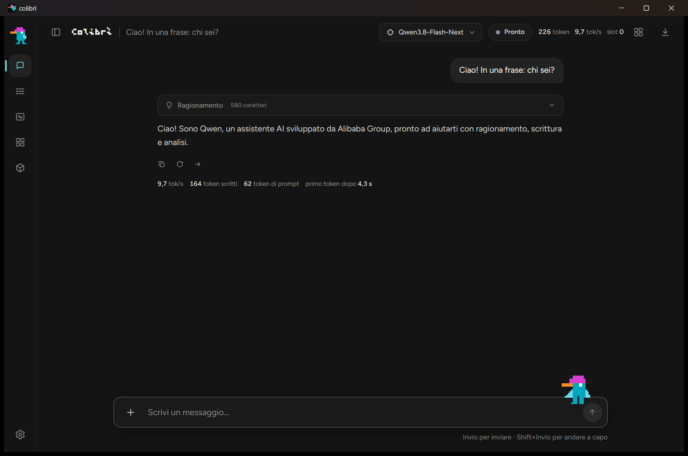

# colibrì desktop

The chat page (`ui/`, the one `coli ui` serves) in a window of its own. The
window is a Tauri v2 shell with no second frontend: it shows the same page the
browser does, served by the same `ui/server.py`. The model stays where the user
put it: the window starts and stops colibri's server, it does not carry one.

<p align="center">
  
</p>
<p align="center"><em>The window on Windows, its page talking to Qwen3.8-Flash-Next on a CPU-only server through an ssh tunnel.</em></p>

## What it does when it opens

1. It finds `coli`: next to the program (a release archive) or above it (this
   checkout, from `desktop/src-tauri/target/release`). `COLIBRI_COLI` names it
   by hand.
2. It finds Python 3: `py -3`, `python`, `python3`, then the usual install
   folders on Windows (python.org, Anaconda, Miniconda). `COLI_PYTHON` names it
   by hand.
3. It finds the colibri server:
   - one that runs already, the one `coli setup` configured or one on
     `127.0.0.1:8000`, is used as it is;
   - otherwise it runs `coli start`, waits for the model to load and shows how
     long it has been loading;
   - with nothing set up it says so, with the command that sets a model up
     (`coli setup`), and a Retry button.
4. It serves the chat page with `ui/server.py` on `127.0.0.1:18790` (the next
   free port up to 18799 when another program holds it) and shows it. The port
   stays the same from one start to the next because the page keeps its
   conversations in the browser storage of its address.

Closing the window stops the page's server, and the colibri server too when it
was the window that started it (`coli stop`). A server that was already
running keeps running.

Links that leave colibri open in the system's browser.

## Another server

```sh
colibri-desktop --backend http://127.0.0.1:8000
```

or `COLIBRI_BACKEND` in the environment: the window then starts nothing and
stops nothing, and waits for that address when it does not answer yet. An ssh
tunnel to a server on another machine works the same way.

## Logs

The page's server writes to `colibri-desktop-ui.log` in the system's temporary
directory. The colibri server it starts writes where `coli start` always does
(`coli logs`).

## Build

```sh
cd desktop/src-tauri
cargo build --release
```

The program lands in `desktop/src-tauri/target/release/`; run from there, it
finds `c/coli` and `ui/server.py` of this checkout. Windows needs the WebView2
runtime (part of Windows 10 and 11); Linux needs WebKitGTK 4.1
(`libwebkit2gtk-4.1-dev` to build).

## Validation

```sh
cargo fmt --manifest-path src-tauri/Cargo.toml --check
cargo clippy --manifest-path src-tauri/Cargo.toml -- -D warnings
```
