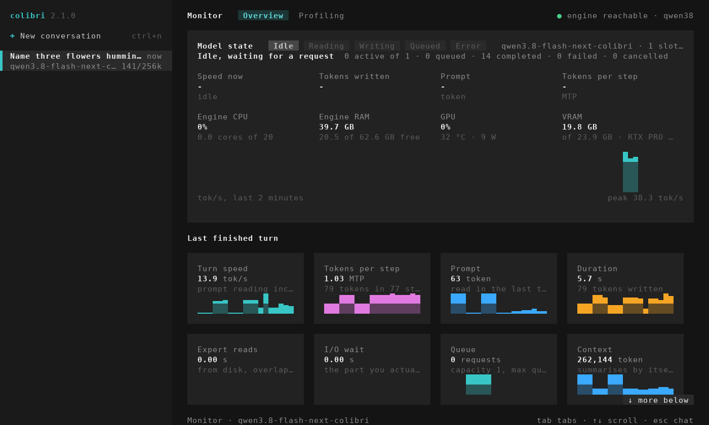
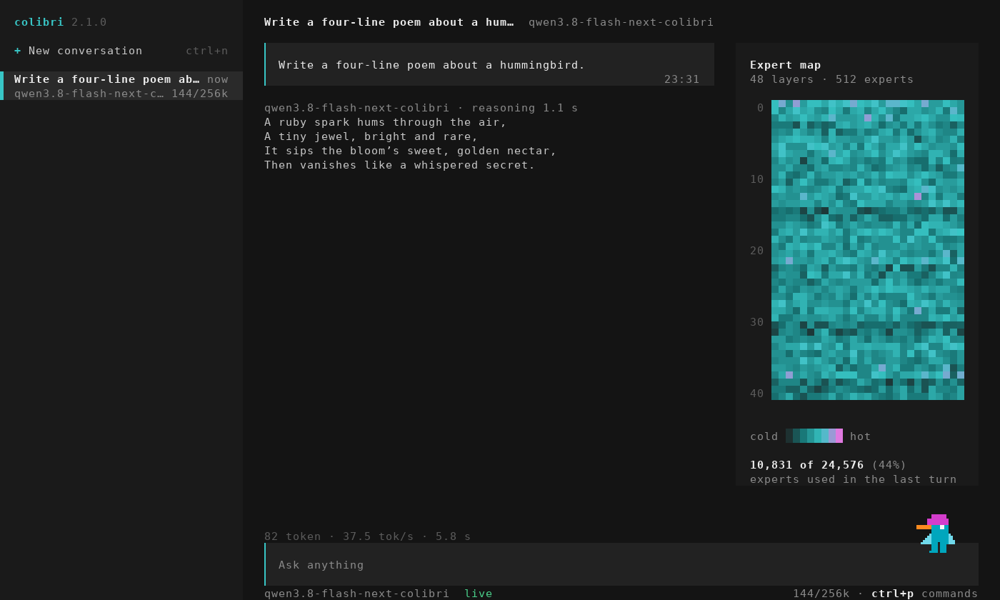

# The terminal UI (`coli tui`)

`colibri-tui` is colibri's chat in a terminal. It is one C file with no libraries
(`c/tui.c`), and it talks to `coli serve` the way the chat page does: the answer
streams from `/v1/chat/completions`, the monitor reads `/health` and `/profile`,
the expert map reads `/experts`.

<p align="center">
  
</p>
<p align="center"><em>Qwen3.8-Flash-Next on an RTX PRO 4000 through <code>coli serve</code>, at a 256K context.</em></p>

## Start it

```bash
coli tui                       # on the coli serve at http://127.0.0.1:8000
coli tui --attach URL          # on another one
coli tui --model /nvme/qwen38  # starts a server for the model, stops it when you quit
```

With `--model`, the server's output goes to `colibri-tui-server.log` in the
system's temporary directory: on the terminal it would draw over the interface.
A server started with `--api-key` needs the same key: `coli tui --api-key KEY`,
or `COLI_API_KEY` in the environment.

The binary runs on its own as well:

```bash
colibri-tui --server http://127.0.0.1:8000
colibri-tui --demo             # no server: the same screens, made-up answers and numbers
```

Without `--server` it looks for a server on `127.0.0.1:8000` for half a second
and plays the demo when none answers. The demo says so in its first answer and
in the status line.

`make -C c colibri-tui` builds it on Linux, macOS and Windows (MSYS2 UCRT64).
The release archives carry it next to `coli`.

## What it shows

- **The conversations**, on the left: each with its model and how much of the
  context it holds. They live in the TUI's memory: closing it forgets them.
- **The answer** as it streams, its markdown drawn (bold, code, lists). The
  reasoning is folded behind its time; `ctrl+r` opens it. Under the answer, its
  tokens, tok/s and seconds.
- **The monitor** (`F2`): the chat page's Overview and Profiling. The model's
  state, the turn in flight (speed now, tokens written, the prompt, tokens per
  step), the engine's CPU and RAM, the last two minutes of tok/s, the last turn's
  numbers with the 40 before them, the context and the memory, the recent turns;
  and where each turn spends its time, phase by phase, when the engine reports
  phases. It adds the GPU (use, temperature, power) and its VRAM, which
  `/health` gives when `nvidia-smi` runs on the server's machine.
- **The expert map** (`ctrl+e`): a cell for each group of experts in each layer.
  Engines that publish every decode step light them as the model writes; the
  others (Qwen3.8's CUDA chain, for one) show the experts the last turn used.

<p align="center">
  
</p>
<p align="center"><em>The monitor on the same server: 20 cores, 39.7 GB of engine RAM, 19.8 of 23.9 GB of VRAM.</em></p>

<p align="center">
  
</p>
<p align="center"><em>The expert map: 10,831 of Qwen3.8's 24,576 experts in the last answer.</em></p>

## The hummingbird

The chat page's mascot (`ui/index.html`), its 19 poses copied as they are by
`c/tools/make_tui_mascot.py`, with the page's moves and timings. It sits on the
input box; it reads while the model reads the prompt, leans while it reasons,
flies while it writes and cheers when it is done. Now and then it swings its
legs, looks around or flaps; after 90 seconds without a key it falls asleep.
A click is a move, a double click a dance; drag it and it flies back to its
place. `ctrl+p`, "Hummingbird: its moves", has all of them.

Where the terminal draws sixel pictures (Windows Terminal 1.22 or later, foot,
WezTerm, mlterm, xterm with `-ti 340`) the bird is a 60 x 60 picture, as on the
page; elsewhere it is drawn with half blocks, bigger. `--sixel` and `--no-sixel`
choose by hand.

## Keys

| key | does |
|---|---|
| enter | sends the message |
| ctrl+j | a new line in the message |
| ctrl+p (F1) | the commands: a new conversation, the model, the monitor, the map, the language |
| ctrl+n | a new conversation |
| tab, then the arrows | picks a conversation |
| tab, then delete | deletes it (enter confirms, esc keeps it) |
| F2 or ctrl+o | the monitor; tab switches Overview and Profiling |
| ctrl+e | the expert map |
| ctrl+r | shows or hides the reasoning |
| ctrl+b | hides the conversations |
| esc | stops the answer |
| page up, page down, the wheel | scroll |
| ctrl+q | quits |

## Terminals

Windows Terminal, the Windows 10 and 11 console, and any POSIX terminal with
24-bit colour. The window needs 60 x 16 cells at least; the conversations show
from 90 columns. The mouse picks a conversation and plays with the bird.

## Not yet

Pictures, System One, tools and agents, conversations saved to disk, and
languages besides English and Italian (`--lang it|en`; the default is the
system's).
